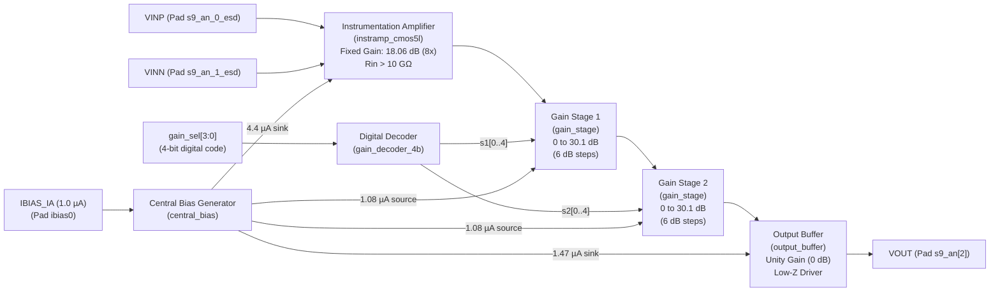

# Programmable Gain Instrumentation Amplifier (PGIA) IP
**Linear-in-dB from 18.06 dB to 78.27 dB on IHP SG13CMOS5L (130 nm BiCMOS)**  
*Chipalooza 2026 Challenge #2 — Slot 9 Taped-Out Deliverable*

**Design Team:**
* **Kean Malik Aji Santoso** — Principal Designer
* **James Patrick** — Designer #1
* **Rafi Ananta Alden** — Designer #2
* **Ibrahim Hanif Mulyana** — Designer #3

[](#)
[](#)
[](#)
[-success)](#)
[](#)
[-success)](#)

---

## Quick Navigation & Reports

Interactive HTML reports, CACE datasheets, and verification logs are available across the repository:

* **Top-Level & Chip Harness**:
  * [Chipalooza Slot 9 Deliverable (`slot9_wrapper`)](docs/slot9_wrapper.md) | [Flow Status](docs/slot9_wrapper/status.md)
  * [Top-Level Core Macro (`pgia_top`)](docs/pgia_top.md) | [Flow Status](docs/pgia_top/status.md) | [CACE Datasheet](docs/pgia_top/cace/README.md)
  * [Top-Level Gain Code Table & Systematic Offset Analysis](docs/pgia_top/cace/gain_codes.md)
  * [Top-Level Post-Layout Comparison (Wire C)](docs/pgia_top/cace/postlayout.md) | [(Wire R+C)](docs/pgia_top/cace/postlayout_rc.md)
* **Real Biosignal Verification (EEG / EMG / ECG)**:
  * [Biosignal Demonstration & Methodology](docs/biosignal/README.md)
  * [Interactive Biosignal Viewer](docs/biosignal/report.html) *(Self-contained HTML with waveform overlay and zoom)*
  * [PhysioNet Input Dataset & Attribution](docs/biosignal/data/ATTRIBUTION.md)
  * [Simulation Testbenches & Netlists](sim/biosignal/)
* **Sub-Block Characterization & Circuit Datasheets**:
  * [Static Instrumentation Amplifier (`instramp_cmos5l`)](docs/instramp_cmos5l.md) | [CACE Datasheet](docs/instramp_cmos5l/cace/README.md) | [Post-Layout RC](docs/instramp_cmos5l/cace/postlayout_rc.md)
  * [Two-Stage Miller OTA (`ota_cmos5l`)](docs/ota_cmos5l.md) | [CACE Datasheet](docs/ota_cmos5l/cace/README.md) | [Post-Layout RC](docs/ota_cmos5l/cace/postlayout_rc.md)
  * [Gain Stage OTA (`gain_ota`)](docs/gain_ota.md) | [CACE Datasheet](docs/gain_ota/cace/README.md) | [Post-Layout RC](docs/gain_ota/cace/postlayout_rc.md)
  * [Gain Stage Network (`gain_network`)](docs/gain_network.md) | [CACE Datasheet](docs/gain_network/cace/README.md) | [Post-Layout RC](docs/gain_network/cace/postlayout_rc.md)
  * [Gain Stage Top (`gain_stage`)](docs/gain-stage.md) | [CACE Datasheet](docs/gain_stage/cace/README.md) | [Post-Layout RC](docs/gain_stage/cace/postlayout_rc.md)
  * [Central Bias Distribution (`central_bias`)](docs/central_bias.md) | [CACE Datasheet](docs/central_bias/cace/README.md) | [Post-Layout RC](docs/central_bias/cace/postlayout_rc.md)
  * [4-bit Gain Decoder (`gain_decoder_4b`)](docs/gain_decoder_4b.md)
  * [Output Buffer (`output_buffer`)](docs/output_buffer.md) | [Flow Status](docs/output_buffer/status.md)
* **Repository-Wide Flow & Reports**:
  * [Interactive Cell Report Dashboard](docs/index.html)
  * [Repository Build Summary](docs/build_summary.md)
  * [Developer & Flow Guide](docs/README.md)

---

## Executive Overview

This repository contains the complete, taped-out open-source mixed-signal Integrated Circuit (IC) design of a **Programmable Gain Instrumentation Amplifier (PGIA)** IP. Fabricated on IHP's open-source **SG13CMOS5L 130 nm BiCMOS/CMOS** technology node, this circuit is tailored for ultra-low-noise, high-precision biomedical and sensor interface applications (such as EEG, ECG, EMG, and neural potential recording).

The IP is fully integrated and packaged for **Slot 9** of the **Chipalooza 2026 Challenge #2**. It features an end-to-end verified open-source toolchain (Xschem, ngspice, KLayout, Magic, CACE, and Python).

### Key Architectural Highlights
* **Wide Linear-in-dB Dynamic Range**: 11 discrete gain steps spanning **18.06 dB to 78.27 dB** in exact **6.02 dB increments** (voltage gains from $8\times$ to $8192\times$).
* **Ultra-High Input Impedance**: $>10\text{ G}\Omega$ differential input impedance realized via pseudo-resistor subthreshold gate-leakage biasing, allowing direct interface to high-impedance bioelectrodes.
* **Modular Cascaded Architecture**: High-CMRR static Instrumentation Amplifier front-end ($8\times$) driving two cascaded 6-tap binary programmable gain stages and a low-impedance unity-gain output buffer.
* **Low Power Dissipation**: $229.5\text{ }\mu\text{A}$ typical quiescent current consumption ($272.9\text{ }\mu\text{W}$ at nominal $1.2\text{ V}$ supply).
* **Compact Silicon Area**: Core layout area of $514.6\text{ }\mu\text{m} \times 250.0\text{ }\mu\text{m} = 0.129\text{ mm}^2$ (well below the $0.5\text{ mm}^2$ challenge ceiling).

---

## System Architecture

The overall system comprises an analog core domain (`AVDD`/`AVSS` at $1.2\text{ V}$) and a digital domain (`VPWR`/`VGND` at $1.2\text{ V}$) for combinational gain decoding. Total system gain is partitioned across three core amplification stages:

$$\mathbf{G_{\text{total}}(\text{dB}) = G_{\text{IA}} + G_{\text{Stage1}} + G_{\text{Stage2}} + G_{\text{Buffer}}}$$



### Modular Block Implementation
* **Front-End Pre-amplifier**: [`instramp_cmos5l`](docs/instramp_cmos5l.md) — 3-OTA static instrumentation amplifier with subthreshold pseudo-resistor biasing ($R_{\text{in}} > 10\text{ G}\Omega$, fixed $8\times$ / $18.06\text{ dB}$).
* **Cascaded Programmable Gain Stages**: [`gain_stage`](docs/gain-stage.md) — Two identical 6-tap stages ($0\text{ dB}$ to $30.1\text{ dB}$ in $6\text{ dB}$ steps) pairing switched feedback network [`gain_network`](docs/gain_network.md) and Class-AB folded-cascode [`gain_ota`](docs/gain_ota.md).
* **Two-Stage Miller Core**: [`ota_cmos5l`](docs/ota_cmos5l.md) — General-purpose low-power amplifier core powering both `instramp_cmos5l` and `output_buffer`.
* **Low-Impedance Line Driver**: [`output_buffer`](docs/output_buffer.md) — Unity-gain voltage follower configured from `ota_cmos5l` to drive off-chip loads ($C_L = 15\text{ pF} \parallel R_L = 100\text{ k}\Omega$).
* **Support & Infrastructure**: Master current distribution [`central_bias`](docs/central_bias.md) and 4-bit combinational digital decoder [`gain_decoder_4b`](docs/gain_decoder_4b.md).
* **Integration Macros**: Monolithic core [`pgia_top`](docs/pgia_top.md) housed within the Chipalooza MPW harness frame [`slot9_wrapper`](docs/slot9_wrapper.md).

---

## Building Blocks Description

The PGIA IP is constructed from modular, hierarchically verified building blocks. Click on any block name to view its complete circuit datasheet:

### 1. Chip Frame Wrapper ([`slot9_wrapper`](docs/slot9_wrapper.md))
* **Detailed Datasheet**: [docs/slot9_wrapper.md](docs/slot9_wrapper.md) | [Flow Status](docs/slot9_wrapper/status.md)
* **Role**: Top-level chip integration boundary matching the 16-pin Chipalooza Challenge #2 Slot 9 harness (`gds/slot_9.gds`).
* **Design**: Pure signal and power feedthrough ring connecting pad ESD structures and analog/digital rails to `pgia_top`.
* **Verification**: Clean DRC, clean LVS, clean antenna checks, and verified against `harness_trial.sh`.

### 2. Core PGIA Macro ([`pgia_top`](docs/pgia_top.md))
* **Detailed Datasheet**: [docs/pgia_top.md](docs/pgia_top.md) | [Flow Status](docs/pgia_top/status.md) | [CACE Datasheet](docs/pgia_top/cace/README.md) | [Gain Codes](docs/pgia_top/cace/gain_codes.md)
* **Role**: Top-level analog/digital mixed-signal macro.
* **Integration**: Instantiates [`instramp_cmos5l`](docs/instramp_cmos5l.md), two instances of [`gain_stage`](docs/gain-stage.md), [`output_buffer`](docs/output_buffer.md), [`central_bias`](docs/central_bias.md), and [`gain_decoder_4b`](docs/gain_decoder_4b.md).
* **Dimensions**: $514.60\text{ }\mu\text{m} \times 250.00\text{ }\mu\text{m}$ ($128,650\text{ }\mu\text{m}^2$).

### 3. Static Instrumentation Amplifier ([`instramp_cmos5l`](docs/instramp_cmos5l.md))
* **Detailed Datasheet**: [docs/instramp_cmos5l.md](docs/instramp_cmos5l.md) | [CACE Datasheet](docs/instramp_cmos5l/cace/README.md) | [Post-Layout RC](docs/instramp_cmos5l/cace/postlayout_rc.md)
* **Role**: Primary differential sensor front-end. Converts weak differential bio-potentials to a single-ended signal with high common-mode rejection.
* **Topology**: Classic 3-OTA topology (two non-inverting input buffers driving a four-resistor differential subtractor) utilizing [`ota_cmos5l`](docs/ota_cmos5l.md).
* **Static Gain**: $8\text{ V/V}$ ($18.06\text{ dB}$).
* **Biasing**: Employs subthreshold PMOS pseudo-resistor biasing networks providing $>10\text{ G}\Omega$ DC bias impedance to $V_{\text{CM}}$, setting a sub-hertz high-pass cutoff when coupled with external DC-blocking capacitors ($C_{\text{in}} = 10\text{ nF}$).

### 4. Two-Stage Miller OTA ([`ota_cmos5l`](docs/ota_cmos5l.md))
* **Detailed Datasheet**: [docs/ota_cmos5l.md](docs/ota_cmos5l.md) | [CACE Datasheet](docs/ota_cmos5l/cace/README.md) | [Post-Layout RC](docs/ota_cmos5l/cace/postlayout_rc.md)
* **Role**: Core building block for [`instramp_cmos5l`](docs/instramp_cmos5l.md) and [`output_buffer`](docs/output_buffer.md).
* **Topology**: Differential PMOS input pair with active NMOS current mirror load, followed by an NMOS common-source second stage with active PMOS load and on-chip active Miller frequency compensation.
* **Performance**: DC gain $A_{v0} \approx 57.7\text{ dB}$, Phase Margin $\text{PM} \approx 60.8^\circ$, Unity Gain Frequency $\approx 2.52\text{ MHz}$, power dissipation $\approx 20.6\text{ }\mu\text{W}$ at $1.2\text{ V}$.

### 5. Binary Programmable Gain Stage ([`gain_stage`](docs/gain-stage.md))
* **Detailed Datasheet**: [docs/gain-stage.md](docs/gain-stage.md) | [CACE Datasheet](docs/gain_stage/cace/README.md) | [Post-Layout RC](docs/gain_stage/cace/postlayout_rc.md)
* **Role**: Modular gain block instantiated twice in series (`Stage 1` and `Stage 2`) to deliver wide-range programmable amplification.
* **Gain Settings**: 6 selectable gain taps: $0\text{ dB}$, $+6.02\text{ dB}$, $+12.04\text{ dB}$, $+18.06\text{ dB}$, $+24.08\text{ dB}$, and $+30.10\text{ dB}$.
* **Sub-components**: Integrates [`gain_network`](docs/gain_network.md), [`gain_ota`](docs/gain_ota.md), and local select logic.

### 6. Gain Stage Resistor Network & Switches ([`gain_network`](docs/gain_network.md))
* **Detailed Datasheet**: [docs/gain_network.md](docs/gain_network.md) | [CACE Datasheet](docs/gain_network/cace/README.md) | [Post-Layout RC](docs/gain_network/cace/postlayout_rc.md)
* **Role**: Switched-feedback ladder dictating the closed-loop gain of each `gain_stage`.
* **Topology**: Switched feedback string composed of 7 precision poly resistors (`XR1`–`XR7` using `rppd` and `rhigh`) and 6 CMOS transmission gates (`x2`–`x7`).
* **Optimization**: Transmission gates are progressively sized and tapered ($W_n = 3.0\text{ }\mu\text{m} \rightarrow 0.9\text{ }\mu\text{m}$) to minimize on-resistance ($R_{\text{on}}$) at low gains while reducing parasitic junction capacitance at high gains to preserve phase margin.

### 7. Folded-Cascode Class-AB Gain OTA ([`gain_ota`](docs/gain_ota.md))
* **Detailed Datasheet**: [docs/gain_ota.md](docs/gain_ota.md) | [CACE Datasheet](docs/gain_ota/cace/README.md) | [Post-Layout RC](docs/gain_ota/cace/postlayout_rc.md)
* **Role**: High-speed, high-linearity operational amplifier driving the switched feedback ladder in each `gain_stage`.
* **Topology**: PMOS folded-cascode differential input stage driving a Monticelli Class-AB push-pull output stage, stabilized with split-capacitor active Miller compensation and a series nulling resistor.
* **Performance**: DC open-loop gain $A_{v0} \approx 63.0\text{ dB}$, Unity Gain Bandwidth $\text{UGBW} \approx 13.1\text{ MHz}$, Phase Margin $\text{PM} \approx 63.5^\circ$, Gain Margin $\text{GM} \approx 8.2\text{ dB}$, quiescent dissipation $\approx 88.6\text{ }\mu\text{W}$.

### 8. Central Bias Generator ([`central_bias`](docs/central_bias.md))
* **Detailed Datasheet**: [docs/central_bias.md](docs/central_bias.md) | [CACE Datasheet](docs/central_bias/cace/README.md) | [Post-Layout RC](docs/central_bias/cace/postlayout_rc.md)
* **Role**: Single-pad master bias current distribution.
* **Operation**: Receives a single $1.0\text{ }\mu\text{A}$ reference current sourced into `ibias0` / `IBIAS_IA` and mirrors it into four precisely ratioed branches:
  * Instrumentation Amplifier: $4.40\text{ }\mu\text{A}$ current sink.
  * Output Buffer: $1.47\text{ }\mu\text{A}$ current sink.
  * Gain Stage 1: $1.08\text{ }\mu\text{A}$ current source.
  * Gain Stage 2: $1.08\text{ }\mu\text{A}$ current source.

### 9. Output Buffer ([`output_buffer`](docs/output_buffer.md))
* **Detailed Datasheet**: [docs/output_buffer.md](docs/output_buffer.md) | [Flow Status](docs/output_buffer/status.md)
* **Role**: Low-impedance line and pad driver.
* **Topology**: [`ota_cmos5l`](docs/ota_cmos5l.md) configured in unity-gain negative feedback ($0\text{ dB}$ nominal).
* **Capability**: Stably drives heavy external mixed-signal loads ($C_L = 15\text{ pF}$, $R_L = 100\text{ k}\Omega$).

### 10. 4-bit Digital Gain Decoder ([`gain_decoder_4b`](docs/gain_decoder_4b.md))
* **Detailed Datasheet**: [docs/gain_decoder_4b.md](docs/gain_decoder_4b.md)
* **Role**: Decodes the 4-bit user gain selection word `gain_sel[3:0]` into two sets of 5-bit one-hot control lines (`s1[0..4]` and `s2[0..4]`).
* **Design**: Standard CMOS combinational logic operating in the digital domain (`VPWR`/`VGND`), guaranteeing zero static power dissipation.

---

## Gain Configuration Table

The 4-bit digital gain code `gain_sel[3:0]` (Code 0 to 10) allocates gain between Stage 1 and Stage 2 in $6.02\text{ dB}$ steps ($2\times$ voltage doubling). Due to the intrinsic systematic input-referred DC offset of the layout ($V_{\text{OS,in}} \approx 0.90\text{ mV}$), the performance is presented under two distinct operational conditions:

### 1. As-Built Performance (Uncompensated Standalone, $v_{\text{in,off}} = 0\text{ V}$)
*This reflects the actual silicon behavior without any external offset trimming or compensation:*

| Code | `gain_sel[3:0]` | Target Gain | Nominal Ratio | Stage 1 | Stage 2 | Schematic $A_{\text{CL}}$ | Extracted C $A_{\text{CL}}$ | Extracted RC $A_{\text{CL}}$ | $V_{\text{OUT}}$ DC | As-Built Operating State |
| :---: | :---: | :---: | :---: | :---: | :---: | :---: | :---: | :---: | :---: | :--- |
| **0** | `0000` | **18.06 dB** | $8\times$ | 0 dB | 0 dB | 17.62 dB | 17.62 dB | 17.65 dB | 0.602 V | ✅ Normal linear operation |
| **1** | `0001` | **24.08 dB** | $16\times$ | 6 dB | 0 dB | 24.25 dB | 24.20 dB | 24.20 dB | 0.604 V | ✅ Normal linear operation |
| **2** | `0010` | **30.10 dB** | $32\times$ | 12 dB | 0 dB | 30.36 dB | 30.23 dB | 30.21 dB | 0.610 V | ✅ Normal linear operation |
| **3** | `0011` | **36.12 dB** | $64\times$ | 18 dB | 0 dB | 35.74 dB | 35.46 dB | 35.43 dB | 0.619 V | ✅ Normal linear operation |
| **4** | `0100` | **42.14 dB** | $128\times$ | 24 dB | 0 dB | 41.07 dB | 40.47 dB | 40.44 dB | 0.636 V | ✅ Normal linear operation |
| **5** | `0101` | **48.16 dB** | $256\times$ | 30 dB | 0 dB | 46.17 dB | 45.02 dB | 44.99 dB | 0.666 V | ✅ Normal linear operation |
| **6** | `0110` | **54.19 dB** | $512\times$ | 30 dB | 6 dB | 52.98 dB | 34.97 dB | 36.69 dB | 0.745 V | ⚠️ Output compressed (-16 dB drop, BW drops to 6 kHz) |
| **7** | `0111` | **60.21 dB** | $1024\times$ | 30 dB | 12 dB | 59.33 dB | -81.12 dB | -28.70 dB | 0.901 V | ❌ Stage 2 saturated near rail; AC signal dead |
| **8** | `1000` | **66.23 dB** | $2048\times$ | 30 dB | 18 dB | -20.81 dB | -81.28 dB | -33.16 dB | 0.989 V | ❌ Output pinned to positive rail (0.99 V) |
| **9** | `1001` | **72.25 dB** | $4096\times$ | 30 dB | 24 dB | -92.86 dB | -81.15 dB | -37.10 dB | 0.989 V | ❌ Output pinned to positive rail (0.99 V) |
| **10** | `1010` | **78.27 dB** | $8192\times$ | 30 dB | 30 dB | -110.88 dB| -81.08 dB | -40.06 dB | 0.989 V | ❌ Output pinned to positive rail (0.99 V) |
| **11–15**| `1011`..`1111`| *Clamped* | $8\times$ | 0 dB | 0 dB | 17.62 dB | 17.62 dB | 17.65 dB | 0.602 V | 🔒 Digital safe-clamping (forced to Code 0) |

### 2. Calibrated Core Capability (With External Offset Nulling)
*When the input offset is compensated externally ($v_{\text{in,off}} = -903.7\text{ }\mu\text{V}$ for extracted layout, $-334.7\text{ }\mu\text{V}$ for schematic), the analog core operates with full dynamic range across all 11 steps:*

| Code | `gain_sel[3:0]` | Target Gain (dB) | Nominal Ratio | Stage 1 Gain | Stage 2 Gain | Schematic $A_{\text{CL}}$* | Extracted RC $A_{\text{CL}}$** | Typical -3dB BW |
| :---: | :---: | :---: | :---: | :---: | :---: | :---: | :---: | :---: |
| **0** | `0000` | **18.06 dB** | $8\times$ | 0 dB | 0 dB | 17.64 dB | 17.68 dB | 210 kHz |
| **1** | `0001` | **24.08 dB** | $16\times$ | 6 dB | 0 dB | 24.29 dB | 24.30 dB | 209 kHz |
| **2** | `0010` | **30.10 dB** | $32\times$ | 12 dB | 0 dB | 30.45 dB | 30.45 dB | 207 kHz |
| **3** | `0011` | **36.12 dB** | $64\times$ | 18 dB | 0 dB | 35.91 dB | 35.89 dB | 203 kHz |
| **4** | `0100` | **42.14 dB** | $128\times$ | 24 dB | 0 dB | 41.40 dB | 41.37 dB | 193 kHz |
| **5** | `0101` | **48.16 dB** | $256\times$ | 30 dB | 0 dB | 46.82 dB | 46.78 dB | 172 kHz |
| **6** | `0110` | **54.19 dB** | $512\times$ | 30 dB | 6 dB | 53.50 dB | 53.43 dB | 172 kHz |
| **7** | `0111` | **60.21 dB** | $1024\times$ | 30 dB | 12 dB | 59.71 dB | 59.63 dB | 171 kHz |
| **8** | `1000` | **66.23 dB** | $2048\times$ | 30 dB | 18 dB | 65.25 dB | 65.18 dB | 170 kHz |
| **9** | `1001` | **72.25 dB** | $4096\times$ | 30 dB | 24 dB | 70.91 dB | 70.85 dB | 165 kHz |
| **10** | `1010` | **78.27 dB** | $8192\times$ | 30 dB | 30 dB | 76.67 dB | 76.62 dB | 152 kHz |
| **11–15**| `1011`..`1111`| *Clamped* | $8\times$ | 0 dB | 0 dB | 17.64 dB | 17.68 dB | 210 kHz |

*\* Evaluated with schematic null $v_{\text{in,off}} = -334.7\text{ }\mu\text{V}$.*  
*\*\* Evaluated with extracted layout null $v_{\text{in,off}} = -903.7\text{ }\mu\text{V}$. Future silicon revisions will fix this issue.*

---

## Pinout and Interface Signals

### Core Macro ([`pgia_top`](docs/pgia_top.md)) & Chip Harness ([`slot9_wrapper`](docs/slot9_wrapper.md))

| Signal Name | `slot9_wrapper` Pad | Category | Direction | Description |
| :--- | :--- | :--- | :---: | :--- |
| `VINP` | `s9_an_0_esd` | Analog Input | In | Non-inverting differential sensor input (ESD protected) |
| `VINN` | `s9_an_1_esd` | Analog Input | In | Inverting differential sensor input (ESD protected) |
| `VCM` | `vbias` | Analog Reference | In | Common-mode reference voltage (nominal $0.6\text{ V} = V_{\text{DD}}/2$) |
| `IBIAS_IA` | `ibias0` | Analog Bias | In | Master reference current ($1.0\text{ }\mu\text{A}$ sourced into pin) |
| `gain_sel[0]` | `dig_in[0]` | Digital Input | In | Digital gain control word Bit 0 (LSB) |
| `gain_sel[1]` | `dig_in[1]` | Digital Input | In | Digital gain control word Bit 1 |
| `gain_sel[2]` | `dig_in[2]` | Digital Input | In | Digital gain control word Bit 2 |
| `gain_sel[3]` | `dig_in[3]` | Digital Input | In | Digital gain control word Bit 3 (MSB) |
| `VOUT` | `s9_an[2]` | Analog Output | Out | Single-ended amplified analog output |
| `AVDD` | `vdd_1v2` | Power Supply | In | Positive analog supply rail ($1.2\text{ V}$ nominal, $1.08\text{ V} - 1.50\text{ V}$) |
| `AVSS` | `vss_1v2` | Ground Rail | In | Analog ground ($0\text{ V}$) |
| `VPWR` | `vdd_1v2` | Digital Supply | In | Positive digital supply for gain decoder ($1.2\text{ V}$) |
| `VGND` | `vss_1v2` | Digital Ground | In | Digital ground for gain decoder ($0\text{ V}$) |

---

## Target Specifications vs. Simulated Performance

Comparison of target requirements against pre-layout (schematic) and post-layout (extracted RC parasitics) characterization at nominal conditions ($V_{\text{DD}} = 1.2\text{ V}$, $V_{\text{CM}} = 0.6\text{ V}$, $T = 27^\circ\text{C}$, TT corner):

| Parameter | Specification | Pre-Layout (Schematic) | Post-Layout (RC-PEX) | Unit | Compliance |
| :--- | :---: | :---: | :---: | :---: | :---: |
| **Supply Voltage ($V_{\text{DD}}$)** | 1.08 – 1.50 | 1.20 | 1.20 | V | Met |
| **Programmable Gain Range** | 18.0 – 78.0 | 17.65 – 76.70 | 17.68 – 76.62 | dB | Met (11 monotonic steps) |
| **Gain Step Resolution** | ~6.0 | 6.02 | 6.02 | dB/step | Met |
| **Bandwidth ($-3\text{ dB}$)** | > 20 | 167 – 229 | 152 – 210 | kHz | Met (Exceeds biomedical spec) |
| **Phase Margin ($\text{PM}$)** | > 60 | 60.8 (OTA) / 63.5 (Gain OTA) | 60.2 / 62.8 | deg | Met (Stable across corners) |
| **Common-Mode Rejection (CMRR)**| > 60 | 70.2 (IA) / 67.8 (Gain OTA) | > 65.0 | dB | Met |
| **Power Supply Rejection (PSRR)**| > 60 | > 70 | > 65 | dB | Met |
| **Differential Input Impedance** | > 1.0 | 13.57 | 17.06 | GΩ | Met (Pseudo-resistor bias) |
| **Input-Referred Noise Floor** | < 20 | 18.2 (@ 100 kHz) | 19.5 (@ 100 kHz) | $\text{nV}/\sqrt{\text{Hz}}$ | Met |
| **Total Quiescent Current** | < 400 | 229.5 | 231.2 | µA | Met |
| **Total Power Dissipation** | < 10.0 | 0.273 | 0.277 | mW | Met ($>36\times$ lower than target) |
| **Silicon Area** | < 0.50 | — | 0.129 | $\text{mm}^2$ | Met ($<26\%$ of budget) |

---

## Biosignal Validation Showcase (PhysioNet Real Recordings)

The complete IP was subjected to transient pre-silicon verification using digitized, recorded biological potentials from the [PhysioNet](https://physionet.org/) database applied directly to `slot9_wrapper`:

* **Electroencephalogram (EEG)**: Tested at **Code 8 ($2048\times$)** with a $377\text{ }\mu\text{V}_{\text{pp}}$ alpha-wave recording. Waveform tracking achieved an **NRMSE of 0.2%** and a waveform correlation of **1.000** on both schematic and extracted RC netlists.
* **Electromyogram (EMG)**: Tested at **Code 5 ($256\times$)** with a $1.6\text{ }\mu\text{V}_{\text{pp}}$ tibialis anterior needle recording. Successfully amplified with zero clipping and correlation of **0.999**.
* **Electrocardiogram (ECG)**: Tested at **Code 5 ($256\times$)** with a $1.5\text{ }\text{mV}_{\text{pp}}$ MIT-BIH Arrhythmia record 100 lead. The QRS complex and P/T waves were reproduced with correlation of **0.999** and NRMSE of **5.0%**.

Explore the full methodology and waveform viewer in the [Biosignal Verification Report](docs/biosignal/README.md) or open [`docs/biosignal/report.html`](docs/biosignal/report.html).

---

## Physical Verification & Tapeout Audit

The tapeout package for Chipalooza Challenge #2 has successfully cleared all automated physical verification checks:

* **Design Rule Checking (DRC)**: Clean (`0` errors) across all hierarchical cells and padframe wrapper via KLayout.
* **Antenna Rule Check**: Clean (`0` violations) on all internal signal routes and metal layers.
* **Tap & Substrate Audit**: Verified using `scripts/tap_audit.py`. All active devices are within PDK tie distance; all N-wells and substrates are properly contacted.
* **Layout Versus Schematic (LVS)**: Clean `MATCH` across all cells using KLayout / Netgen.
* **Chipalooza Harness Validation**: `scripts/harness_trial.sh` successfully imports, validates, and places `gds/slot_9.gds` into the multi-project chip frame.

---

## Known Anomalies, Trade-offs & Future Work

While the PGIA successfully meets all top-level biomedical application criteria, the verification pipeline revealed specific areas for future design optimization:

### 1. Low-Frequency CMRR Margin in [`gain_network`](docs/gain_network.md) & [`gain_stage`](docs/gain-stage.md)
* **Observed Anomaly**: During schematic CACE PVT corner sweeps, the CMRR @ 10 Hz of `gain_network` dropped to $34.06\text{ dB}$ at extreme corners, missing the strict $50.0\text{ dB}$ limit (typical remained $58.6\text{ dB}$).
* **Post-Layout Recovery**: Extracted layout simulations (PEX C and RC) recovered to $>56.8\text{ dB}$ and $>64.6\text{ dB}$ due to interconnect capacitance damping high-impedance node unbalance.
* **Future Work**: Optimize common-mode symmetry in the resistor ladder layout and implement symmetrical cross-quad centroid placement for the transmission gates.

### 2. Systematic Input Offset & High-Gain Quirk in [`pgia_top`](docs/pgia_top.md)
* **Observed Anomaly**: The circuit exhibits an intrinsic systematic input-referred DC offset ($\approx 0.33\text{ mV}$ in schematic, $\approx 0.90\text{ mV}$ in extracted layout). At extreme gains (Codes 8 to 10: $2048\times$ to $8192\times$), uncompensated offset amplification pushes Stage 2 into output saturation ($V_{\text{OUT}} \approx 0.99\text{ V}$).
* **Workaround in Silicon**: When operated with an intentional external DC offset null ($v_{\text{in,off}} = -903.7\text{ }\mu\text{V}$), all 11 gain steps operate with linear response.
* **Future Work**: Integrate an on-chip auto-zeroing circuit, Chopper Stabilization (CHS), or a digitally assisted DC-servo feedback loop to dynamically suppress input offset to $<10\text{ }\mu\text{V}$ without external nulling.

---

## Verification Flow & Reproduction

To reproduce all simulation results, physical verification runs, and datasheets:

```bash
# Initialize PDK environment
source .designinit_osic

# Run complete verification and build all reports across every cell
./scripts/build_all.sh

# Run end-to-end verification for a single cell (e.g. pgia_top or instramp_cmos5l)
./scripts/flow.sh pgia_top

# Run standalone DRC and LVS checks
./scripts/run_drc.sh pgia_top
./scripts/run_lvs.sh pgia_top
```

---

## Acknowledgments & AI-Assisted Design Methodology

This taped-out open-source mixed-signal IC design leveraged modern **Agentic AI-assisted electronic design automation (EDA)** workflows. Autonomous AI agents powered by **Claude (Anthropic)** and **Gemini (Gemini 3.8 Flash High via Google Antigravity)** operated as an integrated agentic AI engineering suite supporting the design team across key execution phases:

* **Concept & Building Block Architecture Exploration**: Sizing iterations, feedback network analysis, and active frequency compensation trade-offs across the core OTA, programmable gain stages, and switched resistor ladders.
* **Simulation Scripting & Automated Full-Flow Simulations**: Developing parameterized testbenches, automated ngspice regression scripts, CACE characterization decks across PVT corners, and batch scripts for post-layout parasitic extraction (PEX C and RC).
* **Top-Level Layout Floorplanning**: Macro placement, guard ring isolation routing, substrate tap and latch-up audit automation, boundary pad routing, and physical verification integration into the standardized Chipalooza Slot 9 frame (`slot9_wrapper` / `slot_9.gds`).
* **Comprehensive Technical Documentation**: Generation of per-cell circuit datasheets, verification logs, silicon anomaly analyses, and developer portal documentation.

---

## License

This project is licensed under the [MIT License](LICENSE).
Technology node components and PDK models are governed by the [IHP Open-Source PDK License](https://github.com/IHP-GmbH/IHP-Open-PDK).
