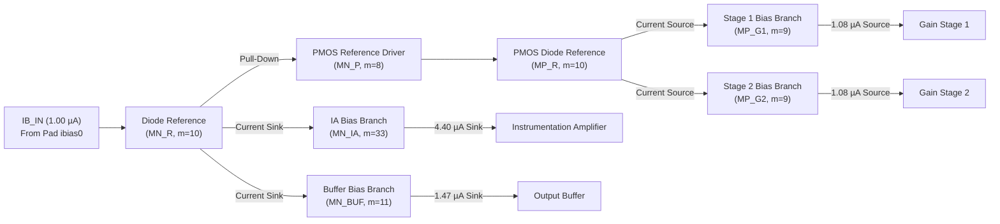

# Central Bias Current Generator (`central_bias`)
**Circuit Datasheet & Silicon Characterization Report**  
*Technology: IHP SG13CMOS5L (130 nm BiCMOS/CMOS) | Status: Taped-Out (Slot 9 Deliverable)*

[-success)](#)

---

## 1. Overview & Circuit Function

The `central_bias` block is the dedicated on-chip master current distribution network for `pgia_top`. It receives a single master reference current ($1.00\text{ }\mu\text{A}$ nominal) from the external chip harness pad `ibias0` (`IBIAS_IA`) and mirrors it into four precisely ratioed, independent bias branches tailored to the specific operating points of the sub-blocks.

### Architectural Highlights
* **Polarity Adaptation**: Converts a single sourced current into both **current sinks** (required by `instramp_cmos5l` and `output_buffer` PMOS diodes) and **current sources** (required by `gain_stage` NMOS reference diodes).
* **Calibrated Current Multipliers**: Multipliers are geometrically scaled and calibrated ($1.26\times$ effective mirror transfer) to guarantee exact operating currents under nominal operating conditions.
* **Layout Generation & Integration**: Synthesized via `scripts/make_central_bias_layout.py` and placed in the silicon floorplan directly above Gain Stage 1 using `scripts/integrate_central_bias.py`.
* **Zero Flagged Delta in RC-PEX**: Achieves a perfect match between pre-layout schematic and post-layout RC parasitics with $0$ flagged metrics.

---

## 2. Port Interface & Pin Description

| Pin Name | Type | Direction | Nominal Level | Description |
| :--- | :---: | :---: | :---: | :--- |
| `AVDD` | Power | Inout | $1.20\text{ V}$ | Positive analog supply rail ($1.08\text{ V} - 1.50\text{ V}$) |
| `AVSS` | Ground | Inout | $0.00\text{ V}$ | Analog ground reference |
| `IB_IN` | Bias Input | Input | $1.00\text{ }\mu\text{A}$ | Master reference current sourced into cell from pad `ibias0` |
| `IB_IA` | Bias Output | Output (Sink)| $4.40\text{ }\mu\text{A}$ | Current sink output to `instramp_cmos5l` (3 OTAs) |
| `IB_BUF` | Bias Output | Output (Sink)| $1.47\text{ }\mu\text{A}$ | Current sink output to `output_buffer` (1 OTA) |
| `IB_G1` | Bias Output | Output (Source)| $1.08\text{ }\mu\text{A}$ | Current source output to Gain Stage 1 (`gain_ota`) |
| `IB_G2` | Bias Output | Output (Source)| $1.08\text{ }\mu\text{A}$ | Current source output to Gain Stage 2 (`gain_ota`) |

---

## 3. Circuit Sizing & Transistor Level Architecture

The schematic is located at `xschem/central_bias/central_bias.sch`. All devices use unit transistors with channel length $L = 2.00\text{ }\mu\text{m}$ to ensure high output impedance and immunity to channel-length modulation:

| Device Instance | Type | $W / L$ ($\mu\text{m}$) | Multiplier ($m$) | Drain Net | Circuit Function |
| :--- | :---: | :---: | :---: | :---: | :--- |
| `MN_R` | `sg13_lv_nmos` | $1.00 / 2.00$ | 10 | `IB_IN` | Master NMOS diode reference receiver |
| `MN_IA` | `sg13_lv_nmos` | $1.00 / 2.00$ | 33 | `IB_IA` | Current sink driver for Instrumentation Amplifier |
| `MN_BUF` | `sg13_lv_nmos` | $1.00 / 2.00$ | 11 | `IB_BUF` | Current sink driver for Output Buffer |
| `MN_P` | `sg13_lv_nmos` | $1.00 / 2.00$ | 8 | `n_pref` | Current sink pulling PMOS reference node |
| `MP_R` | `sg13_lv_pmos` | $2.00 / 2.00$ | 10 | `n_pref` | Master PMOS diode reference generator |
| `MP_G1` | `sg13_lv_pmos` | $2.00 / 2.00$ | 9 | `IB_G1` | Current source driver for Gain Stage 1 |
| `MP_G2` | `sg13_lv_pmos` | $2.00 / 2.00$ | 9 | `IB_G2` | Current source driver for Gain Stage 2 |

---

## 4. Electrical Performance Summary (Pre- vs Post-Layout)

Characterization results across nominal conditions ($V_{\text{AVDD}} = 1.2\text{ V}$, $V_{\text{AVSS}} = 0\text{ V}$, $I_{\text{IN}} = 1.00\text{ }\mu\text{A}$, $T = 27^\circ\text{C}$):

| Figure of Merit (FOM) | Parameter | Unit | Target | Pre-Layout (Schematic) | Post-Layout (RC-PEX) | Delta (%) | Status |
| :--- | :---: | :---: | :---: | :---: | :---: | :---: | :---: |
| **IA Sink Current** | $I_{\text{IA}}$ | $\mu\text{A}$ | 4.20 | **4.444** | **4.396** | -1.08 % | Met |
| **Buffer Sink Current** | $I_{\text{BUF}}$ | $\mu\text{A}$ | 1.40 | **1.481** | **1.465** | -1.08 % | Met |
| **Stage 1 Source Current**| $I_{\text{G1}}$ | $\mu\text{A}$ | 1.00 | **1.080** | **1.080** | +0.00 % | Met |
| **Stage 2 Source Current**| $I_{\text{G2}}$ | $\mu\text{A}$ | 1.00 | **1.080** | **1.080** | +0.00 % | Met |
| **Mirror Ratio: IA / Input**| $R_{\text{IA}}$ | A/A | 4.20 | 4.461 | 4.396 | -1.46 % | Met |
| **Mirror Ratio: Buf / Input**| $R_{\text{BUF}}$ | A/A | 1.40 | 1.487 | 1.465 | -1.48 % | Met |
| **Mirror Ratio: Stages / Input**| $R_{\text{G}}$ | A/A | 1.00 | 1.096 | 1.080 | -1.46 % | Met |
| **Inter-Stage Current Skew** | $\Delta I_{\text{G1-G2}}$ | % | $\le 1.0$ | **0.000 %** | **-0.181 %** | — | Outstanding match |
| **Block Power Dissipation** | $P_{\text{dc}}$ | $\mu\text{W}$ | — | 11.39 | 11.03 | -3.13 % | Met |

*All 8 tracked parameters show less than $1.5\%$ deviation post-layout, yielding $0$ flagged items.*

---

## 5. Input Dynamic Operating Window

Verified using automated regression script `scripts/verify_central_bias.py`:
* **Recommended Harness Input Current**: $0.70\text{ }\mu\text{A} \le I_{\text{bias0}} \le 1.30\text{ }\mu\text{A}$ (Nominal $1.00\text{ }\mu\text{A}$).
* **At $I_{\text{bias0}} = 0.70\text{ }\mu\text{A}$**: Total chip dissipation drops to $208\text{ }\mu\text{W}$, with all 11 PGIA gain codes tracking within $0.25\text{ dB}$.
* **At $I_{\text{bias0}} = 1.30\text{ }\mu\text{A}$**: Total chip dissipation is $342\text{ }\mu\text{W}$, with all gain codes tracking within $0.35\text{ dB}$.
* **Upper Bound Constraint**: Above $1.50\text{ }\mu\text{A}$ ($>384\text{ }\mu\text{W}$), the gain stage OTAs encounter output swing headroom limitations at peak gain (Codes 9–10). Hence, $1.00\text{ }\mu\text{A}$ represents the optimal trade-off between noise floor, bandwidth, and linearity.

---

## 6. Physical Layout & Parasitic Verification

* **Layout Dimensions**: $W = 99.68\text{ }\mu\text{m}$, $L = 26.34\text{ }\mu\text{m}$, Area = $2,626\text{ }\mu\text{m}^2$ ($0.0026\text{ mm}^2$).
* **Physical Checks**: KLayout DRC clean (`0` violations), antenna check clean, and LVS MATCH verified with `--ignore_top_ports_mismatch`.
* **Substrate & Well Isolation**: NMOS transistors sit within a continuous p-tap ring tied to `AVSS`; PMOS transistors reside in a dedicated N-well surrounded by an n-tap ring tied to `AVDD`.
* **Floorplan Placement**: Positioned at coordinates $(x=215.3\text{ }\mu\text{m}, y=110.5\text{ }\mu\text{m})$ in `pgia_top`, physically isolated from the noisy digital routing channels of `gain_decoder_4b`.

---

## 7. Future Work & Enhancements

1. **Cascode Mirror Upgrades**:
   * *Observation*: While unit-device scaling provides excellent nominal ratios, low Early voltage in deep submicron CMOS introduces minor supply voltage sensitivity.
   * *Future Work*: Implement wide-swing cascode current mirrors to increase output resistance above $100\text{ M}\Omega$ and boost PSRR across all bias outputs.
2. **On-Chip Reference Generation**:
   * *Future Work*: Integrate an on-chip low-power subthreshold CMOS proportional-to-absolute-temperature (PTAT) current source to eliminate dependence on the external harness `ibias0` pin.

