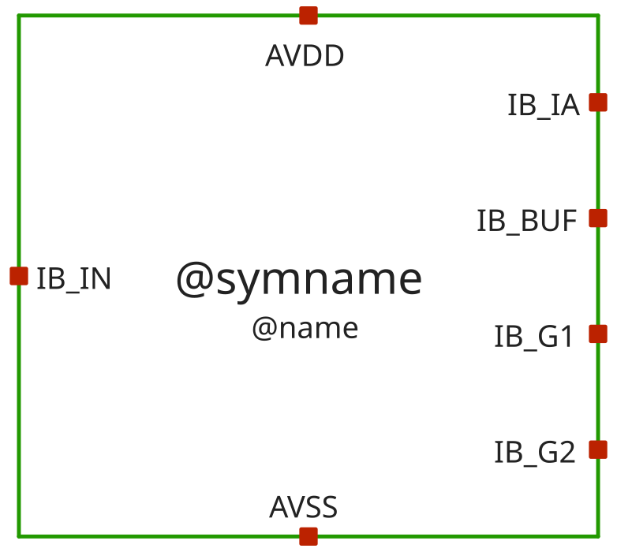
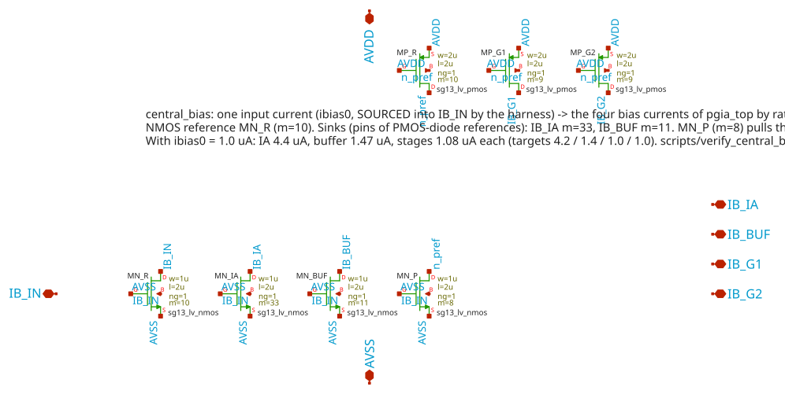
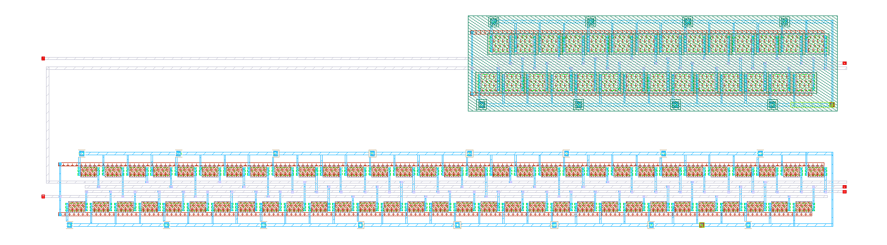
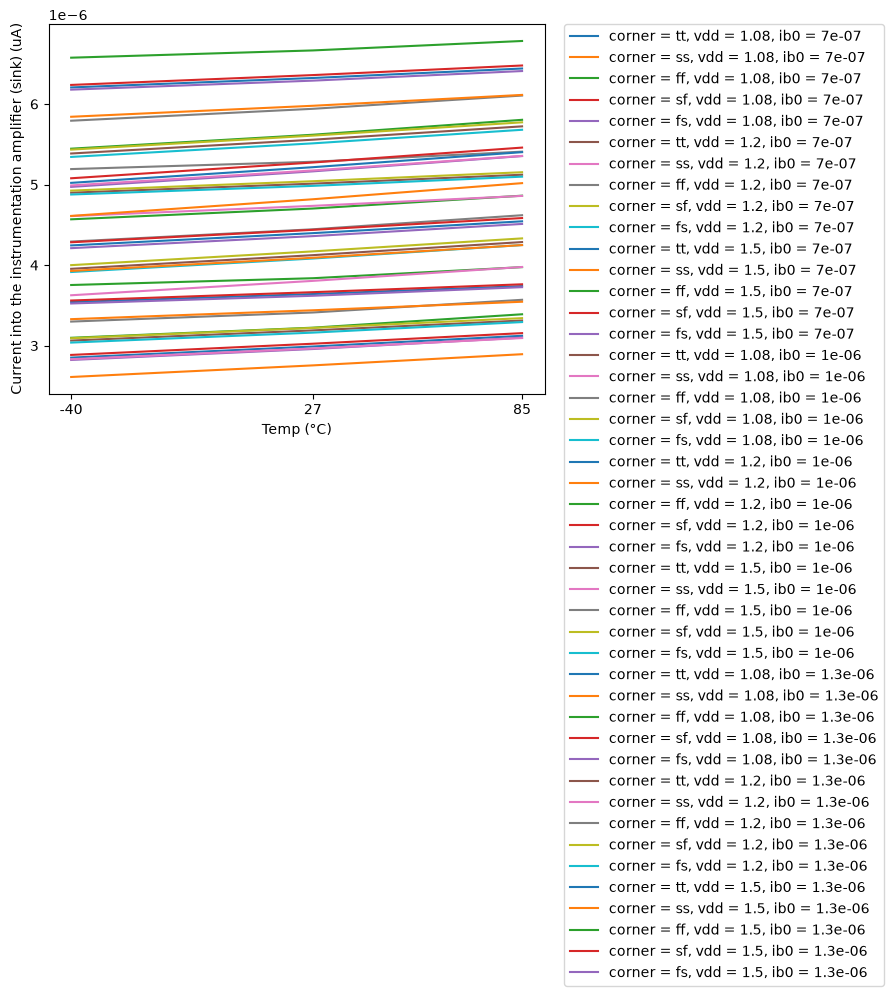
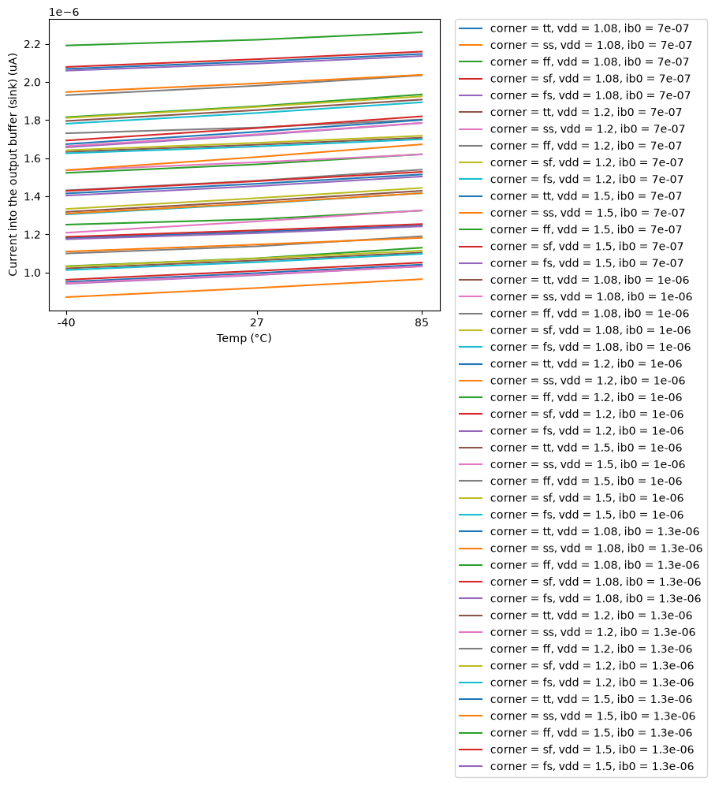
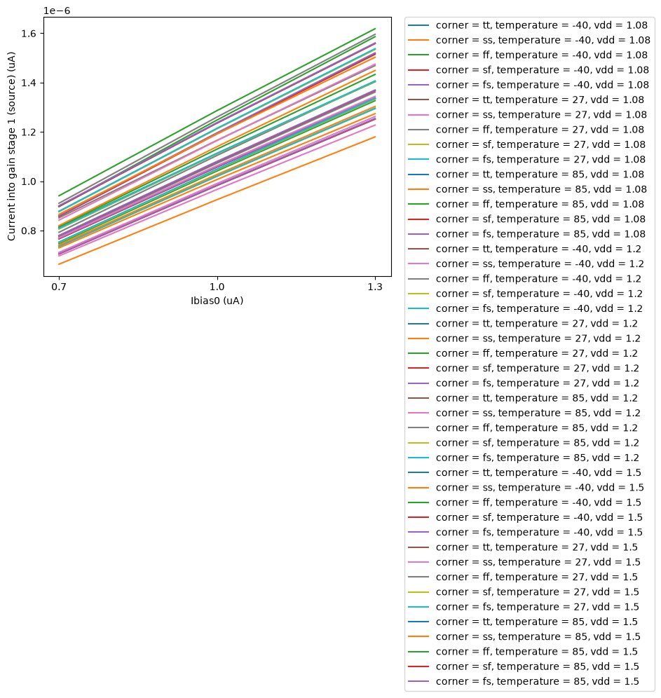
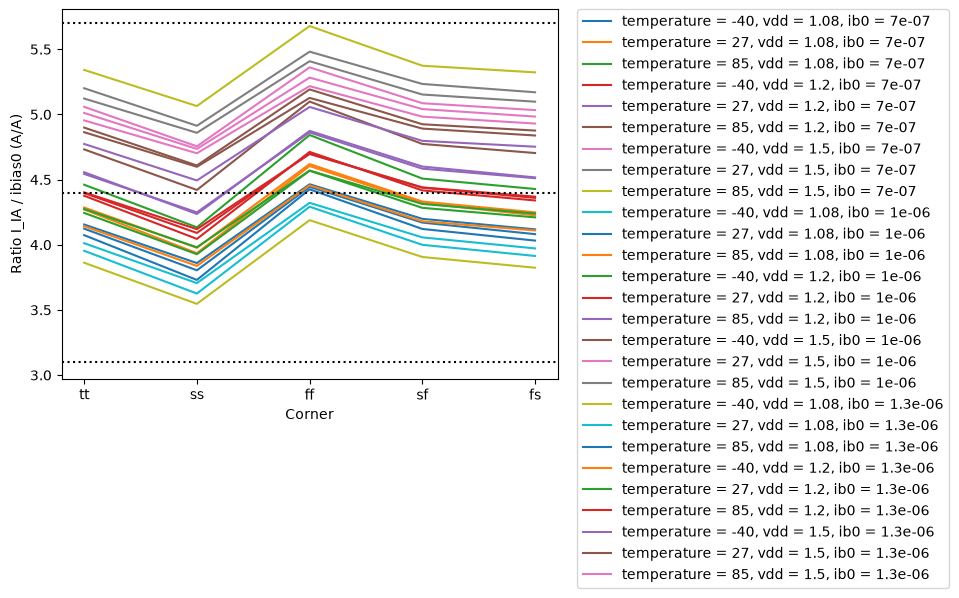
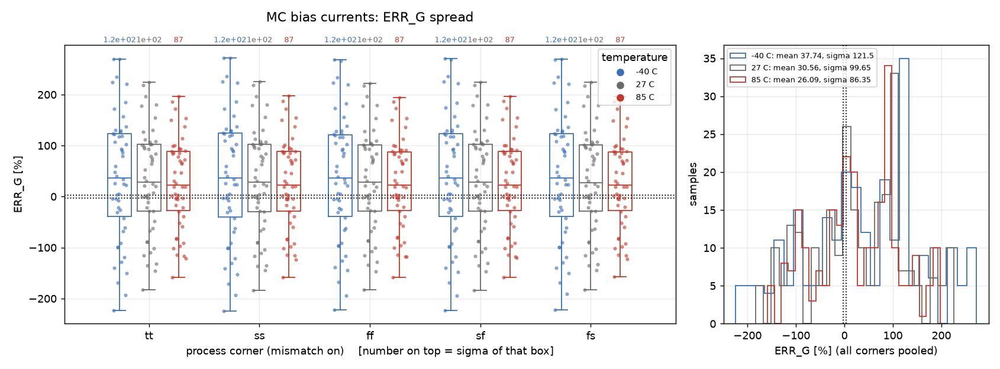

# central_bias - CACE characterisation

- Generated: 2026-11-05 18:54 by `scripts/make_readme.py` from `runs/RUN_2026-11-05_18-53-48`
- Commit: `b495d99` (working tree dirty)
- Netlist source: schematic; datasheet: `cace/central_bias.yaml`; reproduce with `scripts/run_cace.sh central_bias`
- Sections marked *(CACE)* are written by CACE itself, the rest by this script (CACE has no per-corner MC statistics, worst-case conditions or unit-scaled spread plots).

## Design *(CACE)*

- Description: Bias generator of pgia_top: the four block bias currents (IA, buffer sunk; gain stages sourced) made from the single harness input ibias0
- PDK: ihp-sg13cmos5l

### Authorship

- Designer: SPMA
- Created: November 5, 2026
- License: MIT
- Company: None
- Last modified: None

### Pins

- AVDD
  + Description: Positive analog power supply (1.2V typ)
  + Type: power
  + Direction: inout
  + Vmin: 1.08
  + Vmax: 1.5
- AVSS
  + Description: Analog ground (0V)
  + Type: ground
  + Direction: inout
- IB_IN
  + Description: Reference input, current SOURCED into the pin (ibias0 of the harness, 1.0 uA nominal, 0.7 .. 1.3 uA window)
  + Type: signal
  + Direction: input
- IB_IA
  + Description: Bias output SINKING current from the bias reference of the instrumentation amplifier (4.4 uA at 1.0 uA in)
  + Type: signal
  + Direction: output
- IB_BUF
  + Description: Bias output SINKING current from the bias reference of the output buffer (1.47 uA at 1.0 uA in)
  + Type: signal
  + Direction: output
- IB_G1
  + Description: Bias output SOURCING current into the bias reference of gain stage 1 (1.08 uA at 1.0 uA in)
  + Type: signal
  + Direction: output
- IB_G2
  + Description: Bias output SOURCING current into the bias reference of gain stage 2 (1.08 uA at 1.0 uA in)
  + Type: signal
  + Direction: output

### Default Conditions

- vdd
  + Description: Analog power supply voltage
  + Display: Vdd
  + Unit: V
  + Typical: 1.2
- ib0
  + Description: Current sourced into IB_IN (ibias0)
  + Display: Ibias0
  + Unit: uA
  + Typical: 1.0
- corner
  + Description: Process corner
  + Display: Corner
  + Typical: tt
- rcorner
  + Description: Resistor corner (res_<rcorner> section of cornerRES.lib)
  + Display: Rcorner
  + Typical: typ
- temperature
  + Description: Ambient temperature
  + Display: Temp
  + Unit: °C
  + Typical: 27

### Symbol

### Schematic

### Layout

**Physical size** (bounding box of `central_bias`; generated by `scripts/update_images.py`)

| Width W | Length L | Area |
|---|---|---|
| 99.68 µm | 26.34 µm | 2626 µm² |

## Results summary *(CACE)*

min / typ / max over all conditions of a parameter; Monte Carlo parameters (`mc_*`) are min/max over all samples.

**netlist source**: schematic

|      Parameter       |         Tool         |     Result      | Min Limit  |  Min Value   | Typ Target |  Typ Value   | Max Limit  |  Max Value   |  Status  |
| :------------------- | :------------------- | :-------------- | ---------: | -----------: | ---------: | -----------: | ---------: | -----------: | :------: |
| Current into the instrumentation amplifier (sink) | ngspice              | I_IA                 |             any |   2.611 uA |       4.4 uA |   4.444 uA |          any |   6.782 uA |   Pass ✅    |
| Current into the output buffer (sink) | ngspice              | I_BUF                |             any |   0.870 uA |      1.47 uA |   1.481 uA |          any |   2.261 uA |   Pass ✅    |
| Current into gain stage 1 (source) | ngspice              | I_G1                 |             any |   0.664 uA |      1.08 uA |   1.080 uA |          any |   1.618 uA |   Pass ✅    |
| Current into gain stage 2 (source) | ngspice              | I_G2                 |             any |   0.664 uA |      1.08 uA |   1.080 uA |          any |   1.618 uA |   Pass ✅    |
| Ratio I_IA / ibias0  | ngspice              | R_IA                 |         3.1 A/A |  3.547 A/A |      4.4 A/A |  4.461 A/A |      5.7 A/A |  5.678 A/A |   Pass ✅    |
| Ratio I_BUF / ibias0 | ngspice              | R_BUF                |         1.0 A/A |  1.182 A/A |     1.47 A/A |  1.487 A/A |      1.9 A/A |  1.893 A/A |   Pass ✅    |
| Ratio I_G / ibias0 (mean of the two stages) | ngspice              | R_G                  |        0.75 A/A |  0.908 A/A |     1.08 A/A |  1.096 A/A |      1.4 A/A |  1.344 A/A |   Pass ✅    |
| Stage 1 / stage 2 current difference | ngspice              | ERR_G                |            -3 % |   -0.000 % |          0 % |    0.000 % |          3 % |    0.000 % |   Pass ✅    |
| Supply power of the block (with the loads) | ngspice              | PWR                  |             any |   5.979 uW |          any |  11.391 uW |          any |  21.038 uW |   Pass ✅    |
| Current into the instrumentation amplifier (sink) | ngspice              | I_IA                 |             any |   3.623 uA |          any |   4.409 uA |          any |   5.059 uA |   Pass ✅    |
| Current into the output buffer (sink) | ngspice              | I_BUF                |             any |   1.195 uA |          any |   1.461 uA |          any |   1.736 uA |   Pass ✅    |
| Current into gain stage 1 (source) | ngspice              | I_G1                 |             any |   0.893 uA |          any |   1.083 uA |          any |   1.235 uA |   Pass ✅    |
| Current into gain stage 2 (source) | ngspice              | I_G2                 |             any |   0.886 uA |          any |   1.080 uA |          any |   1.237 uA |   Pass ✅    |
| Ratio I_IA / ibias0  | ngspice              | R_IA                 |             any |  3.623 A/A |          any |  4.409 A/A |          any |  5.059 A/A |   Pass ✅    |
| Ratio I_BUF / ibias0 | ngspice              | R_BUF                |             any |  1.195 A/A |          any |  1.461 A/A |          any |  1.736 A/A |   Pass ✅    |
| Ratio I_G / ibias0 (mean of the two stages) | ngspice              | R_G                  |             any |  0.889 A/A |          any |  1.081 A/A |          any |  1.232 A/A |   Pass ✅    |
| Stage 1 / stage 2 current difference | ngspice              | ERR_G                |             any | -224.432 % |          any |   28.986 % |          any |  272.332 % |   Pass ✅    |

### Plots *(CACE)*

#### currents_I_IA_vs_temperature

#### currents_I_BUF_vs_temperature

#### currents_I_G1_vs_ib0

#### currents_R_IA_vs_corner

## PVT worst-case conditions

Corners tt/ss/ff/sf/fs, supply and temperature as in the yaml. Values in the display unit of the yaml.

### currents - Bias currents

135 runs.

| metric | min | at (corner, vdd, T) | max | at (corner, vdd, T) | spec | fails |
|---|---|---|---|---|---|---|
| I_IA [uA] | 2.611 | ss, 1.08 V, -40 C | 6.782 | ff, 1.5 V, 85 C | any | - |
| I_BUF [uA] | 0.8703 | ss, 1.08 V, -40 C | 2.261 | ff, 1.5 V, 85 C | any | - |
| I_G1 [uA] | 0.6637 | ss, 1.08 V, -40 C | 1.618 | ff, 1.5 V, 85 C | any | - |
| I_G2 [uA] | 0.6637 | ss, 1.08 V, -40 C | 1.618 | ff, 1.5 V, 85 C | any | - |
| R_IA [A/A] | 3.547 | ss, 1.08 V, -40 C | 5.678 | ff, 1.5 V, 85 C | >= 3.1 <= 5.7 | 0 |
| R_BUF [A/A] | 1.182 | ss, 1.08 V, -40 C | 1.893 | ff, 1.5 V, 85 C | >= 1 <= 1.9 | 0 |
| R_G [A/A] | 0.9076 | ss, 1.08 V, -40 C | 1.344 | ff, 1.5 V, 85 C | >= 0.75 <= 1.4 | 0 |
| ERR_G [%] | -3.156e-10 | sf, 1.2 V, -40 C | 5.369e-10 | ss, 1.2 V, -40 C | >= -3 <= 3 | 0 |
| PWR [uW] | 5.979 | ss, 1.08 V, -40 C | 21.04 | ff, 1.5 V, 85 C | any | - |

## Monte Carlo (local mismatch)

Mismatch models only (`mos_<corner>_mismatch`, `res_typ_mismatch`; `cap_cmomi` has no characterised spread), one seed per iteration (`seed = 12345 + iteration`, **the same 50 mismatch draws are reused at every corner and temperature**, so boxes are paired comparisons and the pooled counts overstate the number of independent samples: 50, not 50 x 15). Box = interquartile range, dots = individual samples, dotted lines = spec (if any).

### mc_currents - MC bias currents

Monte Carlo (local mismatch, 50 seeds x 5 corners x 3 temperatures, vdd 1.2 V, ibias0 1.0 uA)

**I_IA [uA]** - 750 samples

| corner | T [C] | N | mean | sigma | min | max | mean-3sigma | mean+3sigma |
|---|---|---|---|---|---|---|---|---|
| tt | -40 | 50 | 4.246 | 0.1376 | 3.911 | 4.52 | 3.833 | 4.659 |
| tt | 27 | 50 | 4.399 | 0.1132 | 4.126 | 4.618 | 4.059 | 4.738 |
| tt | 85 | 50 | 4.546 | 0.09844 | 4.314 | 4.732 | 4.251 | 4.841 |
| ss | -40 | 50 | 3.93 | 0.1289 | 3.623 | 4.187 | 3.544 | 4.317 |
| ss | 27 | 50 | 4.094 | 0.1067 | 3.842 | 4.3 | 3.774 | 4.414 |
| ss | 85 | 50 | 4.252 | 0.09335 | 4.036 | 4.427 | 3.972 | 4.532 |
| ff | -40 | 50 | 4.568 | 0.1471 | 4.204 | 4.863 | 4.127 | 5.01 |
| ff | 27 | 50 | 4.703 | 0.1201 | 4.409 | 4.937 | 4.342 | 5.063 |
| ff | 85 | 50 | 4.863 | 0.1029 | 4.615 | 5.059 | 4.555 | 5.172 |
| sf | -40 | 50 | 4.285 | 0.1395 | 3.951 | 4.562 | 3.866 | 4.704 |
| sf | 27 | 50 | 4.44 | 0.1149 | 4.168 | 4.662 | 4.095 | 4.785 |
| sf | 85 | 50 | 4.587 | 0.09998 | 4.355 | 4.774 | 4.287 | 4.887 |
| fs | -40 | 50 | 4.212 | 0.1361 | 3.876 | 4.484 | 3.803 | 4.62 |
| fs | 27 | 50 | 4.362 | 0.1118 | 4.088 | 4.579 | 4.026 | 4.697 |
| fs | 85 | 50 | 4.513 | 0.09696 | 4.28 | 4.697 | 4.222 | 4.804 |
| **all** | | 750 | 4.4 | 0.2608 | 3.623 | 5.059 | 3.618 | 5.183 |

_pooled sigma 0.2608 uA_

**I_BUF [uA]** - 750 samples

| corner | T [C] | N | mean | sigma | min | max | mean-3sigma | mean+3sigma |
|---|---|---|---|---|---|---|---|---|
| tt | -40 | 50 | 1.407 | 0.05426 | 1.296 | 1.573 | 1.245 | 1.57 |
| tt | 27 | 50 | 1.459 | 0.04457 | 1.365 | 1.593 | 1.326 | 1.593 |
| tt | 85 | 50 | 1.509 | 0.03867 | 1.425 | 1.624 | 1.393 | 1.625 |
| ss | -40 | 50 | 1.302 | 0.05074 | 1.195 | 1.457 | 1.15 | 1.454 |
| ss | 27 | 50 | 1.358 | 0.0419 | 1.267 | 1.484 | 1.232 | 1.483 |
| ss | 85 | 50 | 1.411 | 0.03658 | 1.33 | 1.519 | 1.301 | 1.521 |
| ff | -40 | 50 | 1.515 | 0.05811 | 1.399 | 1.692 | 1.341 | 1.689 |
| ff | 27 | 50 | 1.561 | 0.04742 | 1.463 | 1.703 | 1.418 | 1.703 |
| ff | 85 | 50 | 1.615 | 0.04069 | 1.528 | 1.736 | 1.493 | 1.737 |
| sf | -40 | 50 | 1.42 | 0.05503 | 1.306 | 1.587 | 1.255 | 1.585 |
| sf | 27 | 50 | 1.473 | 0.04521 | 1.376 | 1.608 | 1.337 | 1.609 |
| sf | 85 | 50 | 1.522 | 0.03923 | 1.436 | 1.638 | 1.405 | 1.64 |
| fs | -40 | 50 | 1.396 | 0.05365 | 1.287 | 1.56 | 1.235 | 1.557 |
| fs | 27 | 50 | 1.447 | 0.04405 | 1.355 | 1.58 | 1.315 | 1.579 |
| fs | 85 | 50 | 1.498 | 0.03817 | 1.416 | 1.612 | 1.384 | 1.613 |
| **all** | | 750 | 1.46 | 0.09064 | 1.195 | 1.736 | 1.188 | 1.731 |

_pooled sigma 0.09064 uA_

**I_G1 [uA]** - 750 samples

| corner | T [C] | N | mean | sigma | min | max | mean-3sigma | mean+3sigma |
|---|---|---|---|---|---|---|---|---|
| tt | -40 | 50 | 1.048 | 0.04852 | 0.9453 | 1.142 | 0.9028 | 1.194 |
| tt | 27 | 50 | 1.08 | 0.03946 | 0.9947 | 1.157 | 0.962 | 1.199 |
| tt | 85 | 50 | 1.113 | 0.03394 | 1.038 | 1.179 | 1.011 | 1.215 |
| ss | -40 | 50 | 0.9915 | 0.04604 | 0.8928 | 1.081 | 0.8534 | 1.13 |
| ss | 27 | 50 | 1.028 | 0.03763 | 0.9458 | 1.101 | 0.9153 | 1.141 |
| ss | 85 | 50 | 1.064 | 0.03253 | 0.992 | 1.128 | 0.9668 | 1.162 |
| ff | -40 | 50 | 1.105 | 0.05125 | 0.9971 | 1.204 | 0.951 | 1.259 |
| ff | 27 | 50 | 1.131 | 0.0414 | 1.042 | 1.211 | 1.007 | 1.255 |
| ff | 85 | 50 | 1.167 | 0.03531 | 1.089 | 1.235 | 1.061 | 1.273 |
| sf | -40 | 50 | 1.047 | 0.04848 | 0.9435 | 1.141 | 0.9016 | 1.192 |
| sf | 27 | 50 | 1.08 | 0.03944 | 0.9936 | 1.156 | 0.9613 | 1.198 |
| sf | 85 | 50 | 1.113 | 0.03395 | 1.037 | 1.179 | 1.011 | 1.215 |
| fs | -40 | 50 | 1.049 | 0.04866 | 0.9466 | 1.144 | 0.9034 | 1.195 |
| fs | 27 | 50 | 1.081 | 0.03953 | 0.9953 | 1.157 | 0.962 | 1.199 |
| fs | 85 | 50 | 1.114 | 0.03394 | 1.04 | 1.18 | 1.012 | 1.216 |
| **all** | | 750 | 1.081 | 0.05933 | 0.8928 | 1.235 | 0.9028 | 1.259 |

_pooled sigma 0.05933 uA_

**I_G2 [uA]** - 750 samples

| corner | T [C] | N | mean | sigma | min | max | mean-3sigma | mean+3sigma |
|---|---|---|---|---|---|---|---|---|
| tt | -40 | 50 | 1.044 | 0.04725 | 0.9378 | 1.15 | 0.9026 | 1.186 |
| tt | 27 | 50 | 1.077 | 0.03841 | 0.9878 | 1.161 | 0.9618 | 1.192 |
| tt | 85 | 50 | 1.11 | 0.03303 | 1.032 | 1.182 | 1.011 | 1.209 |
| ss | -40 | 50 | 0.9877 | 0.04481 | 0.8856 | 1.089 | 0.8533 | 1.122 |
| ss | 27 | 50 | 1.025 | 0.03661 | 0.9392 | 1.106 | 0.9151 | 1.135 |
| ss | 85 | 50 | 1.062 | 0.03163 | 0.9857 | 1.13 | 0.9667 | 1.157 |
| ff | -40 | 50 | 1.101 | 0.04994 | 0.9893 | 1.212 | 0.9508 | 1.25 |
| ff | 27 | 50 | 1.127 | 0.04032 | 1.035 | 1.216 | 1.006 | 1.248 |
| ff | 85 | 50 | 1.164 | 0.03437 | 1.082 | 1.237 | 1.061 | 1.267 |
| sf | -40 | 50 | 1.043 | 0.04719 | 0.936 | 1.149 | 0.9014 | 1.185 |
| sf | 27 | 50 | 1.076 | 0.03837 | 0.9867 | 1.161 | 0.9611 | 1.191 |
| sf | 85 | 50 | 1.11 | 0.03302 | 1.031 | 1.181 | 1.011 | 1.209 |
| fs | -40 | 50 | 1.045 | 0.0474 | 0.9391 | 1.151 | 0.9032 | 1.188 |
| fs | 27 | 50 | 1.077 | 0.0385 | 0.9883 | 1.162 | 0.9618 | 1.193 |
| fs | 85 | 50 | 1.111 | 0.03304 | 1.033 | 1.182 | 1.012 | 1.21 |
| **all** | | 750 | 1.077 | 0.05873 | 0.8856 | 1.237 | 0.9012 | 1.254 |

_pooled sigma 0.05873 uA_

**R_IA [A/A]** - 750 samples

| corner | T [C] | N | mean | sigma | min | max | mean-3sigma | mean+3sigma |
|---|---|---|---|---|---|---|---|---|
| tt | -40 | 50 | 4.246 | 0.1376 | 3.911 | 4.52 | 3.833 | 4.659 |
| tt | 27 | 50 | 4.399 | 0.1132 | 4.126 | 4.618 | 4.059 | 4.738 |
| tt | 85 | 50 | 4.546 | 0.09844 | 4.314 | 4.732 | 4.251 | 4.841 |
| ss | -40 | 50 | 3.93 | 0.1289 | 3.623 | 4.187 | 3.544 | 4.317 |
| ss | 27 | 50 | 4.094 | 0.1067 | 3.842 | 4.3 | 3.774 | 4.414 |
| ss | 85 | 50 | 4.252 | 0.09335 | 4.036 | 4.427 | 3.972 | 4.532 |
| ff | -40 | 50 | 4.568 | 0.1471 | 4.204 | 4.863 | 4.127 | 5.01 |
| ff | 27 | 50 | 4.703 | 0.1201 | 4.409 | 4.937 | 4.342 | 5.063 |
| ff | 85 | 50 | 4.863 | 0.1029 | 4.615 | 5.059 | 4.555 | 5.172 |
| sf | -40 | 50 | 4.285 | 0.1395 | 3.951 | 4.562 | 3.866 | 4.704 |
| sf | 27 | 50 | 4.44 | 0.1149 | 4.168 | 4.662 | 4.095 | 4.785 |
| sf | 85 | 50 | 4.587 | 0.09998 | 4.355 | 4.774 | 4.287 | 4.887 |
| fs | -40 | 50 | 4.212 | 0.1361 | 3.876 | 4.484 | 3.803 | 4.62 |
| fs | 27 | 50 | 4.362 | 0.1118 | 4.088 | 4.579 | 4.026 | 4.697 |
| fs | 85 | 50 | 4.513 | 0.09696 | 4.28 | 4.697 | 4.222 | 4.804 |
| **all** | | 750 | 4.4 | 0.2608 | 3.623 | 5.059 | 3.618 | 5.183 |

_pooled sigma 0.2608 A/A - 100 % of all samples inside [3.1, 5.7] A/A_

**R_BUF [A/A]** - 750 samples

| corner | T [C] | N | mean | sigma | min | max | mean-3sigma | mean+3sigma |
|---|---|---|---|---|---|---|---|---|
| tt | -40 | 50 | 1.407 | 0.05426 | 1.296 | 1.573 | 1.245 | 1.57 |
| tt | 27 | 50 | 1.459 | 0.04457 | 1.365 | 1.593 | 1.326 | 1.593 |
| tt | 85 | 50 | 1.509 | 0.03867 | 1.425 | 1.624 | 1.393 | 1.625 |
| ss | -40 | 50 | 1.302 | 0.05074 | 1.195 | 1.457 | 1.15 | 1.454 |
| ss | 27 | 50 | 1.358 | 0.0419 | 1.267 | 1.484 | 1.232 | 1.483 |
| ss | 85 | 50 | 1.411 | 0.03658 | 1.33 | 1.519 | 1.301 | 1.521 |
| ff | -40 | 50 | 1.515 | 0.05811 | 1.399 | 1.692 | 1.341 | 1.689 |
| ff | 27 | 50 | 1.561 | 0.04742 | 1.463 | 1.703 | 1.418 | 1.703 |
| ff | 85 | 50 | 1.615 | 0.04069 | 1.528 | 1.736 | 1.493 | 1.737 |
| sf | -40 | 50 | 1.42 | 0.05503 | 1.306 | 1.587 | 1.255 | 1.585 |
| sf | 27 | 50 | 1.473 | 0.04521 | 1.376 | 1.608 | 1.337 | 1.609 |
| sf | 85 | 50 | 1.522 | 0.03923 | 1.436 | 1.638 | 1.405 | 1.64 |
| fs | -40 | 50 | 1.396 | 0.05365 | 1.287 | 1.56 | 1.235 | 1.557 |
| fs | 27 | 50 | 1.447 | 0.04405 | 1.355 | 1.58 | 1.315 | 1.579 |
| fs | 85 | 50 | 1.498 | 0.03817 | 1.416 | 1.612 | 1.384 | 1.613 |
| **all** | | 750 | 1.46 | 0.09064 | 1.195 | 1.736 | 1.188 | 1.731 |

_pooled sigma 0.09064 A/A - 100 % of all samples inside [1, 1.9] A/A_

**R_G [A/A]** - 750 samples

| corner | T [C] | N | mean | sigma | min | max | mean-3sigma | mean+3sigma |
|---|---|---|---|---|---|---|---|---|
| tt | -40 | 50 | 1.046 | 0.04746 | 0.9415 | 1.144 | 0.904 | 1.189 |
| tt | 27 | 50 | 1.079 | 0.03856 | 0.9913 | 1.156 | 0.963 | 1.194 |
| tt | 85 | 50 | 1.112 | 0.03314 | 1.035 | 1.176 | 1.012 | 1.211 |
| ss | -40 | 50 | 0.9896 | 0.04501 | 0.8892 | 1.082 | 0.8545 | 1.125 |
| ss | 27 | 50 | 1.027 | 0.03676 | 0.9425 | 1.1 | 0.9163 | 1.137 |
| ss | 85 | 50 | 1.063 | 0.03175 | 0.9888 | 1.125 | 0.9678 | 1.158 |
| ff | -40 | 50 | 1.103 | 0.05015 | 0.9932 | 1.205 | 0.9522 | 1.253 |
| ff | 27 | 50 | 1.129 | 0.04047 | 1.038 | 1.209 | 1.008 | 1.25 |
| ff | 85 | 50 | 1.165 | 0.03447 | 1.086 | 1.232 | 1.062 | 1.269 |
| sf | -40 | 50 | 1.045 | 0.04741 | 0.9398 | 1.142 | 0.9028 | 1.187 |
| sf | 27 | 50 | 1.078 | 0.03853 | 0.9901 | 1.155 | 0.9623 | 1.194 |
| sf | 85 | 50 | 1.111 | 0.03314 | 1.034 | 1.176 | 1.012 | 1.211 |
| fs | -40 | 50 | 1.047 | 0.0476 | 0.9429 | 1.145 | 0.9046 | 1.19 |
| fs | 27 | 50 | 1.079 | 0.03864 | 0.9918 | 1.156 | 0.963 | 1.195 |
| fs | 85 | 50 | 1.113 | 0.03315 | 1.036 | 1.177 | 1.013 | 1.212 |
| **all** | | 750 | 1.079 | 0.05877 | 0.8892 | 1.232 | 0.9028 | 1.255 |

_pooled sigma 0.05877 A/A - 100 % of all samples inside [0.75, 1.4] A/A_

**ERR_G [%]** - 750 samples

| corner | T [C] | N | mean | sigma | min | max | mean-3sigma | mean+3sigma |
|---|---|---|---|---|---|---|---|---|
| tt | -40 | 50 | 37.69 | 122.4 | -222.8 | 269.3 | -329.5 | 404.9 |
| tt | 27 | 50 | 30.52 | 100.5 | -183 | 224.2 | -270.8 | 331.9 |
| tt | 85 | 50 | 26.07 | 87.09 | -158.1 | 196.3 | -235.2 | 287.3 |
| ss | -40 | 50 | 37.92 | 123.6 | -224.4 | 272.3 | -332.9 | 408.8 |
| ss | 27 | 50 | 30.55 | 101 | -183.4 | 225.9 | -272.5 | 333.6 |
| ss | 85 | 50 | 26.02 | 87.4 | -158 | 197.3 | -236.2 | 288.2 |
| ff | -40 | 50 | 37.64 | 121.4 | -222 | 268 | -326.5 | 401.8 |
| ff | 27 | 50 | 30.62 | 99.95 | -183.1 | 222.2 | -269.2 | 330.5 |
| ff | 85 | 50 | 26.18 | 86.65 | -158.3 | 194.7 | -233.8 | 286.1 |
| sf | -40 | 50 | 37.89 | 122.6 | -223.6 | 270.3 | -329.9 | 405.6 |
| sf | 27 | 50 | 30.71 | 100.6 | -183.7 | 224.1 | -271.1 | 332.6 |
| sf | 85 | 50 | 26.23 | 87.2 | -158.8 | 196.2 | -235.4 | 287.8 |
| fs | -40 | 50 | 37.56 | 122.3 | -222.4 | 269.2 | -329.3 | 404.4 |
| fs | 27 | 50 | 30.39 | 100.3 | -182.4 | 224.1 | -270.5 | 331.2 |
| fs | 85 | 50 | 25.93 | 86.91 | -157.5 | 196.1 | -234.8 | 286.7 |
| **all** | | 750 | 31.46 | 103.5 | -224.4 | 272.3 | -279 | 341.9 |

_pooled sigma 103.5 % - 5 % of all samples inside [-3, 3] %_

