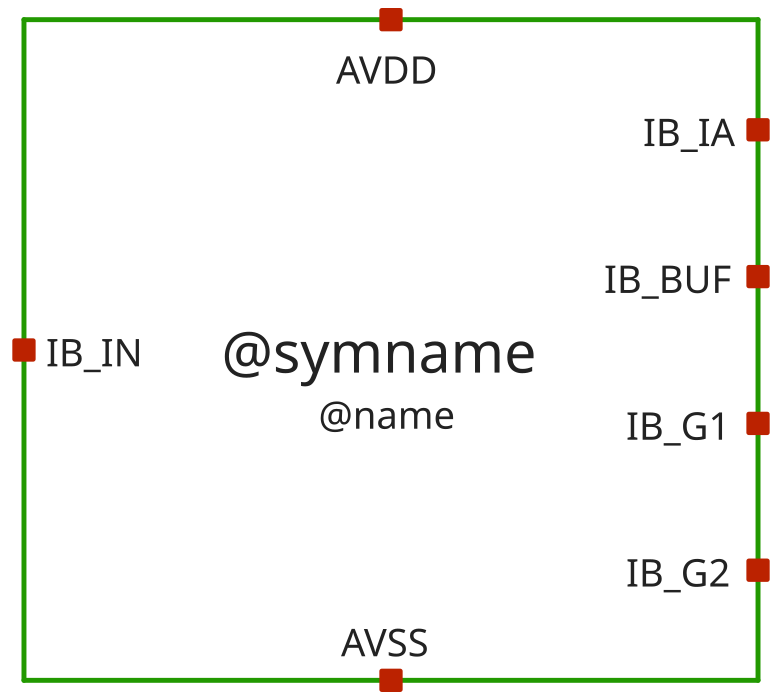
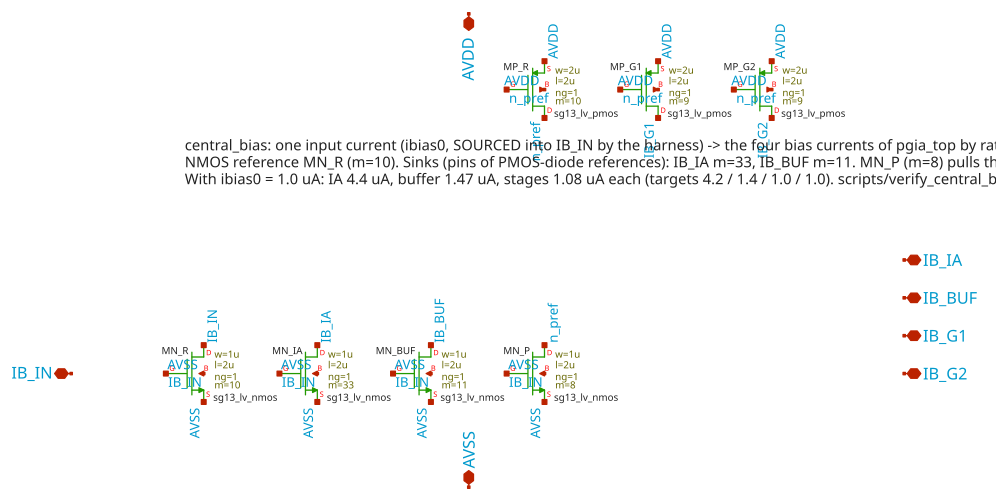

# central_bias

- Description: Bias generator of pgia_top: the four block bias currents (IA, buffer sunk; gain stages sourced) made from the single harness input ibias0
- PDK: ihp-sg13cmos5l

## Authorship

- Designer: SPMA
- Created: November 5, 2026
- License: MIT
- Company: None
- Last modified: None

## Pins

- AVDD
  + Description: Positive analog power supply (1.2V typ)
  + Type: power
  + Direction: inout
  + Vmin: 1.08
  + Vmax: 1.5
- AVSS
  + Description: Analog ground (0V)
  + Type: ground
  + Direction: inout
- IB_IN
  + Description: Reference input, current SOURCED into the pin (ibias0 of the harness, 1.0 uA nominal, 0.7 .. 1.3 uA window)
  + Type: signal
  + Direction: input
- IB_IA
  + Description: Bias output SINKING current from the bias reference of the instrumentation amplifier (4.4 uA at 1.0 uA in)
  + Type: signal
  + Direction: output
- IB_BUF
  + Description: Bias output SINKING current from the bias reference of the output buffer (1.47 uA at 1.0 uA in)
  + Type: signal
  + Direction: output
- IB_G1
  + Description: Bias output SOURCING current into the bias reference of gain stage 1 (1.08 uA at 1.0 uA in)
  + Type: signal
  + Direction: output
- IB_G2
  + Description: Bias output SOURCING current into the bias reference of gain stage 2 (1.08 uA at 1.0 uA in)
  + Type: signal
  + Direction: output

## Default Conditions

- vdd
  + Description: Analog power supply voltage
  + Display: Vdd
  + Unit: V
  + Typical: 1.2
- ib0
  + Description: Current sourced into IB_IN (ibias0)
  + Display: Ibias0
  + Unit: uA
  + Typical: 1.0
- corner
  + Description: Process corner
  + Display: Corner
  + Typical: tt
- rcorner
  + Description: Resistor corner (res_<rcorner> section of cornerRES.lib)
  + Display: Rcorner
  + Typical: typ
- temperature
  + Description: Ambient temperature
  + Display: Temp
  + Unit: °C
  + Typical: 27

## Symbol

## Schematic

