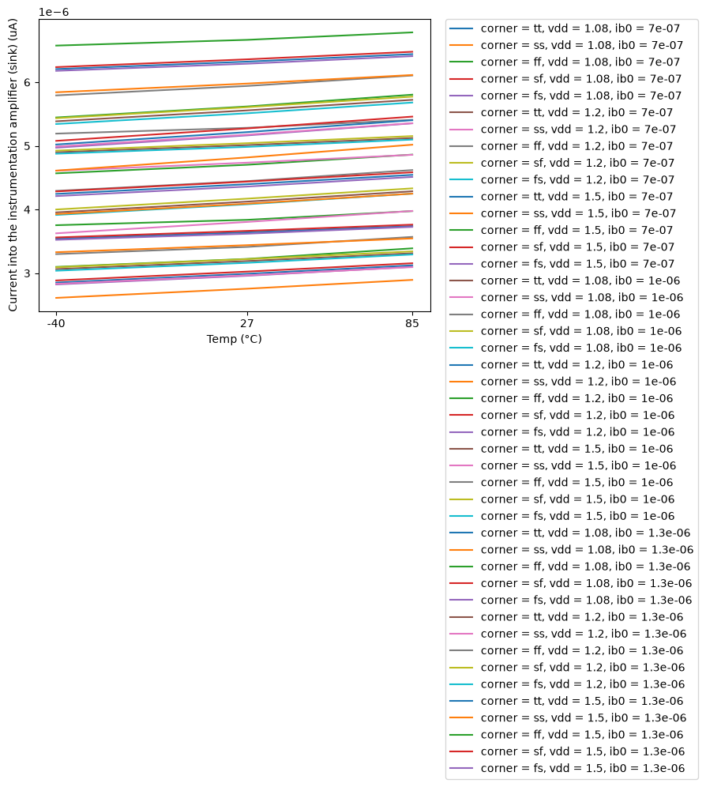
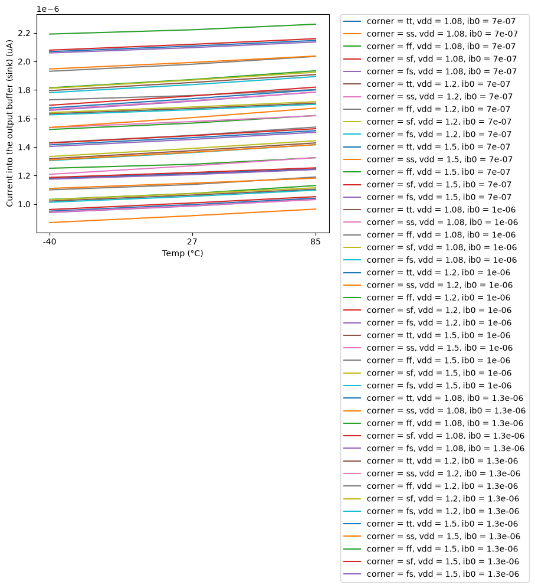
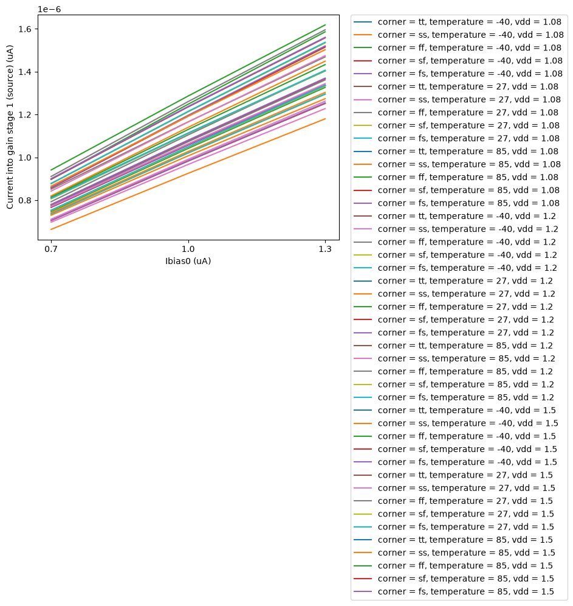
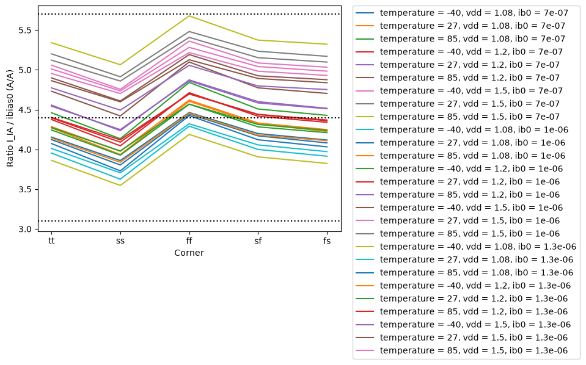

# CACE Summary for central_bias

**netlist source**: schematic

|      Parameter       |         Tool         |     Result      | Min Limit  |  Min Value   | Typ Target |  Typ Value   | Max Limit  |  Max Value   |  Status  |
| :------------------- | :------------------- | :-------------- | ---------: | -----------: | ---------: | -----------: | ---------: | -----------: | :------: |
| Current into the instrumentation amplifier (sink) | ngspice              | I_IA                 |             any |   2.611 uA |       4.4 uA |   4.444 uA |          any |   6.782 uA |   Pass ✅    |
| Current into the output buffer (sink) | ngspice              | I_BUF                |             any |   0.870 uA |      1.47 uA |   1.481 uA |          any |   2.261 uA |   Pass ✅    |
| Current into gain stage 1 (source) | ngspice              | I_G1                 |             any |   0.664 uA |      1.08 uA |   1.080 uA |          any |   1.618 uA |   Pass ✅    |
| Current into gain stage 2 (source) | ngspice              | I_G2                 |             any |   0.664 uA |      1.08 uA |   1.080 uA |          any |   1.618 uA |   Pass ✅    |
| Ratio I_IA / ibias0  | ngspice              | R_IA                 |         3.1 A/A |  3.547 A/A |      4.4 A/A |  4.461 A/A |      5.7 A/A |  5.678 A/A |   Pass ✅    |
| Ratio I_BUF / ibias0 | ngspice              | R_BUF                |         1.0 A/A |  1.182 A/A |     1.47 A/A |  1.487 A/A |      1.9 A/A |  1.893 A/A |   Pass ✅    |
| Ratio I_G / ibias0 (mean of the two stages) | ngspice              | R_G                  |        0.75 A/A |  0.908 A/A |     1.08 A/A |  1.096 A/A |      1.4 A/A |  1.344 A/A |   Pass ✅    |
| Stage 1 / stage 2 current difference | ngspice              | ERR_G                |            -3 % |   -0.000 % |          0 % |    0.000 % |          3 % |    0.000 % |   Pass ✅    |
| Supply power of the block (with the loads) | ngspice              | PWR                  |             any |   5.979 uW |          any |  11.391 uW |          any |  21.038 uW |   Pass ✅    |
| Current into the instrumentation amplifier (sink) | ngspice              | I_IA                 |             any |   3.623 uA |          any |   4.409 uA |          any |   5.059 uA |   Pass ✅    |
| Current into the output buffer (sink) | ngspice              | I_BUF                |             any |   1.195 uA |          any |   1.461 uA |          any |   1.736 uA |   Pass ✅    |
| Current into gain stage 1 (source) | ngspice              | I_G1                 |             any |   0.893 uA |          any |   1.083 uA |          any |   1.235 uA |   Pass ✅    |
| Current into gain stage 2 (source) | ngspice              | I_G2                 |             any |   0.886 uA |          any |   1.080 uA |          any |   1.237 uA |   Pass ✅    |
| Ratio I_IA / ibias0  | ngspice              | R_IA                 |             any |  3.623 A/A |          any |  4.409 A/A |          any |  5.059 A/A |   Pass ✅    |
| Ratio I_BUF / ibias0 | ngspice              | R_BUF                |             any |  1.195 A/A |          any |  1.461 A/A |          any |  1.736 A/A |   Pass ✅    |
| Ratio I_G / ibias0 (mean of the two stages) | ngspice              | R_G                  |             any |  0.889 A/A |          any |  1.081 A/A |          any |  1.232 A/A |   Pass ✅    |
| Stage 1 / stage 2 current difference | ngspice              | ERR_G                |             any | -224.432 % |          any |   28.986 % |          any |  272.332 % |   Pass ✅    |

## Plots

## currents_I_IA_vs_temperature

## currents_I_BUF_vs_temperature

## currents_I_G1_vs_ib0

## currents_R_IA_vs_corner

