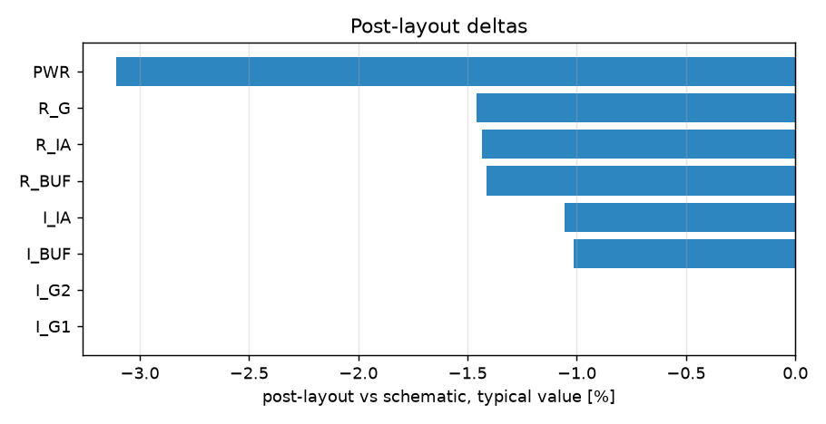

# Schematic vs post-layout

* schematic run: `/foss/designs/sg13cmos5l_spma_ip__instramp/runs/RUN_2026-11-05_17-40-05` (netlist source: schematic)
* post-layout run: `/foss/designs/sg13cmos5l_spma_ip__instramp/runs/pex_cace/central_bias/RUN_2026-11-05_18-12-00` (netlist source: pex)
* flag threshold: 5 % on the typical value; units as in the CACE summary

| Parameter | Var | Unit | Schematic min / typ / max | Post-layout min / typ / max | Δ typ | Δ typ % | Status | Flag |
|---|---|---|---|---|---:|---:|---|---|
| Current into the instrumentation amplifier (sink) | I_IA | uA | 2.611 / 4.444 / 6.782 | 3.19 / 4.397 / 5.557 | -0.047 | -1.06 | Pass → Pass |  |
| Current into the output buffer (sink) | I_BUF | uA | 0.87 / 1.481 / 2.261 | 1.063 / 1.466 / 1.852 | -0.015 | -1.01 | Pass → Pass |  |
| Current into gain stage 1 (source) | I_G1 | uA | 0.664 / 1.08 / 1.618 | 0.779 / 1.08 / 1.369 | +0 | +0.00 | Pass → Pass |  |
| Current into gain stage 2 (source) | I_G2 | uA | 0.664 / 1.08 / 1.618 | 0.779 / 1.08 / 1.369 | +0 | +0.00 | Pass → Pass |  |
| Ratio I_IA / ibias0 | R_IA | A/A | 3.547 / 4.461 / 5.678 | 4.274 / 4.397 / 4.557 | -0.064 | -1.43 | Pass → Pass |  |
| Ratio I_BUF / ibias0 | R_BUF | A/A | 1.182 / 1.487 / 1.893 | 1.425 / 1.466 / 1.519 | -0.021 | -1.41 | Pass → Pass |  |
| Ratio I_G / ibias0 (mean of the two stages) | R_G | A/A | 0.908 / 1.096 / 1.344 | 1.053 / 1.08 / 1.113 | -0.016 | -1.46 | Pass → Pass |  |
| Stage 1 / stage 2 current difference | ERR_G | % | -0 / 0 / 0 | 0 / 0 / 0 | +0 | n/a | Pass → Pass |  |
| Supply power of the block (with the loads) | PWR | uW | 5.979 / 11.391 / 21.038 | 7.993 / 11.037 / 13.965 | -0.354 | -3.11 | Pass → Pass |  |

0 row(s) flagged.

