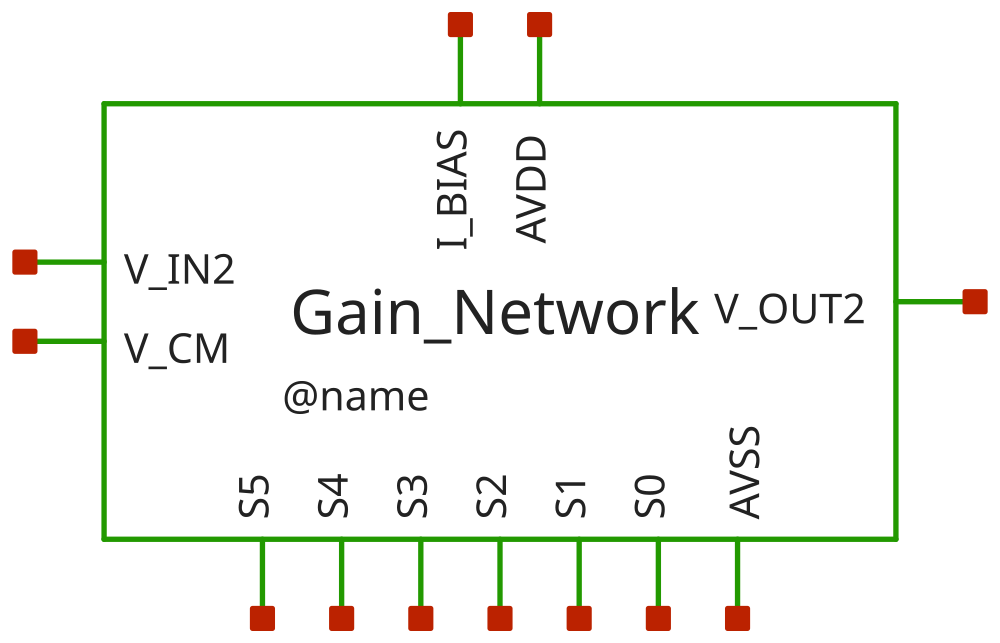
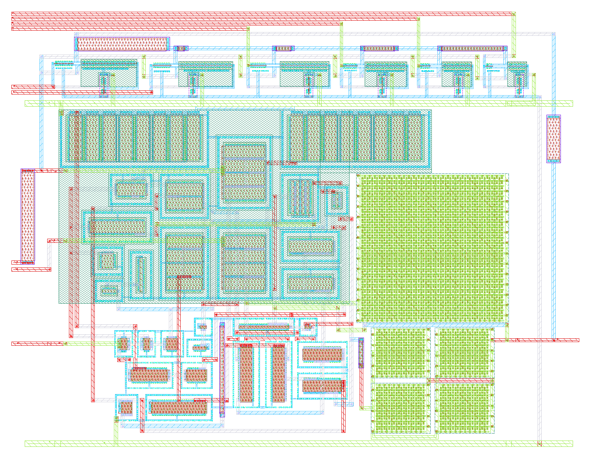

# gain_network - CACE characterisation

- Generated: 2026-10-22 12:21 by `scripts/make_readme.py` from `runs/RUN_2026-10-22_12-19-21`
- Commit: `ab932a5` (working tree dirty)
- Netlist source: schematic; datasheet: `cace/gain_network.yaml`; reproduce with `scripts/run_cace.sh gain_network`
- Sections marked *(CACE)* are written by CACE itself, the rest by this script (CACE has no per-corner MC statistics, worst-case conditions or unit-scaled spread plots).

## Design *(CACE)*

- Description: Gain OTA network with resistor networks and switches with transmission gates
- PDK: ihp-sg13cmos5l

### Authorship

- Designer: SPMA
- Created: October 22, 2026
- License: MIT
- Company: None
- Last modified: None

### Pins

- AVDD
  + Description: Positive analog power supply
  + Type: power
  + Direction: inout
  + Vmin: 1.08
  + Vmax: 1.5
- AVSS
  + Description: Analog ground
  + Type: ground
  + Direction: inout
- I_BIAS
  + Description: Bias current input
  + Type: signal
  + Direction: input
- V_CM
  + Description: Common-mode input
  + Type: signal
  + Direction: input
- V_IN2
  + Description: Input signal for instrumentation amplifier in the 1st stage
  + Type: signal
  + Direction: input
- V_OUT2
  + Description: Output signal to pass onto the next gain stage/output buffer
  + Type: signal
  + Direction: output
- S0
  + Description: Gain select bit 0 (0 dB / 1x)
  + Type: signal
  + Direction: input
- S1
  + Description: Gain select bit 1 (+6.02 dB / 2x)
  + Type: signal
  + Direction: input
- S2
  + Description: Gain select bit 2 (+12.04 dB / 4x)
  + Type: signal
  + Direction: input
- S3
  + Description: Gain select bit 3 (+18.06 dB / 8x)
  + Type: signal
  + Direction: input
- S4
  + Description: Gain select bit 4 (+24.08 dB / 16x)
  + Type: signal
  + Direction: input
- S5
  + Description: Gain select bit 5 (+30.10 dB / 32x)
  + Type: signal
  + Direction: input

### Default Conditions

- vdd
  + Description: Analog power supply voltage
  + Display: Vdd
  + Unit: V
  + Typical: 1.2
- vcm
  + Description: Input common mode voltage
  + Display: Vcm
  + Unit: V
  + Typical: 0.6
- ib
  + Description: Bias current
  + Display: Ib
  + Unit: uA
  + Typical: 1
- cl
  + Description: Output load capacitance
  + Display: CLoad
  + Unit: pF
  + Typical: 2
- gain_tap
  + Description: Active binary gain tap (0=0dB to 5=30dB)
  + Display: Tap
  + Typical: 0
- corner
  + Description: Process corner
  + Display: Corner
  + Typical: tt
- rcorner
  + Description: Resistor corner (res_<rcorner> section of cornerRES.lib)
  + Display: Rcorner
  + Typical: typ
- temperature
  + Description: Ambient temperature
  + Display: Temp
  + Unit: °C
  + Typical: 27

### Symbol

### Schematic

### Layout

**Physical size** (bounding box of `gain_network`; generated by `scripts/update_images.py`)

| Width W | Length L | Area |
|---|---|---|
| 97.45 µm | 74.61 µm | 7271 µm² |

## Results summary *(CACE)*

min / typ / max over all conditions of a parameter; Monte Carlo parameters (`mc_*`) are min/max over all samples.

**netlist source**: schematic

|      Parameter       |         Tool         |     Result      | Min Limit  |  Min Value   | Typ Target |  Typ Value   | Max Limit  |  Max Value   |  Status  |
| :------------------- | :------------------- | :-------------- | ---------: | -----------: | ---------: | -----------: | ---------: | -----------: | :------: |
| Closed-loop gain @1 kHz | ngspice              | A_CL                 |             any |  -4.828 dB |         0 dB |  15.219 dB |          any |  31.985 dB |   Pass ✅    |
| Gain error vs target | ngspice              | A_ERR                |             any | -34.729 dB |         0 dB |  -0.261 dB |          any |   8.377 dB |   Pass ✅    |
| -3 dB bandwidth      | ngspice              | F3DB                 |        20000 Hz | 253332.000 Hz |          any | 1700675.000 Hz |          any | 68540400.000 Hz |   Pass ✅    |
| 0 dB frequency       | ngspice              | F0DB                 |             any | 308891.000 Hz |          any | 10395550.000 Hz |          any | 100000000.000 Hz |   Pass ✅    |
| Phase @0 dB          | ngspice              | PH0                  |             any | -180.000 ° |          any |   71.769 ° |          any |  173.845 ° |   Pass ✅    |
| Output offset voltage | ngspice              | VOS                  |             any | -284.892 mV |     0.013 mV |  -2.227 mV |          any | 474.153 mV |   Pass ✅    |
| Virtual ground error | ngspice              | V_VG_ERR             |             any | -10.115 mV |     0.012 mV |  -0.653 mV |          any |  18.195 mV |   Pass ✅    |
| Quiescent current    | ngspice              | IQ                   |             any |  64.207 uA |        74 uA |  73.956 uA |       150 uA |  85.999 uA |   Pass ✅    |
| DC power dissipation | ngspice              | PWR                  |             any |  69.343 uW |      88.6 uW |  88.747 uW |       200 uW | 128.999 uW |   Pass ✅    |
| DC output voltage    | ngspice              | VOUT                 |             any |    0.315 V |        0.6 V |    0.598 V |          any |    1.074 V |   Pass ✅    |
| Input noise @10 Hz   | ngspice              | IRN_10               |             any | 5574.510 nV/rtHz |          any | 7162.080 nV/rtHz |          any | 12611.100 nV/rtHz |   Pass ✅    |
| Input noise @100 Hz  | ngspice              | IRN_100              |             any | 1763.570 nV/rtHz |          any | 2265.810 nV/rtHz |          any | 3989.740 nV/rtHz |   Pass ✅    |
| Input noise @1 kHz   | ngspice              | IRN_1K               |             any | 560.067 nV/rtHz | 1500 nV/rtHz | 719.534 nV/rtHz | 3500 nV/rtHz | 1267.200 nV/rtHz |   Pass ✅    |
| Input noise @10 kHz  | ngspice              | IRN_10K              |             any | 184.460 nV/rtHz |          any | 236.884 nV/rtHz |          any | 417.824 nV/rtHz |   Pass ✅    |
| Output noise @1 kHz  | ngspice              | ORN_1K               |             any | 966.459 nV/rtHz |          any | 9429.370 nV/rtHz |          any | 19260.400 nV/rtHz |   Pass ✅    |
| Integrated output noise | ngspice              | ONOISE_TOT           |             any | 449.403 uV-rms |          any | 1384.775 uV-rms |          any | 2435.990 uV-rms |   Pass ✅    |
| In-band input noise  | ngspice              | INOISE_EQ            |             any | 71.302 uV-rms |          any | 184.625 uV-rms |          any | 589.249 uV-rms |   Pass ✅    |
| Transient step gain  | ngspice              | TR_GAIN              |             any |    0.76511 |          any |    8.01361 |          any |    33.2226 |   Pass ✅    |
| Percentage overshoot | ngspice              | OVERSHOOT            |             any |    0.000 % |          2 % |    0.000 % |         20 % |    0.000 % |   Pass ✅    |
| Settling time (0.1%) | ngspice              | SETTLING_TIME        |             any |   0.206 us |       0.8 us |   0.792 us |       5.0 us |   2.870 us |   Pass ✅    |
| Slew rate positive   | ngspice              | SR_POS               |       1.0e6 V/s | 3069220.000 V/s |    3.0e6 V/s | 4271170.000 V/s |          any | 9544260.000 V/s |   Pass ✅    |
| Slew rate negative   | ngspice              | SR_NEG               |       1.0e6 V/s | 1421300.000 V/s |    4.0e6 V/s | 4044690.000 V/s |          any | 7299100.000 V/s |   Pass ✅    |
| THD in dB            | ngspice              | THD_DB               |             any | -51.884 dB |       -49 dB | -49.037 dB |       -20 dB | -24.696 dB |   Pass ✅    |
| THD in %             | ngspice              | THD_PCT              |             any |    0.255 % |       0.35 % |    0.354 % |         10 % |    5.824 % |   Pass ✅    |
| 2nd harmonic         | ngspice              | HD2_DB               |             any | -57.701 dB |          any | -50.100 dB |          any | -35.073 dB |   Pass ✅    |
| 3rd harmonic         | ngspice              | HD3_DB               |             any | -82.708 dB |          any | -58.256 dB |          any | -25.459 dB |   Pass ✅    |
| Fundamental output amplitude | ngspice              | VO1                  |             any |    0.157 V |          any |    0.200 V |          any |    0.263 V |   Pass ✅    |
| PSRR @10 Hz          | ngspice              | PSRR_DC              |           25 dB |  30.485 dB |        37 dB |  32.910 dB |          any |  37.733 dB |   Pass ✅    |
| PSRR @100 kHz        | ngspice              | PSRR_100K            |           25 dB |  30.264 dB |        37 dB |  32.943 dB |          any |  37.784 dB |   Pass ✅    |
| PSRR @1 MHz          | ngspice              | PSRR_1M              |             any |  22.548 dB |          any |  31.695 dB |          any |  38.484 dB |   Pass ✅    |
| CMRR @10 Hz          | ngspice              | CMRR_DC              |           50 dB |  57.512 dB |        67 dB |  62.055 dB |          any |  67.517 dB |   Pass ✅    |
| CMRR @100 kHz        | ngspice              | CMRR_100K            |           25 dB |  34.791 dB |        42 dB |  40.133 dB |          any |  42.384 dB |   Pass ✅    |
| CMRR @1 MHz          | ngspice              | CMRR_1M              |             any |  14.886 dB |          any |  24.497 dB |          any |  31.372 dB |   Pass ✅    |
| Max glitch voltage deviation | ngspice              | V_GLITCH_MAX         |             any |   0.248 mV |        50 mV |  11.622 mV |       200 mV |  50.638 mV |   Pass ✅    |
| Gain switching settling time | ngspice              | T_SWITCH_SETTLE      |             any |   0.003 us |       0.5 us |   0.500 us |       3.0 us |   2.153 us |   Pass ✅    |

### Plots *(CACE)*

#### ac_gain_A_CL_vs_temperature

#### ac_gain_F3DB_vs_temperature

#### ac_gain_A_CL_vs_vdd

#### dc_op_VOS_vs_temperature

#### dc_op_PWR_vs_temperature

#### dc_op_IQ_vs_vdd

#### noise_IRN_1K_vs_temperature

#### noise_ONOISE_TOT_vs_temperature

#### tran_small_OVERSHOOT_vs_temperature

#### tran_small_SETTLING_TIME_vs_temperature

#### tran_large_SR_POS_vs_temperature

#### tran_large_SR_NEG_vs_temperature

#### thd_THD_PCT_vs_temperature

#### thd_THD_DB_vs_temperature

#### psrr_PSRR_DC_vs_temperature

#### psrr_PSRR_100K_vs_temperature

#### cmrr_CMRR_DC_vs_temperature

#### cmrr_CMRR_100K_vs_temperature

#### tran_switch_V_GLITCH_MAX_vs_temperature

#### tran_switch_T_SWITCH_SETTLE_vs_temperature

## PVT worst-case conditions

Corners tt/ss/ff/sf/fs, supply and temperature as in the yaml. Values in the display unit of the yaml.

### ac_gain - Closed-loop AC gain & bandwidth

270 runs.

| metric | min | at (corner, vdd, T) | max | at (corner, vdd, T) | spec | fails |
|---|---|---|---|---|---|---|
| A_CL [dB] | -4.828 | ff, 1.5 V, 85 C | 31.99 | ss, 1.2 V, -40 C | any | - |
| A_ERR [dB] | -34.73 | ss, 1.08 V, -40 C | 8.377 | ss, 1.2 V, -40 C | any | - |
| F3DB [Hz] | 2.533e+05 | ss, 1.08 V, 27 C | 6.854e+07 | tt, 1.5 V, -40 C | >= 20000 | 0 |
| F0DB [Hz] | 3.089e+05 | tt, 1.08 V, 85 C | 1e+08 | ff, 1.08 V, 27 C | any | - |
| PH0 [°] | -180 | ff, 1.08 V, 27 C | 173.8 | tt, 1.08 V, 85 C | any | - |

### dc_op - DC operating point

270 runs.

| metric | min | at (corner, vdd, T) | max | at (corner, vdd, T) | spec | fails |
|---|---|---|---|---|---|---|
| VOS [mV] | -284.9 | ff, 1.5 V, 85 C | 474.2 | ss, 1.08 V, -40 C | any | - |
| V_VG_ERR [mV] | -10.11 | ff, 1.5 V, 85 C | 18.2 | ss, 1.08 V, -40 C | any | - |
| IQ [uA] | 64.21 | ss, 1.08 V, -40 C | 86 | ff, 1.5 V, -40 C | <= 150 | 0 |
| PWR [uW] | 69.34 | ss, 1.08 V, -40 C | 129 | ff, 1.5 V, -40 C | <= 200 | 0 |
| VOUT [V] | 0.3151 | ff, 1.5 V, 85 C | 1.074 | ss, 1.08 V, -40 C | any | - |

### noise - Noise performance

6 runs.

| metric | min | at (corner, vdd, T) | max | at (corner, vdd, T) | spec | fails |
|---|---|---|---|---|---|---|
| IRN_10 [nV/rtHz] | 5575 | tt, 1.2 V, 27 C | 1.261e+04 | ff, 1.2 V, 27 C | any | - |
| IRN_100 [nV/rtHz] | 1764 | tt, 1.2 V, 27 C | 3990 | ff, 1.2 V, 27 C | any | - |
| IRN_1K [nV/rtHz] | 560.1 | tt, 1.2 V, 27 C | 1267 | ff, 1.2 V, 27 C | <= 3500 | 0 |
| IRN_10K [nV/rtHz] | 184.5 | tt, 1.2 V, 27 C | 417.8 | ff, 1.2 V, 27 C | any | - |
| ORN_1K [nV/rtHz] | 966.5 | ff, 1.2 V, 27 C | 1.926e+04 | ss, 1.2 V, 27 C | any | - |
| ONOISE_TOT [uV-rms] | 449.4 | ff, 1.2 V, 27 C | 2436 | ss, 1.2 V, 27 C | any | - |
| INOISE_EQ [uV-rms] | 71.3 | ss, 1.2 V, 27 C | 589.2 | ff, 1.2 V, 27 C | any | - |

### tran_small - Small-signal step response

9 runs.

| metric | min | at (corner, vdd, T) | max | at (corner, vdd, T) | spec | fails |
|---|---|---|---|---|---|---|
| TR_GAIN [] | 0.7651 | ff, 1.2 V, 27 C | 33.22 | ss, 1.2 V, 27 C | any | - |
| OVERSHOOT [%] | 0 | tt, 1.2 V, 27 C | 0 | tt, 1.2 V, 27 C | <= 20 | 0 |
| SETTLING_TIME [us] | 0.2056 | ff, 1.2 V, 27 C | 2.87 | ss, 1.2 V, 27 C | <= 5 | 0 |

### tran_large - Large-signal step response (Slew Rate)

45 runs.

| metric | min | at (corner, vdd, T) | max | at (corner, vdd, T) | spec | fails |
|---|---|---|---|---|---|---|
| SR_POS [V/s] | 3.069e+06 | ff, 1.08 V, 27 C | 9.544e+06 | ss, 1.2 V, -40 C | >= 1e+06 | 0 |
| SR_NEG [V/s] | 1.421e+06 | ss, 1.08 V, -40 C | 7.299e+06 | ss, 1.2 V, -40 C | >= 1e+06 | 0 |

### thd - Total harmonic distortion (THD)

18 runs.

| metric | min | at (corner, vdd, T) | max | at (corner, vdd, T) | spec | fails |
|---|---|---|---|---|---|---|
| THD_DB [dB] | -51.88 | tt, 1.2 V, 27 C | -24.7 | ss, 1.2 V, 27 C | <= -20 | 0 |
| THD_PCT [%] | 0.2546 | tt, 1.2 V, 27 C | 5.824 | ss, 1.2 V, 27 C | <= 10 | 0 |
| HD2_DB [dB] | -57.7 | ff, 1.2 V, 27 C | -35.07 | ss, 1.2 V, 27 C | any | - |
| HD3_DB [dB] | -82.71 | ss, 1.2 V, 27 C | -25.46 | ss, 1.2 V, 27 C | any | - |
| VO1 [V] | 0.1569 | ff, 1.2 V, 27 C | 0.2628 | ss, 1.2 V, 27 C | any | - |

### psrr - Power supply rejection ratio (PSRR)

6 runs.

| metric | min | at (corner, vdd, T) | max | at (corner, vdd, T) | spec | fails |
|---|---|---|---|---|---|---|
| PSRR_DC [dB] | 30.49 | ff, 1.2 V, 27 C | 37.73 | ff, 1.2 V, 27 C | >= 25 | 0 |
| PSRR_100K [dB] | 30.26 | ff, 1.2 V, 27 C | 37.78 | ff, 1.2 V, 27 C | >= 25 | 0 |
| PSRR_1M [dB] | 22.55 | ff, 1.2 V, 27 C | 38.48 | tt, 1.2 V, 27 C | any | - |

### cmrr - Common-mode rejection ratio (CMRR)

6 runs.

| metric | min | at (corner, vdd, T) | max | at (corner, vdd, T) | spec | fails |
|---|---|---|---|---|---|---|
| CMRR_DC [dB] | 57.51 | ss, 1.2 V, 27 C | 67.52 | tt, 1.2 V, 27 C | >= 50 | 0 |
| CMRR_100K [dB] | 34.79 | ff, 1.2 V, 27 C | 42.38 | ss, 1.2 V, 27 C | >= 25 | 0 |
| CMRR_1M [dB] | 14.89 | ff, 1.2 V, 27 C | 31.37 | ss, 1.2 V, 27 C | any | - |

### tran_switch - Dynamic gain switching transient & glitch

45 runs.

| metric | min | at (corner, vdd, T) | max | at (corner, vdd, T) | spec | fails |
|---|---|---|---|---|---|---|
| V_GLITCH_MAX [mV] | 0.248 | ss, 1.08 V, 85 C | 50.64 | ss, 1.08 V, -40 C | <= 200 | 0 |
| T_SWITCH_SETTLE [us] | 0.002585 | ff, 1.5 V, 27 C | 2.153 | ss, 1.5 V, -40 C | <= 3 | 0 |

## Monte Carlo (local mismatch)

Mismatch models only (`mos_<corner>_mismatch`, `res_typ_mismatch`; `cap_cmomi` has no characterised spread), one seed per iteration (`seed = 12345 + iteration`, **the same 50 mismatch draws are reused at every corner and temperature**, so boxes are paired comparisons and the pooled counts overstate the number of independent samples: 50, not 50 x 15). Box = interquartile range, dots = individual samples, dotted lines = spec (if any).

