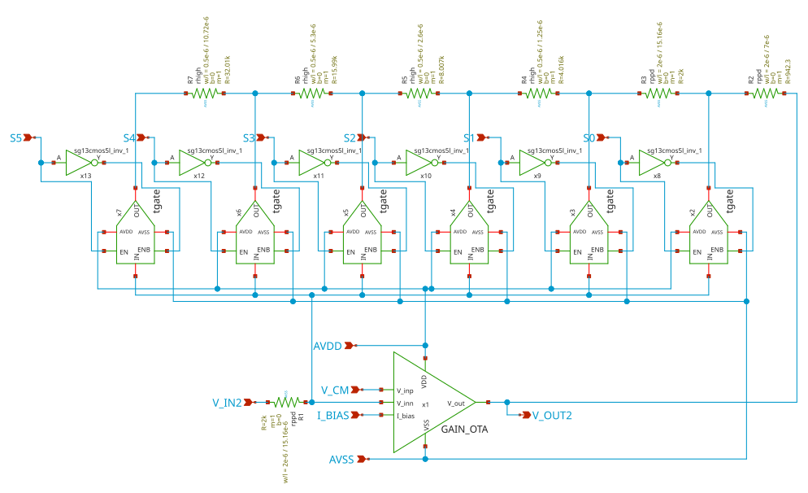

# gain_network

- Description: Gain OTA network with resistor networks and switches with transmission gates
- PDK: ihp-sg13cmos5l

## Authorship

- Designer: SPMA
- Created: October 22, 2026
- License: MIT
- Company: None
- Last modified: None

## Pins

- AVDD
  + Description: Positive analog power supply
  + Type: power
  + Direction: inout
  + Vmin: 1.08
  + Vmax: 1.5
- AVSS
  + Description: Analog ground
  + Type: ground
  + Direction: inout
- I_BIAS
  + Description: Bias current input
  + Type: signal
  + Direction: input
- V_CM
  + Description: Common-mode input
  + Type: signal
  + Direction: input
- V_IN2
  + Description: Input signal for instrumentation amplifier in the 1st stage
  + Type: signal
  + Direction: input
- V_OUT2
  + Description: Output signal to pass onto the next gain stage/output buffer
  + Type: signal
  + Direction: output
- S0
  + Description: Gain select bit 0 (0 dB / 1x)
  + Type: signal
  + Direction: input
- S1
  + Description: Gain select bit 1 (+6.02 dB / 2x)
  + Type: signal
  + Direction: input
- S2
  + Description: Gain select bit 2 (+12.04 dB / 4x)
  + Type: signal
  + Direction: input
- S3
  + Description: Gain select bit 3 (+18.06 dB / 8x)
  + Type: signal
  + Direction: input
- S4
  + Description: Gain select bit 4 (+24.08 dB / 16x)
  + Type: signal
  + Direction: input
- S5
  + Description: Gain select bit 5 (+30.10 dB / 32x)
  + Type: signal
  + Direction: input

## Default Conditions

- vdd
  + Description: Analog power supply voltage
  + Display: Vdd
  + Unit: V
  + Typical: 1.2
- vcm
  + Description: Input common mode voltage
  + Display: Vcm
  + Unit: V
  + Typical: 0.6
- ib
  + Description: Bias current
  + Display: Ib
  + Unit: uA
  + Typical: 1
- cl
  + Description: Output load capacitance
  + Display: CLoad
  + Unit: pF
  + Typical: 2
- gain_tap
  + Description: Active binary gain tap (0=0dB to 5=30dB)
  + Display: Tap
  + Typical: 0
- corner
  + Description: Process corner
  + Display: Corner
  + Typical: tt
- rcorner
  + Description: Resistor corner (res_<rcorner> section of cornerRES.lib)
  + Display: Rcorner
  + Typical: typ
- temperature
  + Description: Ambient temperature
  + Display: Temp
  + Unit: °C
  + Typical: 27

## Symbol

## Schematic

