# CACE Summary for gain_network

**netlist source**: schematic

|      Parameter       |         Tool         |     Result      | Min Limit  |  Min Value   | Typ Target |  Typ Value   | Max Limit  |  Max Value   |  Status  |
| :------------------- | :------------------- | :-------------- | ---------: | -----------: | ---------: | -----------: | ---------: | -----------: | :------: |
| Closed-loop gain @1 kHz | ngspice              | A_CL                 |             any |  -4.204 dB |         0 dB |  15.967 dB |          any |  30.684 dB |   Pass ✅    |
| Gain error vs target | ngspice              | A_ERR                |             any | -32.114 dB |         0 dB |  -0.041 dB |          any |   7.307 dB |   Pass ✅    |
| -3 dB bandwidth      | ngspice              | F3DB                 |        20000 Hz | 276128.000 Hz |          any | 2086540.000 Hz |          any | 20155500.000 Hz |   Pass ✅    |
| 0 dB frequency       | ngspice              | F0DB                 |             any | 2233980.000 Hz |          any | 11685200.000 Hz |          any | 100000000.000 Hz |   Pass ✅    |
| Phase @0 dB          | ngspice              | PH0                  |             any | -180.000 ° |          any |   54.478 ° |          any |  160.214 ° |   Pass ✅    |
| Output offset voltage | ngspice              | VOS                  |             any | -330.326 mV |     0.013 mV |  -2.304 mV |          any | 476.591 mV |   Pass ✅    |
| Virtual ground error | ngspice              | V_VG_ERR             |             any | -10.412 mV |     0.012 mV |  -0.680 mV |          any |  19.354 mV |   Pass ✅    |
| Quiescent current    | ngspice              | IQ                   |             any |  60.534 uA |        74 uA |  73.836 uA |       150 uA |  87.544 uA |   Pass ✅    |
| DC power dissipation | ngspice              | PWR                  |             any |  65.376 uW |      88.6 uW |  88.599 uW |       200 uW | 131.315 uW |   Pass ✅    |
| DC output voltage    | ngspice              | VOUT                 |             any |    0.270 V |        0.6 V |    0.598 V |          any |    1.077 V |   Pass ✅    |
| Input noise @10 Hz   | ngspice              | IRN_10               |             any | 5575.600 nV/rtHz |          any | 7108.350 nV/rtHz |          any | 12510.000 nV/rtHz |   Pass ✅    |
| Input noise @100 Hz  | ngspice              | IRN_100              |             any | 1763.990 nV/rtHz |          any | 2248.865 nV/rtHz |          any | 3957.830 nV/rtHz |   Pass ✅    |
| Input noise @1 kHz   | ngspice              | IRN_1K               |             any | 560.448 nV/rtHz | 1500 nV/rtHz | 714.317 nV/rtHz | 3500 nV/rtHz | 1257.340 nV/rtHz |   Pass ✅    |
| Input noise @10 kHz  | ngspice              | IRN_10K              |             any | 185.327 nV/rtHz |          any | 235.850 nV/rtHz |          any | 415.396 nV/rtHz |   Pass ✅    |
| Output noise @1 kHz  | ngspice              | ORN_1K               |             any | 973.814 nV/rtHz |          any | 9513.945 nV/rtHz |          any | 18907.700 nV/rtHz |   Pass ✅    |
| Integrated output noise | ngspice              | ONOISE_TOT           |             any | 608.882 uV-rms |          any | 1509.114 uV-rms |          any | 2496.030 uV-rms |   Pass ✅    |
| In-band input noise  | ngspice              | INOISE_EQ            |             any | 74.698 uV-rms |          any | 224.680 uV-rms |          any | 786.159 uV-rms |   Pass ✅    |
| Transient step gain  | ngspice              | TR_GAIN              |             any |    0.77379 |          any |    8.49047 |          any |    32.8962 |   Pass ✅    |
| Percentage overshoot | ngspice              | OVERSHOOT            |             any |    0.000 % |          2 % |    0.000 % |         20 % |   22.228 % |   Fail ❌    |
| Settling time (0.1%) | ngspice              | SETTLING_TIME        |             any |   0.066 us |       0.8 us |   0.695 us |       5.0 us |   2.578 us |   Pass ✅    |
| Slew rate positive   | ngspice              | SR_POS               |       1.0e6 V/s | 3200000.000 V/s |    3.0e6 V/s | 6170700.000 V/s |          any | 11113400.000 V/s |   Pass ✅    |
| Slew rate negative   | ngspice              | SR_NEG               |       1.0e6 V/s | 1742200.000 V/s |    4.0e6 V/s | 4471270.000 V/s |          any | 8276430.000 V/s |   Pass ✅    |
| THD in dB            | ngspice              | THD_DB               |             any | -55.326 dB |       -49 dB | -46.288 dB |       -20 dB | -22.210 dB |   Pass ✅    |
| THD in %             | ngspice              | THD_PCT              |             any |    0.171 % |       0.35 % |    0.499 % |         10 % |    7.753 % |   Pass ✅    |
| 2nd harmonic         | ngspice              | HD2_DB               |             any | -57.570 dB |          any | -46.588 dB |          any | -27.479 dB |   Pass ✅    |
| 3rd harmonic         | ngspice              | HD3_DB               |             any | -78.019 dB |          any | -62.654 dB |          any | -24.493 dB |   Pass ✅    |
| Fundamental output amplitude | ngspice              | VO1                  |             any |    0.155 V |          any |    0.206 V |          any |    0.282 V |   Pass ✅    |
| PSRR @10 Hz          | ngspice              | PSRR_DC              |           25 dB |  30.646 dB |        37 dB |  32.952 dB |          any |  37.880 dB |   Pass ✅    |
| PSRR @100 kHz        | ngspice              | PSRR_100K            |           25 dB |  30.526 dB |        37 dB |  33.037 dB |          any |  38.044 dB |   Pass ✅    |
| PSRR @1 MHz          | ngspice              | PSRR_1M              |             any |  24.775 dB |          any |  34.398 dB |          any |  42.000 dB |   Pass ✅    |
| CMRR @10 Hz          | ngspice              | CMRR_DC              |           50 dB |  34.063 dB |        67 dB |  58.607 dB |          any |  67.565 dB |   Fail ❌    |
| CMRR @100 kHz        | ngspice              | CMRR_100K            |           25 dB |  33.166 dB |        42 dB |  41.211 dB |          any |  44.907 dB |   Pass ✅    |
| CMRR @1 MHz          | ngspice              | CMRR_1M              |             any |  16.300 dB |          any |  26.371 dB |          any |  33.218 dB |   Pass ✅    |
| Max glitch voltage deviation | ngspice              | V_GLITCH_MAX         |             any |   0.086 mV |        50 mV |  11.831 mV |       200 mV |  51.724 mV |   Pass ✅    |
| Gain switching settling time | ngspice              | T_SWITCH_SETTLE      |             any |   0.001 us |       0.5 us |   0.500 us |       3.0 us |   2.106 us |   Pass ✅    |

## Plots

## ac_gain_A_CL_vs_temperature

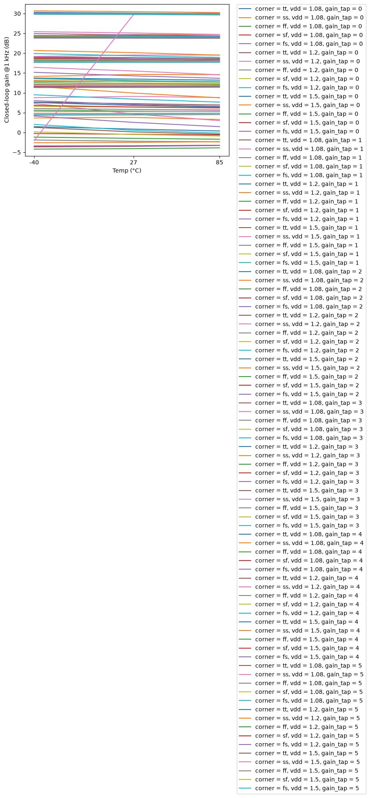

## ac_gain_F3DB_vs_temperature

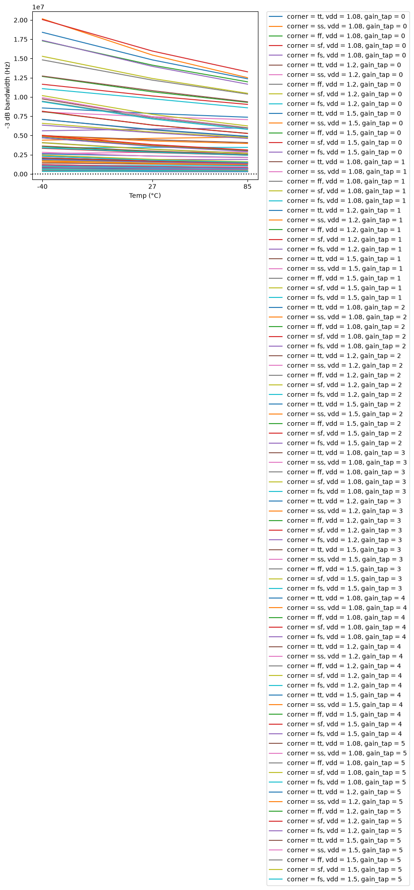

## ac_gain_A_CL_vs_vdd

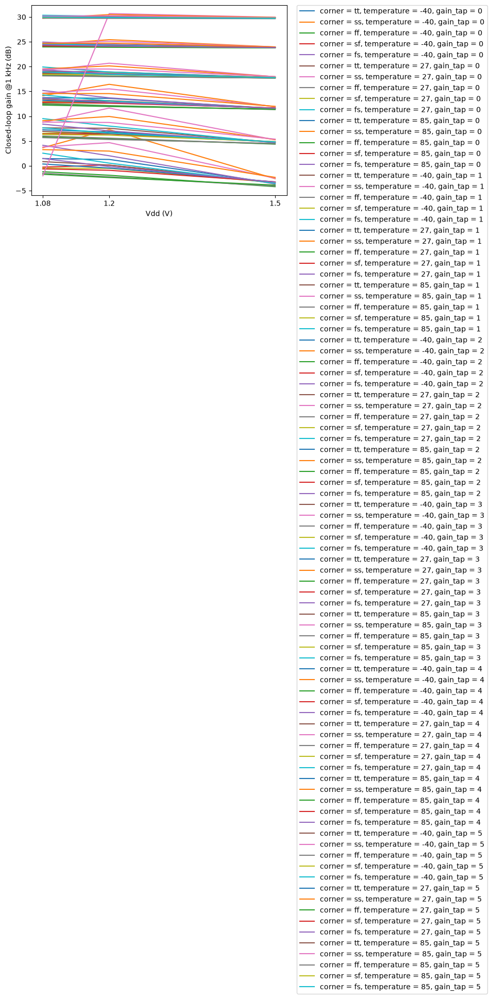

## dc_op_VOS_vs_temperature

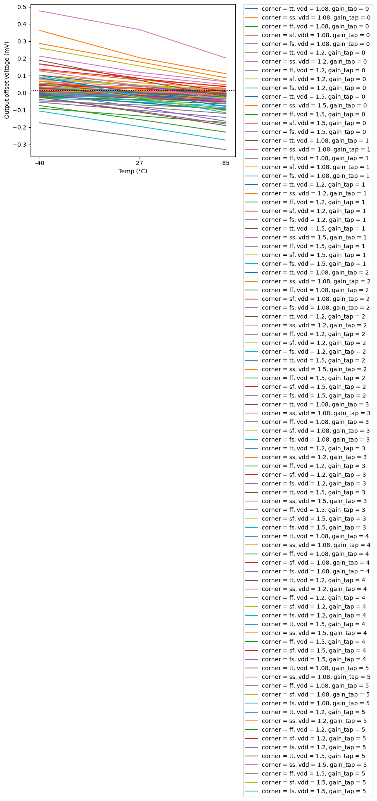

## dc_op_PWR_vs_temperature

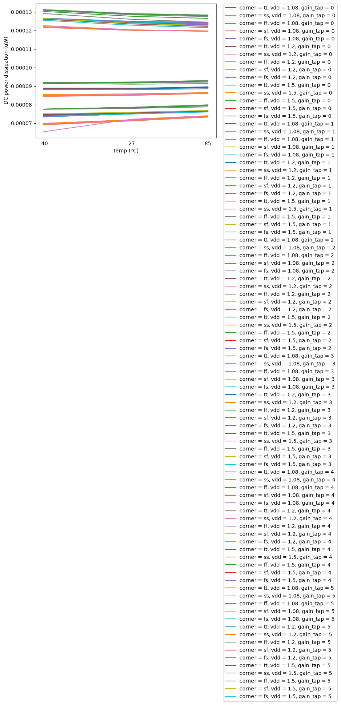

## dc_op_IQ_vs_vdd

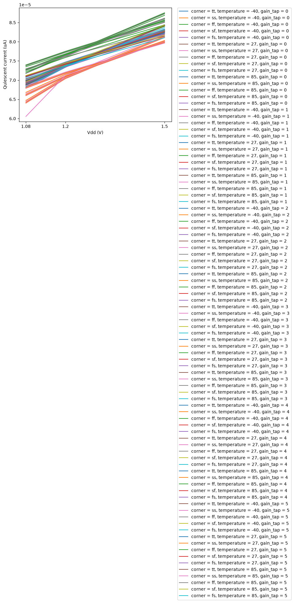

## noise_IRN_1K_vs_temperature

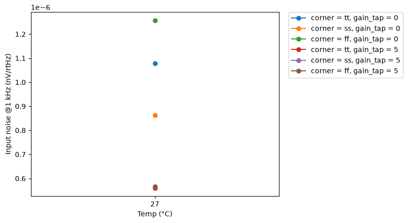

## noise_ONOISE_TOT_vs_temperature

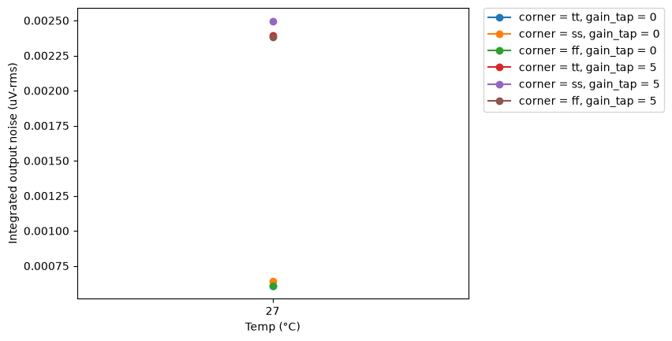

## tran_small_OVERSHOOT_vs_temperature

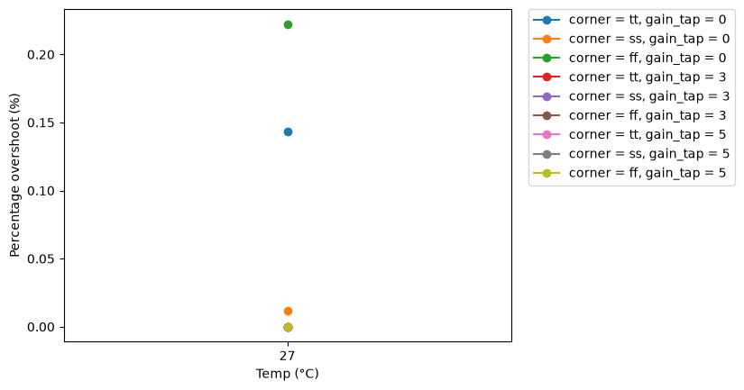

## tran_small_SETTLING_TIME_vs_temperature

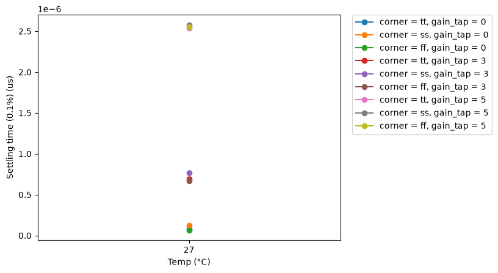

## tran_large_SR_POS_vs_temperature

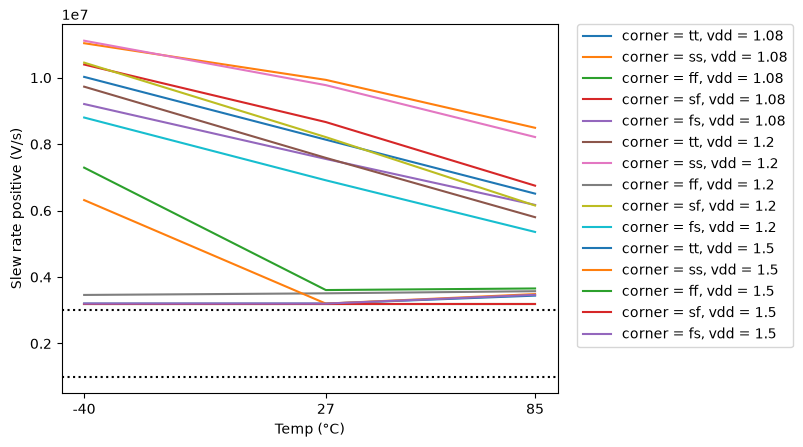

## tran_large_SR_NEG_vs_temperature

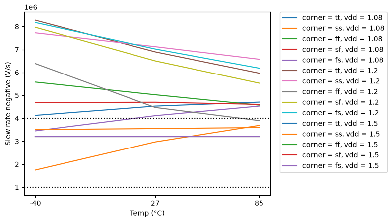

## thd_THD_PCT_vs_temperature

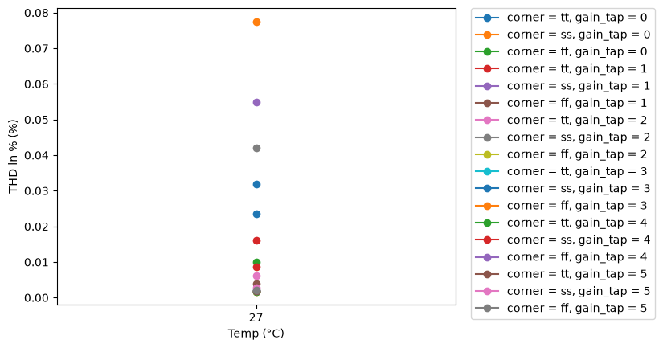

## thd_THD_DB_vs_temperature

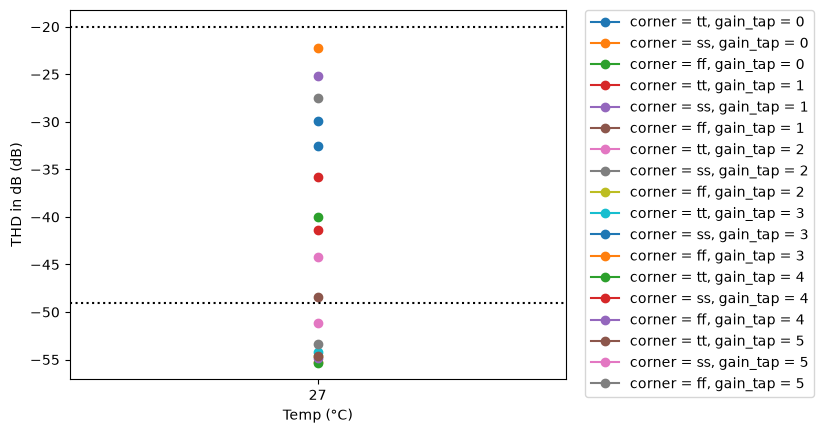

## psrr_PSRR_DC_vs_temperature

## psrr_PSRR_100K_vs_temperature

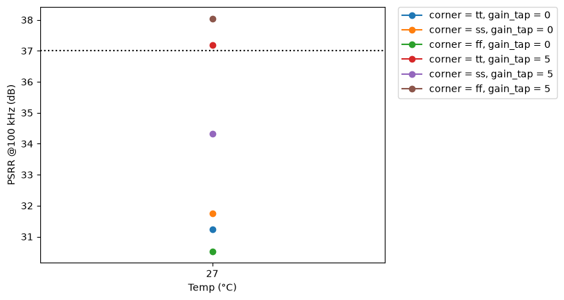

## cmrr_CMRR_DC_vs_temperature

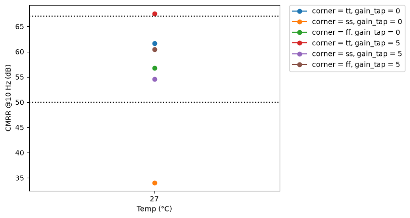

## cmrr_CMRR_100K_vs_temperature

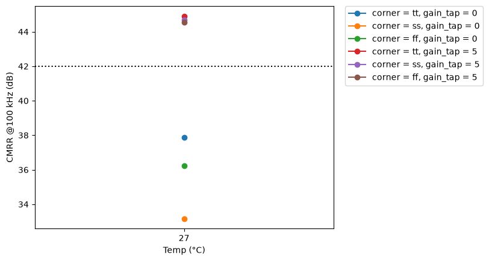

## tran_switch_V_GLITCH_MAX_vs_temperature

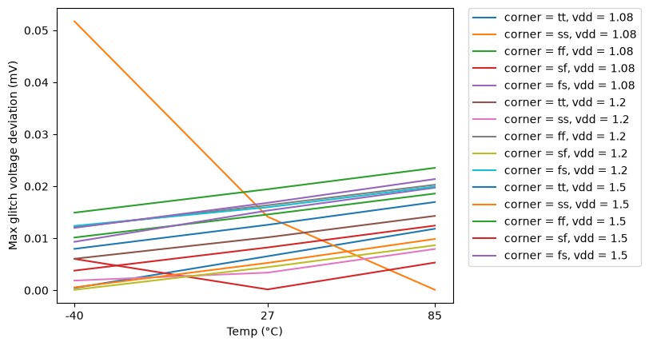

## tran_switch_T_SWITCH_SETTLE_vs_temperature

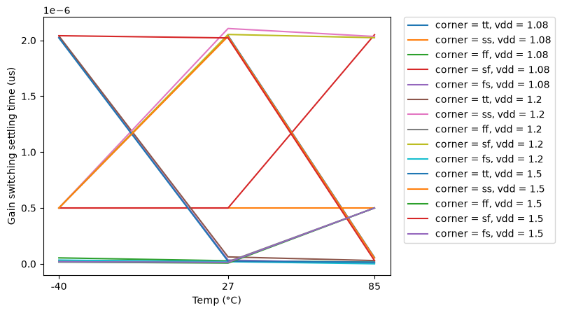
