# CACE Summary for gain_network

**netlist source**: schematic

|      Parameter       |         Tool         |     Result      | Min Limit  |  Min Value   | Typ Target |  Typ Value   | Max Limit  |  Max Value   |  Status  |
| :------------------- | :------------------- | :-------------- | ---------: | -----------: | ---------: | -----------: | ---------: | -----------: | :------: |
| Closed-loop gain @1 kHz | ngspice              | A_CL                 |             any |  -4.828 dB |         0 dB |  15.219 dB |          any |  31.985 dB |   Pass ✅    |
| Gain error vs target | ngspice              | A_ERR                |             any | -34.729 dB |         0 dB |  -0.261 dB |          any |   8.377 dB |   Pass ✅    |
| -3 dB bandwidth      | ngspice              | F3DB                 |        20000 Hz | 253332.000 Hz |          any | 1700675.000 Hz |          any | 68540400.000 Hz |   Pass ✅    |
| 0 dB frequency       | ngspice              | F0DB                 |             any | 308891.000 Hz |          any | 10395550.000 Hz |          any | 100000000.000 Hz |   Pass ✅    |
| Phase @0 dB          | ngspice              | PH0                  |             any | -180.000 ° |          any |   71.769 ° |          any |  173.845 ° |   Pass ✅    |
| Output offset voltage | ngspice              | VOS                  |             any | -284.892 mV |     0.013 mV |  -2.227 mV |          any | 474.153 mV |   Pass ✅    |
| Virtual ground error | ngspice              | V_VG_ERR             |             any | -10.115 mV |     0.012 mV |  -0.653 mV |          any |  18.195 mV |   Pass ✅    |
| Quiescent current    | ngspice              | IQ                   |             any |  64.207 uA |        74 uA |  73.956 uA |       150 uA |  85.999 uA |   Pass ✅    |
| DC power dissipation | ngspice              | PWR                  |             any |  69.343 uW |      88.6 uW |  88.747 uW |       200 uW | 128.999 uW |   Pass ✅    |
| DC output voltage    | ngspice              | VOUT                 |             any |    0.315 V |        0.6 V |    0.598 V |          any |    1.074 V |   Pass ✅    |
| Input noise @10 Hz   | ngspice              | IRN_10               |             any | 5574.510 nV/rtHz |          any | 7162.080 nV/rtHz |          any | 12611.100 nV/rtHz |   Pass ✅    |
| Input noise @100 Hz  | ngspice              | IRN_100              |             any | 1763.570 nV/rtHz |          any | 2265.810 nV/rtHz |          any | 3989.740 nV/rtHz |   Pass ✅    |
| Input noise @1 kHz   | ngspice              | IRN_1K               |             any | 560.067 nV/rtHz | 1500 nV/rtHz | 719.534 nV/rtHz | 3500 nV/rtHz | 1267.200 nV/rtHz |   Pass ✅    |
| Input noise @10 kHz  | ngspice              | IRN_10K              |             any | 184.460 nV/rtHz |          any | 236.884 nV/rtHz |          any | 417.824 nV/rtHz |   Pass ✅    |
| Output noise @1 kHz  | ngspice              | ORN_1K               |             any | 966.459 nV/rtHz |          any | 9429.370 nV/rtHz |          any | 19260.400 nV/rtHz |   Pass ✅    |
| Integrated output noise | ngspice              | ONOISE_TOT           |             any | 449.403 uV-rms |          any | 1384.775 uV-rms |          any | 2435.990 uV-rms |   Pass ✅    |
| In-band input noise  | ngspice              | INOISE_EQ            |             any | 71.302 uV-rms |          any | 184.625 uV-rms |          any | 589.249 uV-rms |   Pass ✅    |
| Transient step gain  | ngspice              | TR_GAIN              |             any |    0.76511 |          any |    8.01361 |          any |    33.2226 |   Pass ✅    |
| Percentage overshoot | ngspice              | OVERSHOOT            |             any |    0.000 % |          2 % |    0.000 % |         20 % |    0.000 % |   Pass ✅    |
| Settling time (0.1%) | ngspice              | SETTLING_TIME        |             any |   0.206 us |       0.8 us |   0.792 us |       5.0 us |   2.870 us |   Pass ✅    |
| Slew rate positive   | ngspice              | SR_POS               |       1.0e6 V/s | 3069220.000 V/s |    3.0e6 V/s | 4271170.000 V/s |          any | 9544260.000 V/s |   Pass ✅    |
| Slew rate negative   | ngspice              | SR_NEG               |       1.0e6 V/s | 1421300.000 V/s |    4.0e6 V/s | 4044690.000 V/s |          any | 7299100.000 V/s |   Pass ✅    |
| THD in dB            | ngspice              | THD_DB               |             any | -51.884 dB |       -49 dB | -49.037 dB |       -20 dB | -24.696 dB |   Pass ✅    |
| THD in %             | ngspice              | THD_PCT              |             any |    0.255 % |       0.35 % |    0.354 % |         10 % |    5.824 % |   Pass ✅    |
| 2nd harmonic         | ngspice              | HD2_DB               |             any | -57.701 dB |          any | -50.100 dB |          any | -35.073 dB |   Pass ✅    |
| 3rd harmonic         | ngspice              | HD3_DB               |             any | -82.708 dB |          any | -58.256 dB |          any | -25.459 dB |   Pass ✅    |
| Fundamental output amplitude | ngspice              | VO1                  |             any |    0.157 V |          any |    0.200 V |          any |    0.263 V |   Pass ✅    |
| PSRR @10 Hz          | ngspice              | PSRR_DC              |           25 dB |  30.485 dB |        37 dB |  32.910 dB |          any |  37.733 dB |   Pass ✅    |
| PSRR @100 kHz        | ngspice              | PSRR_100K            |           25 dB |  30.264 dB |        37 dB |  32.943 dB |          any |  37.784 dB |   Pass ✅    |
| PSRR @1 MHz          | ngspice              | PSRR_1M              |             any |  22.548 dB |          any |  31.695 dB |          any |  38.484 dB |   Pass ✅    |
| CMRR @10 Hz          | ngspice              | CMRR_DC              |           50 dB |  57.512 dB |        67 dB |  62.055 dB |          any |  67.517 dB |   Pass ✅    |
| CMRR @100 kHz        | ngspice              | CMRR_100K            |           25 dB |  34.791 dB |        42 dB |  40.133 dB |          any |  42.384 dB |   Pass ✅    |
| CMRR @1 MHz          | ngspice              | CMRR_1M              |             any |  14.886 dB |          any |  24.497 dB |          any |  31.372 dB |   Pass ✅    |
| Max glitch voltage deviation | ngspice              | V_GLITCH_MAX         |             any |   0.248 mV |        50 mV |  11.622 mV |       200 mV |  50.638 mV |   Pass ✅    |
| Gain switching settling time | ngspice              | T_SWITCH_SETTLE      |             any |   0.003 us |       0.5 us |   0.500 us |       3.0 us |   2.153 us |   Pass ✅    |

## Plots

## ac_gain_A_CL_vs_temperature

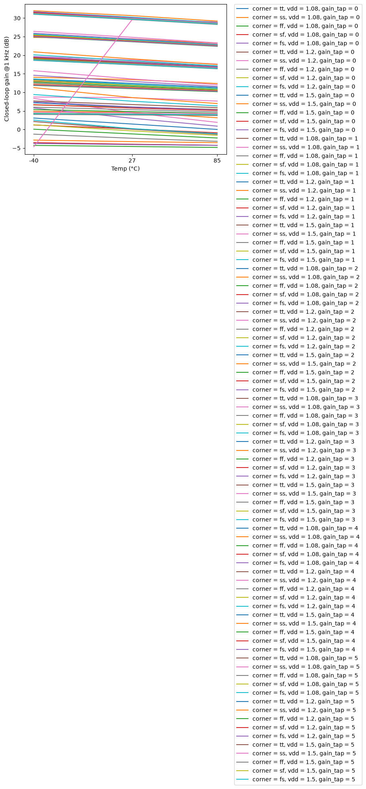

## ac_gain_F3DB_vs_temperature

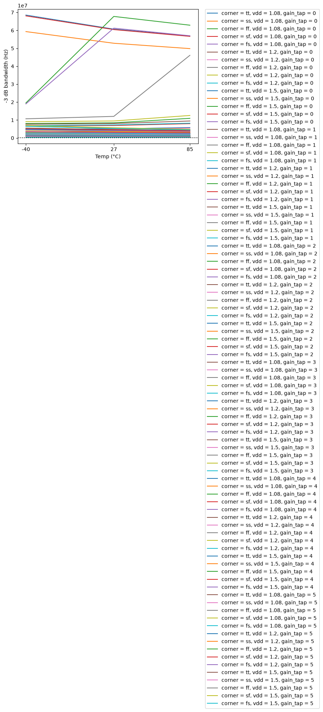

## ac_gain_A_CL_vs_vdd

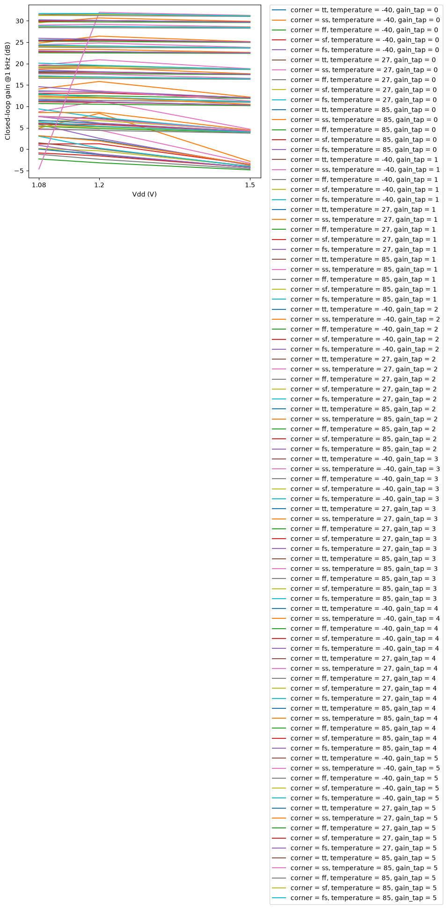

## dc_op_VOS_vs_temperature

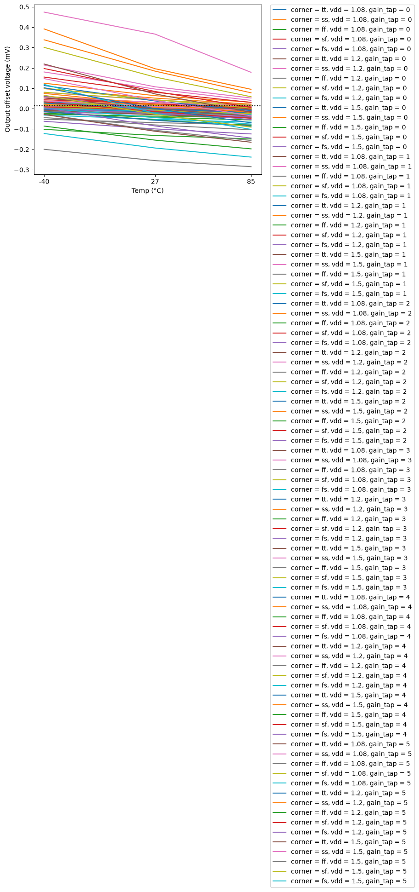

## dc_op_PWR_vs_temperature

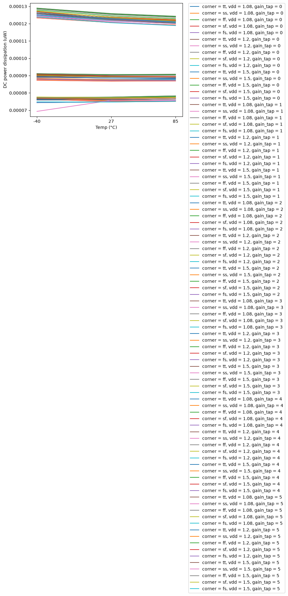

## dc_op_IQ_vs_vdd

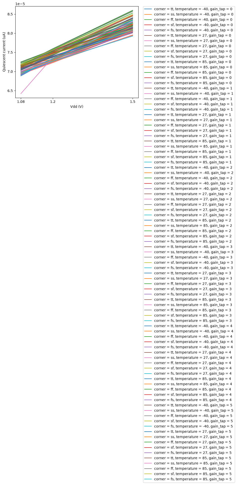

## noise_IRN_1K_vs_temperature

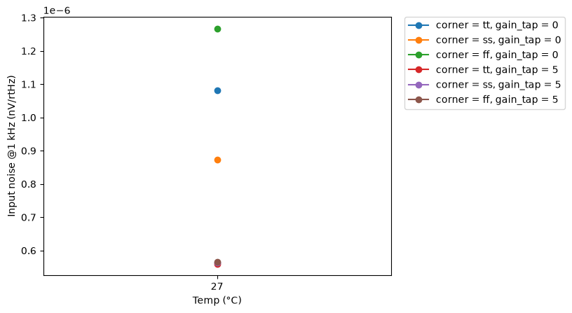

## noise_ONOISE_TOT_vs_temperature

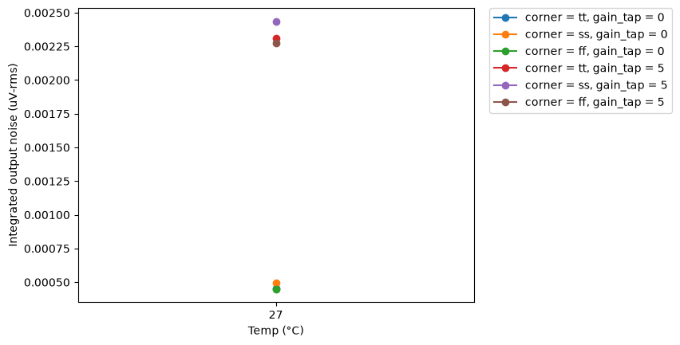

## tran_small_OVERSHOOT_vs_temperature

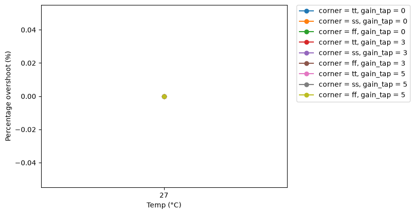

## tran_small_SETTLING_TIME_vs_temperature

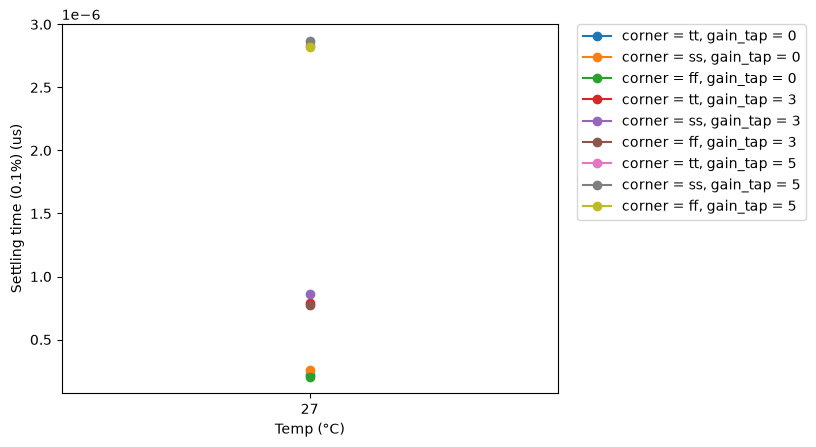

## tran_large_SR_POS_vs_temperature

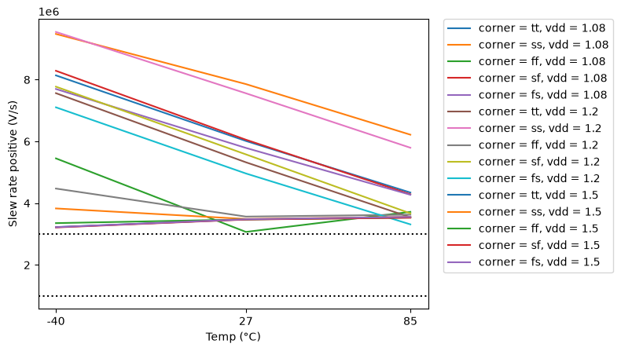

## tran_large_SR_NEG_vs_temperature

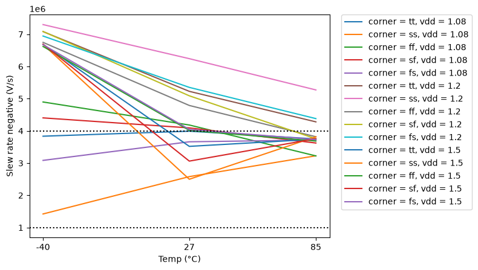

## thd_THD_PCT_vs_temperature

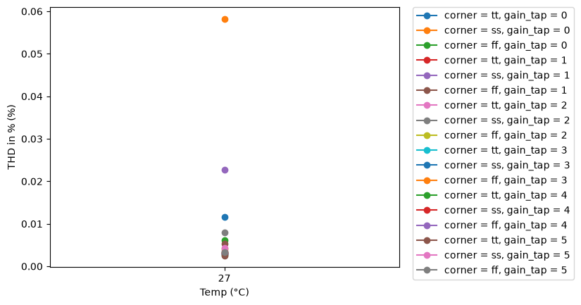

## thd_THD_DB_vs_temperature

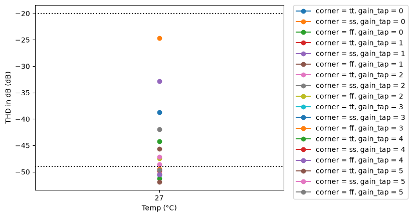

## psrr_PSRR_DC_vs_temperature

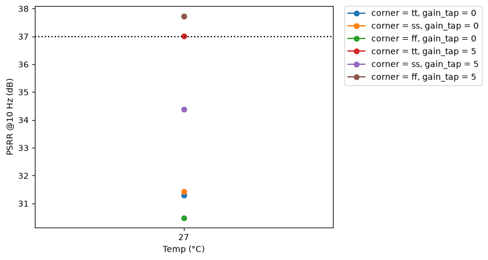

## psrr_PSRR_100K_vs_temperature

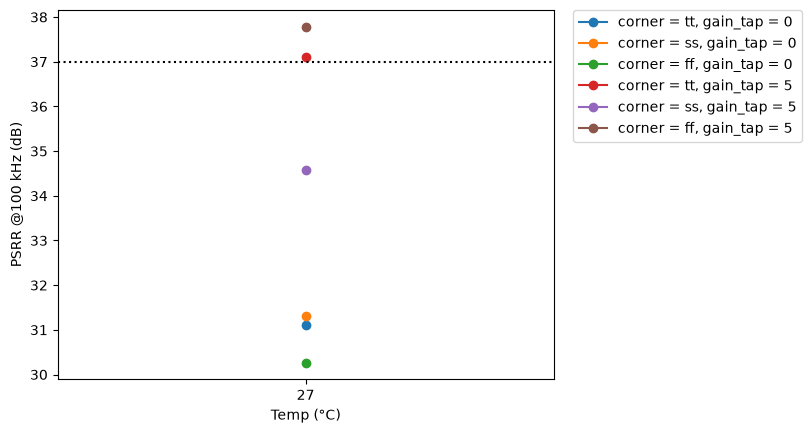

## cmrr_CMRR_DC_vs_temperature

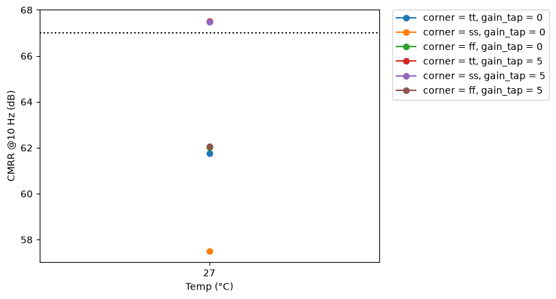

## cmrr_CMRR_100K_vs_temperature

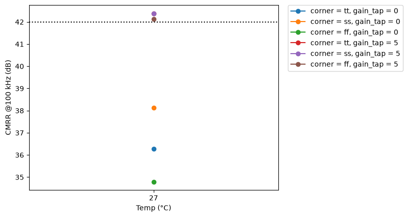

## tran_switch_V_GLITCH_MAX_vs_temperature

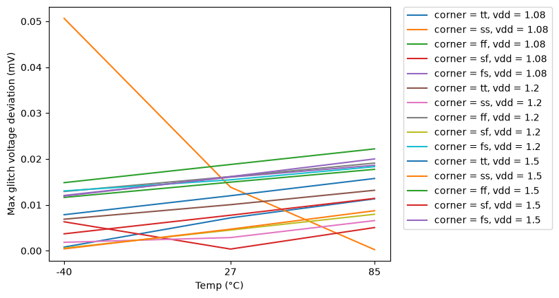

## tran_switch_T_SWITCH_SETTLE_vs_temperature

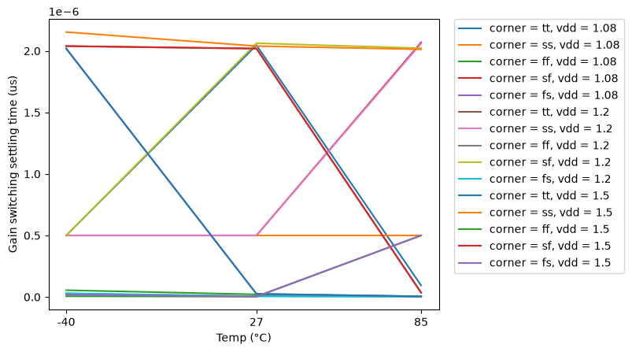
