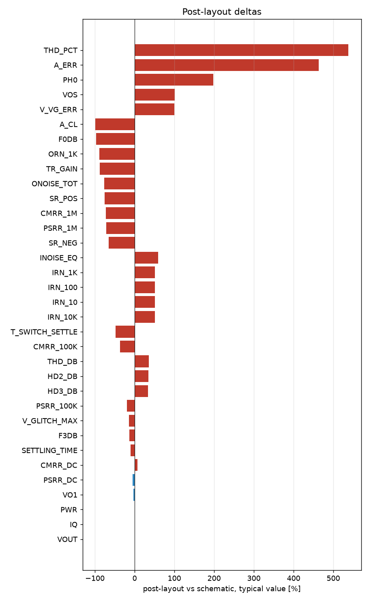

# Schematic vs post-layout

* schematic run: `/foss/designs/sg13cmos5l_spma_ip__instramp/runs/RUN_2026-11-05_17-34-32` (netlist source: schematic)
* post-layout run: `/foss/designs/sg13cmos5l_spma_ip__instramp/runs/pex_cace/gain_network/RUN_2026-11-05_17-36-49` (netlist source: pex)
* flag threshold: 5 % on the typical value; units as in the CACE summary

| Parameter | Var | Unit | Schematic min / typ / max | Post-layout min / typ / max | Δ typ | Δ typ % | Status | Flag |
|---|---|---|---|---|---:|---:|---|---|
| Closed-loop gain @1 kHz | A_CL | dB | -4.204 / 15.967 / 30.684 | 0.149 / 0.149 / 0.149 | -15.82 | -99.07 | Pass → Pass | Δ |
| Gain error vs target | A_ERR | dB | -32.114 / -0.041 / 7.307 | 0.149 / 0.149 / 0.149 | +0.19 | +463.41 | Pass → Pass | Δ |
| -3 dB bandwidth | F3DB | Hz | 2.5724e+05 / 1.9258e+06 / 1.7383e+07 | 1.6762e+06 / 1.6762e+06 / 1.6762e+06 | -2.496e+05 | -12.96 | Pass → Pass | Δ |
| 0 dB frequency | F0DB | Hz | 1.938e+06 / 1.0838e+07 / 1e+08 | 3.058e+05 / 3.058e+05 / 3.058e+05 | -1.053e+07 | -97.18 | Pass → Pass | Δ |
| Phase @0 dB | PH0 | ° | -180 / 56.944 / 161.6 | 169.42 / 169.42 / 169.42 | +112.5 | +197.53 | Pass → Pass | Δ |
| Output offset voltage | VOS | mV | -330.33 / -2.304 / 476.59 | 0.023 / 0.023 / 0.023 | +2.327 | +101.00 | Pass → Pass | Δ |
| Virtual ground error | V_VG_ERR | mV | -10.412 / -0.68 / 19.354 | 0 / 0 / 0 | +0.68 | +100.00 | Pass → Pass | Δ |
| Quiescent current | IQ | uA | 60.534 / 73.836 / 87.544 | 74.436 / 74.436 / 74.436 | +0.6 | +0.81 | Pass → Pass |  |
| DC power dissipation | PWR | uW | 65.376 / 88.599 / 131.31 | 89.323 / 89.323 / 89.323 | +0.724 | +0.82 | Pass → Pass |  |
| DC output voltage | VOUT | V | 0.27 / 0.598 / 1.077 | 0.6 / 0.6 / 0.6 | +0.002 | +0.33 | Pass → Pass |  |
| Input noise @10 Hz | IRN_10 | nV/rtHz | 5575.6 / 7108.4 / 12510 | 10719 / 10719 / 10719 | +3610 | +50.79 | Pass → Pass | Δ |
| Input noise @100 Hz | IRN_100 | nV/rtHz | 1764 / 2248.9 / 3957.8 | 3391.1 / 3391.1 / 3391.1 | +1142 | +50.79 | Pass → Pass | Δ |
| Input noise @1 kHz | IRN_1K | nV/rtHz | 560.45 / 714.32 / 1257.3 | 1077.2 / 1077.2 / 1077.2 | +362.9 | +50.80 | Pass → Pass | Δ |
| Input noise @10 kHz | IRN_10K | nV/rtHz | 185.33 / 235.85 / 415.4 | 355.58 / 355.58 / 355.58 | +119.7 | +50.77 | Pass → Pass | Δ |
| Output noise @1 kHz | ORN_1K | nV/rtHz | 973.81 / 9513.9 / 18908 | 1095.8 / 1095.8 / 1095.8 | -8418 | -88.48 | Pass → Pass | Δ |
| Integrated output noise | ONOISE_TOT | uV-rms | 583.18 / 1477.1 / 2457 | 351.35 / 351.35 / 351.35 | -1126 | -76.21 | Pass → Pass | Δ |
| In-band input noise | INOISE_EQ | uV-rms | 73.532 / 216.74 / 752.98 | 345.39 / 345.39 / 345.39 | +128.7 | +59.36 | Pass → Pass | Δ |
| Transient step gain | TR_GAIN |  | 0.77379 / 8.4905 / 32.896 | 1.0114 / 1.0114 / 1.0114 | -7.479 | -88.09 | Pass → Pass | Δ |
| Percentage overshoot | OVERSHOOT | % | 0 / 0 / 9.951 | 0 / 0 / 0 | +0 | n/a | Pass → Pass |  |
| Settling time (0.1%) | SETTLING_TIME | us | 0.085 / 0.75 / 2.769 | 0.674 / 0.674 / 0.674 | -0.076 | -10.13 | Pass → Pass | Δ |
| Slew rate positive | SR_POS | V/s | 3.2e+06 / 5.67e+06 / 1.0395e+07 | 1.401e+06 / 1.401e+06 / 1.401e+06 | -4.269e+06 | -75.29 | Pass → Pass | Δ |
| Slew rate negative | SR_NEG | V/s | 1.6254e+06 / 4.0642e+06 / 7.5982e+06 | 1.3981e+06 / 1.3981e+06 / 1.3981e+06 | -2.666e+06 | -65.60 | Pass → Pass | Δ |
| THD in dB | THD_DB | dB | -55.325 / -46.288 / -22.21 | -29.94 / -29.94 / -29.94 | +16.35 | +35.32 | Pass → Pass | Δ |
| THD in % | THD_PCT | % | 0.171 / 0.499 / 7.753 | 3.184 / 3.184 / 3.184 | +2.685 | +538.08 | Pass → Pass | Δ |
| 2nd harmonic | HD2_DB | dB | -57.57 / -46.588 / -27.479 | -30.328 / -30.328 / -30.328 | +16.26 | +34.90 | Pass → Pass | Δ |
| 3rd harmonic | HD3_DB | dB | -78.02 / -62.654 / -24.493 | -41.598 / -41.598 / -41.598 | +21.06 | +33.61 | Pass → Pass | Δ |
| Fundamental output amplitude | VO1 | V | 0.155 / 0.206 / 0.282 | 0.199 / 0.199 / 0.199 | -0.007 | -3.40 | Pass → Pass |  |
| PSRR @10 Hz | PSRR_DC | dB | 30.646 / 32.952 / 37.88 | 31.323 / 31.323 / 31.323 | -1.629 | -4.94 | Pass → Pass |  |
| PSRR @100 kHz | PSRR_100K | dB | 30.49 / 33.041 / 38.052 | 26.565 / 26.565 / 26.565 | -6.476 | -19.60 | Pass → Pass | Δ |
| PSRR @1 MHz | PSRR_1M | dB | 23.905 / 33.977 / 41.554 | 9.706 / 9.706 / 9.706 | -24.27 | -71.43 | Pass → Pass | Δ |
| CMRR @10 Hz | CMRR_DC | dB | 34.063 / 58.607 / 67.565 | 62.726 / 62.726 / 62.726 | +4.119 | +7.03 | Fail → Pass | Δ |
| CMRR @100 kHz | CMRR_100K | dB | 33.019 / 40.514 / 44.17 | 25.706 / 25.706 / 25.706 | -14.81 | -36.55 | Pass → Pass | Δ |
| CMRR @1 MHz | CMRR_1M | dB | 15.64 / 25.909 / 32.954 | 7.108 / 7.108 / 7.108 | -18.8 | -72.57 | Pass → Pass | Δ |
| Max glitch voltage deviation | V_GLITCH_MAX | mV | 0.086 / 11.831 / 51.714 | 10.181 / 10.181 / 10.181 | -1.65 | -13.95 | Pass → Pass | Δ |
| Gain switching settling time | T_SWITCH_SETTLE | us | 0.001 / 0.5 / 2.112 | 0.259 / 0.259 / 0.259 | -0.241 | -48.20 | Pass → Pass | Δ |

29 row(s) flagged.

