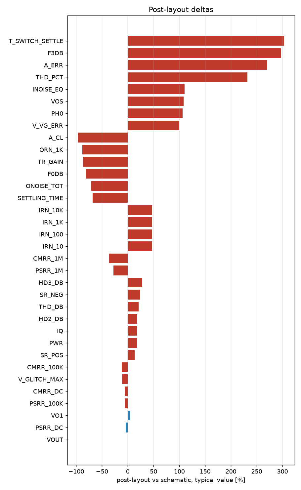

# Schematic vs post-layout

* schematic run: `/foss/designs/sg13cmos5l_spma_ip__instramp/runs/RUN_2026-10-22_12-19-21` (netlist source: schematic)
* post-layout run: `/foss/designs/sg13cmos5l_spma_ip__instramp/runs/pex_cace_rc/gain_network/RUN_2026-10-22_12-23-58` (netlist source: pex)
* flag threshold: 5 % on the typical value; units as in the CACE summary

| Parameter | Var | Unit | Schematic min / typ / max | Post-layout min / typ / max | Δ typ | Δ typ % | Status | Flag |
|---|---|---|---|---|---:|---:|---|---|
| Closed-loop gain @1 kHz | A_CL | dB | -4.828 / 15.219 / 31.985 | 0.445 / 0.445 / 0.445 | -14.77 | -97.08 | Pass → Pass | Δ |
| Gain error vs target | A_ERR | dB | -34.729 / -0.261 / 8.377 | 0.445 / 0.445 / 0.445 | +0.706 | +270.50 | Pass → Pass | Δ |
| -3 dB bandwidth | F3DB | Hz | 2.5333e+05 / 1.7007e+06 / 6.854e+07 | 6.7442e+06 / 6.7442e+06 / 6.7442e+06 | +5.044e+06 | +296.56 | Pass → Pass | Δ |
| 0 dB frequency | F0DB | Hz | 3.0889e+05 / 1.0396e+07 / 1e+08 | 1.9073e+06 / 1.9073e+06 / 1.9073e+06 | -8.488e+06 | -81.65 | Pass → Pass | Δ |
| Phase @0 dB | PH0 | ° | -180 / 71.769 / 173.84 | 148.13 / 148.13 / 148.13 | +76.36 | +106.40 | Pass → Pass | Δ |
| Output offset voltage | VOS | mV | -284.89 / -2.227 / 474.15 | 0.178 / 0.178 / 0.178 | +2.405 | +107.99 | Pass → Pass | Δ |
| Virtual ground error | V_VG_ERR | mV | -10.115 / -0.653 / 18.195 | 0 / 0 / 0 | +0.653 | +100.00 | Pass → Pass | Δ |
| Quiescent current | IQ | uA | 64.207 / 73.956 / 85.999 | 87.067 / 87.067 / 87.067 | +13.11 | +17.73 | Pass → Pass | Δ |
| DC power dissipation | PWR | uW | 69.343 / 88.747 / 129 | 104.48 / 104.48 / 104.48 | +15.73 | +17.73 | Pass → Pass | Δ |
| DC output voltage | VOUT | V | 0.315 / 0.598 / 1.074 | 0.6 / 0.6 / 0.6 | +0.002 | +0.33 | Pass → Pass |  |
| Input noise @10 Hz | IRN_10 | nV/rtHz | 5574.5 / 7162.1 / 12611 | 10544 / 10544 / 10544 | +3382 | +47.22 | Pass → Pass | Δ |
| Input noise @100 Hz | IRN_100 | nV/rtHz | 1763.6 / 2265.8 / 3989.7 | 3335.6 / 3335.6 / 3335.6 | +1070 | +47.22 | Pass → Pass | Δ |
| Input noise @1 kHz | IRN_1K | nV/rtHz | 560.07 / 719.53 / 1267.2 | 1059.3 / 1059.3 / 1059.3 | +339.8 | +47.22 | Pass → Pass | Δ |
| Input noise @10 kHz | IRN_10K | nV/rtHz | 184.46 / 236.88 / 417.82 | 348.86 / 348.86 / 348.86 | +112 | +47.27 | Pass → Pass | Δ |
| Output noise @1 kHz | ORN_1K | nV/rtHz | 966.46 / 9429.4 / 19260 | 1115 / 1115 / 1115 | -8314 | -88.18 | Pass → Pass | Δ |
| Integrated output noise | ONOISE_TOT | uV-rms | 449.4 / 1384.8 / 2436 | 407.95 / 407.95 / 407.95 | -976.8 | -70.54 | Pass → Pass | Δ |
| In-band input noise | INOISE_EQ | uV-rms | 71.302 / 184.62 / 589.25 | 387.59 / 387.59 / 387.59 | +203 | +109.93 | Pass → Pass | Δ |
| Transient step gain | TR_GAIN |  | 0.76511 / 8.0136 / 33.223 | 1.0549 / 1.0549 / 1.0549 | -6.959 | -86.84 | Pass → Pass | Δ |
| Percentage overshoot | OVERSHOOT | % | 0 / 0 / 0 | 0 / 0 / 0 | +0 | n/a | Pass → Pass |  |
| Settling time (0.1%) | SETTLING_TIME | us | 0.206 / 0.792 / 2.87 | 0.254 / 0.254 / 0.254 | -0.538 | -67.93 | Pass → Pass | Δ |
| Slew rate positive | SR_POS | V/s | 3.0692e+06 / 4.2712e+06 / 9.5443e+06 | 4.8428e+06 / 4.8428e+06 / 4.8428e+06 | +5.717e+05 | +13.38 | Pass → Pass | Δ |
| Slew rate negative | SR_NEG | V/s | 1.4213e+06 / 4.0447e+06 / 7.2991e+06 | 4.9896e+06 / 4.9896e+06 / 4.9896e+06 | +9.449e+05 | +23.36 | Pass → Pass | Δ |
| THD in dB | THD_DB | dB | -51.884 / -49.037 / -24.696 | -38.589 / -38.589 / -38.589 | +10.45 | +21.31 | Pass → Pass | Δ |
| THD in % | THD_PCT | % | 0.255 / 0.354 / 5.824 | 1.176 / 1.176 / 1.176 | +0.822 | +232.20 | Pass → Pass | Δ |
| 2nd harmonic | HD2_DB | dB | -57.701 / -50.1 / -35.073 | -41.213 / -41.213 / -41.213 | +8.887 | +17.74 | Pass → Pass | Δ |
| 3rd harmonic | HD3_DB | dB | -82.708 / -58.256 / -25.459 | -42.412 / -42.412 / -42.412 | +15.84 | +27.20 | Pass → Pass | Δ |
| Fundamental output amplitude | VO1 | V | 0.157 / 0.2 / 0.263 | 0.209 / 0.209 / 0.209 | +0.009 | +4.50 | Pass → Pass |  |
| PSRR @10 Hz | PSRR_DC | dB | 30.485 / 32.91 / 37.733 | 31.557 / 31.557 / 31.557 | -1.353 | -4.11 | Pass → Pass |  |
| PSRR @100 kHz | PSRR_100K | dB | 30.264 / 32.943 / 37.784 | 31.293 / 31.293 / 31.293 | -1.65 | -5.01 | Pass → Pass | Δ |
| PSRR @1 MHz | PSRR_1M | dB | 22.548 / 31.695 / 38.484 | 22.82 / 22.82 / 22.82 | -8.875 | -28.00 | Pass → Pass | Δ |
| CMRR @10 Hz | CMRR_DC | dB | 57.512 / 62.055 / 67.517 | 58.901 / 58.901 / 58.901 | -3.154 | -5.08 | Pass → Pass | Δ |
| CMRR @100 kHz | CMRR_100K | dB | 34.791 / 40.133 / 42.384 | 35.484 / 35.484 / 35.484 | -4.649 | -11.58 | Pass → Pass | Δ |
| CMRR @1 MHz | CMRR_1M | dB | 14.886 / 24.497 / 31.372 | 15.654 / 15.654 / 15.654 | -8.843 | -36.10 | Pass → Pass | Δ |
| Max glitch voltage deviation | V_GLITCH_MAX | mV | 0.248 / 11.622 / 50.638 | 10.334 / 10.334 / 10.334 | -1.288 | -11.08 | Pass → Pass | Δ |
| Gain switching settling time | T_SWITCH_SETTLE | us | 0.003 / 0.5 / 2.153 | 2.017 / 2.017 / 2.017 | +1.517 | +303.40 | Pass → Pass | Δ |

31 row(s) flagged.

