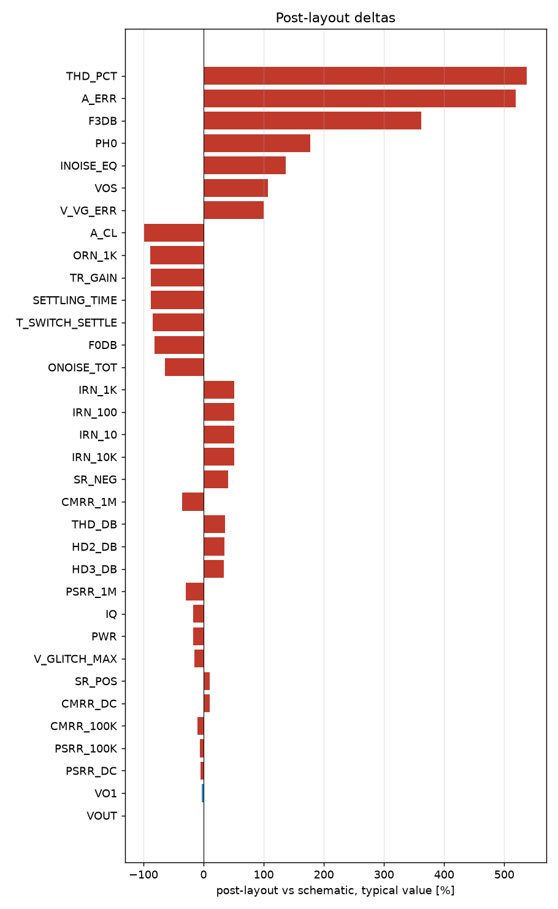

# Schematic vs post-layout

* schematic run: `/foss/designs/sg13cmos5l_spma_ip__instramp/runs/RUN_2026-11-05_17-34-32` (netlist source: schematic)
* post-layout run: `/foss/designs/sg13cmos5l_spma_ip__instramp/runs/pex_cace_rc/gain_network/RUN_2026-11-05_17-37-04` (netlist source: pex)
* flag threshold: 5 % on the typical value; units as in the CACE summary

| Parameter | Var | Unit | Schematic min / typ / max | Post-layout min / typ / max | Δ typ | Δ typ % | Status | Flag |
|---|---|---|---|---|---:|---:|---|---|
| Closed-loop gain @1 kHz | A_CL | dB | -4.204 / 15.967 / 30.684 | 0.172 / 0.172 / 0.172 | -15.79 | -98.92 | Pass → Pass | Δ |
| Gain error vs target | A_ERR | dB | -32.114 / -0.041 / 7.307 | 0.172 / 0.172 / 0.172 | +0.213 | +519.51 | Pass → Pass | Δ |
| -3 dB bandwidth | F3DB | Hz | 2.5724e+05 / 1.9258e+06 / 1.7383e+07 | 8.9024e+06 / 8.9024e+06 / 8.9024e+06 | +6.977e+06 | +362.26 | Pass → Pass | Δ |
| 0 dB frequency | F0DB | Hz | 1.938e+06 / 1.0838e+07 / 1e+08 | 2.0581e+06 / 2.0581e+06 / 2.0581e+06 | -8.779e+06 | -81.01 | Pass → Pass | Δ |
| Phase @0 dB | PH0 | ° | -180 / 56.944 / 161.6 | 157.95 / 157.95 / 157.95 | +101 | +177.38 | Pass → Pass | Δ |
| Output offset voltage | VOS | mV | -330.33 / -2.304 / 476.59 | 0.172 / 0.172 / 0.172 | +2.476 | +107.47 | Pass → Pass | Δ |
| Virtual ground error | V_VG_ERR | mV | -10.412 / -0.68 / 19.354 | 0 / 0 / 0 | +0.68 | +100.00 | Pass → Pass | Δ |
| Quiescent current | IQ | uA | 60.534 / 73.836 / 87.544 | 61.21 / 61.21 / 61.21 | -12.63 | -17.10 | Pass → Pass | Δ |
| DC power dissipation | PWR | uW | 65.376 / 88.599 / 131.31 | 73.452 / 73.452 / 73.452 | -15.15 | -17.10 | Pass → Pass | Δ |
| DC output voltage | VOUT | V | 0.27 / 0.598 / 1.077 | 0.6 / 0.6 / 0.6 | +0.002 | +0.33 | Pass → Pass |  |
| Input noise @10 Hz | IRN_10 | nV/rtHz | 5575.6 / 7108.4 / 12510 | 10713 / 10713 / 10713 | +3604 | +50.71 | Pass → Pass | Δ |
| Input noise @100 Hz | IRN_100 | nV/rtHz | 1764 / 2248.9 / 3957.8 | 3389.2 / 3389.2 / 3389.2 | +1140 | +50.71 | Pass → Pass | Δ |
| Input noise @1 kHz | IRN_1K | nV/rtHz | 560.45 / 714.32 / 1257.3 | 1076.6 / 1076.6 / 1076.6 | +362.3 | +50.72 | Pass → Pass | Δ |
| Input noise @10 kHz | IRN_10K | nV/rtHz | 185.33 / 235.85 / 415.4 | 355.4 / 355.4 / 355.4 | +119.6 | +50.69 | Pass → Pass | Δ |
| Output noise @1 kHz | ORN_1K | nV/rtHz | 973.81 / 9513.9 / 18908 | 1098.2 / 1098.2 / 1098.2 | -8416 | -88.46 | Pass → Pass | Δ |
| Integrated output noise | ONOISE_TOT | uV-rms | 583.18 / 1477.1 / 2457 | 523.62 / 523.62 / 523.62 | -953.5 | -64.55 | Pass → Pass | Δ |
| In-band input noise | INOISE_EQ | uV-rms | 73.532 / 216.74 / 752.98 | 513.33 / 513.33 / 513.33 | +296.6 | +136.84 | Pass → Pass | Δ |
| Transient step gain | TR_GAIN |  | 0.77379 / 8.4905 / 32.896 | 1.0158 / 1.0158 / 1.0158 | -7.475 | -88.04 | Pass → Pass | Δ |
| Percentage overshoot | OVERSHOOT | % | 0 / 0 / 9.951 | 18.311 / 18.311 / 18.311 | +18.31 | n/a | Pass → Pass |  |
| Settling time (0.1%) | SETTLING_TIME | us | 0.085 / 0.75 / 2.769 | 0.096 / 0.096 / 0.096 | -0.654 | -87.20 | Pass → Pass | Δ |
| Slew rate positive | SR_POS | V/s | 3.2e+06 / 5.67e+06 / 1.0395e+07 | 6.28e+06 / 6.28e+06 / 6.28e+06 | +6.1e+05 | +10.76 | Pass → Pass | Δ |
| Slew rate negative | SR_NEG | V/s | 1.6254e+06 / 4.0642e+06 / 7.5982e+06 | 5.7084e+06 / 5.7084e+06 / 5.7084e+06 | +1.644e+06 | +40.45 | Pass → Pass | Δ |
| THD in dB | THD_DB | dB | -55.325 / -46.288 / -22.21 | -29.945 / -29.945 / -29.945 | +16.34 | +35.31 | Pass → Pass | Δ |
| THD in % | THD_PCT | % | 0.171 / 0.499 / 7.753 | 3.182 / 3.182 / 3.182 | +2.683 | +537.68 | Pass → Pass | Δ |
| 2nd harmonic | HD2_DB | dB | -57.57 / -46.588 / -27.479 | -30.329 / -30.329 / -30.329 | +16.26 | +34.90 | Pass → Pass | Δ |
| 3rd harmonic | HD3_DB | dB | -78.02 / -62.654 / -24.493 | -41.653 / -41.653 / -41.653 | +21 | +33.52 | Pass → Pass | Δ |
| Fundamental output amplitude | VO1 | V | 0.155 / 0.206 / 0.282 | 0.2 / 0.2 / 0.2 | -0.006 | -2.91 | Pass → Pass |  |
| PSRR @10 Hz | PSRR_DC | dB | 30.646 / 32.952 / 37.88 | 31.298 / 31.298 / 31.298 | -1.654 | -5.02 | Pass → Pass | Δ |
| PSRR @100 kHz | PSRR_100K | dB | 30.49 / 33.041 / 38.052 | 31.128 / 31.128 / 31.128 | -1.913 | -5.79 | Pass → Pass | Δ |
| PSRR @1 MHz | PSRR_1M | dB | 23.905 / 33.977 / 41.554 | 24.058 / 24.058 / 24.058 | -9.919 | -29.19 | Pass → Pass | Δ |
| CMRR @10 Hz | CMRR_DC | dB | 34.063 / 58.607 / 67.565 | 64.582 / 64.582 / 64.582 | +5.975 | +10.20 | Fail → Pass | Δ |
| CMRR @100 kHz | CMRR_100K | dB | 33.019 / 40.514 / 44.17 | 36.625 / 36.625 / 36.625 | -3.889 | -9.60 | Pass → Pass | Δ |
| CMRR @1 MHz | CMRR_1M | dB | 15.64 / 25.909 / 32.954 | 16.652 / 16.652 / 16.652 | -9.257 | -35.73 | Pass → Pass | Δ |
| Max glitch voltage deviation | V_GLITCH_MAX | mV | 0.086 / 11.831 / 51.714 | 10.078 / 10.078 / 10.078 | -1.753 | -14.82 | Pass → Pass | Δ |
| Gain switching settling time | T_SWITCH_SETTLE | us | 0.001 / 0.5 / 2.112 | 0.078 / 0.078 / 0.078 | -0.422 | -84.40 | Pass → Pass | Δ |

32 row(s) flagged.

