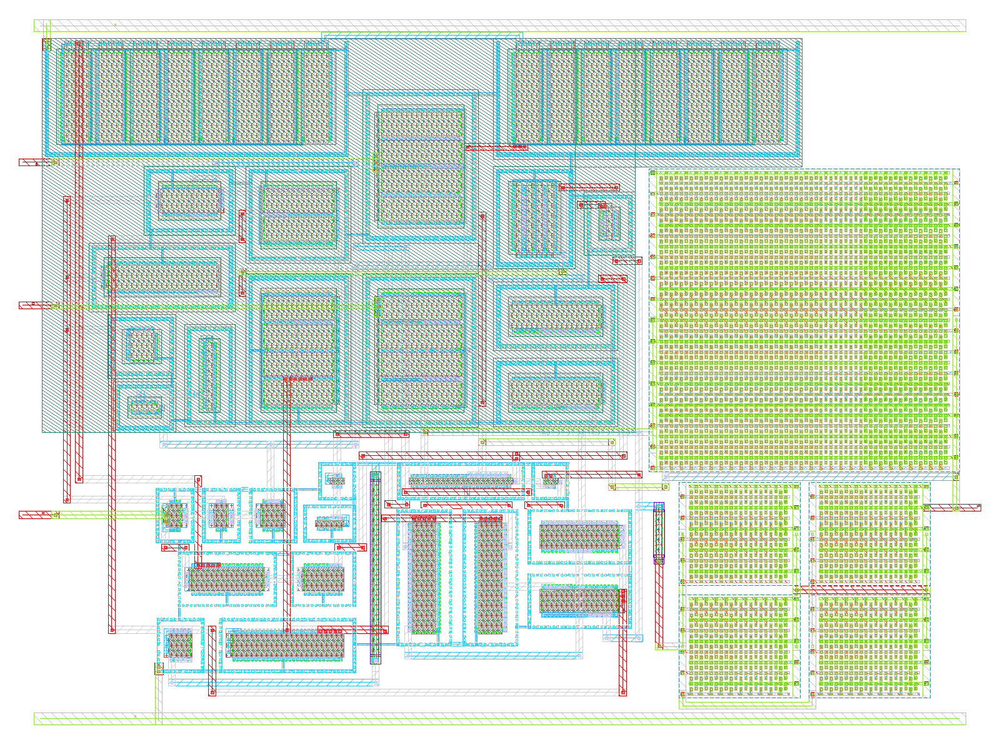
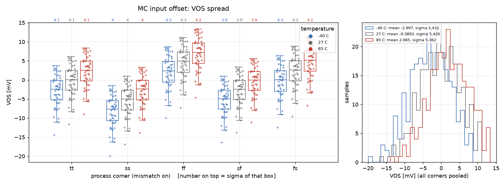
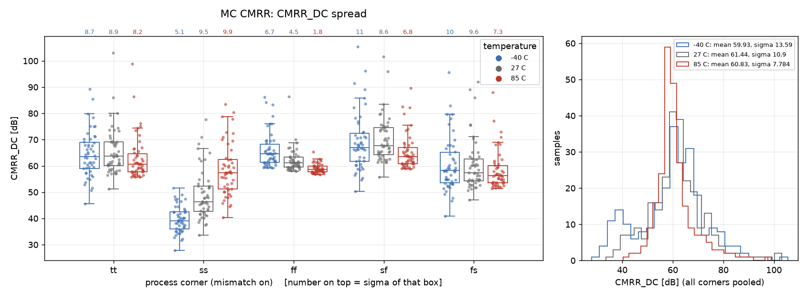
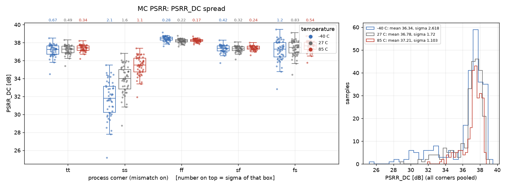

# gain_ota - CACE characterisation

- Generated: 2026-10-21 07:22 by `scripts/make_readme.py` from `runs/RUN_2026-10-21_07-18-34`
- Commit: `2bf6127` (working tree dirty)
- Netlist source: schematic; datasheet: `cace/gain_ota.yaml`; reproduce with `scripts/run_cace.sh gain_ota`
- Sections marked *(CACE)* are written by CACE itself, the rest by this script (CACE has no per-corner MC statistics, worst-case conditions or unit-scaled spread plots).

## Design *(CACE)*

- Description: PMOS-input folded-cascode common-source AB two-stage OTA
- PDK: ihp-sg13cmos5l

### Authorship

- Designer: SPMA
- Created: October 9, 2026
- License: MIT
- Company: None
- Last modified: None

### Pins

- VDD
  + Description: Positive analog power supply
  + Type: power
  + Direction: inout
  + Vmin: 1.08
  + Vmax: 1.5
- VSS
  + Description: Analog ground
  + Type: ground
  + Direction: inout
- I_bias
  + Description: Bias current input
  + Type: signal
  + Direction: input
- V_inp
  + Description: Non-inverting input
  + Type: signal
  + Direction: input
- V_inn
  + Description: Inverting input
  + Type: signal
  + Direction: input
- V_out
  + Description: Output
  + Type: signal
  + Direction: output

### Default Conditions

- vdd
  + Description: Analog power supply voltage
  + Display: Vdd
  + Unit: V
  + Typical: 1.2
- vcm
  + Description: Input common mode voltage
  + Display: Vcm
  + Unit: V
  + Typical: 0.6
- ib
  + Description: Bias current
  + Display: Ib
  + Unit: uA
  + Typical: 1
- cl
  + Description: Output load capacitance
  + Display: CLoad
  + Unit: pF
  + Typical: 2
- corner
  + Description: Process corner
  + Display: Corner
  + Typical: tt
- rcorner
  + Description: Resistor corner (res_<rcorner> section of cornerRES.lib)
  + Display: Rcorner
  + Typical: typ
- temperature
  + Description: Ambient temperature
  + Display: Temp
  + Unit: °C
  + Typical: 27

### Symbol

### Schematic

### Layout

**Physical size** (bounding box of `gain_ota`; generated by `scripts/update_images.py`)

| Width W | Length L | Area |
|---|---|---|
| 81.00 µm | 59.41 µm | 4812 µm² |

## Results summary *(CACE)*

min / typ / max over all conditions of a parameter; Monte Carlo parameters (`mc_*`) are min/max over all samples.

**netlist source**: schematic

|      Parameter       |         Tool         |     Result      | Min Limit  |  Min Value   | Typ Target |  Typ Value   | Max Limit  |  Max Value   |  Status  |
| :------------------- | :------------------- | :-------------- | ---------: | -----------: | ---------: | -----------: | ---------: | -----------: | :------: |
| DC gain              | ngspice              | A0                   |             any |  58.131 dB |          any |  62.342 dB |          any |  66.472 dB |   Pass ✅    |
| -3 dB frequency      | ngspice              | F3DB                 |             any | 8311.370 Hz |          any | 9143.140 Hz |          any | 11318.700 Hz |   Pass ✅    |
| Unity-gain frequency | ngspice              | UGF                  |             any | 6549840.000 Hz |          any | 12084600.000 Hz |          any | 17688000.000 Hz |   Pass ✅    |
| Phase margin         | ngspice              | PM                   |             any |   63.173 ° |          any |   67.529 ° |          any |   73.400 ° |   Pass ✅    |
| Gain margin          | ngspice              | GM                   |             any |   6.277 dB |          any |   8.385 dB |          any |  15.645 dB |   Pass ✅    |
| Gain-bandwidth product | ngspice              | GBW                  |             any | 6810030.000 Hz |          any | 11907500.000 Hz |          any | 17508700.000 Hz |   Pass ✅    |
| Input noise @100 Hz  | ngspice              | IRN_100              |             any | 1382.630 nV/rtHz |          any | 1788.010 nV/rtHz |          any | 2598.510 nV/rtHz |   Pass ✅    |
| Input noise @1 kHz   | ngspice              | IRN_1K               |             any | 438.758 nV/rtHz |          any | 567.917 nV/rtHz |          any | 824.344 nV/rtHz |   Pass ✅    |
| Input noise @10 kHz  | ngspice              | IRN_10K              |             any | 143.500 nV/rtHz |          any | 187.312 nV/rtHz |          any | 268.839 nV/rtHz |   Pass ✅    |
| Input noise @1 MHz   | ngspice              | IRN_1M               |             any | 41.584 nV/rtHz |          any | 57.856 nV/rtHz |          any | 80.047 nV/rtHz |   Pass ✅    |
| Output noise @1 kHz  | ngspice              | ORN_1K               |             any | 438.544 nV/rtHz |          any | 566.488 nV/rtHz |          any | 1043.020 nV/rtHz |   Pass ✅    |
| Integrated input noise | ngspice              | INOISE_TOT           |             any | 890.803 uV-rms |          any | 1247.690 uV-rms |          any | 1500.700 uV-rms |   Pass ✅    |
| Integrated output noise | ngspice              | ONOISE_TOT           |             any | 480.243 uV-rms |          any | 568.994 uV-rms |          any | 623.705 uV-rms |   Pass ✅    |
| Input offset voltage | ngspice              | VOS                  |             any | -19.087 mV |          any |   0.690 mV |          any |  10.456 mV |   Pass ✅    |
| Quiescent current    | ngspice              | IQ                   |             any |  63.309 uA |          any |  73.951 uA |          any |  87.729 uA |   Pass ✅    |
| Quiescent power      | ngspice              | PWR                  |             any |  68.374 uW |          any |  88.611 uW |          any | 131.593 uW |   Pass ✅    |
| Output voltage       | ngspice              | VOUT                 |             any |    0.590 V |          any |    0.599 V |          any |    0.619 V |   Pass ✅    |
| Gain error (1 - dVout/dVin) | ngspice              | GAIN_ERR             |             any | -383.867 % |          any |    0.046 % |          any |    0.642 % |   Pass ✅    |
| Maximum DC gain      | ngspice              | MAX_GAIN_DB          |             any |  59.010 dB |          any |  62.722 dB |          any |  67.007 dB |   Pass ✅    |
| Gain tempco (ppm per °C) | ngspice              | GAIN_TC              |             any |  1.845 ppm |          any | 14.091 ppm |          any | 23281.900 ppm |   Pass ✅    |
| Mean follower gain   | ngspice              | G_MEAN               |             any |  0.998 V/V |          any |  0.999 V/V |          any |  1.307 V/V |   Pass ✅    |
| CMRR @10 Hz          | ngspice              | CMRR_DC              |             any |  11.526 dB |          any |  62.232 dB |          any |  94.558 dB |   Pass ✅    |
| CMRR @100 kHz        | ngspice              | CMRR_100K            |             any |  11.510 dB |          any |  41.058 dB |          any |  44.880 dB |   Pass ✅    |
| CMRR @1 MHz          | ngspice              | CMRR_1M              |             any |  10.138 dB |          any |  21.497 dB |          any |  24.895 dB |   Pass ✅    |
| PSRR @10 Hz          | ngspice              | PSRR_DC              |             any |  10.484 dB |          any |  37.459 dB |          any |  40.627 dB |   Pass ✅    |
| PSRR @100 kHz        | ngspice              | PSRR_100K            |             any |  10.482 dB |          any |  37.225 dB |          any |  40.359 dB |   Pass ✅    |
| PSRR @1 MHz          | ngspice              | PSRR_1M              |             any |  10.216 dB |          any |  29.362 dB |          any |  32.353 dB |   Pass ✅    |
| Lower ICMR bound     | ngspice              | ICMR_MIN             |             any |    0.010 V |          any |    0.035 V |          any |    0.056 V |   Pass ✅    |
| Upper ICMR bound     | ngspice              | ICMR_MAX             |             any |    0.657 V |          any |    0.869 V |          any |    1.200 V |   Pass ✅    |
| ICMR span            | ngspice              | ICMR_SPAN            |             any |    0.629 V |          any |    0.844 V |          any |    1.173 V |   Pass ✅    |
| Delay (50 %)         | ngspice              | T_DELAY              |             any |   9.182 ns |          any |  14.002 ns |          any |  18.649 ns |   Pass ✅    |
| Rise time (10-90 %)  | ngspice              | T_RISE               |             any | -549.582 ns |          any |  17.597 ns |          any |  39.418 ns |   Pass ✅    |
| Overshoot            | ngspice              | OVERSHOOT            |             any |    2.350 % |          any |  194.680 % |          any |  385.720 % |   Pass ✅    |
| Settling time 1 %    | ngspice              | TS_1PCT              |             any |  31.089 ns |          any |  45.152 ns |          any | 447.388 ns |   Pass ✅    |
| Settling time 0.1 %  | ngspice              | TS_01PCT             |             any |  32.184 ns |          any |  58.098 ns |          any | 458.726 ns |   Pass ✅    |
| Positive slew rate   | ngspice              | SR_POS               |             any | 483943.000 V/s |          any | 6659170.000 V/s |          any | 11769400.000 V/s |   Pass ✅    |
| Negative slew rate   | ngspice              | SR_NEG               |             any | 8821750.000 V/s |          any | 10794500.000 V/s |          any | 13157500.000 V/s |   Pass ✅    |
| Rise time (10-90 %)  | ngspice              | T_RISE               |             any |  40.784 ns |          any |  72.081 ns |          any | 991.852 ns |   Pass ✅    |
| Fall time (90-10 %)  | ngspice              | T_FALL               |             any |  36.481 ns |          any |  44.467 ns |          any |  54.411 ns |   Pass ✅    |
| Propagation delay tpLH | ngspice              | T_PLH                |             any |  29.198 ns |          any |  37.089 ns |          any |  44.335 ns |   Pass ✅    |
| Propagation delay tpHL | ngspice              | T_PHL                |             any |  22.278 ns |          any |  28.792 ns |          any |  72.384 ns |   Pass ✅    |
| Input offset voltage | ngspice              | VOS                  |             any | -19.923 mV |          any |  -0.278 mV |          any |  13.369 mV |   Pass ✅    |
| CMRR @10 Hz          | ngspice              | CMRR_DC              |             any |  27.842 dB |          any |  60.399 dB |          any | 105.499 dB |   Pass ✅    |
| PSRR @10 Hz          | ngspice              | PSRR_DC              |             any |  25.190 dB |          any |  37.371 dB |          any |  39.496 dB |   Pass ✅    |

### Plots *(CACE)*

#### ac_response_A0_vs_temperature

#### ac_response_UGF_vs_temperature

#### ac_response_PM_vs_temperature

#### ac_response_PM_vs_vdd

#### icmr_ICMR_SPAN_vs_vdd

## PVT worst-case conditions

Corners tt/ss/ff/sf/fs, supply and temperature as in the yaml. Values in the display unit of the yaml.

### ac_response - AC response (Tian loop gain)

45 runs.

| metric | min | at (corner, vdd, T) | max | at (corner, vdd, T) | spec | fails |
|---|---|---|---|---|---|---|
| A0 [dB] | 58.13 | ss, 1.08 V, -40 C | 66.47 | ss, 1.5 V, -40 C | any | - |
| F3DB [Hz] | 8311 | ss, 1.5 V, -40 C | 1.132e+04 | ff, 1.08 V, 85 C | any | - |
| UGF [Hz] | 6.55e+06 | ss, 1.08 V, -40 C | 1.769e+07 | ss, 1.5 V, -40 C | any | - |
| PM [°] | 63.17 | ss, 1.2 V, 85 C | 73.4 | ss, 1.08 V, -40 C | any | - |
| GM [dB] | 6.277 | sf, 1.5 V, -40 C | 15.64 | ss, 1.08 V, -40 C | any | - |
| GBW [Hz] | 6.81e+06 | ss, 1.08 V, -40 C | 1.751e+07 | ss, 1.5 V, -40 C | any | - |

### noise - Noise

45 runs.

| metric | min | at (corner, vdd, T) | max | at (corner, vdd, T) | spec | fails |
|---|---|---|---|---|---|---|
| IRN_100 [nV/rtHz] | 1383 | sf, 1.5 V, -40 C | 2599 | ss, 1.08 V, -40 C | any | - |
| IRN_1K [nV/rtHz] | 438.8 | sf, 1.5 V, -40 C | 824.3 | ss, 1.08 V, -40 C | any | - |
| IRN_10K [nV/rtHz] | 143.5 | sf, 1.5 V, -40 C | 268.8 | ss, 1.08 V, -40 C | any | - |
| IRN_1M [nV/rtHz] | 41.58 | ss, 1.5 V, -40 C | 80.05 | ss, 1.08 V, 85 C | any | - |
| ORN_1K [nV/rtHz] | 438.5 | sf, 1.5 V, -40 C | 1043 | ss, 1.08 V, -40 C | any | - |
| INOISE_TOT [uV-rms] | 890.8 | ss, 1.2 V, -40 C | 1501 | fs, 1.08 V, 85 C | any | - |
| ONOISE_TOT [uV-rms] | 480.2 | fs, 1.08 V, -40 C | 623.7 | sf, 1.5 V, 85 C | any | - |

### dc_op - DC operating point (follower)

45 runs.

| metric | min | at (corner, vdd, T) | max | at (corner, vdd, T) | spec | fails |
|---|---|---|---|---|---|---|
| VOS [mV] | -19.09 | ss, 1.08 V, -40 C | 10.46 | ff, 1.5 V, 85 C | any | - |
| IQ [uA] | 63.31 | ss, 1.08 V, -40 C | 87.73 | ff, 1.5 V, -40 C | any | - |
| PWR [uW] | 68.37 | ss, 1.08 V, -40 C | 131.6 | ff, 1.5 V, -40 C | any | - |
| VOUT [V] | 0.5895 | ff, 1.5 V, 85 C | 0.6191 | ss, 1.08 V, -40 C | any | - |
| GAIN_ERR [%] | -383.9 | ss, 1.08 V, -40 C | 0.6416 | fs, 1.08 V, 85 C | any | - |

### dc_swing - DC open-loop differential swing

45 runs.

| metric | min | at (corner, vdd, T) | max | at (corner, vdd, T) | spec | fails |
|---|---|---|---|---|---|---|
| MAX_GAIN_DB [dB] | 59.01 | fs, 1.08 V, 85 C | 67.01 | ss, 1.5 V, -40 C | any | - |

### gain_tc - Gain temperature coefficient

15 runs.

| metric | min | at (corner, vdd, T) | max | at (corner, vdd, T) | spec | fails |
|---|---|---|---|---|---|---|
| GAIN_TC [ppm] | 1.845 | sf, 1.5 V, 27 C | 2.328e+04 | ss, 1.08 V, 27 C | any | - |
| G_MEAN [V/V] | 0.9976 | ff, 1.08 V, 27 C | 1.307 | ss, 1.08 V, 27 C | any | - |

### cmrr - CMRR

45 runs.

| metric | min | at (corner, vdd, T) | max | at (corner, vdd, T) | spec | fails |
|---|---|---|---|---|---|---|
| CMRR_DC [dB] | 11.53 | ss, 1.08 V, -40 C | 94.56 | fs, 1.2 V, -40 C | any | - |
| CMRR_100K [dB] | 11.51 | ss, 1.08 V, -40 C | 44.88 | ss, 1.5 V, -40 C | any | - |
| CMRR_1M [dB] | 10.14 | ss, 1.08 V, -40 C | 24.9 | ss, 1.5 V, -40 C | any | - |

### psrr - PSRR

45 runs.

| metric | min | at (corner, vdd, T) | max | at (corner, vdd, T) | spec | fails |
|---|---|---|---|---|---|---|
| PSRR_DC [dB] | 10.48 | ss, 1.08 V, -40 C | 40.63 | ff, 1.5 V, -40 C | any | - |
| PSRR_100K [dB] | 10.48 | ss, 1.08 V, -40 C | 40.36 | ff, 1.5 V, -40 C | any | - |
| PSRR_1M [dB] | 10.22 | ss, 1.08 V, -40 C | 32.35 | sf, 1.5 V, -40 C | any | - |

### icmr - Input common-mode range

45 runs.

| metric | min | at (corner, vdd, T) | max | at (corner, vdd, T) | spec | fails |
|---|---|---|---|---|---|---|
| ICMR_MIN [V] | 0.009883 | ss, 1.08 V, -40 C | 0.05601 | ff, 1.5 V, 85 C | any | - |
| ICMR_MAX [V] | 0.6566 | ss, 1.08 V, -40 C | 1.2 | ss, 1.5 V, 27 C | any | - |
| ICMR_SPAN [V] | 0.6285 | fs, 1.08 V, 85 C | 1.173 | sf, 1.5 V, -40 C | any | - |

### tran_small - Small-signal step (100 mV)

45 runs.

| metric | min | at (corner, vdd, T) | max | at (corner, vdd, T) | spec | fails |
|---|---|---|---|---|---|---|
| T_DELAY [ns] | 9.182 | ss, 1.5 V, -40 C | 18.65 | fs, 1.08 V, 85 C | any | - |
| T_RISE [ns] | -549.6 | ss, 1.08 V, -40 C | 39.42 | ff, 1.5 V, 85 C | any | - |
| OVERSHOOT [%] | 2.35 | ss, 1.08 V, 27 C | 385.7 | ss, 1.2 V, 85 C | any | - |
| TS_1PCT [ns] | 31.09 | ff, 1.5 V, -40 C | 447.4 | ss, 1.08 V, -40 C | any | - |
| TS_01PCT [ns] | 32.18 | ff, 1.5 V, -40 C | 458.7 | ss, 1.08 V, -40 C | any | - |

### tran_large - Large-signal step (0.8 V)

45 runs.

| metric | min | at (corner, vdd, T) | max | at (corner, vdd, T) | spec | fails |
|---|---|---|---|---|---|---|
| SR_POS [V/s] | 4.839e+05 | ff, 1.08 V, -40 C | 1.177e+07 | ss, 1.5 V, -40 C | any | - |
| SR_NEG [V/s] | 8.822e+06 | ss, 1.08 V, 85 C | 1.316e+07 | sf, 1.5 V, -40 C | any | - |
| T_RISE [ns] | 40.78 | ss, 1.5 V, -40 C | 991.9 | ff, 1.08 V, -40 C | any | - |
| T_FALL [ns] | 36.48 | sf, 1.5 V, -40 C | 54.41 | ss, 1.08 V, 85 C | any | - |
| T_PLH [ns] | 29.2 | ss, 1.5 V, -40 C | 44.33 | fs, 1.08 V, 85 C | any | - |
| T_PHL [ns] | 22.28 | ss, 1.5 V, -40 C | 72.38 | ss, 1.2 V, -40 C | any | - |

## Monte Carlo (local mismatch)

Mismatch models only (`mos_<corner>_mismatch`, `res_typ_mismatch`; `cap_cmomi` has no characterised spread), one seed per iteration (`seed = 12345 + iteration`, **the same 50 mismatch draws are reused at every corner and temperature**, so boxes are paired comparisons and the pooled counts overstate the number of independent samples: 50, not 50 x 15). Box = interquartile range, dots = individual samples, dotted lines = spec (if any).

### mc_vos - MC input offset

Monte Carlo (local mismatch, 50 seeds x 5 corners x 3 temperatures, vdd 1.2 V)

**VOS [mV]** - 750 samples

| corner | T [C] | N | mean | sigma | min | max | mean-3sigma | mean+3sigma |
|---|---|---|---|---|---|---|---|---|
| tt | -40 | 50 | -2.916 | 4.06 | -14.42 | 3.658 | -15.1 | 9.264 |
| tt | 27 | 50 | -0.3163 | 4.077 | -11.63 | 6.115 | -12.55 | 11.92 |
| tt | 85 | 50 | 2.137 | 4.051 | -8.949 | 8.376 | -10.02 | 14.29 |
| ss | -40 | 50 | -8.22 | 4.023 | -19.92 | -1.534 | -20.29 | 3.849 |
| ss | 27 | 50 | -5.532 | 4.011 | -16.86 | 0.9639 | -17.56 | 6.501 |
| ss | 85 | 50 | -2.937 | 3.962 | -13.89 | 3.324 | -14.82 | 8.949 |
| ff | -40 | 50 | 1.979 | 4.28 | -9.962 | 8.686 | -10.86 | 14.82 |
| ff | 27 | 50 | 4.536 | 4.268 | -7.222 | 11.07 | -8.267 | 17.34 |
| ff | 85 | 50 | 6.866 | 4.21 | -4.607 | 13.37 | -5.765 | 19.5 |
| sf | -40 | 50 | -5.397 | 3.882 | -16.37 | 1.014 | -17.04 | 6.248 |
| sf | 27 | 50 | -2.887 | 3.911 | -13.75 | 3.396 | -14.62 | 8.848 |
| sf | 85 | 50 | -0.5145 | 3.896 | -11.18 | 5.597 | -12.2 | 11.17 |
| fs | -40 | 50 | -0.429 | 4.264 | -12.47 | 6.334 | -13.22 | 12.36 |
| fs | 27 | 50 | 2.252 | 4.259 | -9.602 | 8.85 | -10.53 | 15.03 |
| fs | 85 | 50 | 4.774 | 4.215 | -6.755 | 11.18 | -7.871 | 17.42 |
| **all** | | 750 | -0.4404 | 5.782 | -19.92 | 13.37 | -17.79 | 16.91 |

_pooled sigma 5.782 mV_

### mc_cmrr - MC CMRR

Monte Carlo (local mismatch, 50 seeds x 5 corners x 3 temperatures, vdd 1.2 V)

**CMRR_DC [dB]** - 750 samples

| corner | T [C] | N | mean | sigma | min | max | mean-3sigma | mean+3sigma |
|---|---|---|---|---|---|---|---|---|
| tt | -40 | 50 | 64.41 | 8.748 | 45.61 | 89.32 | 38.17 | 90.66 |
| tt | 27 | 50 | 65.59 | 8.882 | 51.17 | 103.1 | 38.95 | 92.24 |
| tt | 85 | 50 | 62.91 | 8.209 | 55.71 | 98.85 | 38.28 | 87.54 |
| ss | -40 | 50 | 39.69 | 5.075 | 27.84 | 51.57 | 24.47 | 54.92 |
| ss | 27 | 50 | 49.18 | 9.47 | 33.57 | 77.69 | 20.77 | 77.59 |
| ss | 85 | 50 | 58.55 | 9.875 | 40.37 | 83.44 | 28.93 | 88.18 |
| ff | -40 | 50 | 66 | 6.653 | 59.19 | 86.14 | 46.04 | 85.96 |
| ff | 27 | 50 | 62.05 | 4.522 | 57.99 | 86.47 | 48.49 | 75.62 |
| ff | 85 | 50 | 59 | 1.821 | 56.56 | 65.3 | 53.53 | 64.46 |
| sf | -40 | 50 | 69.12 | 11.02 | 50.29 | 105.5 | 36.06 | 102.2 |
| sf | 27 | 50 | 70.05 | 8.575 | 55.72 | 101.6 | 44.32 | 95.77 |
| sf | 85 | 50 | 65.34 | 6.802 | 58.75 | 89.66 | 44.94 | 85.75 |
| fs | -40 | 50 | 60.42 | 10.38 | 40.95 | 95.64 | 29.28 | 91.56 |
| fs | 27 | 50 | 60.33 | 9.64 | 47.1 | 91.94 | 31.41 | 89.25 |
| fs | 85 | 50 | 58.36 | 7.298 | 51.4 | 88 | 36.47 | 80.26 |
| **all** | | 750 | 60.73 | 11.02 | 27.84 | 105.5 | 27.68 | 93.79 |

_pooled sigma 11.02 dB_

### mc_psrr - MC PSRR

Monte Carlo (local mismatch, 50 seeds x 5 corners x 3 temperatures, vdd 1.2 V)

**PSRR_DC [dB]** - 750 samples

| corner | T [C] | N | mean | sigma | min | max | mean-3sigma | mean+3sigma |
|---|---|---|---|---|---|---|---|---|
| tt | -40 | 50 | 37.11 | 0.6708 | 34.52 | 38.53 | 35.1 | 39.13 |
| tt | 27 | 50 | 37.2 | 0.4942 | 35.39 | 38.3 | 35.72 | 38.68 |
| tt | 85 | 50 | 37.39 | 0.3423 | 36.21 | 38.2 | 36.36 | 38.42 |
| ss | -40 | 50 | 31.71 | 2.069 | 25.19 | 35.51 | 25.51 | 37.92 |
| ss | 27 | 50 | 33.88 | 1.594 | 28.77 | 36.82 | 29.1 | 38.66 |
| ss | 85 | 50 | 35.42 | 1.055 | 31.95 | 37.39 | 32.26 | 38.58 |
| ff | -40 | 50 | 38.43 | 0.2763 | 37.6 | 39.15 | 37.6 | 39.25 |
| ff | 27 | 50 | 38.19 | 0.2178 | 37.58 | 38.79 | 37.54 | 38.85 |
| ff | 85 | 50 | 38.25 | 0.175 | 37.79 | 38.72 | 37.73 | 38.77 |
| sf | -40 | 50 | 37.32 | 0.421 | 35.73 | 38.29 | 36.05 | 38.58 |
| sf | 27 | 50 | 37.29 | 0.3201 | 36.15 | 38.07 | 36.33 | 38.25 |
| sf | 85 | 50 | 37.41 | 0.2391 | 36.62 | 38.02 | 36.69 | 38.12 |
| fs | -40 | 50 | 37.11 | 1.173 | 32.83 | 39.5 | 33.6 | 40.63 |
| fs | 27 | 50 | 37.35 | 0.8341 | 34.44 | 39.1 | 34.85 | 39.85 |
| fs | 85 | 50 | 37.58 | 0.5366 | 35.77 | 38.75 | 35.97 | 39.19 |
| **all** | | 750 | 36.78 | 1.948 | 25.19 | 39.5 | 30.93 | 42.62 |

_pooled sigma 1.948 dB_

