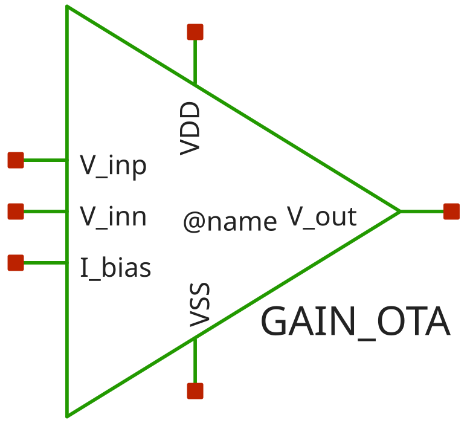
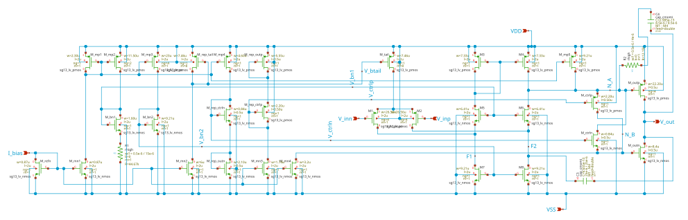

# gain_ota

- Description: PMOS-input folded-cascode common-source AB two-stage OTA
- PDK: ihp-sg13cmos5l

## Authorship

- Designer: SPMA
- Created: October 9, 2026
- License: MIT
- Company: None
- Last modified: None

## Pins

- VDD
  + Description: Positive analog power supply
  + Type: power
  + Direction: inout
  + Vmin: 1.08
  + Vmax: 1.5
- VSS
  + Description: Analog ground
  + Type: ground
  + Direction: inout
- I_bias
  + Description: Bias current input
  + Type: signal
  + Direction: input
- V_inp
  + Description: Non-inverting input
  + Type: signal
  + Direction: input
- V_inn
  + Description: Inverting input
  + Type: signal
  + Direction: input
- V_out
  + Description: Output
  + Type: signal
  + Direction: output

## Default Conditions

- vdd
  + Description: Analog power supply voltage
  + Display: Vdd
  + Unit: V
  + Typical: 1.2
- vcm
  + Description: Input common mode voltage
  + Display: Vcm
  + Unit: V
  + Typical: 0.6
- ib
  + Description: Bias current
  + Display: Ib
  + Unit: uA
  + Typical: 1
- cl
  + Description: Output load capacitance
  + Display: CLoad
  + Unit: pF
  + Typical: 2
- corner
  + Description: Process corner
  + Display: Corner
  + Typical: tt
- rcorner
  + Description: Resistor corner (res_<rcorner> section of cornerRES.lib)
  + Display: Rcorner
  + Typical: typ
- temperature
  + Description: Ambient temperature
  + Display: Temp
  + Unit: °C
  + Typical: 27

## Symbol

## Schematic

