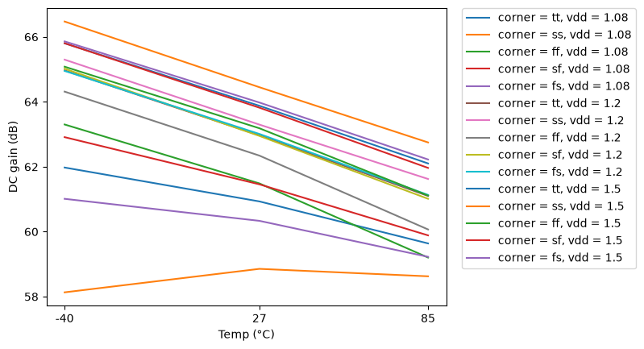
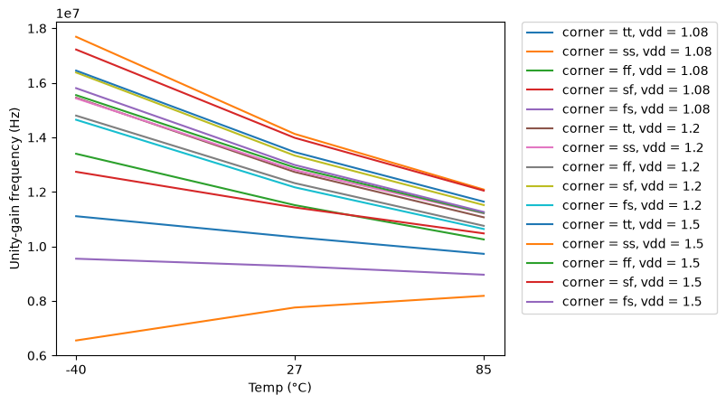
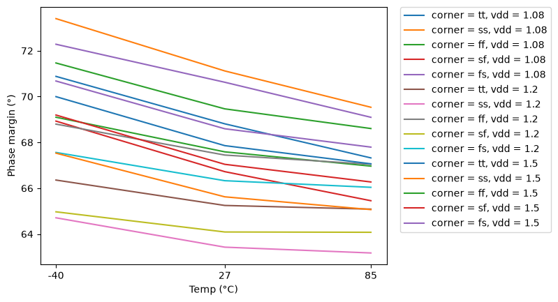
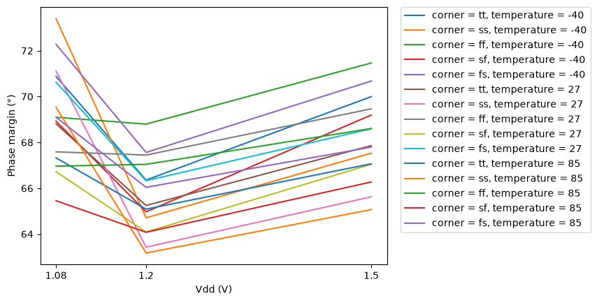
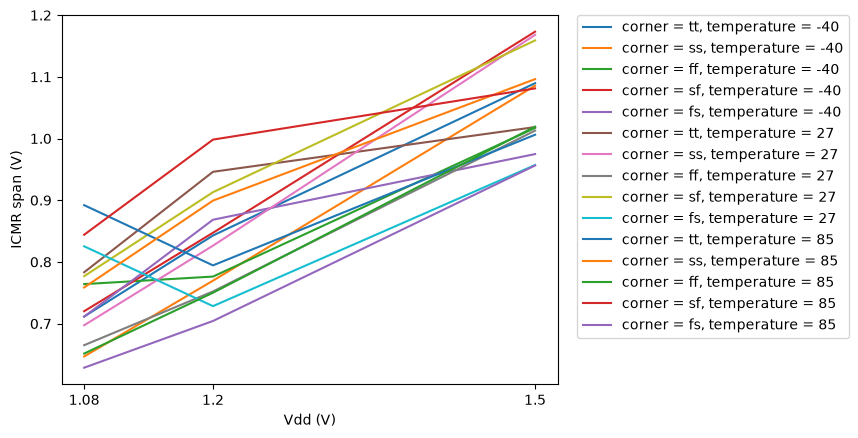

# CACE Summary for gain_ota

**netlist source**: schematic

|      Parameter       |         Tool         |     Result      | Min Limit  |  Min Value   | Typ Target |  Typ Value   | Max Limit  |  Max Value   |  Status  |
| :------------------- | :------------------- | :-------------- | ---------: | -----------: | ---------: | -----------: | ---------: | -----------: | :------: |
| DC gain              | ngspice              | A0                   |             any |  58.131 dB |          any |  62.342 dB |          any |  66.472 dB |   Pass ✅    |
| -3 dB frequency      | ngspice              | F3DB                 |             any | 8311.370 Hz |          any | 9143.140 Hz |          any | 11318.700 Hz |   Pass ✅    |
| Unity-gain frequency | ngspice              | UGF                  |             any | 6549840.000 Hz |          any | 12084600.000 Hz |          any | 17688000.000 Hz |   Pass ✅    |
| Phase margin         | ngspice              | PM                   |             any |   63.173 ° |          any |   67.529 ° |          any |   73.400 ° |   Pass ✅    |
| Gain margin          | ngspice              | GM                   |             any |   6.277 dB |          any |   8.385 dB |          any |  15.645 dB |   Pass ✅    |
| Gain-bandwidth product | ngspice              | GBW                  |             any | 6810030.000 Hz |          any | 11907500.000 Hz |          any | 17508700.000 Hz |   Pass ✅    |
| Input noise @100 Hz  | ngspice              | IRN_100              |             any | 1382.630 nV/rtHz |          any | 1788.010 nV/rtHz |          any | 2598.510 nV/rtHz |   Pass ✅    |
| Input noise @1 kHz   | ngspice              | IRN_1K               |             any | 438.758 nV/rtHz |          any | 567.917 nV/rtHz |          any | 824.344 nV/rtHz |   Pass ✅    |
| Input noise @10 kHz  | ngspice              | IRN_10K              |             any | 143.500 nV/rtHz |          any | 187.312 nV/rtHz |          any | 268.839 nV/rtHz |   Pass ✅    |
| Input noise @1 MHz   | ngspice              | IRN_1M               |             any | 41.584 nV/rtHz |          any | 57.856 nV/rtHz |          any | 80.047 nV/rtHz |   Pass ✅    |
| Output noise @1 kHz  | ngspice              | ORN_1K               |             any | 438.544 nV/rtHz |          any | 566.488 nV/rtHz |          any | 1043.020 nV/rtHz |   Pass ✅    |
| Integrated input noise | ngspice              | INOISE_TOT           |             any | 890.803 uV-rms |          any | 1247.690 uV-rms |          any | 1500.700 uV-rms |   Pass ✅    |
| Integrated output noise | ngspice              | ONOISE_TOT           |             any | 480.243 uV-rms |          any | 568.994 uV-rms |          any | 623.705 uV-rms |   Pass ✅    |
| Input offset voltage | ngspice              | VOS                  |             any | -19.087 mV |          any |   0.690 mV |          any |  10.456 mV |   Pass ✅    |
| Quiescent current    | ngspice              | IQ                   |             any |  63.309 uA |          any |  73.951 uA |          any |  87.729 uA |   Pass ✅    |
| Quiescent power      | ngspice              | PWR                  |             any |  68.374 uW |          any |  88.611 uW |          any | 131.593 uW |   Pass ✅    |
| Output voltage       | ngspice              | VOUT                 |             any |    0.590 V |          any |    0.599 V |          any |    0.619 V |   Pass ✅    |
| Gain error (1 - dVout/dVin) | ngspice              | GAIN_ERR             |             any | -383.867 % |          any |    0.046 % |          any |    0.642 % |   Pass ✅    |
| Maximum DC gain      | ngspice              | MAX_GAIN_DB          |             any |  59.010 dB |          any |  62.722 dB |          any |  67.007 dB |   Pass ✅    |
| Gain tempco (ppm per °C) | ngspice              | GAIN_TC              |             any |  1.845 ppm |          any | 14.091 ppm |          any | 23281.900 ppm |   Pass ✅    |
| Mean follower gain   | ngspice              | G_MEAN               |             any |  0.998 V/V |          any |  0.999 V/V |          any |  1.307 V/V |   Pass ✅    |
| CMRR @10 Hz          | ngspice              | CMRR_DC              |             any |  11.526 dB |          any |  62.232 dB |          any |  94.558 dB |   Pass ✅    |
| CMRR @100 kHz        | ngspice              | CMRR_100K            |             any |  11.510 dB |          any |  41.058 dB |          any |  44.880 dB |   Pass ✅    |
| CMRR @1 MHz          | ngspice              | CMRR_1M              |             any |  10.138 dB |          any |  21.497 dB |          any |  24.895 dB |   Pass ✅    |
| PSRR @10 Hz          | ngspice              | PSRR_DC              |             any |  10.484 dB |          any |  37.459 dB |          any |  40.627 dB |   Pass ✅    |
| PSRR @100 kHz        | ngspice              | PSRR_100K            |             any |  10.482 dB |          any |  37.225 dB |          any |  40.359 dB |   Pass ✅    |
| PSRR @1 MHz          | ngspice              | PSRR_1M              |             any |  10.216 dB |          any |  29.362 dB |          any |  32.353 dB |   Pass ✅    |
| Lower ICMR bound     | ngspice              | ICMR_MIN             |             any |    0.010 V |          any |    0.035 V |          any |    0.056 V |   Pass ✅    |
| Upper ICMR bound     | ngspice              | ICMR_MAX             |             any |    0.657 V |          any |    0.869 V |          any |    1.200 V |   Pass ✅    |
| ICMR span            | ngspice              | ICMR_SPAN            |             any |    0.629 V |          any |    0.844 V |          any |    1.173 V |   Pass ✅    |
| Delay (50 %)         | ngspice              | T_DELAY              |             any |   9.182 ns |          any |  14.002 ns |          any |  18.649 ns |   Pass ✅    |
| Rise time (10-90 %)  | ngspice              | T_RISE               |             any | -549.582 ns |          any |  17.597 ns |          any |  39.418 ns |   Pass ✅    |
| Overshoot            | ngspice              | OVERSHOOT            |             any |    2.350 % |          any |  194.680 % |          any |  385.720 % |   Pass ✅    |
| Settling time 1 %    | ngspice              | TS_1PCT              |             any |  31.089 ns |          any |  45.152 ns |          any | 447.388 ns |   Pass ✅    |
| Settling time 0.1 %  | ngspice              | TS_01PCT             |             any |  32.184 ns |          any |  58.098 ns |          any | 458.726 ns |   Pass ✅    |
| Positive slew rate   | ngspice              | SR_POS               |             any | 483943.000 V/s |          any | 6659170.000 V/s |          any | 11769400.000 V/s |   Pass ✅    |
| Negative slew rate   | ngspice              | SR_NEG               |             any | 8821750.000 V/s |          any | 10794500.000 V/s |          any | 13157500.000 V/s |   Pass ✅    |
| Rise time (10-90 %)  | ngspice              | T_RISE               |             any |  40.784 ns |          any |  72.081 ns |          any | 991.852 ns |   Pass ✅    |
| Fall time (90-10 %)  | ngspice              | T_FALL               |             any |  36.481 ns |          any |  44.467 ns |          any |  54.411 ns |   Pass ✅    |
| Propagation delay tpLH | ngspice              | T_PLH                |             any |  29.198 ns |          any |  37.089 ns |          any |  44.335 ns |   Pass ✅    |
| Propagation delay tpHL | ngspice              | T_PHL                |             any |  22.278 ns |          any |  28.792 ns |          any |  72.384 ns |   Pass ✅    |
| Input offset voltage | ngspice              | VOS                  |             any | -19.923 mV |          any |  -0.278 mV |          any |  13.369 mV |   Pass ✅    |
| CMRR @10 Hz          | ngspice              | CMRR_DC              |             any |  27.842 dB |          any |  60.399 dB |          any | 105.499 dB |   Pass ✅    |
| PSRR @10 Hz          | ngspice              | PSRR_DC              |             any |  25.190 dB |          any |  37.371 dB |          any |  39.496 dB |   Pass ✅    |

## Plots

## ac_response_A0_vs_temperature

## ac_response_UGF_vs_temperature

## ac_response_PM_vs_temperature

## ac_response_PM_vs_vdd

## icmr_ICMR_SPAN_vs_vdd

