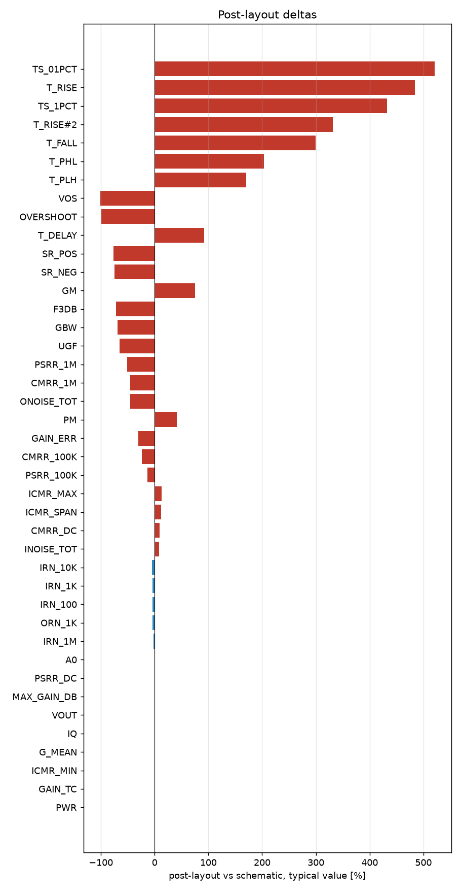

# Schematic vs post-layout

* schematic run: `/foss/designs/sg13cmos5l_spma_ip__instramp/runs/RUN_2026-11-05_17-29-30` (netlist source: schematic)
* post-layout run: `/foss/designs/sg13cmos5l_spma_ip__instramp/runs/pex_cace/gain_ota/RUN_2026-11-05_17-33-37` (netlist source: pex)
* flag threshold: 5 % on the typical value; units as in the CACE summary

| Parameter | Var | Unit | Schematic min / typ / max | Post-layout min / typ / max | Δ typ | Δ typ % | Status | Flag |
|---|---|---|---|---|---:|---:|---|---|
| DC gain | A0 | dB | 58.131 / 62.342 / 66.472 | 62.966 / 62.966 / 62.966 | +0.624 | +1.00 | Pass → Pass |  |
| -3 dB frequency | F3DB | Hz | 8311.4 / 9143.1 / 11319 | 2586.6 / 2586.6 / 2586.6 | -6557 | -71.71 | Pass → Pass | Δ |
| Unity-gain frequency | UGF | Hz | 6.5498e+06 / 1.2085e+07 / 1.7688e+07 | 4.1528e+06 / 4.1528e+06 / 4.1528e+06 | -7.932e+06 | -65.64 | Pass → Pass | Δ |
| Phase margin | PM | ° | 63.173 / 67.529 / 73.4 | 95.561 / 95.561 / 95.561 | +28.03 | +41.51 | Pass → Pass | Δ |
| Gain margin | GM | dB | 6.277 / 8.385 / 15.645 | 14.67 / 14.67 / 14.67 | +6.285 | +74.96 | Pass → Pass | Δ |
| Gain-bandwidth product | GBW | Hz | 6.81e+06 / 1.1908e+07 / 1.7509e+07 | 3.6395e+06 / 3.6395e+06 / 3.6395e+06 | -8.268e+06 | -69.44 | Pass → Pass | Δ |
| Input noise @100 Hz | IRN_100 | nV/rtHz | 1382.6 / 1788 / 2598.5 | 1710.7 / 1710.7 / 1710.7 | -77.35 | -4.33 | Pass → Pass |  |
| Input noise @1 kHz | IRN_1K | nV/rtHz | 438.76 / 567.92 / 824.34 | 543.24 / 543.24 / 543.24 | -24.68 | -4.35 | Pass → Pass |  |
| Input noise @10 kHz | IRN_10K | nV/rtHz | 143.5 / 187.31 / 268.84 | 178.84 / 178.84 / 178.84 | -8.475 | -4.52 | Pass → Pass |  |
| Input noise @1 MHz | IRN_1M | nV/rtHz | 41.584 / 57.856 / 80.047 | 56.375 / 56.375 / 56.375 | -1.481 | -2.56 | Pass → Pass |  |
| Output noise @1 kHz | ORN_1K | nV/rtHz | 438.54 / 566.49 / 1043 | 543.02 / 543.02 / 543.02 | -23.47 | -4.14 | Pass → Pass |  |
| Integrated input noise | INOISE_TOT | uV-rms | 890.8 / 1247.7 / 1500.7 | 1352 / 1352 / 1352 | +104.3 | +8.36 | Pass → Pass | Δ |
| Integrated output noise | ONOISE_TOT | uV-rms | 480.24 / 568.99 / 623.71 | 312.96 / 312.96 / 312.96 | -256 | -45.00 | Pass → Pass | Δ |
| Input offset voltage | VOS | mV | -19.087 / 0.69 / 10.456 | -0.009 / -0.009 / -0.009 | -0.699 | -101.30 | Pass → Pass | Δ |
| Quiescent current | IQ | uA | 63.309 / 73.951 / 87.729 | 73.842 / 73.842 / 73.842 | -0.109 | -0.15 | Pass → Pass |  |
| Quiescent power | PWR | uW | 68.374 / 88.611 / 131.59 | 88.611 / 88.611 / 88.611 | +0 | +0.00 | Pass → Pass |  |
| Output voltage | VOUT | V | 0.59 / 0.599 / 0.619 | 0.6 / 0.6 / 0.6 | +0.001 | +0.17 | Pass → Pass |  |
| Gain error (1 - dVout/dVin) | GAIN_ERR | % | -383.87 / 0.046 / 0.642 | 0.032 / 0.032 / 0.032 | -0.014 | -30.43 | Pass → Pass | Δ |
| Maximum DC gain | MAX_GAIN_DB | dB | 59.01 / 62.722 / 67.007 | 62.858 / 62.858 / 62.858 | +0.136 | +0.22 | Pass → Pass |  |
| Gain tempco (ppm per °C) | GAIN_TC | ppm | 1.845 / 14.091 / 23282 | 14.091 / 14.091 / 14.091 | +0 | +0.00 | Pass → Pass |  |
| Mean follower gain | G_MEAN | V/V | 0.998 / 0.999 / 1.307 | 1 / 1 / 1 | +0.001 | +0.10 | Pass → Pass |  |
| CMRR @10 Hz | CMRR_DC | dB | 11.526 / 62.232 / 94.558 | 67.818 / 67.818 / 67.818 | +5.586 | +8.98 | Pass → Pass | Δ |
| CMRR @100 kHz | CMRR_100K | dB | 11.51 / 41.058 / 44.88 | 31.258 / 31.258 / 31.258 | -9.8 | -23.87 | Pass → Pass | Δ |
| CMRR @1 MHz | CMRR_1M | dB | 10.138 / 21.497 / 24.895 | 11.729 / 11.729 / 11.729 | -9.768 | -45.44 | Pass → Pass | Δ |
| PSRR @10 Hz | PSRR_DC | dB | 10.484 / 37.459 / 40.627 | 37.276 / 37.276 / 37.276 | -0.183 | -0.49 | Pass → Pass |  |
| PSRR @100 kHz | PSRR_100K | dB | 10.482 / 37.225 / 40.359 | 32.313 / 32.313 / 32.313 | -4.912 | -13.20 | Pass → Pass | Δ |
| PSRR @1 MHz | PSRR_1M | dB | 10.216 / 29.362 / 32.353 | 14.43 / 14.43 / 14.43 | -14.93 | -50.85 | Pass → Pass | Δ |
| Lower ICMR bound | ICMR_MIN | V | 0.01 / 0.035 / 0.056 | 0.035 / 0.035 / 0.035 | +0 | +0.00 | Pass → Pass |  |
| Upper ICMR bound | ICMR_MAX | V | 0.657 / 0.869 / 1.2 | 0.981 / 0.981 / 0.981 | +0.112 | +12.89 | Pass → Pass | Δ |
| ICMR span | ICMR_SPAN | V | 0.629 / 0.844 / 1.173 | 0.946 / 0.946 / 0.946 | +0.102 | +12.09 | Pass → Pass | Δ |
| Delay (50 %) | T_DELAY | ns | 9.182 / 14.002 / 18.649 | 26.937 / 26.937 / 26.937 | +12.94 | +92.38 | Pass → Pass | Δ |
| Rise time (10-90 %) | T_RISE | ns | -549.58 / 17.597 / 39.418 | 102.79 / 102.79 / 102.79 | +85.19 | +484.12 | Pass → Pass | Δ |
| Overshoot | OVERSHOOT | % | 2.35 / 194.68 / 385.72 | 1.05 / 1.05 / 1.05 | -193.6 | -99.46 | Pass → Pass | Δ |
| Settling time 1 % | TS_1PCT | ns | 31.089 / 45.152 / 447.39 | 240.27 / 240.27 / 240.27 | +195.1 | +432.13 | Pass → Pass | Δ |
| Settling time 0.1 % | TS_01PCT | ns | 32.184 / 58.098 / 458.73 | 360.45 / 360.45 / 360.45 | +302.4 | +520.42 | Pass → Pass | Δ |
| Positive slew rate | SR_POS | V/s | 4.8394e+05 / 6.6592e+06 / 1.1769e+07 | 1.5422e+06 / 1.5422e+06 / 1.5422e+06 | -5.117e+06 | -76.84 | Pass → Pass | Δ |
| Negative slew rate | SR_NEG | V/s | 8.8218e+06 / 1.0794e+07 / 1.3158e+07 | 2.6997e+06 / 2.6997e+06 / 2.6997e+06 | -8.095e+06 | -74.99 | Pass → Pass | Δ |
| Rise time (10-90 %) | T_RISE#2 | ns | 40.784 / 72.081 / 991.85 | 311.25 / 311.25 / 311.25 | +239.2 | +331.81 | Pass → Pass | Δ |
| Fall time (90-10 %) | T_FALL | ns | 36.481 / 44.467 / 54.411 | 177.8 / 177.8 / 177.8 | +133.3 | +299.85 | Pass → Pass | Δ |
| Propagation delay tpLH | T_PLH | ns | 29.198 / 37.089 / 44.335 | 100.19 / 100.19 / 100.19 | +63.11 | +170.15 | Pass → Pass | Δ |
| Propagation delay tpHL | T_PHL | ns | 22.278 / 28.792 / 72.384 | 87.465 / 87.465 / 87.465 | +58.67 | +203.78 | Pass → Pass | Δ |

27 row(s) flagged.

