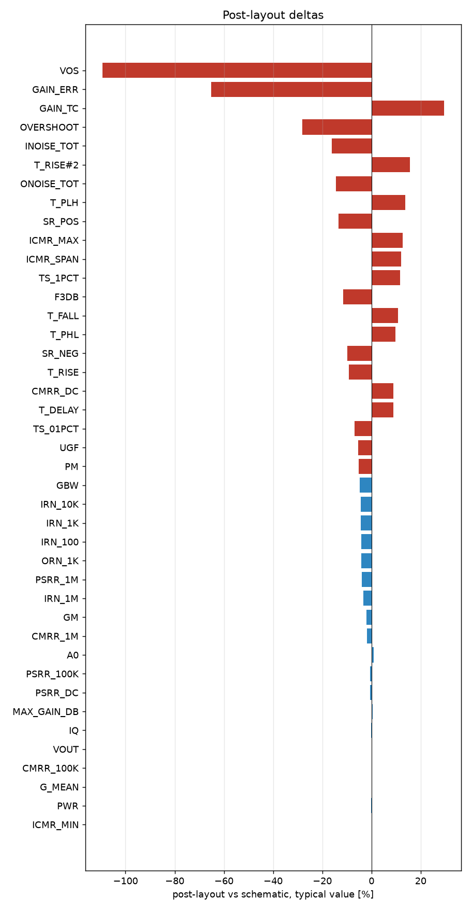

# Schematic vs post-layout

* schematic run: `/foss/designs/sg13cmos5l_spma_ip__instramp/runs/RUN_2026-10-21_07-18-34` (netlist source: schematic)
* post-layout run: `/foss/designs/sg13cmos5l_spma_ip__instramp/runs/pex_cace_rc/gain_ota/RUN_2026-10-21_20-35-02` (netlist source: pex)
* flag threshold: 5 % on the typical value; units as in the CACE summary

| Parameter | Var | Unit | Schematic min / typ / max | Post-layout min / typ / max | Δ typ | Δ typ % | Status | Flag |
|---|---|---|---|---|---:|---:|---|---|
| DC gain | A0 | dB | 58.131 / 62.342 / 66.472 | 62.932 / 62.932 / 62.932 | +0.59 | +0.95 | Pass → Pass |  |
| -3 dB frequency | F3DB | Hz | 8311.4 / 9143.1 / 11319 | 8095.1 / 8095.1 / 8095.1 | -1048 | -11.46 | Pass → Pass | Δ |
| Unity-gain frequency | UGF | Hz | 6.5498e+06 / 1.2085e+07 / 1.7688e+07 | 1.1428e+07 / 1.1428e+07 / 1.1428e+07 | -6.571e+05 | -5.44 | Pass → Pass | Δ |
| Phase margin | PM | ° | 63.173 / 67.529 / 73.4 | 64.024 / 64.024 / 64.024 | -3.505 | -5.19 | Pass → Pass | Δ |
| Gain margin | GM | dB | 6.277 / 8.385 / 15.645 | 8.205 / 8.205 / 8.205 | -0.18 | -2.15 | Pass → Pass |  |
| Gain-bandwidth product | GBW | Hz | 6.81e+06 / 1.1908e+07 / 1.7509e+07 | 1.1345e+07 / 1.1345e+07 / 1.1345e+07 | -5.623e+05 | -4.72 | Pass → Pass |  |
| Input noise @100 Hz | IRN_100 | nV/rtHz | 1382.6 / 1788 / 2598.5 | 1711.9 / 1711.9 / 1711.9 | -76.09 | -4.26 | Pass → Pass |  |
| Input noise @1 kHz | IRN_1K | nV/rtHz | 438.76 / 567.92 / 824.34 | 543.64 / 543.64 / 543.64 | -24.28 | -4.27 | Pass → Pass |  |
| Input noise @10 kHz | IRN_10K | nV/rtHz | 143.5 / 187.31 / 268.84 | 178.98 / 178.98 / 178.98 | -8.33 | -4.45 | Pass → Pass |  |
| Input noise @1 MHz | IRN_1M | nV/rtHz | 41.584 / 57.856 / 80.047 | 55.908 / 55.908 / 55.908 | -1.948 | -3.37 | Pass → Pass |  |
| Output noise @1 kHz | ORN_1K | nV/rtHz | 438.54 / 566.49 / 1043 | 543.42 / 543.42 / 543.42 | -23.07 | -4.07 | Pass → Pass |  |
| Integrated input noise | INOISE_TOT | uV-rms | 890.8 / 1247.7 / 1500.7 | 1046.4 / 1046.4 / 1046.4 | -201.3 | -16.13 | Pass → Pass | Δ |
| Integrated output noise | ONOISE_TOT | uV-rms | 480.24 / 568.99 / 623.71 | 487.09 / 487.09 / 487.09 | -81.91 | -14.40 | Pass → Pass | Δ |
| Input offset voltage | VOS | mV | -19.087 / 0.69 / 10.456 | -0.065 / -0.065 / -0.065 | -0.755 | -109.42 | Pass → Pass | Δ |
| Quiescent current | IQ | uA | 63.309 / 73.951 / 87.729 | 73.773 / 73.773 / 73.773 | -0.178 | -0.24 | Pass → Pass |  |
| Quiescent power | PWR | uW | 68.374 / 88.611 / 131.59 | 88.527 / 88.527 / 88.527 | -0.084 | -0.09 | Pass → Pass |  |
| Output voltage | VOUT | V | 0.59 / 0.599 / 0.619 | 0.6 / 0.6 / 0.6 | +0.001 | +0.17 | Pass → Pass |  |
| Gain error (1 - dVout/dVin) | GAIN_ERR | % | -383.87 / 0.046 / 0.642 | 0.016 / 0.016 / 0.016 | -0.03 | -65.22 | Pass → Pass | Δ |
| Maximum DC gain | MAX_GAIN_DB | dB | 59.01 / 62.722 / 67.007 | 63.002 / 63.002 / 63.002 | +0.28 | +0.45 | Pass → Pass |  |
| Gain tempco (ppm per °C) | GAIN_TC | ppm | 1.845 / 14.091 / 23282 | 18.235 / 18.235 / 18.235 | +4.144 | +29.41 | Pass → Pass | Δ |
| Mean follower gain | G_MEAN | V/V | 0.998 / 0.999 / 1.307 | 1 / 1 / 1 | +0.001 | +0.10 | Pass → Pass |  |
| CMRR @10 Hz | CMRR_DC | dB | 11.526 / 62.232 / 94.558 | 67.753 / 67.753 / 67.753 | +5.521 | +8.87 | Pass → Pass | Δ |
| CMRR @100 kHz | CMRR_100K | dB | 11.51 / 41.058 / 44.88 | 41.121 / 41.121 / 41.121 | +0.063 | +0.15 | Pass → Pass |  |
| CMRR @1 MHz | CMRR_1M | dB | 10.138 / 21.497 / 24.895 | 21.121 / 21.121 / 21.121 | -0.376 | -1.75 | Pass → Pass |  |
| PSRR @10 Hz | PSRR_DC | dB | 10.484 / 37.459 / 40.627 | 37.26 / 37.26 / 37.26 | -0.199 | -0.53 | Pass → Pass |  |
| PSRR @100 kHz | PSRR_100K | dB | 10.482 / 37.225 / 40.359 | 36.985 / 36.985 / 36.985 | -0.24 | -0.64 | Pass → Pass |  |
| PSRR @1 MHz | PSRR_1M | dB | 10.216 / 29.362 / 32.353 | 28.23 / 28.23 / 28.23 | -1.132 | -3.86 | Pass → Pass |  |
| Lower ICMR bound | ICMR_MIN | V | 0.01 / 0.035 / 0.056 | 0.035 / 0.035 / 0.035 | +0 | +0.00 | Pass → Pass |  |
| Upper ICMR bound | ICMR_MAX | V | 0.657 / 0.869 / 1.2 | 0.979 / 0.979 / 0.979 | +0.11 | +12.66 | Pass → Pass | Δ |
| ICMR span | ICMR_SPAN | V | 0.629 / 0.844 / 1.173 | 0.945 / 0.945 / 0.945 | +0.101 | +11.97 | Pass → Pass | Δ |
| Delay (50 %) | T_DELAY | ns | 9.182 / 14.002 / 18.649 | 15.241 / 15.241 / 15.241 | +1.239 | +8.85 | Pass → Pass | Δ |
| Rise time (10-90 %) | T_RISE | ns | -549.58 / 17.597 / 39.418 | 15.962 / 15.962 / 15.962 | -1.635 | -9.29 | Pass → Pass | Δ |
| Overshoot | OVERSHOOT | % | 2.35 / 194.68 / 385.72 | 140.02 / 140.02 / 140.02 | -54.66 | -28.08 | Pass → Pass | Δ |
| Settling time 1 % | TS_1PCT | ns | 31.089 / 45.152 / 447.39 | 50.363 / 50.363 / 50.363 | +5.211 | +11.54 | Pass → Pass | Δ |
| Settling time 0.1 % | TS_01PCT | ns | 32.184 / 58.098 / 458.73 | 54.129 / 54.129 / 54.129 | -3.969 | -6.83 | Pass → Pass | Δ |
| Positive slew rate | SR_POS | V/s | 4.8394e+05 / 6.6592e+06 / 1.1769e+07 | 5.7603e+06 / 5.7603e+06 / 5.7603e+06 | -8.988e+05 | -13.50 | Pass → Pass | Δ |
| Negative slew rate | SR_NEG | V/s | 8.8218e+06 / 1.0794e+07 / 1.3158e+07 | 9.7428e+06 / 9.7428e+06 / 9.7428e+06 | -1.052e+06 | -9.74 | Pass → Pass | Δ |
| Rise time (10-90 %) | T_RISE#2 | ns | 40.784 / 72.081 / 991.85 | 83.329 / 83.329 / 83.329 | +11.25 | +15.60 | Pass → Pass | Δ |
| Fall time (90-10 %) | T_FALL | ns | 36.481 / 44.467 / 54.411 | 49.267 / 49.267 / 49.267 | +4.8 | +10.79 | Pass → Pass | Δ |
| Propagation delay tpLH | T_PLH | ns | 29.198 / 37.089 / 44.335 | 42.152 / 42.152 / 42.152 | +5.063 | +13.65 | Pass → Pass | Δ |
| Propagation delay tpHL | T_PHL | ns | 22.278 / 28.792 / 72.384 | 31.618 / 31.618 / 31.618 | +2.826 | +9.82 | Pass → Pass | Δ |

22 row(s) flagged.

