# gain_stage - CACE characterisation

- Generated: 2026-11-05 18:53 by `scripts/make_readme.py` from `runs/RUN_2026-11-05_18-52-08`
- Commit: `b495d99` (working tree dirty)
- Netlist source: schematic; datasheet: `cace/gain_stage.yaml`; reproduce with `scripts/run_cace.sh gain_stage`
- Sections marked *(CACE)* are written by CACE itself, the rest by this script (CACE has no per-corner MC statistics, worst-case conditions or unit-scaled spread plots).

## Design *(CACE)*

- Description: Binary programmable gain stage with standard-cell S0 decoding and 6-tap binary feedback network
- PDK: ihp-sg13cmos5l

### Authorship

- Designer: SPMA
- Created: November 3, 2026
- License: MIT
- Company: None
- Last modified: None

### Pins

- AVDD
  + Description: Positive analog power supply
  + Type: power
  + Direction: inout
  + Vmin: 1.08
  + Vmax: 1.5
- AVSS
  + Description: Analog ground
  + Type: ground
  + Direction: inout
- IBIAS
  + Description: Bias current input
  + Type: signal
  + Direction: input
- VCM
  + Description: Common-mode reference input
  + Type: signal
  + Direction: input
- VIN
  + Description: Analog input signal
  + Type: signal
  + Direction: input
- VOUT
  + Description: Output signal to next gain stage or buffer
  + Type: signal
  + Direction: output
- s[0]
  + Description: Gain select bit 0 (Tap 1: +6.02 dB / 2x)
  + Type: signal
  + Direction: input
- s[1]
  + Description: Gain select bit 1 (Tap 2: +12.04 dB / 4x)
  + Type: signal
  + Direction: input
- s[2]
  + Description: Gain select bit 2 (Tap 3: +18.06 dB / 8x)
  + Type: signal
  + Direction: input
- s[3]
  + Description: Gain select bit 3 (Tap 4: +24.08 dB / 16x)
  + Type: signal
  + Direction: input
- s[4]
  + Description: Gain select bit 4 (Tap 5: +30.10 dB / 32x)
  + Type: signal
  + Direction: input

### Default Conditions

- vdd
  + Description: Analog power supply voltage
  + Display: Vdd
  + Unit: V
  + Typical: 1.2
- vcm
  + Description: Input common mode voltage
  + Display: Vcm
  + Unit: V
  + Typical: 0.6
- ib
  + Description: Bias current
  + Display: Ib
  + Unit: uA
  + Typical: 1
- cl
  + Description: Output load capacitance
  + Display: CLoad
  + Unit: pF
  + Typical: 2
- gain_tap
  + Description: Active binary gain tap (0=0dB to 5=30dB)
  + Display: Tap
  + Typical: 0
- corner
  + Description: Process corner
  + Display: Corner
  + Typical: tt
- rcorner
  + Description: Resistor corner (res_<rcorner> section of cornerRES.lib)
  + Display: Rcorner
  + Typical: typ
- temperature
  + Description: Ambient temperature
  + Display: Temp
  + Unit: °C
  + Typical: 27

### Symbol

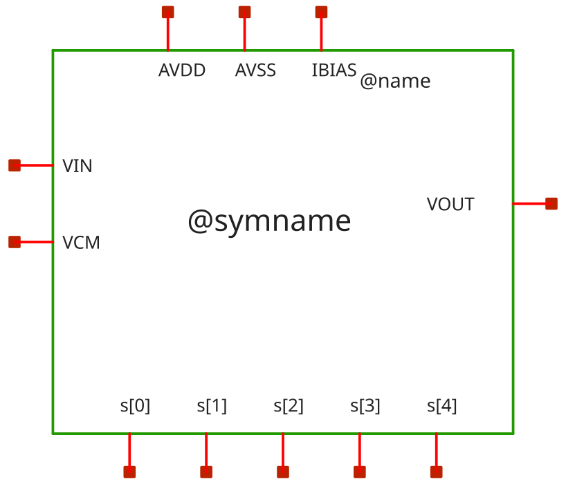

### Schematic

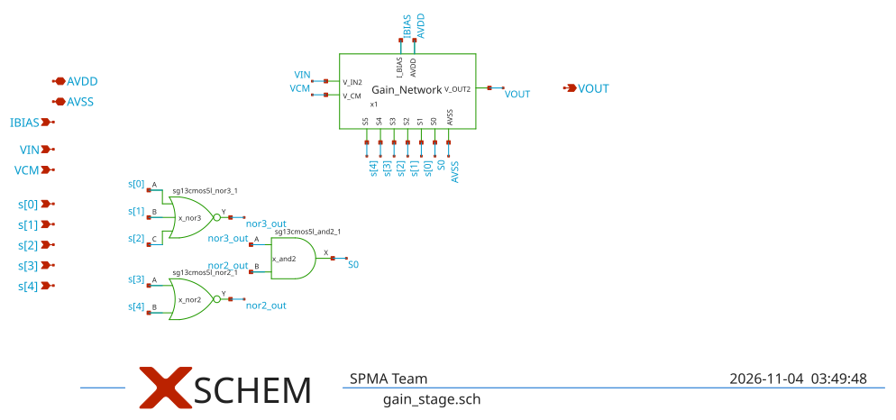

### Layout

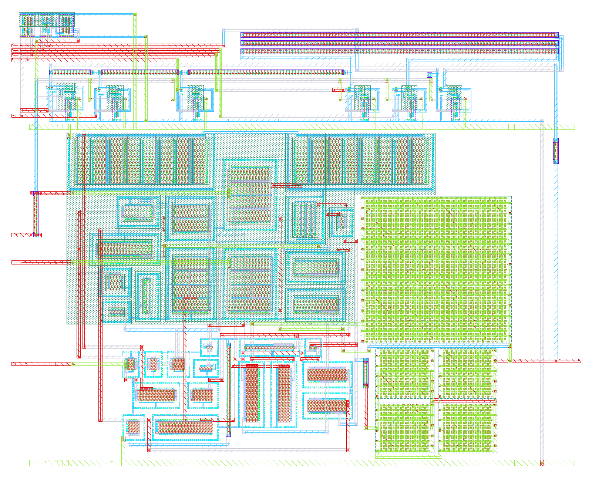

**Physical size** (bounding box of `gain_stage`; generated by `scripts/update_images.py`)

| Width W | Length L | Area |
|---|---|---|
| 98.90 µm | 78.81 µm | 7794 µm² |

## Results summary *(CACE)*

min / typ / max over all conditions of a parameter; Monte Carlo parameters (`mc_*`) are min/max over all samples.

**netlist source**: schematic

|      Parameter       |         Tool         |     Result      | Min Limit  |  Min Value   | Typ Target |  Typ Value   | Max Limit  |  Max Value   |  Status  |
| :------------------- | :------------------- | :-------------- | ---------: | -----------: | ---------: | -----------: | ---------: | -----------: | :------: |
| Closed-loop gain @10 kHz | ngspice              | A_CL                 |             any |  -4.204 dB |         0 dB |  15.967 dB |          any |  30.683 dB |   Pass ✅    |
| Gain error vs target | ngspice              | A_ERR                |             any | -32.116 dB |         0 dB |  -0.041 dB |          any |   7.307 dB |   Pass ✅    |
| -3 dB bandwidth      | ngspice              | F3DB                 |        20000 Hz | 257623.000 Hz |          any | 1925895.000 Hz |          any | 17383400.000 Hz |   Pass ✅    |
| 0 dB frequency       | ngspice              | F0DB                 |             any | 1938010.000 Hz |          any | 10837550.000 Hz |          any | 100000000.000 Hz |   Pass ✅    |
| Phase @0 dB          | ngspice              | PH0                  |             any | -180.000 ° |          any |   56.944 ° |          any |  161.600 ° |   Pass ✅    |
| Output offset voltage | ngspice              | VOS                  |             any | -330.326 mV |     0.013 mV |  -2.304 mV |          any | 476.591 mV |   Pass ✅    |
| Quiescent current    | ngspice              | IQ                   |             any |  59.534 uA |        74 uA |  72.837 uA |       150 uA |  86.545 uA |   Pass ✅    |
| DC power dissipation | ngspice              | PWR                  |             any |  64.296 uW |      88.6 uW |  87.399 uW |       200 uW | 129.817 uW |   Pass ✅    |
| DC output voltage    | ngspice              | VOUT                 |             any |    0.270 V |        0.6 V |    0.598 V |          any |    1.077 V |   Pass ✅    |
| Input noise @10 Hz   | ngspice              | IRN_10               |             any | 5575.600 nV/rtHz |          any | 7108.350 nV/rtHz |          any | 12509.900 nV/rtHz |   Pass ✅    |
| Input noise @100 Hz  | ngspice              | IRN_100              |             any | 1763.990 nV/rtHz |          any | 2248.865 nV/rtHz |          any | 3957.830 nV/rtHz |   Pass ✅    |
| Input noise @1 kHz   | ngspice              | IRN_1K               |             any | 560.448 nV/rtHz | 1500 nV/rtHz | 714.317 nV/rtHz | 3500 nV/rtHz | 1257.340 nV/rtHz |   Pass ✅    |
| Input noise @10 kHz  | ngspice              | IRN_10K              |             any | 185.327 nV/rtHz |          any | 235.850 nV/rtHz |          any | 415.396 nV/rtHz |   Pass ✅    |
| Output noise @1 kHz  | ngspice              | ORN_1K               |             any | 973.814 nV/rtHz |          any | 9513.945 nV/rtHz |          any | 18907.700 nV/rtHz |   Pass ✅    |
| Integrated output noise | ngspice              | ONOISE_TOT           |             any | 583.181 uV-rms |          any | 1477.101 uV-rms |          any | 2457.040 uV-rms |   Pass ✅    |
| In-band input noise  | ngspice              | INOISE_EQ            |             any | 73.532 uV-rms |          any | 216.744 uV-rms |          any | 752.975 uV-rms |   Pass ✅    |
| Transient step gain  | ngspice              | TR_GAIN              |             any |    0.77379 |          1.0 | 6.844110000000001 |          any |     32.896 |   Pass ✅    |
| Percentage overshoot | ngspice              | OVERSHOOT            |             any |    0.000 % |          0 % |    0.000 % |         20 % |    9.951 % |   Pass ✅    |
| Settling time (0.1%) | ngspice              | SETTLING_TIME        |             any |   0.085 us |       0.8 us |   0.599 us |       5.0 us |   2.769 us |   Pass ✅    |
| Slew rate positive   | ngspice              | SR_POS               |       1.0e6 V/s | 3512510.000 V/s |    3.0e6 V/s | 6921160.000 V/s |          any | 9062330.000 V/s |   Pass ✅    |
| Slew rate negative   | ngspice              | SR_NEG               |       1.0e6 V/s | 4064210.000 V/s |    4.0e6 V/s | 6328610.000 V/s |          any | 6585310.000 V/s |   Pass ✅    |
| THD in dB            | ngspice              | THD_DB               |             any | -54.588 dB |       -49 dB | -35.823 dB |       -20 dB | -22.210 dB |   Pass ✅    |
| THD in %             | ngspice              | THD_PCT              |             any |    0.186 % |       0.35 % |    1.618 % |         10 % |    7.753 % |   Pass ✅    |
| 2nd harmonic         | ngspice              | HD2_DB               |             any | -56.703 dB |          any | -35.874 dB |          any | -27.479 dB |   Pass ✅    |
| 3rd harmonic         | ngspice              | HD3_DB               |             any | -78.020 dB |          any | -59.880 dB |          any | -24.493 dB |   Pass ✅    |
| Fundamental output amplitude | ngspice              | VO1                  |             any |    0.155 V |          any |    0.218 V |          any |    0.282 V |   Pass ✅    |
| PSRR @10 Hz          | ngspice              | PSRR_DC              |           25 dB |  27.044 dB |        37 dB |  33.311 dB |          any |  37.880 dB |   Pass ✅    |
| PSRR @100 kHz        | ngspice              | PSRR_100K            |           25 dB |  27.017 dB |        37 dB |  33.319 dB |          any |  38.052 dB |   Pass ✅    |
| PSRR @1 MHz          | ngspice              | PSRR_1M              |             any |  24.306 dB |          any |  32.916 dB |          any |  41.554 dB |   Pass ✅    |
| CMRR @10 Hz          | ngspice              | CMRR_DC              |           50 dB |  34.063 dB |        67 dB |  58.607 dB |          any |  67.565 dB |   Fail ❌    |
| CMRR @100 kHz        | ngspice              | CMRR_100K            |           25 dB |  33.019 dB |        42 dB |  40.514 dB |          any |  44.170 dB |   Pass ✅    |
| CMRR @1 MHz          | ngspice              | CMRR_1M              |             any |  15.640 dB |          any |  25.909 dB |          any |  32.954 dB |   Pass ✅    |
| Max glitch voltage deviation | ngspice              | V_GLITCH_MAX         |             any |   3.367 mV |        50 mV |  10.157 mV |       200 mV |  16.329 mV |   Pass ✅    |
| Gain switching settling time | ngspice              | T_SWITCH_SETTLE      |             any |   0.021 us |       0.5 us |   0.069 us |       3.0 us |   2.112 us |   Pass ✅    |

### Plots *(CACE)*

#### ac_gain_A_CL_vs_temperature

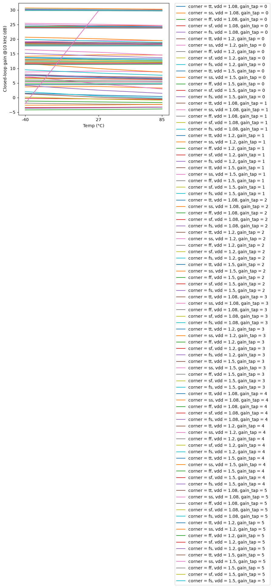

#### ac_gain_F3DB_vs_temperature

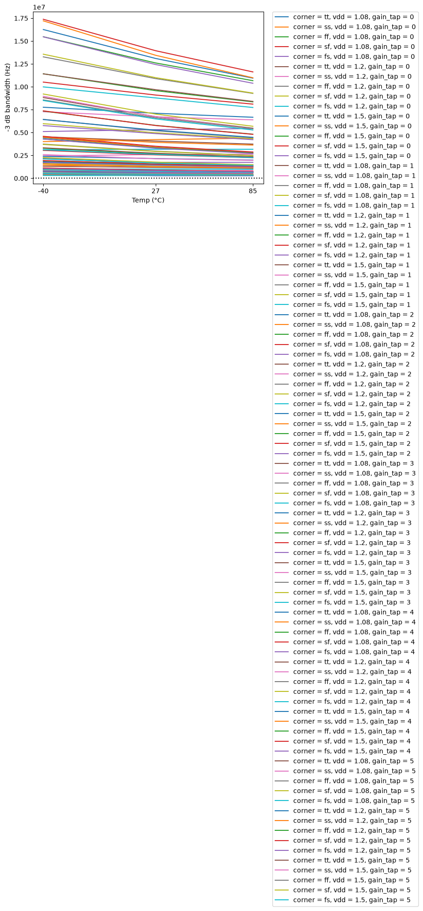

#### ac_gain_A_CL_vs_vdd

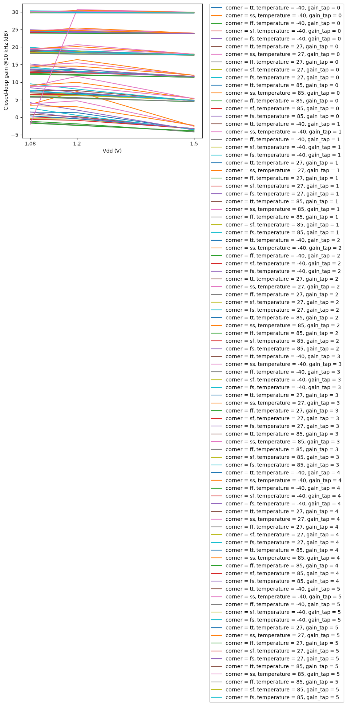

#### dc_op_VOS_vs_temperature

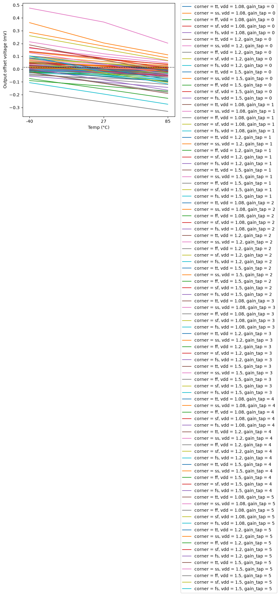

#### dc_op_PWR_vs_temperature

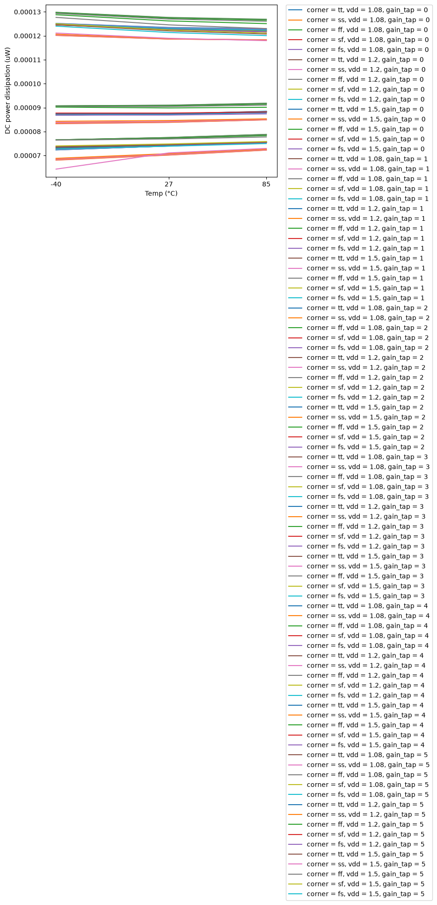

#### dc_op_IQ_vs_vdd

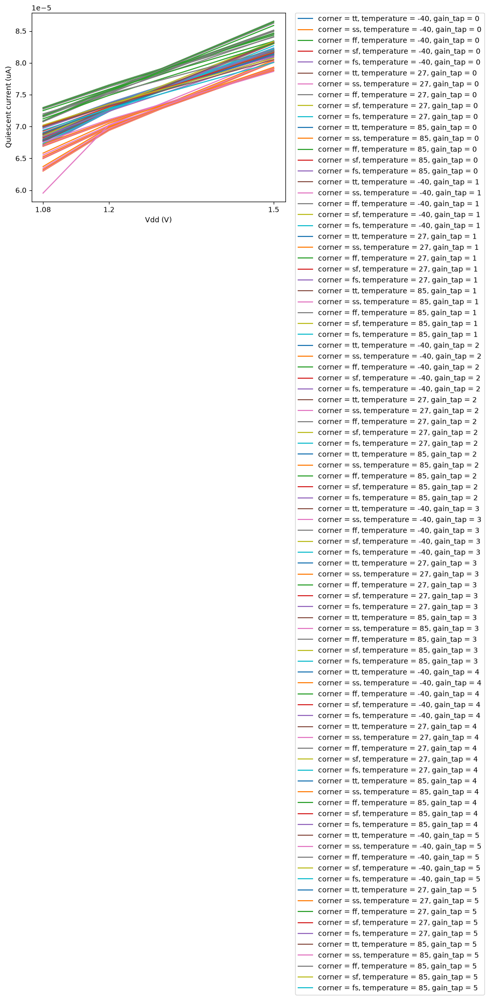

#### noise_IRN_1K_vs_temperature

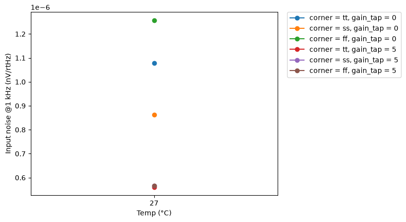

#### noise_ONOISE_TOT_vs_temperature

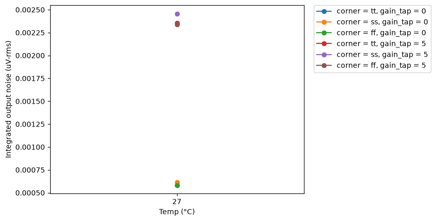

#### tran_small_TR_GAIN_vs_temperature

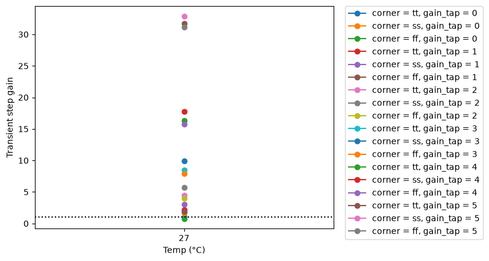

#### tran_small_SETTLING_TIME_vs_temperature

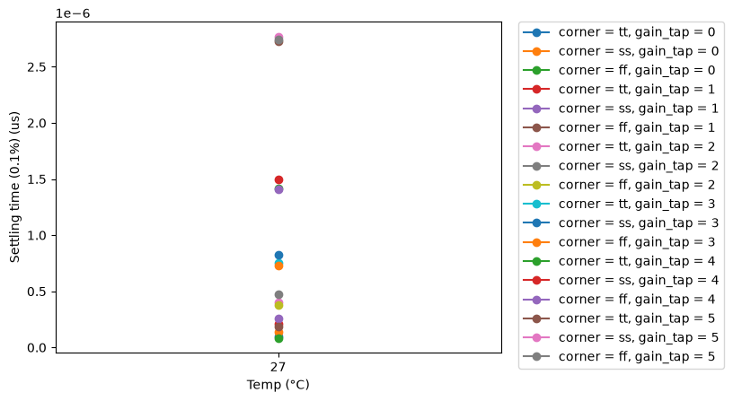

#### tran_large_SR_POS_vs_temperature

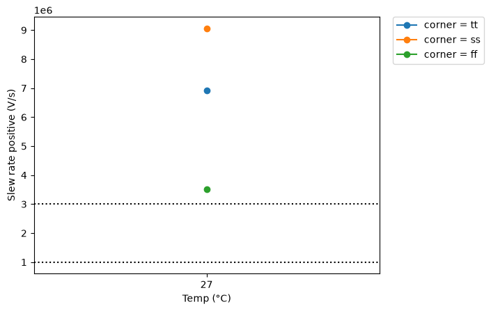

#### tran_large_SR_NEG_vs_temperature

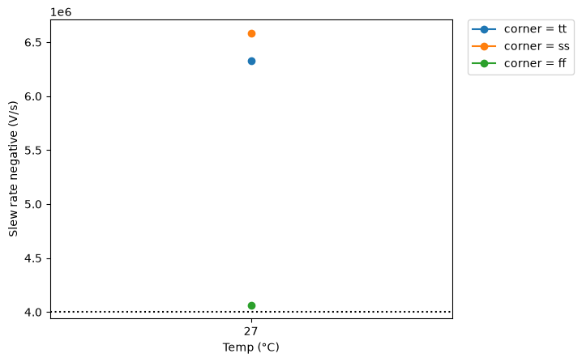

#### thd_THD_DB_vs_temperature

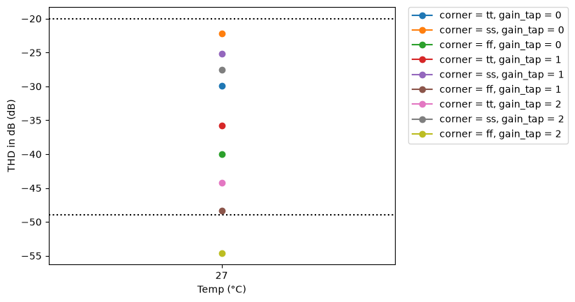

#### thd_THD_PCT_vs_temperature

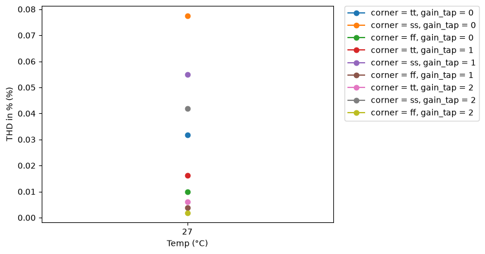

#### psrr_PSRR_DC_vs_temperature

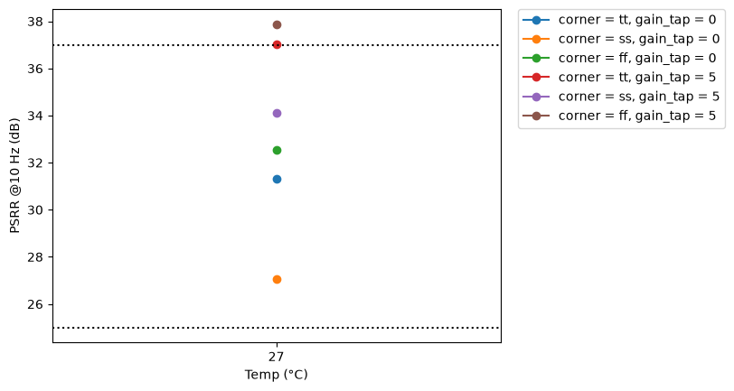

#### psrr_PSRR_100K_vs_temperature

#### cmrr_CMRR_DC_vs_temperature

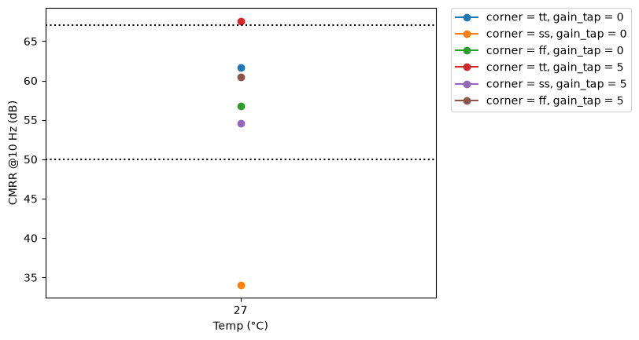

#### cmrr_CMRR_100K_vs_temperature

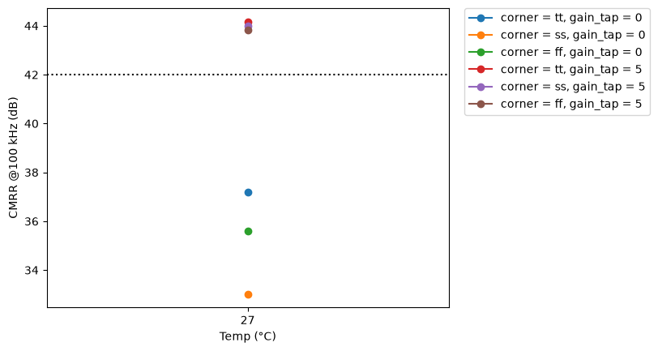

#### tran_switch_V_GLITCH_MAX_vs_temperature

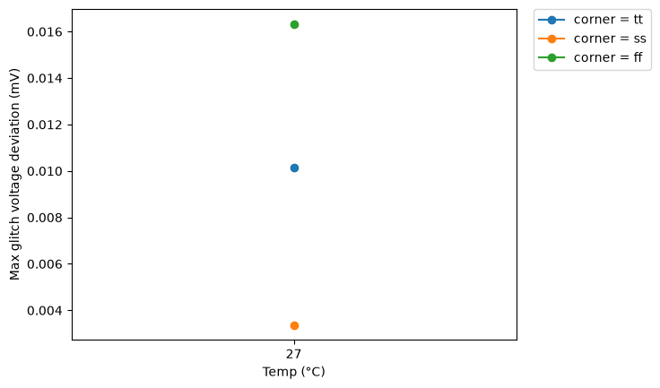

#### tran_switch_T_SWITCH_SETTLE_vs_temperature

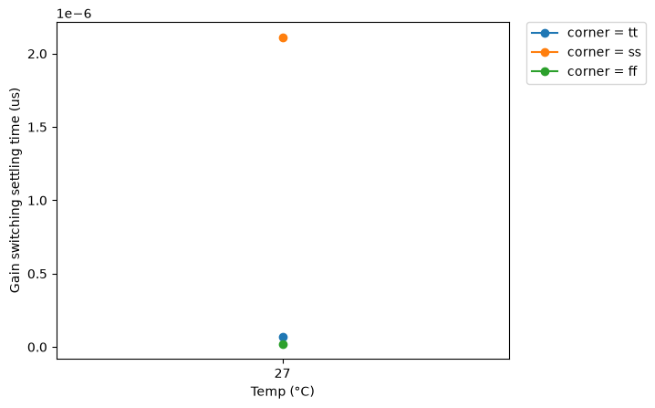

## PVT worst-case conditions

Corners tt/ss/ff/sf/fs, supply and temperature as in the yaml. Values in the display unit of the yaml.

### ac_gain - Closed-loop AC gain & bandwidth

270 runs.

| metric | min | at (corner, vdd, T) | max | at (corner, vdd, T) | spec | fails |
|---|---|---|---|---|---|---|
| A_CL [dB] | -4.204 | ff, 1.5 V, -40 C | 30.68 | ss, 1.2 V, -40 C | any | - |
| A_ERR [dB] | -32.12 | ss, 1.08 V, -40 C | 7.307 | ss, 1.2 V, -40 C | any | - |
| F3DB [Hz] | 2.576e+05 | ss, 1.08 V, 27 C | 1.738e+07 | sf, 1.5 V, -40 C | >= 20000 | 0 |
| F0DB [Hz] | 1.938e+06 | tt, 1.2 V, 27 C | 1e+08 | ff, 1.08 V, -40 C | any | - |
| PH0 [°] | -180 | ff, 1.08 V, -40 C | 161.6 | tt, 1.2 V, 27 C | any | - |

### dc_op - DC operating point

270 runs.

| metric | min | at (corner, vdd, T) | max | at (corner, vdd, T) | spec | fails |
|---|---|---|---|---|---|---|
| VOS [mV] | -330.3 | ff, 1.5 V, 85 C | 476.6 | ss, 1.08 V, -40 C | any | - |
| IQ [uA] | 59.53 | ss, 1.08 V, -40 C | 86.54 | ff, 1.5 V, -40 C | <= 150 | 0 |
| PWR [uW] | 64.3 | ss, 1.08 V, -40 C | 129.8 | ff, 1.5 V, -40 C | <= 200 | 0 |
| VOUT [V] | 0.2697 | ff, 1.5 V, 85 C | 1.077 | ss, 1.08 V, -40 C | any | - |

### noise - Noise performance

6 runs.

| metric | min | at (corner, vdd, T) | max | at (corner, vdd, T) | spec | fails |
|---|---|---|---|---|---|---|
| IRN_10 [nV/rtHz] | 5576 | tt, 1.2 V, 27 C | 1.251e+04 | ff, 1.2 V, 27 C | any | - |
| IRN_100 [nV/rtHz] | 1764 | tt, 1.2 V, 27 C | 3958 | ff, 1.2 V, 27 C | any | - |
| IRN_1K [nV/rtHz] | 560.4 | tt, 1.2 V, 27 C | 1257 | ff, 1.2 V, 27 C | <= 3500 | 0 |
| IRN_10K [nV/rtHz] | 185.3 | tt, 1.2 V, 27 C | 415.4 | ff, 1.2 V, 27 C | any | - |
| ORN_1K [nV/rtHz] | 973.8 | ff, 1.2 V, 27 C | 1.891e+04 | ss, 1.2 V, 27 C | any | - |
| ONOISE_TOT [uV-rms] | 583.2 | ff, 1.2 V, 27 C | 2457 | ss, 1.2 V, 27 C | any | - |
| INOISE_EQ [uV-rms] | 73.53 | ss, 1.2 V, 27 C | 753 | ff, 1.2 V, 27 C | any | - |

### tran_small - Small-signal step response

18 runs.

| metric | min | at (corner, vdd, T) | max | at (corner, vdd, T) | spec | fails |
|---|---|---|---|---|---|---|
| TR_GAIN [] | 0.7738 | ff, 1.2 V, 27 C | 32.9 | ss, 1.2 V, 27 C | any | - |
| OVERSHOOT [%] | 0 | ss, 1.2 V, 27 C | 9.951 | ff, 1.2 V, 27 C | <= 20 | 0 |
| SETTLING_TIME [us] | 0.08471 | ff, 1.2 V, 27 C | 2.769 | ss, 1.2 V, 27 C | <= 5 | 0 |

### tran_large - Large-signal transient & slew rate

3 runs.

| metric | min | at (corner, vdd, T) | max | at (corner, vdd, T) | spec | fails |
|---|---|---|---|---|---|---|
| SR_POS [V/s] | 3.513e+06 | ff, 1.2 V, 27 C | 9.062e+06 | ss, 1.2 V, 27 C | >= 1e+06 | 0 |
| SR_NEG [V/s] | 4.064e+06 | ff, 1.2 V, 27 C | 6.585e+06 | ss, 1.2 V, 27 C | >= 1e+06 | 0 |

### thd - Total harmonic distortion

9 runs.

| metric | min | at (corner, vdd, T) | max | at (corner, vdd, T) | spec | fails |
|---|---|---|---|---|---|---|
| THD_DB [dB] | -54.59 | ff, 1.2 V, 27 C | -22.21 | ss, 1.2 V, 27 C | <= -20 | 0 |
| THD_PCT [%] | 0.1865 | ff, 1.2 V, 27 C | 7.753 | ss, 1.2 V, 27 C | <= 10 | 0 |
| HD2_DB [dB] | -56.7 | ff, 1.2 V, 27 C | -27.48 | ss, 1.2 V, 27 C | any | - |
| HD3_DB [dB] | -78.02 | tt, 1.2 V, 27 C | -24.49 | ss, 1.2 V, 27 C | any | - |
| VO1 [V] | 0.155 | ff, 1.2 V, 27 C | 0.282 | ss, 1.2 V, 27 C | any | - |

### psrr - Power supply rejection ratio

6 runs.

| metric | min | at (corner, vdd, T) | max | at (corner, vdd, T) | spec | fails |
|---|---|---|---|---|---|---|
| PSRR_DC [dB] | 27.04 | ss, 1.2 V, 27 C | 37.88 | ff, 1.2 V, 27 C | >= 25 | 0 |
| PSRR_100K [dB] | 27.02 | ss, 1.2 V, 27 C | 38.05 | ff, 1.2 V, 27 C | >= 25 | 0 |
| PSRR_1M [dB] | 24.31 | ff, 1.2 V, 27 C | 41.55 | ff, 1.2 V, 27 C | any | - |

### cmrr - Common-mode rejection ratio

6 runs.

| metric | min | at (corner, vdd, T) | max | at (corner, vdd, T) | spec | fails |
|---|---|---|---|---|---|---|
| CMRR_DC [dB] | 34.06 | ss, 1.2 V, 27 C | 67.56 | tt, 1.2 V, 27 C | >= 50 | **1/6** |
| CMRR_100K [dB] | 33.02 | ss, 1.2 V, 27 C | 44.17 | tt, 1.2 V, 27 C | >= 25 | 0 |
| CMRR_1M [dB] | 15.64 | ff, 1.2 V, 27 C | 32.95 | ss, 1.2 V, 27 C | any | - |

### tran_switch - Gain tap switching transient

3 runs.

| metric | min | at (corner, vdd, T) | max | at (corner, vdd, T) | spec | fails |
|---|---|---|---|---|---|---|
| V_GLITCH_MAX [mV] | 3.367 | ss, 1.2 V, 27 C | 16.33 | ff, 1.2 V, 27 C | <= 200 | 0 |
| T_SWITCH_SETTLE [us] | 0.0213 | ff, 1.2 V, 27 C | 2.112 | ss, 1.2 V, 27 C | <= 3 | 0 |

## Monte Carlo (local mismatch)

Mismatch models only (`mos_<corner>_mismatch`, `res_typ_mismatch`; `cap_cmomi` has no characterised spread), one seed per iteration (`seed = 12345 + iteration`, **the same 50 mismatch draws are reused at every corner and temperature**, so boxes are paired comparisons and the pooled counts overstate the number of independent samples: 50, not 50 x 15). Box = interquartile range, dots = individual samples, dotted lines = spec (if any).

