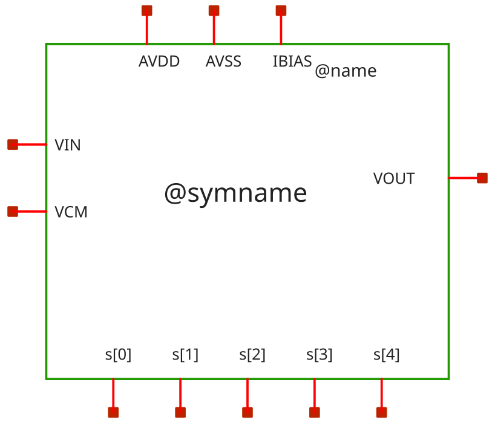
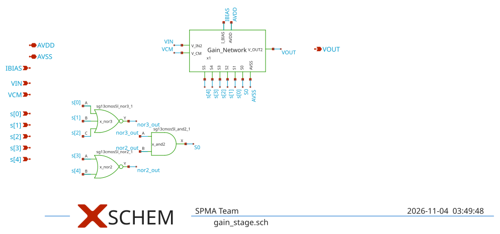

# gain_stage

- Description: Binary programmable gain stage with standard-cell S0 decoding and 6-tap binary feedback network
- PDK: ihp-sg13cmos5l

## Authorship

- Designer: SPMA
- Created: November 3, 2026
- License: MIT
- Company: None
- Last modified: None

## Pins

- AVDD
  + Description: Positive analog power supply
  + Type: power
  + Direction: inout
  + Vmin: 1.08
  + Vmax: 1.5
- AVSS
  + Description: Analog ground
  + Type: ground
  + Direction: inout
- IBIAS
  + Description: Bias current input
  + Type: signal
  + Direction: input
- VCM
  + Description: Common-mode reference input
  + Type: signal
  + Direction: input
- VIN
  + Description: Analog input signal
  + Type: signal
  + Direction: input
- VOUT
  + Description: Output signal to next gain stage or buffer
  + Type: signal
  + Direction: output
- s[0]
  + Description: Gain select bit 0 (Tap 1: +6.02 dB / 2x)
  + Type: signal
  + Direction: input
- s[1]
  + Description: Gain select bit 1 (Tap 2: +12.04 dB / 4x)
  + Type: signal
  + Direction: input
- s[2]
  + Description: Gain select bit 2 (Tap 3: +18.06 dB / 8x)
  + Type: signal
  + Direction: input
- s[3]
  + Description: Gain select bit 3 (Tap 4: +24.08 dB / 16x)
  + Type: signal
  + Direction: input
- s[4]
  + Description: Gain select bit 4 (Tap 5: +30.10 dB / 32x)
  + Type: signal
  + Direction: input

## Default Conditions

- vdd
  + Description: Analog power supply voltage
  + Display: Vdd
  + Unit: V
  + Typical: 1.2
- vcm
  + Description: Input common mode voltage
  + Display: Vcm
  + Unit: V
  + Typical: 0.6
- ib
  + Description: Bias current
  + Display: Ib
  + Unit: uA
  + Typical: 1
- cl
  + Description: Output load capacitance
  + Display: CLoad
  + Unit: pF
  + Typical: 2
- gain_tap
  + Description: Active binary gain tap (0=0dB to 5=30dB)
  + Display: Tap
  + Typical: 0
- corner
  + Description: Process corner
  + Display: Corner
  + Typical: tt
- rcorner
  + Description: Resistor corner (res_<rcorner> section of cornerRES.lib)
  + Display: Rcorner
  + Typical: typ
- temperature
  + Description: Ambient temperature
  + Display: Temp
  + Unit: °C
  + Typical: 27

## Symbol

## Schematic

