# CACE Summary for gain_stage

**netlist source**: schematic

|      Parameter       |         Tool         |     Result      | Min Limit  |  Min Value   | Typ Target |  Typ Value   | Max Limit  |  Max Value   |  Status  |
| :------------------- | :------------------- | :-------------- | ---------: | -----------: | ---------: | -----------: | ---------: | -----------: | :------: |
| Closed-loop gain @10 kHz | ngspice              | A_CL                 |             any |  -4.204 dB |         0 dB |  15.967 dB |          any |  30.683 dB |   Pass ✅    |
| Gain error vs target | ngspice              | A_ERR                |             any | -32.116 dB |         0 dB |  -0.041 dB |          any |   7.307 dB |   Pass ✅    |
| -3 dB bandwidth      | ngspice              | F3DB                 |        20000 Hz | 257623.000 Hz |          any | 1925895.000 Hz |          any | 17383400.000 Hz |   Pass ✅    |
| 0 dB frequency       | ngspice              | F0DB                 |             any | 1938010.000 Hz |          any | 10837550.000 Hz |          any | 100000000.000 Hz |   Pass ✅    |
| Phase @0 dB          | ngspice              | PH0                  |             any | -180.000 ° |          any |   56.944 ° |          any |  161.600 ° |   Pass ✅    |
| Output offset voltage | ngspice              | VOS                  |             any | -330.326 mV |     0.013 mV |  -2.304 mV |          any | 476.591 mV |   Pass ✅    |
| Quiescent current    | ngspice              | IQ                   |             any |  59.534 uA |        74 uA |  72.837 uA |       150 uA |  86.545 uA |   Pass ✅    |
| DC power dissipation | ngspice              | PWR                  |             any |  64.296 uW |      88.6 uW |  87.399 uW |       200 uW | 129.817 uW |   Pass ✅    |
| DC output voltage    | ngspice              | VOUT                 |             any |    0.270 V |        0.6 V |    0.598 V |          any |    1.077 V |   Pass ✅    |
| Input noise @10 Hz   | ngspice              | IRN_10               |             any | 5575.600 nV/rtHz |          any | 7108.350 nV/rtHz |          any | 12509.900 nV/rtHz |   Pass ✅    |
| Input noise @100 Hz  | ngspice              | IRN_100              |             any | 1763.990 nV/rtHz |          any | 2248.865 nV/rtHz |          any | 3957.830 nV/rtHz |   Pass ✅    |
| Input noise @1 kHz   | ngspice              | IRN_1K               |             any | 560.448 nV/rtHz | 1500 nV/rtHz | 714.317 nV/rtHz | 3500 nV/rtHz | 1257.340 nV/rtHz |   Pass ✅    |
| Input noise @10 kHz  | ngspice              | IRN_10K              |             any | 185.327 nV/rtHz |          any | 235.850 nV/rtHz |          any | 415.396 nV/rtHz |   Pass ✅    |
| Output noise @1 kHz  | ngspice              | ORN_1K               |             any | 973.814 nV/rtHz |          any | 9513.945 nV/rtHz |          any | 18907.700 nV/rtHz |   Pass ✅    |
| Integrated output noise | ngspice              | ONOISE_TOT           |             any | 583.181 uV-rms |          any | 1477.101 uV-rms |          any | 2457.040 uV-rms |   Pass ✅    |
| In-band input noise  | ngspice              | INOISE_EQ            |             any | 73.532 uV-rms |          any | 216.744 uV-rms |          any | 752.975 uV-rms |   Pass ✅    |
| Transient step gain  | ngspice              | TR_GAIN              |             any |    0.77379 |          1.0 | 6.844110000000001 |          any |     32.896 |   Pass ✅    |
| Percentage overshoot | ngspice              | OVERSHOOT            |             any |    0.000 % |          0 % |    0.000 % |         20 % |    9.951 % |   Pass ✅    |
| Settling time (0.1%) | ngspice              | SETTLING_TIME        |             any |   0.085 us |       0.8 us |   0.599 us |       5.0 us |   2.769 us |   Pass ✅    |
| Slew rate positive   | ngspice              | SR_POS               |       1.0e6 V/s | 3512510.000 V/s |    3.0e6 V/s | 6921160.000 V/s |          any | 9062330.000 V/s |   Pass ✅    |
| Slew rate negative   | ngspice              | SR_NEG               |       1.0e6 V/s | 4064210.000 V/s |    4.0e6 V/s | 6328610.000 V/s |          any | 6585310.000 V/s |   Pass ✅    |
| THD in dB            | ngspice              | THD_DB               |             any | -54.588 dB |       -49 dB | -35.823 dB |       -20 dB | -22.210 dB |   Pass ✅    |
| THD in %             | ngspice              | THD_PCT              |             any |    0.186 % |       0.35 % |    1.618 % |         10 % |    7.753 % |   Pass ✅    |
| 2nd harmonic         | ngspice              | HD2_DB               |             any | -56.703 dB |          any | -35.874 dB |          any | -27.479 dB |   Pass ✅    |
| 3rd harmonic         | ngspice              | HD3_DB               |             any | -78.020 dB |          any | -59.880 dB |          any | -24.493 dB |   Pass ✅    |
| Fundamental output amplitude | ngspice              | VO1                  |             any |    0.155 V |          any |    0.218 V |          any |    0.282 V |   Pass ✅    |
| PSRR @10 Hz          | ngspice              | PSRR_DC              |           25 dB |  27.044 dB |        37 dB |  33.311 dB |          any |  37.880 dB |   Pass ✅    |
| PSRR @100 kHz        | ngspice              | PSRR_100K            |           25 dB |  27.017 dB |        37 dB |  33.319 dB |          any |  38.052 dB |   Pass ✅    |
| PSRR @1 MHz          | ngspice              | PSRR_1M              |             any |  24.306 dB |          any |  32.916 dB |          any |  41.554 dB |   Pass ✅    |
| CMRR @10 Hz          | ngspice              | CMRR_DC              |           50 dB |  34.063 dB |        67 dB |  58.607 dB |          any |  67.565 dB |   Fail ❌    |
| CMRR @100 kHz        | ngspice              | CMRR_100K            |           25 dB |  33.019 dB |        42 dB |  40.514 dB |          any |  44.170 dB |   Pass ✅    |
| CMRR @1 MHz          | ngspice              | CMRR_1M              |             any |  15.640 dB |          any |  25.909 dB |          any |  32.954 dB |   Pass ✅    |
| Max glitch voltage deviation | ngspice              | V_GLITCH_MAX         |             any |   3.367 mV |        50 mV |  10.157 mV |       200 mV |  16.329 mV |   Pass ✅    |
| Gain switching settling time | ngspice              | T_SWITCH_SETTLE      |             any |   0.021 us |       0.5 us |   0.069 us |       3.0 us |   2.112 us |   Pass ✅    |

## Plots

## ac_gain_A_CL_vs_temperature

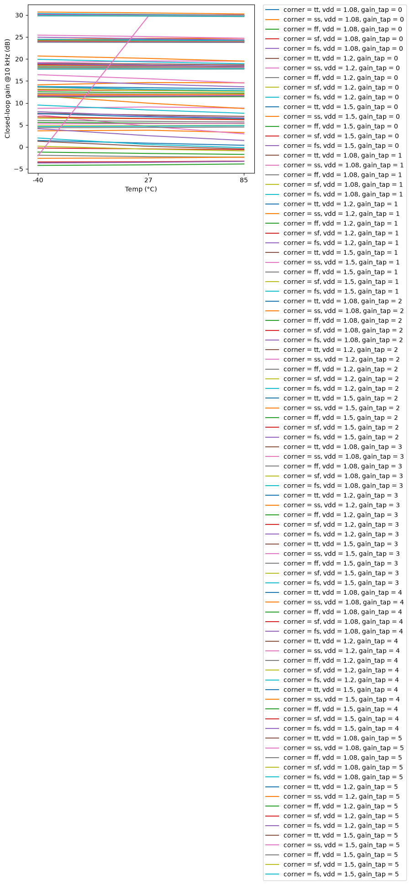

## ac_gain_F3DB_vs_temperature

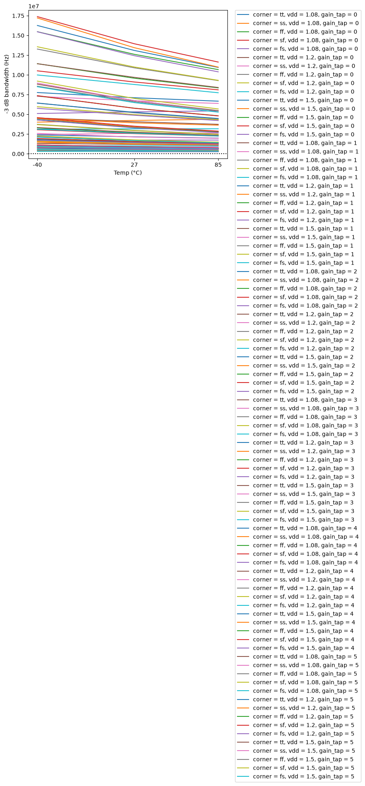

## ac_gain_A_CL_vs_vdd

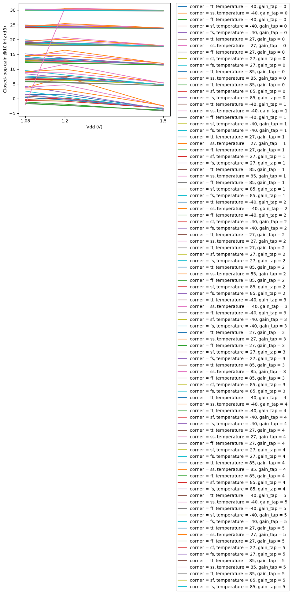

## dc_op_VOS_vs_temperature

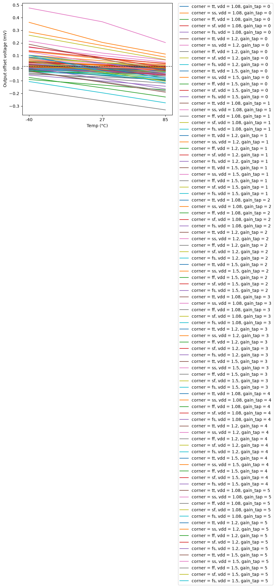

## dc_op_PWR_vs_temperature

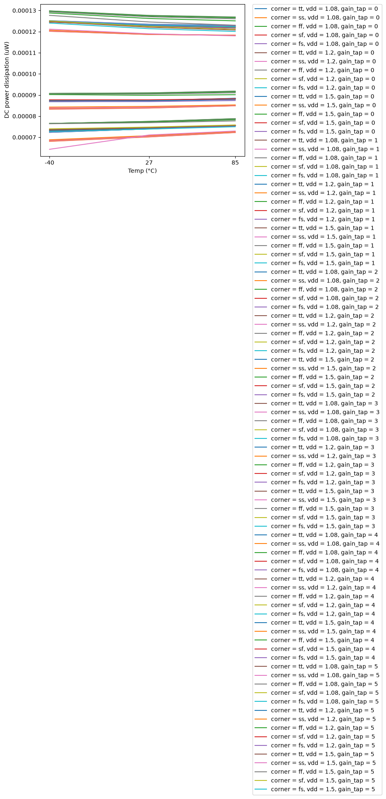

## dc_op_IQ_vs_vdd

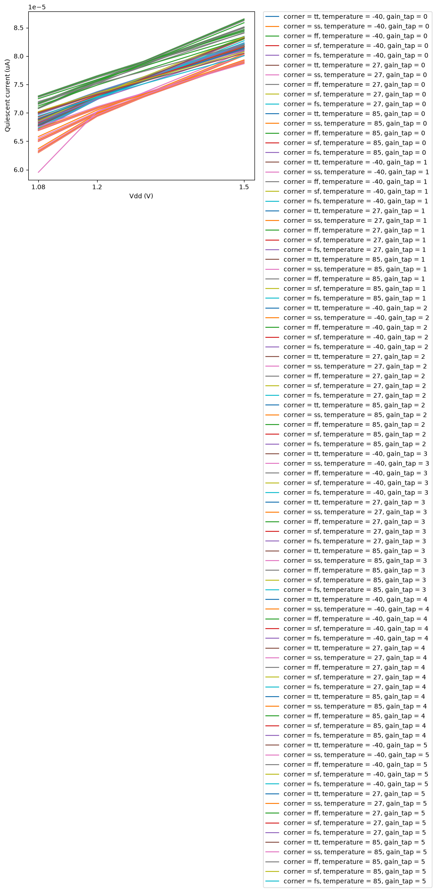

## noise_IRN_1K_vs_temperature

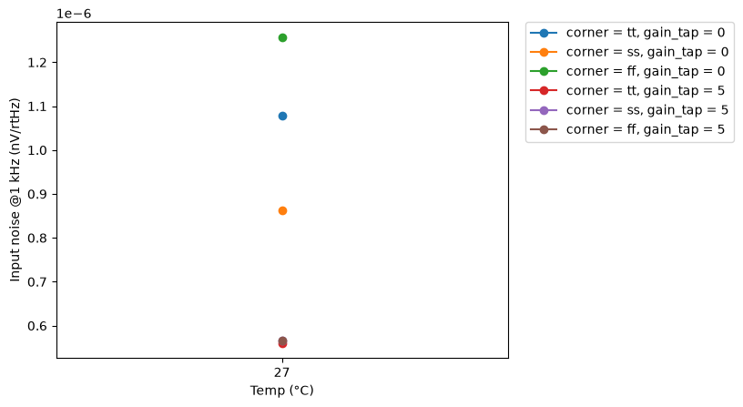

## noise_ONOISE_TOT_vs_temperature

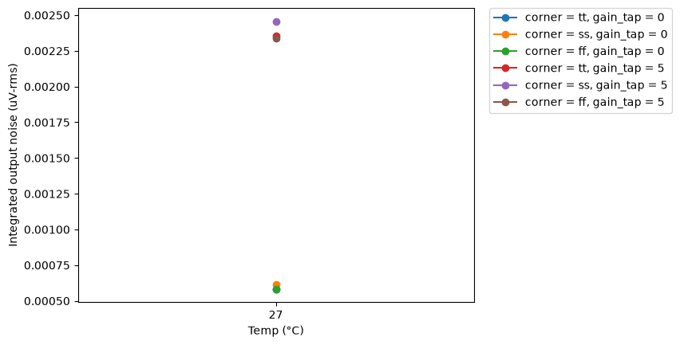

## tran_small_TR_GAIN_vs_temperature

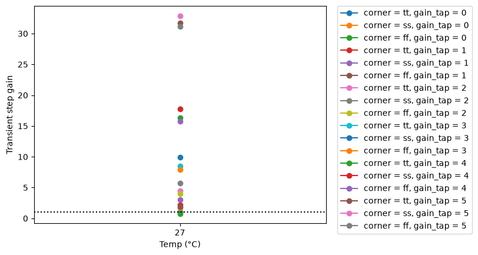

## tran_small_SETTLING_TIME_vs_temperature

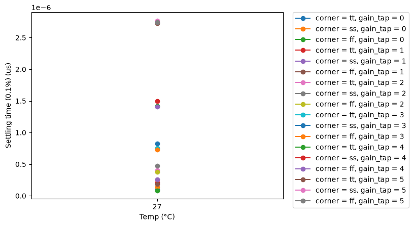

## tran_large_SR_POS_vs_temperature

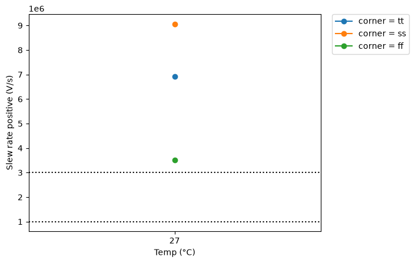

## tran_large_SR_NEG_vs_temperature

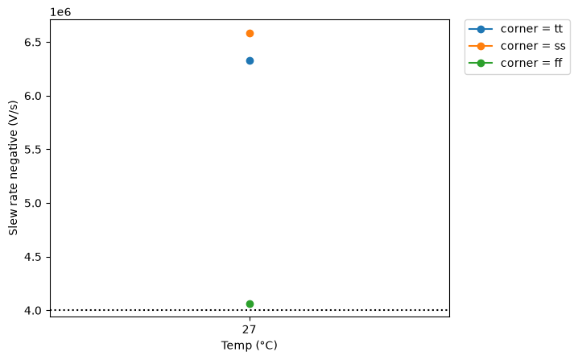

## thd_THD_DB_vs_temperature

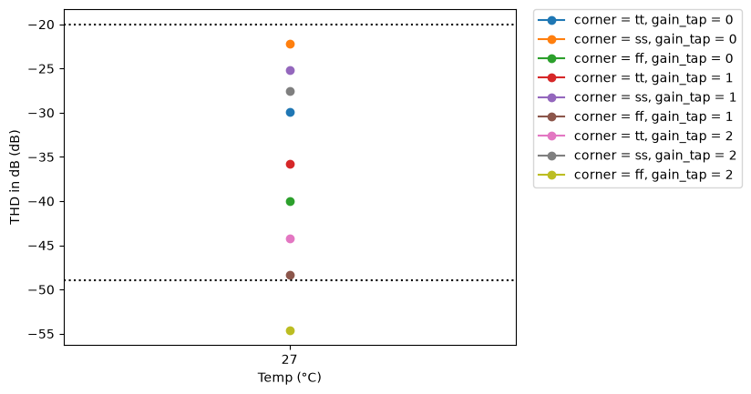

## thd_THD_PCT_vs_temperature

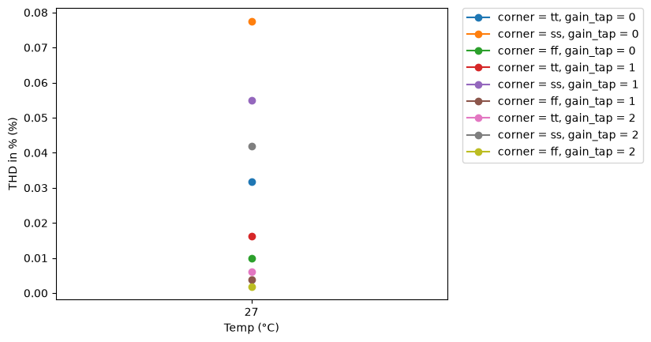

## psrr_PSRR_DC_vs_temperature

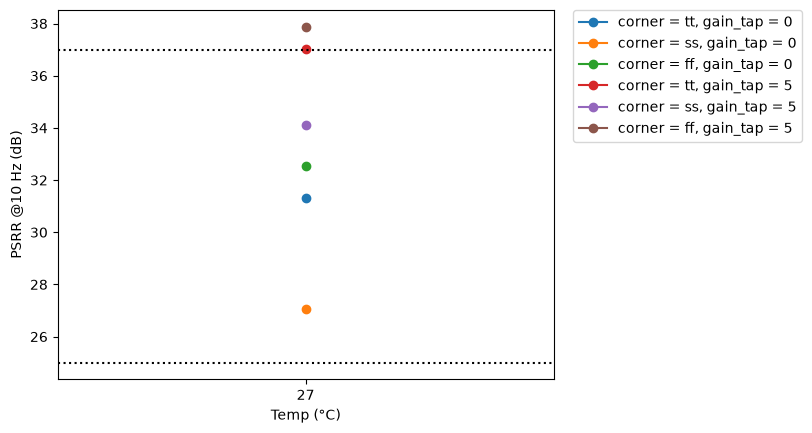

## psrr_PSRR_100K_vs_temperature

## cmrr_CMRR_DC_vs_temperature

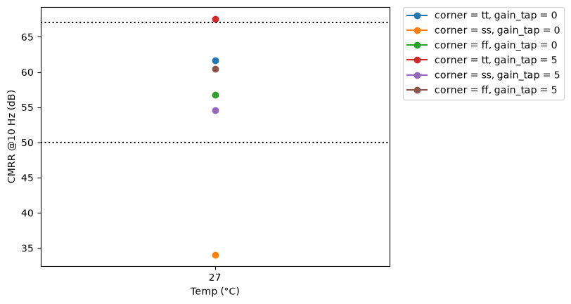

## cmrr_CMRR_100K_vs_temperature

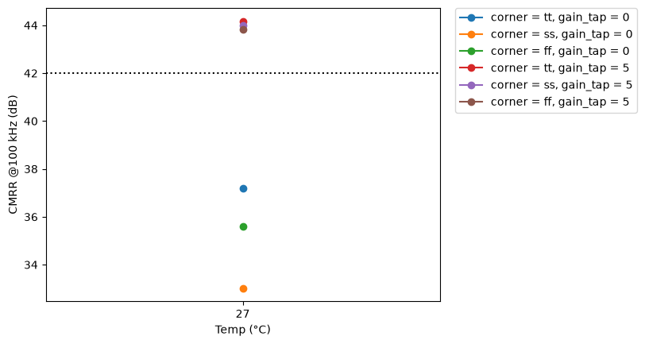

## tran_switch_V_GLITCH_MAX_vs_temperature

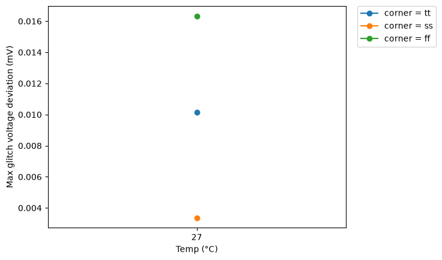

## tran_switch_T_SWITCH_SETTLE_vs_temperature

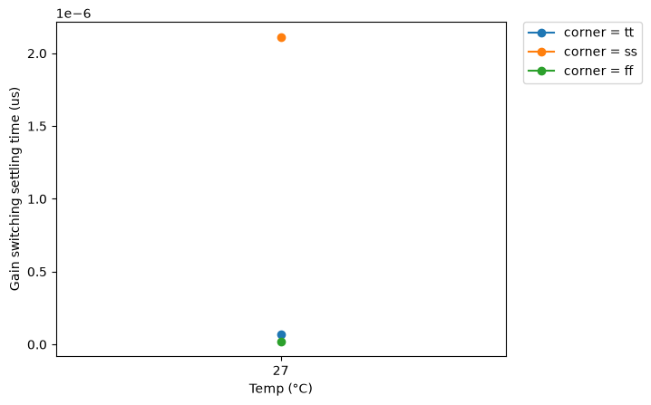
