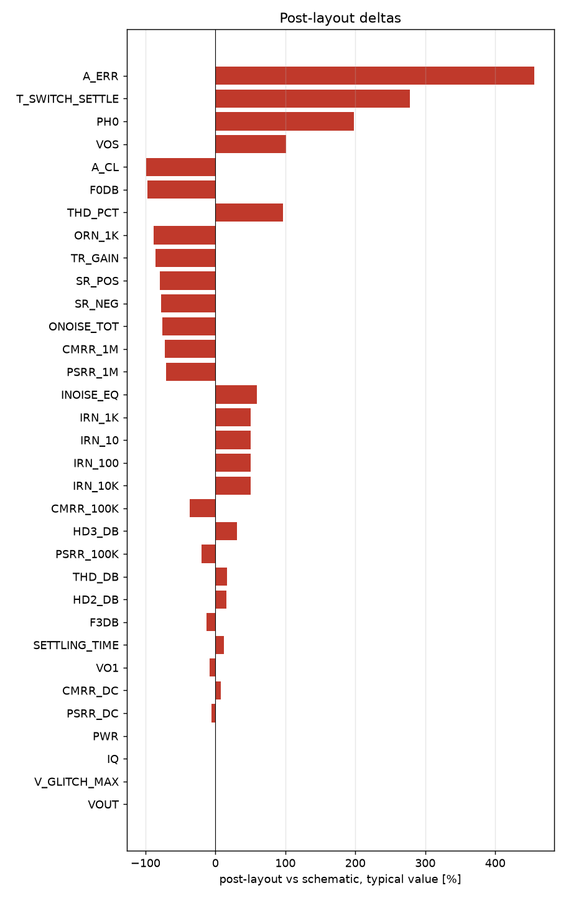

# Schematic vs post-layout

* schematic run: `/foss/designs/sg13cmos5l_spma_ip__instramp/runs/RUN_2026-11-05_17-37-24` (netlist source: schematic)
* post-layout run: `/foss/designs/sg13cmos5l_spma_ip__instramp/runs/pex_cace/gain_stage/RUN_2026-11-05_17-39-29` (netlist source: pex)
* flag threshold: 5 % on the typical value; units as in the CACE summary

| Parameter | Var | Unit | Schematic min / typ / max | Post-layout min / typ / max | Δ typ | Δ typ % | Status | Flag |
|---|---|---|---|---|---:|---:|---|---|
| Closed-loop gain @10 kHz | A_CL | dB | -4.204 / 15.967 / 30.683 | 0.146 / 0.146 / 0.146 | -15.82 | -99.09 | Pass → Pass | Δ |
| Gain error vs target | A_ERR | dB | -32.116 / -0.041 / 7.307 | 0.146 / 0.146 / 0.146 | +0.187 | +456.10 | Pass → Pass | Δ |
| -3 dB bandwidth | F3DB | Hz | 2.5762e+05 / 1.9259e+06 / 1.7383e+07 | 1.6764e+06 / 1.6764e+06 / 1.6764e+06 | -2.495e+05 | -12.95 | Pass → Pass | Δ |
| 0 dB frequency | F0DB | Hz | 1.938e+06 / 1.0838e+07 / 1e+08 | 3.0316e+05 / 3.0316e+05 / 3.0316e+05 | -1.053e+07 | -97.20 | Pass → Pass | Δ |
| Phase @0 dB | PH0 | ° | -180 / 56.944 / 161.6 | 169.51 / 169.51 / 169.51 | +112.6 | +197.69 | Pass → Pass | Δ |
| Output offset voltage | VOS | mV | -330.33 / -2.304 / 476.59 | 0.023 / 0.023 / 0.023 | +2.327 | +101.00 | Pass → Pass | Δ |
| Quiescent current | IQ | uA | 59.534 / 72.837 / 86.545 | 73.476 / 73.476 / 73.476 | +0.639 | +0.88 | Pass → Pass |  |
| DC power dissipation | PWR | uW | 64.296 / 87.399 / 129.82 | 88.171 / 88.171 / 88.171 | +0.772 | +0.88 | Pass → Pass |  |
| DC output voltage | VOUT | V | 0.27 / 0.598 / 1.077 | 0.6 / 0.6 / 0.6 | +0.002 | +0.33 | Pass → Pass |  |
| Input noise @10 Hz | IRN_10 | nV/rtHz | 5575.6 / 7108.4 / 12510 | 10721 / 10721 / 10721 | +3612 | +50.82 | Pass → Pass | Δ |
| Input noise @100 Hz | IRN_100 | nV/rtHz | 1764 / 2248.9 / 3957.8 | 3391.7 / 3391.7 / 3391.7 | +1143 | +50.82 | Pass → Pass | Δ |
| Input noise @1 kHz | IRN_1K | nV/rtHz | 560.45 / 714.32 / 1257.3 | 1077.4 / 1077.4 / 1077.4 | +363.1 | +50.83 | Pass → Pass | Δ |
| Input noise @10 kHz | IRN_10K | nV/rtHz | 185.33 / 235.85 / 415.4 | 355.64 / 355.64 / 355.64 | +119.8 | +50.79 | Pass → Pass | Δ |
| Output noise @1 kHz | ORN_1K | nV/rtHz | 973.81 / 9513.9 / 18908 | 1095.7 / 1095.7 / 1095.7 | -8418 | -88.48 | Pass → Pass | Δ |
| Integrated output noise | ONOISE_TOT | uV-rms | 583.18 / 1477.1 / 2457 | 351.3 / 351.3 / 351.3 | -1126 | -76.22 | Pass → Pass | Δ |
| In-band input noise | INOISE_EQ | uV-rms | 73.532 / 216.74 / 752.98 | 345.44 / 345.44 / 345.44 | +128.7 | +59.38 | Pass → Pass | Δ |
| Transient step gain | TR_GAIN |  | 0.77379 / 6.8441 / 32.896 | 1.0114 / 1.0114 / 1.0114 | -5.833 | -85.22 | Pass → Pass | Δ |
| Percentage overshoot | OVERSHOOT | % | 0 / 0 / 9.951 | 0 / 0 / 0 | +0 | n/a | Pass → Pass |  |
| Settling time (0.1%) | SETTLING_TIME | us | 0.085 / 0.599 / 2.769 | 0.674 / 0.674 / 0.674 | +0.075 | +12.52 | Pass → Pass | Δ |
| Slew rate positive | SR_POS | V/s | 3.5125e+06 / 6.9212e+06 / 9.0623e+06 | 1.401e+06 / 1.401e+06 / 1.401e+06 | -5.52e+06 | -79.76 | Pass → Pass | Δ |
| Slew rate negative | SR_NEG | V/s | 4.0642e+06 / 6.3286e+06 / 6.5853e+06 | 1.398e+06 / 1.398e+06 / 1.398e+06 | -4.931e+06 | -77.91 | Pass → Pass | Δ |
| THD in dB | THD_DB | dB | -54.588 / -35.823 / -22.21 | -29.94 / -29.94 / -29.94 | +5.883 | +16.42 | Pass → Pass | Δ |
| THD in % | THD_PCT | % | 0.186 / 1.618 / 7.753 | 3.184 / 3.184 / 3.184 | +1.566 | +96.79 | Pass → Pass | Δ |
| 2nd harmonic | HD2_DB | dB | -56.703 / -35.874 / -27.479 | -30.328 / -30.328 / -30.328 | +5.546 | +15.46 | Pass → Pass | Δ |
| 3rd harmonic | HD3_DB | dB | -78.02 / -59.88 / -24.493 | -41.598 / -41.598 / -41.598 | +18.28 | +30.53 | Pass → Pass | Δ |
| Fundamental output amplitude | VO1 | V | 0.155 / 0.218 / 0.282 | 0.199 / 0.199 / 0.199 | -0.019 | -8.72 | Pass → Pass | Δ |
| PSRR @10 Hz | PSRR_DC | dB | 27.044 / 33.311 / 37.88 | 31.362 / 31.362 / 31.362 | -1.949 | -5.85 | Pass → Pass | Δ |
| PSRR @100 kHz | PSRR_100K | dB | 27.017 / 33.319 / 38.052 | 26.578 / 26.578 / 26.578 | -6.741 | -20.23 | Pass → Pass | Δ |
| PSRR @1 MHz | PSRR_1M | dB | 24.306 / 32.916 / 41.554 | 9.706 / 9.706 / 9.706 | -23.21 | -70.51 | Pass → Pass | Δ |
| CMRR @10 Hz | CMRR_DC | dB | 34.063 / 58.607 / 67.565 | 63.172 / 63.172 / 63.172 | +4.565 | +7.79 | Fail → Pass | Δ |
| CMRR @100 kHz | CMRR_100K | dB | 33.019 / 40.514 / 44.17 | 25.704 / 25.704 / 25.704 | -14.81 | -36.56 | Pass → Pass | Δ |
| CMRR @1 MHz | CMRR_1M | dB | 15.64 / 25.909 / 32.954 | 7.105 / 7.105 / 7.105 | -18.8 | -72.58 | Pass → Pass | Δ |
| Max glitch voltage deviation | V_GLITCH_MAX | mV | 3.367 / 10.157 / 16.329 | 10.108 / 10.108 / 10.108 | -0.049 | -0.48 | Pass → Pass |  |
| Gain switching settling time | T_SWITCH_SETTLE | us | 0.021 / 0.069 / 2.112 | 0.261 / 0.261 / 0.261 | +0.192 | +278.26 | Pass → Pass | Δ |

29 row(s) flagged.

