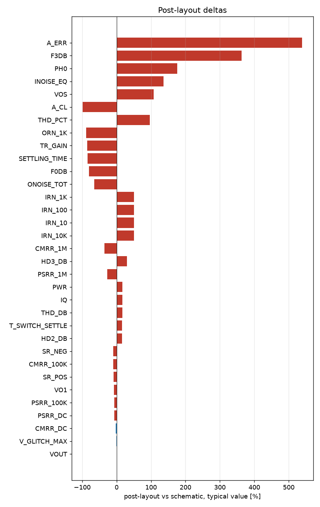

# Schematic vs post-layout

* schematic run: `/foss/designs/sg13cmos5l_spma_ip__instramp/runs/RUN_2026-11-05_17-37-24` (netlist source: schematic)
* post-layout run: `/foss/designs/sg13cmos5l_spma_ip__instramp/runs/pex_cace_rc/gain_stage/RUN_2026-11-05_17-39-40` (netlist source: pex)
* flag threshold: 5 % on the typical value; units as in the CACE summary

| Parameter | Var | Unit | Schematic min / typ / max | Post-layout min / typ / max | Δ typ | Δ typ % | Status | Flag |
|---|---|---|---|---|---:|---:|---|---|
| Closed-loop gain @10 kHz | A_CL | dB | -4.204 / 15.967 / 30.683 | 0.18 / 0.18 / 0.18 | -15.79 | -98.87 | Pass → Pass | Δ |
| Gain error vs target | A_ERR | dB | -32.116 / -0.041 / 7.307 | 0.18 / 0.18 / 0.18 | +0.221 | +539.02 | Pass → Pass | Δ |
| -3 dB bandwidth | F3DB | Hz | 2.5762e+05 / 1.9259e+06 / 1.7383e+07 | 8.9225e+06 / 8.9225e+06 / 8.9225e+06 | +6.997e+06 | +363.29 | Pass → Pass | Δ |
| 0 dB frequency | F0DB | Hz | 1.938e+06 / 1.0838e+07 / 1e+08 | 2.1095e+06 / 2.1095e+06 / 2.1095e+06 | -8.728e+06 | -80.54 | Pass → Pass | Δ |
| Phase @0 dB | PH0 | ° | -180 / 56.944 / 161.6 | 157.41 / 157.41 / 157.41 | +100.5 | +176.42 | Pass → Pass | Δ |
| Output offset voltage | VOS | mV | -330.33 / -2.304 / 476.59 | 0.17 / 0.17 / 0.17 | +2.474 | +107.38 | Pass → Pass | Δ |
| Quiescent current | IQ | uA | 59.534 / 72.837 / 86.545 | 84.835 / 84.835 / 84.835 | +12 | +16.47 | Pass → Pass | Δ |
| DC power dissipation | PWR | uW | 64.296 / 87.399 / 129.82 | 101.8 / 101.8 / 101.8 | +14.4 | +16.48 | Pass → Pass | Δ |
| DC output voltage | VOUT | V | 0.27 / 0.598 / 1.077 | 0.6 / 0.6 / 0.6 | +0.002 | +0.33 | Pass → Pass |  |
| Input noise @10 Hz | IRN_10 | nV/rtHz | 5575.6 / 7108.4 / 12510 | 10701 / 10701 / 10701 | +3593 | +50.54 | Pass → Pass | Δ |
| Input noise @100 Hz | IRN_100 | nV/rtHz | 1764 / 2248.9 / 3957.8 | 3385.5 / 3385.5 / 3385.5 | +1137 | +50.54 | Pass → Pass | Δ |
| Input noise @1 kHz | IRN_1K | nV/rtHz | 560.45 / 714.32 / 1257.3 | 1075.4 / 1075.4 / 1075.4 | +361.1 | +50.55 | Pass → Pass | Δ |
| Input noise @10 kHz | IRN_10K | nV/rtHz | 185.33 / 235.85 / 415.4 | 355.02 / 355.02 / 355.02 | +119.2 | +50.53 | Pass → Pass | Δ |
| Output noise @1 kHz | ORN_1K | nV/rtHz | 973.81 / 9513.9 / 18908 | 1097.9 / 1097.9 / 1097.9 | -8416 | -88.46 | Pass → Pass | Δ |
| Integrated output noise | ONOISE_TOT | uV-rms | 583.18 / 1477.1 / 2457 | 523.62 / 523.62 / 523.62 | -953.5 | -64.55 | Pass → Pass | Δ |
| In-band input noise | INOISE_EQ | uV-rms | 73.532 / 216.74 / 752.98 | 512.9 / 512.9 / 512.9 | +296.2 | +136.64 | Pass → Pass | Δ |
| Transient step gain | TR_GAIN |  | 0.77379 / 6.8441 / 32.896 | 1.0159 / 1.0159 / 1.0159 | -5.828 | -85.16 | Pass → Pass | Δ |
| Percentage overshoot | OVERSHOOT | % | 0 / 0 / 9.951 | 18.9 / 18.9 / 18.9 | +18.9 | n/a | Pass → Pass |  |
| Settling time (0.1%) | SETTLING_TIME | us | 0.085 / 0.599 / 2.769 | 0.095 / 0.095 / 0.095 | -0.504 | -84.14 | Pass → Pass | Δ |
| Slew rate positive | SR_POS | V/s | 3.5125e+06 / 6.9212e+06 / 9.0623e+06 | 6.286e+06 / 6.286e+06 / 6.286e+06 | -6.352e+05 | -9.18 | Pass → Pass | Δ |
| Slew rate negative | SR_NEG | V/s | 4.0642e+06 / 6.3286e+06 / 6.5853e+06 | 5.7122e+06 / 5.7122e+06 / 5.7122e+06 | -6.164e+05 | -9.74 | Pass → Pass | Δ |
| THD in dB | THD_DB | dB | -54.588 / -35.823 / -22.21 | -29.941 / -29.941 / -29.941 | +5.882 | +16.42 | Pass → Pass | Δ |
| THD in % | THD_PCT | % | 0.186 / 1.618 / 7.753 | 3.184 / 3.184 / 3.184 | +1.566 | +96.79 | Pass → Pass | Δ |
| 2nd harmonic | HD2_DB | dB | -56.703 / -35.874 / -27.479 | -30.325 / -30.325 / -30.325 | +5.549 | +15.47 | Pass → Pass | Δ |
| 3rd harmonic | HD3_DB | dB | -78.02 / -59.88 / -24.493 | -41.645 / -41.645 / -41.645 | +18.23 | +30.45 | Pass → Pass | Δ |
| Fundamental output amplitude | VO1 | V | 0.155 / 0.218 / 0.282 | 0.2 / 0.2 / 0.2 | -0.018 | -8.26 | Pass → Pass | Δ |
| PSRR @10 Hz | PSRR_DC | dB | 27.044 / 33.311 / 37.88 | 31.152 / 31.152 / 31.152 | -2.159 | -6.48 | Pass → Pass | Δ |
| PSRR @100 kHz | PSRR_100K | dB | 27.017 / 33.319 / 38.052 | 30.989 / 30.989 / 30.989 | -2.33 | -6.99 | Pass → Pass | Δ |
| PSRR @1 MHz | PSRR_1M | dB | 24.306 / 32.916 / 41.554 | 24.042 / 24.042 / 24.042 | -8.874 | -26.96 | Pass → Pass | Δ |
| CMRR @10 Hz | CMRR_DC | dB | 34.063 / 58.607 / 67.565 | 56.777 / 56.777 / 56.777 | -1.83 | -3.12 | Fail → Pass |  |
| CMRR @100 kHz | CMRR_100K | dB | 33.019 / 40.514 / 44.17 | 36.618 / 36.618 / 36.618 | -3.896 | -9.62 | Pass → Pass | Δ |
| CMRR @1 MHz | CMRR_1M | dB | 15.64 / 25.909 / 32.954 | 16.679 / 16.679 / 16.679 | -9.23 | -35.62 | Pass → Pass | Δ |
| Max glitch voltage deviation | V_GLITCH_MAX | mV | 3.367 / 10.157 / 16.329 | 10.045 / 10.045 / 10.045 | -0.112 | -1.10 | Pass → Pass |  |
| Gain switching settling time | T_SWITCH_SETTLE | us | 0.021 / 0.069 / 2.112 | 0.08 / 0.08 / 0.08 | +0.011 | +15.94 | Pass → Pass | Δ |

30 row(s) flagged.

