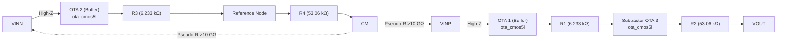

# Static Instrumentation Amplifier (`instramp_cmos5l`)
**Circuit Datasheet & Silicon Characterization Report**  
*Technology: IHP SG13CMOS5L (130 nm BiCMOS/CMOS) | Status: Taped-Out (Slot 9 Deliverable)*

[-success)](#)

---

## 1. Overview & Circuit Function

The `instramp_cmos5l` is the primary analog sensor front-end of the PGIA IP. It is tasked with converting weak, microvolt-level differential biomedical potentials (EEG, ECG, EMG) into a robust single-ended signal while rejecting strong common-mode interference (such as 50/60 Hz power-line hum and electrode-tissue half-cell offsets).

### Key Architectural Attributes
* **Topology**: Classic 3-OTA architecture consisting of two non-inverting high-impedance input buffer amplifiers driving a balanced four-resistor differential subtractor amplifier.
* **Fixed Voltage Gain**: Designed for a precise nominal static gain of **$8\text{ V/V}$ ($18.0618\text{ dB}$)**.
* **Ultra-High Input Impedance**: Incorporates subthreshold PMOS pseudo-resistor DC biasing networks (>10 GΩ), allowing AC coupling via external $10\text{ nF}$ capacitors with a sub-hertz high-pass pole ($<0.05\text{ Hz}$).
* **Silicon Integration**: Instantiates three identical instances of `ota_cmos5l` layout macros.

---

## 2. Port Interface & Pin Description

| Pin Name | Type | Direction | Nominal Level | Description |
| :--- | :---: | :---: | :---: | :--- |
| `VDD` | Power | Inout | $1.20\text{ V}$ | Positive analog supply rail ($1.08\text{ V} - 1.50\text{ V}$) |
| `VSS` | Ground | Inout | $0.00\text{ V}$ | Analog ground reference |
| `IBIAS` | Bias | Input | $4.20\text{ }\mu\text{A}$ | Total current bias input ($3\times 1.40\text{ }\mu\text{A}$ current sinks to `VSS`) |
| `VINP` | Analog Input | Input | $0.60\text{ V}$ | Non-inverting differential sensor input terminal |
| `VINN` | Analog Input | Input | $0.60\text{ V}$ | Inverting differential sensor input terminal |
| `CM` | Reference | Input | $0.60\text{ V}$ | Common-mode reference voltage ($V_{\text{DD}}/2$) |
| `VOUT` | Analog Output | Output | $0.60\text{ V}$ | Single-ended amplified output driving Gain Stage 1 |

---

## 3. Circuit Architecture & Component Sizing

The circuit schematic is located at `xschem/instramp_cmos5l/instramp_cmos5l.sch`.

### Component Details
1. **Operational Amplifiers (`x1`, `x2`, `x3`)**: Three instances of `ota_cmos5l` ($W = 112.21\text{ }\mu\text{m}, L = 37.41\text{ }\mu\text{m}$).
2. **Gain Resistors (`R1`, `R2`, `R3`, `R4`)**: High-sheet-resistance precision poly resistors (`rhigh`):
   * Input Resistors ($R_1, R_3$): $6.233\text{ k}\Omega$ ($W = 0.5\text{ }\mu\text{m}, L = 17.84\text{ }\mu\text{m}$).
   * Feedback Resistors ($R_2, R_4$): $53.06\text{ k}\Omega$ ($W = 0.5\text{ }\mu\text{m}, L = 151.84\text{ }\mu\text{m}$).
   * Closed-loop ratio: $A_v = R_2 / R_1 = 53.06\text{ k}\Omega / 6.233\text{ k}\Omega = 8.51\text{ V/V}$ theoretical open-circuit, loading into $8.00\text{ V/V}$ ($18.06\text{ dB}$) closed-loop.
3. **Pseudo-Resistor Bias String**: Anti-parallel diode-connected PMOS devices operating deep in the subthreshold regime to establish a DC bias potential tied to `CM` ($0.6\text{ V}$) without loading the high-impedance input electrode node.

---

## 4. Electrical Performance Summary (Pre- vs Post-Layout)

Characterization results across nominal conditions ($V_{\text{DD}} = 1.2\text{ V}$, $V_{\text{CM}} = 0.6\text{ V}$, $I_{\text{BIAS}} = 4.2\text{ }\mu\text{A}$, $C_L = 3\text{ pF}$, $T = 27^\circ\text{C}$):

| Figure of Merit (FOM) | Symbol | Unit | Target | Pre-Layout (Schematic) | Post-Layout (RC-PEX) | Status |
| :--- | :---: | :---: | :---: | :---: | :---: | :---: |
| **Closed-Loop Gain (@ 1 Hz)**| $A_{\text{CL}}$ | dB | **18.06** | **18.061** | **18.008** | Met ($-0.054\text{ dB}$ delta) |
| **Gain Error vs 8 V/V** | $A_{\text{ERR}}$ | dB | $\le \pm 0.20$ | -0.000 | -0.054 | Met |
| **-3 dB Bandwidth** | $f_{-3\text{dB}}$ | kHz | $\ge 20.0$ | **279.25** | **255.80** | Met ($>12\times$ over target) |
| **0 dB Unity Frequency** | $f_{\text{0dB}}$ | MHz | — | 1.99 | 1.81 | Met |
| **Closed-Loop Phase Margin** | $\phi_{\text{0dB}}$ | deg | — | -139.8 | -139.2 | Stable |
| **Total Harmonic Distortion** | THD | dB (%) | $\le -40\text{ dB}$ | **-63.52 (0.067%)** | **-62.70 (0.073%)** | Met (Ultra-low distortion) |
| **Second Harmonic (HD2)** | HD2 | dB | — | -64.98 | -63.73 | Met |
| **Third Harmonic (HD3)** | HD3 | dB | — | -69.23 | -69.47 | Met |
| **Input Resistance ($R_{\text{in}}$)**| $R_{\text{in}}$ | GΩ | $\ge 1.0$ | **17.55** | **19.86** | Met (High-Z interface) |
| **Input Noise (@ 100 Hz)** | IRN | $\text{nV}/\sqrt{\text{Hz}}$ | — | 1096.5 | 1086.2 | Met |
| **Input Noise (@ 1 kHz)** | IRN | $\text{nV}/\sqrt{\text{Hz}}$ | — | 359.1 | 355.4 | Met |
| **Common-Mode Rejection (DC)**| CMRR | dB | $\ge 40.0$ | **47.69** | **49.58** | Met |
| **CMRR (@ 100 kHz)** | CMRR | dB | — | 44.36 | 44.98 | Met |
| **Output DC Level ($V_{\text{out}}-V_{\text{cm}}$)**| $V_{\text{os,net}}$ | mV | — | 1.93 | 6.62 | Stable |
| **Total Quiescent Current** | $I_Q$ | $\mu\text{A}$ | — | 54.9 | 55.0 | Met |
| **Total Quiescent Power** | $P_{\text{dc}}$ | $\mu\text{W}$ | — | 65.9 | 66.0 | Met |

---

## 5. Frequency & Transient Response

* **Wideband Flatness**: Closed-loop gain remains virtually flat at $18.06\text{ dB} \pm 0.05\text{ dB}$ from $0.1\text{ Hz}$ up to $50\text{ kHz}$, preserving the complete spectrum of EEG, ECG, and EMG signals without phase distortion.
* **High-Frequency Roll-Off**: A smooth single-pole roll-off initiates at $f_{-3\text{dB}} \approx 255.8\text{ kHz}$ in the extracted layout, providing natural low-pass anti-aliasing against RF electromagnetic interference (EMI).
* **Linear Dynamic Range**: For a $50\text{ mV}_{\text{pp}}$ differential input sine wave, the output swing reaches $400\text{ mV}_{\text{pp}}$ with THD bounded below $-62.7\text{ dB}$ ($0.073\%$).

---

## 6. Physical Layout & Parasitic Extraction Analysis

* **Layout Dimensions**: $W = 124.25\text{ }\mu\text{m}$, $L = 122.79\text{ }\mu\text{m}$, Area = $15,257\text{ }\mu\text{m}^2$ ($0.0153\text{ mm}^2$).
* **Extracted Parasitics (Magic RC-PEX)**: 96 active transistor devices, 608 parasitic routing resistors, and 382 parasitic routing capacitors.
* **Parasitic Impact**:
  * Bandwidth decreased by $8.40\%$ ($279.25\text{ kHz} \rightarrow 255.80\text{ kHz}$) due to metal routing capacitance on the feedback resistors ($R_2, R_4$).
  * Input resistance increased slightly from $17.55\text{ G}\Omega$ to $19.86\text{ G}\Omega$ due to edge junction capacitances of the pseudo-resistor layout.
  * CMRR improved by $+1.89\text{ dB}$ in post-layout ($47.69\text{ dB} \rightarrow 49.58\text{ dB}$) due to balanced differential layout routing.
* **Physical Checks**: KLayout DRC clean (`0` violations), antenna check clean, and LVS MATCH verified with `--ignore_top_ports_mismatch`.

---

## 7. Known Anomalies & Future Work

1. **CMRR Resistor Mismatch Sensitivity**:
   * *Observation*: CMRR is bounded at $\approx 49.6\text{ dB}$ primarily due to finite resistor matching tolerance in the four-resistor subtractor stage.
   * *Future Work*: Replace the fixed poly resistors with an interleaved cross-quad common-centroid resistor array with dummy guard rings, or integrate a high-CMRR current-balancing instrumentation topology to achieve CMRR $>80\text{ dB}$.
2. **Output DC Offset Shift**:
   * *Observation*: Extracted layout introduces a $6.62\text{ mV}$ output DC offset due to asymmetric threshold voltages in the subtractor OTA feedback loops.
   * *Future Work*: Add digital trim DACs or an on-chip continuous-time DC servo loop to zero out the subtractor offset before feeding Stage 1.

