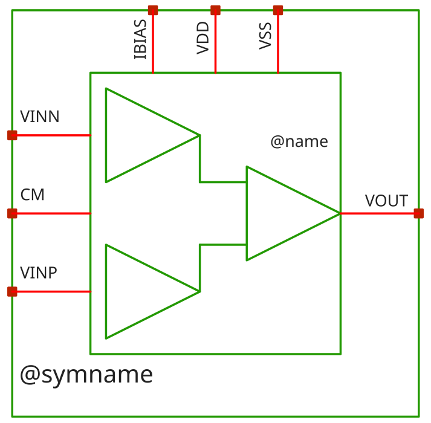
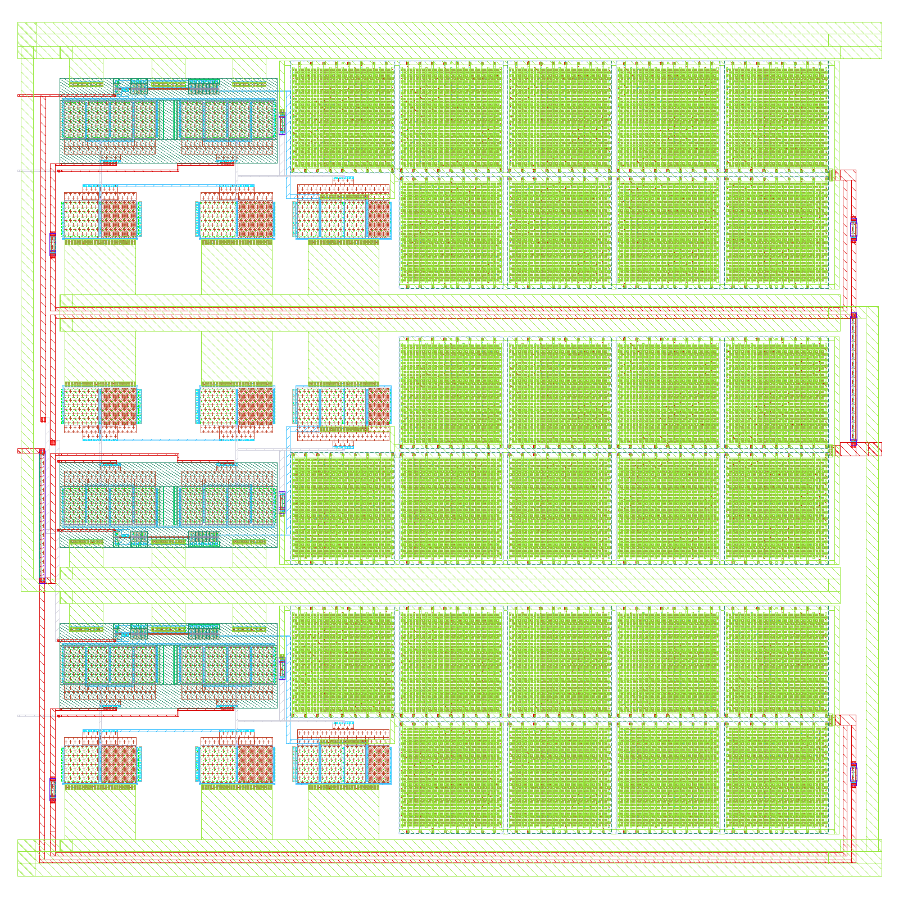
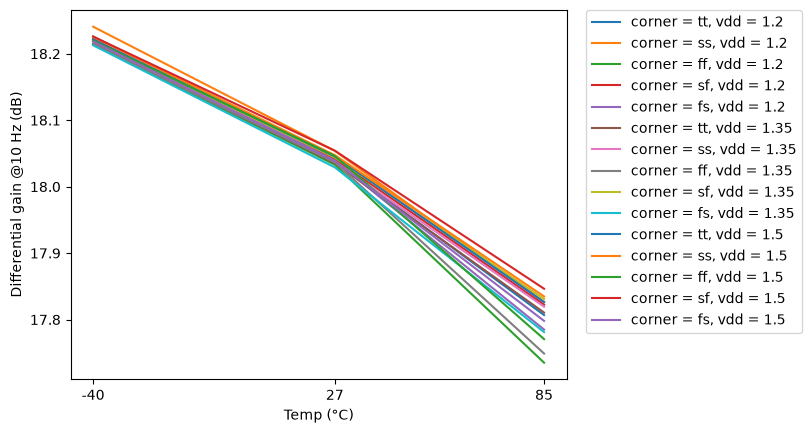
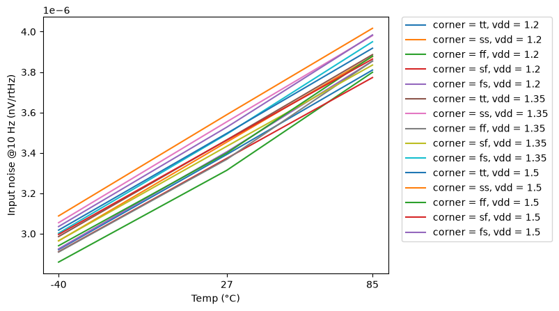
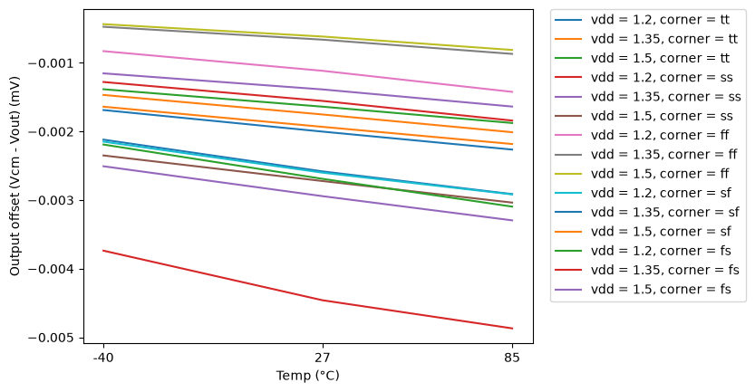
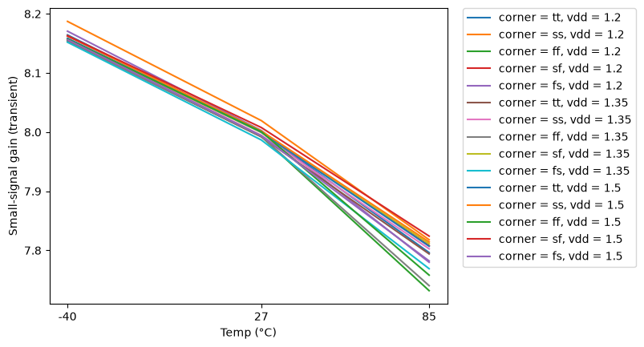

# instramp_cmos5l - CACE characterisation

- Generated: 2026-10-21 10:04 by `scripts/make_readme.py` from `runs/RUN_2026-10-21_10-03-50`
- Commit: `2bf6127` (working tree dirty)
- Netlist source: schematic; datasheet: `cace/instramp_cmos5l.yaml`; reproduce with `scripts/run_cace.sh instramp_cmos5l`
- Sections marked *(CACE)* are written by CACE itself, the rest by this script (CACE has no per-corner MC statistics, worst-case conditions or unit-scaled spread plots).

## Design *(CACE)*

- Description: Three-OTA instrumentation amplifier, closed-loop gain 8 V/V (18.0618 dB)
- PDK: ihp-sg13cmos5l

### Authorship

- Designer: SPMA
- Created: October 13, 2026
- License: MIT
- Company: None
- Last modified: None

### Pins

- VDD
  + Description: Positive analog power supply
  + Type: power
  + Direction: inout
  + Vmin: 1.2
  + Vmax: 1.5
- VSS
  + Description: Analog ground
  + Type: ground
  + Direction: inout
- IBIAS
  + Description: Bias current input (shared by the three OTAs, 1.4 uA each)
  + Type: signal
  + Direction: input
- VINP
  + Description: Non-inverting input
  + Type: signal
  + Direction: input
- VINN
  + Description: Inverting input
  + Type: signal
  + Direction: input
- CM
  + Description: Common-mode reference (input resistor divider centre)
  + Type: signal
  + Direction: input
- VOUT
  + Description: Output
  + Type: signal
  + Direction: output

### Default Conditions

- vdd
  + Description: Analog power supply voltage
  + Display: Vdd
  + Unit: V
  + Typical: 1.2
- vcm
  + Description: Input and CM pin common-mode voltage
  + Display: Vcm
  + Unit: V
  + Typical: 0.6
- ib
  + Description: Total bias current (three OTAs)
  + Display: Ib
  + Unit: uA
  + Typical: 4.2
- fin
  + Description: Input sine frequency for THD
  + Display: Fin
  + Unit: kHz
  + Typical: 1
- vin_amp
  + Description: Differential input sine amplitude (peak) for THD
  + Display: Vin amp
  + Unit: mV
  + Typical: 25
- cl
  + Description: Output load capacitance
  + Display: CLoad
  + Unit: pF
  + Typical: 3
- corner
  + Description: Process corner
  + Display: Corner
  + Typical: tt
- rcorner
  + Description: Resistor corner (res_<rcorner> section of cornerRES.lib)
  + Display: Rcorner
  + Typical: typ
- temperature
  + Description: Ambient temperature
  + Display: Temp
  + Unit: °C
  + Typical: 27

### Symbol

### Schematic

**Parameters** (`.param` of the schematic and of the cells it instantiates; generated by `scripts/update_images.py`, do not edit)

| Source | Parameter | Value |
|---|---|---|
| ota_cmos5l (x1, x2, x3) | `temp` | `27` |
| ota_cmos5l (x1, x2, x3) | `lbias` | `0.15u` |
| ota_cmos5l (x1, x2, x3) | `wbias` | `0.15u` |
| ota_cmos5l (x1, x2, x3) | `m6` | `1` |
| ota_cmos5l (x1, x2, x3) | `m7` | `4` |
| ota_cmos5l (x1, x2, x3) | `m8` | `8` |
| ota_cmos5l (x1, x2, x3) | `linpair` | `3u` |
| ota_cmos5l (x1, x2, x3) | `winpair` | `20u` |
| ota_cmos5l (x1, x2, x3) | `lload` | `5u` |
| ota_cmos5l (x1, x2, x3) | `wload` | `10u` |
| ota_cmos5l (x1, x2, x3) | `lcs` | `3u` |
| ota_cmos5l (x1, x2, x3) | `wcs` | `20u` |
| ota_cmos5l (x1, x2, x3) | `Cc` | `2p` |

### Layout

**Physical size** (bounding box of `instramp_cmos5l`; generated by `scripts/update_images.py`)

| Width W | Length L | Area |
|---|---|---|
| 124.25 µm | 122.79 µm | 15257 µm² |

## Results summary *(CACE)*

min / typ / max over all conditions of a parameter; Monte Carlo parameters (`mc_*`) are min/max over all samples.

**netlist source**: schematic

|      Parameter       |         Tool         |     Result      | Min Limit  |  Min Value   | Typ Target |  Typ Value   | Max Limit  |  Max Value   |  Status  |
| :------------------- | :------------------- | :-------------- | ---------: | -----------: | ---------: | -----------: | ---------: | -----------: | :------: |
| Closed-loop gain at 1 Hz | ngspice              | A_CL                 |             any |  17.765 dB |   18.0618 dB |  18.061 dB |          any |  18.262 dB |   Pass ✅    |
| Gain error vs 8 V/V  | ngspice              | A_ERR                |             any |  -0.297 dB |          any |  -0.000 dB |          any |   0.200 dB |   Pass ✅    |
| -3 dB bandwidth      | ngspice              | F3DB                 |             any | 208894.000 Hz |          any | 279254.000 Hz |          any | 361657.000 Hz |   Pass ✅    |
| 0 dB frequency       | ngspice              | F0DB                 |             any | 1506090.000 Hz |          any | 1987590.000 Hz |          any | 2539050.000 Hz |   Pass ✅    |
| Closed-loop phase at 0 dB | ngspice              | PH0                  |             any | -143.186 ° |          any | -139.829 ° |          any | -134.184 ° |   Pass ✅    |
| THD                  | ngspice              | THD_DB               |             any | -72.538 dB |          any | -63.520 dB |          any | -46.170 dB |   Pass ✅    |
| THD                  | ngspice              | THD_PCT              |             any |    0.024 % |          any |    0.067 % |          any |    0.491 % |   Pass ✅    |
| 2nd harmonic         | ngspice              | HD2_DB               |             any | -80.791 dB |          any | -64.979 dB |          any | -48.314 dB |   Pass ✅    |
| 3rd harmonic         | ngspice              | HD3_DB               |             any | -76.241 dB |          any | -69.230 dB |          any | -50.352 dB |   Pass ✅    |
| Output fundamental amplitude | ngspice              | VO1                  |             any |    0.192 V |          any |    0.200 V |          any |    0.204 V |   Pass ✅    |
| Differential gain @10 Hz | ngspice              | ADM_DC               |             any |  17.735 dB |          any |  18.039 dB |          any |  18.241 dB |   Pass ✅    |
| CMRR @10 Hz          | ngspice              | CMRR_DC              |             any |  41.798 dB |          any |  47.694 dB |          any |  52.303 dB |   Pass ✅    |
| CMRR @100 kHz        | ngspice              | CMRR_100K            |             any |  38.520 dB |          any |  44.356 dB |          any |  49.510 dB |   Pass ✅    |
| CMRR @1 MHz          | ngspice              | CMRR_1M              |             any |  21.311 dB |          any |  27.278 dB |          any |  32.934 dB |   Pass ✅    |
| Differential gain @10 Hz | ngspice              | ADM_DC               |             any |  17.735 dB |          any |  18.039 dB |          any |  18.241 dB |   Pass ✅    |
| PSRR @10 Hz          | ngspice              | PSRR_DC              |             any |  50.403 dB |          any |  72.884 dB |          any | 102.125 dB |   Pass ✅    |
| PSRR @100 kHz        | ngspice              | PSRR_100K            |             any |  50.344 dB |          any |  62.056 dB |          any |  66.067 dB |   Pass ✅    |
| PSRR @1 MHz          | ngspice              | PSRR_1M              |             any |  41.461 dB |          any |  44.243 dB |          any |  50.529 dB |   Pass ✅    |
| Input noise @10 Hz   | ngspice              | IRN_10               |             any | 2859.500 nV/rtHz |          any | 3453.580 nV/rtHz |          any | 4016.520 nV/rtHz |   Pass ✅    |
| Input noise @100 Hz  | ngspice              | IRN_100              |             any | 906.405 nV/rtHz |          any | 1094.970 nV/rtHz |          any | 1272.920 nV/rtHz |   Pass ✅    |
| Input noise @1 kHz   | ngspice              | IRN_1K               |             any | 293.349 nV/rtHz |          any | 354.553 nV/rtHz |          any | 411.250 nV/rtHz |   Pass ✅    |
| Input noise @10 kHz  | ngspice              | IRN_10K              |             any | 111.854 nV/rtHz |          any | 134.681 nV/rtHz |          any | 155.093 nV/rtHz |   Pass ✅    |
| Output noise @1 kHz  | ngspice              | ORN_1K               |             any | 2392.110 nV/rtHz |          any | 2837.670 nV/rtHz |          any | 3213.450 nV/rtHz |   Pass ✅    |
| Integrated output noise | ngspice              | ONOISE_TOT           |             any | 482.778 uV-rms |          any | 544.195 uV-rms |          any | 593.505 uV-rms |   Pass ✅    |
| In-band input-referred noise (Vn_out / gain) | ngspice              | INOISE_EQ            |             any | 59.204 uV-rms |          any | 67.899 uV-rms |          any | 75.955 uV-rms |   Pass ✅    |
| Output offset (Vcm - Vout) | ngspice              | VOS                  |             any |  -4.870 mV |          any |  -1.933 mV |          any |  -0.436 mV |   Pass ✅    |
| Output voltage       | ngspice              | VOUT                 |             any |    0.600 V |          any |    0.602 V |          any |    0.605 V |   Pass ✅    |
| Quiescent current    | ngspice              | IQ                   |             any |  48.004 uA |          any |  54.873 uA |          any |  59.750 uA |   Pass ✅    |
| Quiescent power      | ngspice              | PWR                  |             any |  57.605 uW |          any |  74.078 uW |          any |  89.625 uW |   Pass ✅    |
| Small-signal gain (transient) | ngspice              | TR_GAIN              |             any |    7.73179 |          any |    7.99988 |          any |    8.18719 |   Pass ✅    |
| Mean output level    | ngspice              | TR_VOUT_AVG          |             any |    0.600 V |          any |    0.602 V |          any |    0.605 V |   Pass ✅    |

### Plots *(CACE)*

#### ac_gain_A_CL_vs_temperature

#### ac_gain_F3DB_vs_temperature

#### ac_gain_A_CL_vs_vdd

#### thd_THD_DB_vs_temperature

#### cmrr_ADM_DC_vs_temperature

#### psrr_ADM_DC_vs_temperature

#### noise_IRN_10_vs_temperature

#### dc_op_VOS_vs_temperature

#### tran_small_TR_GAIN_vs_temperature

## PVT worst-case conditions

Corners tt/ss/ff/sf/fs, supply and temperature as in the yaml. Values in the display unit of the yaml.

### ac_gain - Closed-loop AC gain

45 runs.

| metric | min | at (corner, vdd, T) | max | at (corner, vdd, T) | spec | fails |
|---|---|---|---|---|---|---|
| A_CL [dB] | 17.77 | ff, 1.2 V, 85 C | 18.26 | ss, 1.2 V, -40 C | any | - |
| A_ERR [dB] | -0.2967 | ff, 1.2 V, 85 C | 0.2002 | ss, 1.2 V, -40 C | any | - |
| F3DB [Hz] | 2.089e+05 | ss, 1.2 V, 85 C | 3.617e+05 | ff, 1.5 V, -40 C | any | - |
| F0DB [Hz] | 1.506e+06 | ss, 1.2 V, 85 C | 2.539e+06 | ff, 1.5 V, -40 C | any | - |
| PH0 [°] | -143.2 | ff, 1.5 V, 85 C | -134.2 | ss, 1.2 V, -40 C | any | - |

### thd - Total harmonic distortion

45 runs.

| metric | min | at (corner, vdd, T) | max | at (corner, vdd, T) | spec | fails |
|---|---|---|---|---|---|---|
| THD_DB [dB] | -72.54 | ss, 1.2 V, -40 C | -46.17 | ff, 1.2 V, 85 C | any | - |
| THD_PCT [%] | 0.02361 | ss, 1.2 V, -40 C | 0.4915 | ff, 1.2 V, 85 C | any | - |
| HD2_DB [dB] | -80.79 | ss, 1.2 V, -40 C | -48.31 | ff, 1.2 V, 85 C | any | - |
| HD3_DB [dB] | -76.24 | ff, 1.5 V, -40 C | -50.35 | ff, 1.2 V, 85 C | any | - |
| VO1 [V] | 0.1916 | ff, 1.2 V, 85 C | 0.2045 | ss, 1.2 V, -40 C | any | - |

### cmrr - CMRR

45 runs.

| metric | min | at (corner, vdd, T) | max | at (corner, vdd, T) | spec | fails |
|---|---|---|---|---|---|---|
| ADM_DC [dB] | 17.74 | ff, 1.2 V, 85 C | 18.24 | ss, 1.2 V, -40 C | any | - |
| CMRR_DC [dB] | 41.8 | ss, 1.2 V, 85 C | 52.3 | sf, 1.5 V, -40 C | any | - |
| CMRR_100K [dB] | 38.52 | ss, 1.2 V, 85 C | 49.51 | ff, 1.5 V, -40 C | any | - |
| CMRR_1M [dB] | 21.31 | ss, 1.2 V, 85 C | 32.93 | ff, 1.5 V, -40 C | any | - |

### psrr - PSRR

45 runs.

| metric | min | at (corner, vdd, T) | max | at (corner, vdd, T) | spec | fails |
|---|---|---|---|---|---|---|
| ADM_DC [dB] | 17.74 | ff, 1.2 V, 85 C | 18.24 | ss, 1.2 V, -40 C | any | - |
| PSRR_DC [dB] | 50.4 | ss, 1.2 V, 27 C | 102.1 | sf, 1.5 V, 27 C | any | - |
| PSRR_100K [dB] | 50.34 | ss, 1.2 V, 27 C | 66.07 | ff, 1.5 V, -40 C | any | - |
| PSRR_1M [dB] | 41.46 | ss, 1.5 V, 85 C | 50.53 | fs, 1.2 V, -40 C | any | - |

### noise - Noise

45 runs.

| metric | min | at (corner, vdd, T) | max | at (corner, vdd, T) | spec | fails |
|---|---|---|---|---|---|---|
| IRN_10 [nV/rtHz] | 2859 | ff, 1.2 V, -40 C | 4017 | ss, 1.5 V, 85 C | any | - |
| IRN_100 [nV/rtHz] | 906.4 | ff, 1.2 V, -40 C | 1273 | ss, 1.5 V, 85 C | any | - |
| IRN_1K [nV/rtHz] | 293.3 | ff, 1.2 V, -40 C | 411.2 | ss, 1.5 V, 85 C | any | - |
| IRN_10K [nV/rtHz] | 111.9 | ff, 1.2 V, -40 C | 155.1 | ss, 1.35 V, 85 C | any | - |
| ORN_1K [nV/rtHz] | 2392 | ff, 1.2 V, -40 C | 3213 | ss, 1.5 V, 85 C | any | - |
| ONOISE_TOT [uV-rms] | 482.8 | ff, 1.2 V, -40 C | 593.5 | ss, 1.5 V, 85 C | any | - |
| INOISE_EQ [uV-rms] | 59.2 | ff, 1.2 V, -40 C | 75.95 | ss, 1.5 V, 85 C | any | - |

### dc_op - DC operating point

45 runs.

| metric | min | at (corner, vdd, T) | max | at (corner, vdd, T) | spec | fails |
|---|---|---|---|---|---|---|
| VOS [mV] | -4.87 | ss, 1.2 V, 85 C | -0.4359 | ff, 1.5 V, -40 C | any | - |
| VOUT [V] | 0.6004 | ff, 1.5 V, -40 C | 0.6049 | ss, 1.2 V, 85 C | any | - |
| IQ [uA] | 48 | ss, 1.2 V, -40 C | 59.75 | ff, 1.5 V, 85 C | any | - |
| PWR [uW] | 57.6 | ss, 1.2 V, -40 C | 89.63 | ff, 1.5 V, 85 C | any | - |

### tran_small - Small-signal transient

45 runs.

| metric | min | at (corner, vdd, T) | max | at (corner, vdd, T) | spec | fails |
|---|---|---|---|---|---|---|
| TR_GAIN [] | 7.732 | ff, 1.2 V, 85 C | 8.187 | ss, 1.2 V, -40 C | any | - |
| TR_VOUT_AVG [V] | 0.6004 | ff, 1.5 V, -40 C | 0.6049 | ss, 1.2 V, 85 C | any | - |

## Monte Carlo (local mismatch)

Mismatch models only (`mos_<corner>_mismatch`, `res_typ_mismatch`; `cap_cmomi` has no characterised spread), one seed per iteration (`seed = 12345 + iteration`, **the same 50 mismatch draws are reused at every corner and temperature**, so boxes are paired comparisons and the pooled counts overstate the number of independent samples: 50, not 50 x 15). Box = interquartile range, dots = individual samples, dotted lines = spec (if any).

