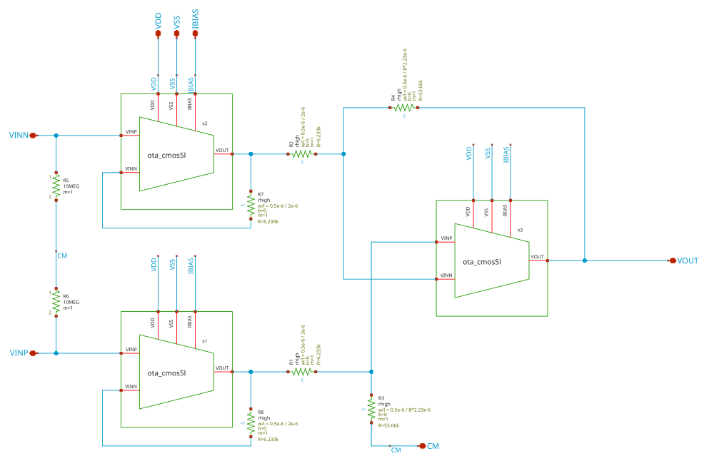
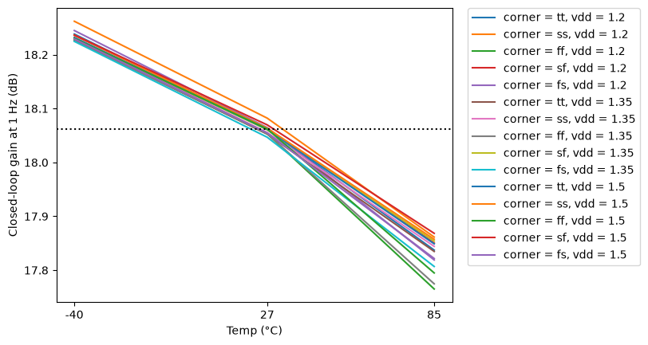
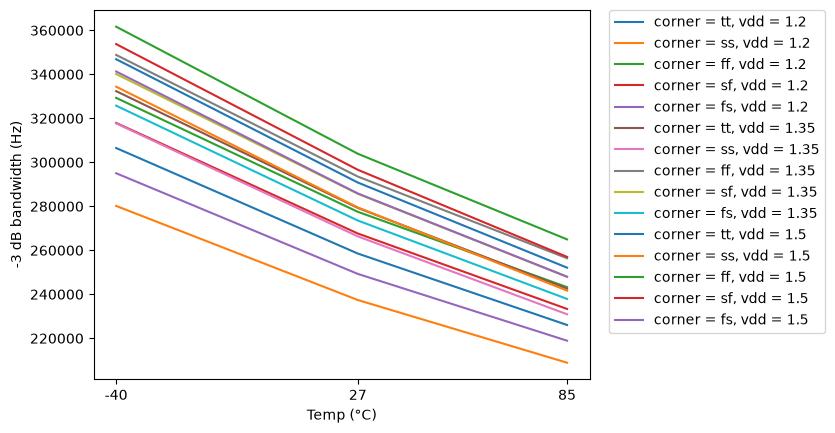
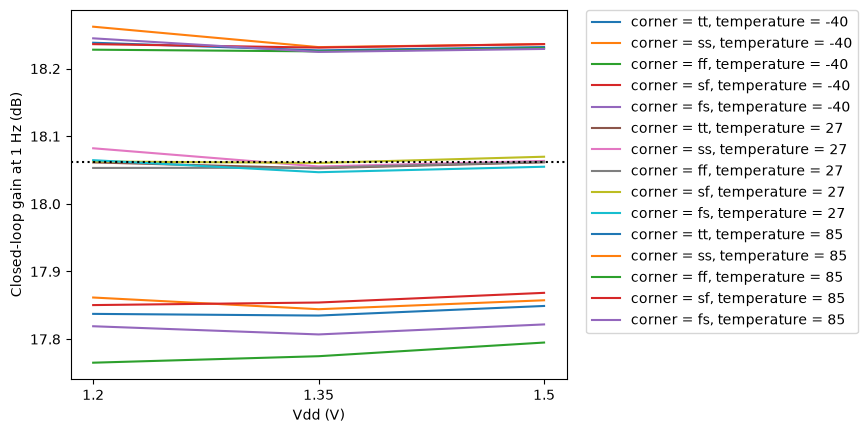
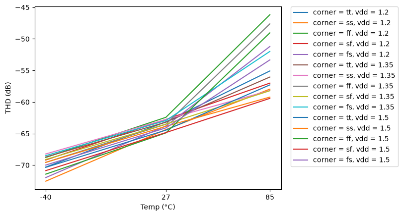

# instramp_cmos5l - CACE characterisation

- Generated: 2026-10-13 19:20 by `scripts/make_readme.py` from `runs/RUN_2026-10-13_19-20-22`
- Commit: `3b31128` (working tree dirty)
- Netlist source: schematic; datasheet: `cace/instramp_cmos5l.yaml`; reproduce with `scripts/run_cace.sh instramp_cmos5l`
- Sections marked *(CACE)* are written by CACE itself, the rest by this script (CACE has no per-corner MC statistics, worst-case conditions or unit-scaled spread plots).

## Design *(CACE)*

- Description: Three-OTA instrumentation amplifier, closed-loop gain 8 V/V (18.0618 dB)
- PDK: ihp-sg13cmos5l

### Authorship

- Designer: SPMA
- Created: October 13, 2026
- License: MIT
- Company: None
- Last modified: None

### Pins

- VDD
  + Description: Positive analog power supply
  + Type: power
  + Direction: inout
  + Vmin: 1.2
  + Vmax: 1.5
- VSS
  + Description: Analog ground
  + Type: ground
  + Direction: inout
- IBIAS
  + Description: Bias current input (shared by the three OTAs, 1.4 uA each)
  + Type: signal
  + Direction: input
- VINP
  + Description: Non-inverting input
  + Type: signal
  + Direction: input
- VINN
  + Description: Inverting input
  + Type: signal
  + Direction: input
- CM
  + Description: Common-mode reference (input resistor divider centre)
  + Type: signal
  + Direction: input
- VOUT
  + Description: Output
  + Type: signal
  + Direction: output

### Default Conditions

- vdd
  + Description: Analog power supply voltage
  + Display: Vdd
  + Unit: V
  + Typical: 1.2
- vcm
  + Description: Input and CM pin common-mode voltage
  + Display: Vcm
  + Unit: V
  + Typical: 0.6
- ib
  + Description: Total bias current (three OTAs)
  + Display: Ib
  + Unit: uA
  + Typical: 4.2
- fin
  + Description: Input sine frequency for THD
  + Display: Fin
  + Unit: kHz
  + Typical: 1
- vin_amp
  + Description: Differential input sine amplitude (peak) for THD
  + Display: Vin amp
  + Unit: mV
  + Typical: 25
- cl
  + Description: Output load capacitance
  + Display: CLoad
  + Unit: pF
  + Typical: 3
- corner
  + Description: Process corner
  + Display: Corner
  + Typical: tt
- rcorner
  + Description: Resistor corner (res_<rcorner> section of cornerRES.lib)
  + Display: Rcorner
  + Typical: typ
- temperature
  + Description: Ambient temperature
  + Display: Temp
  + Unit: °C
  + Typical: 27

### Symbol

### Schematic

## Results summary *(CACE)*

min / typ / max over all conditions of a parameter; Monte Carlo parameters (`mc_*`) are min/max over all samples.

**netlist source**: schematic

|      Parameter       |         Tool         |     Result      | Min Limit  |  Min Value   | Typ Target |  Typ Value   | Max Limit  |  Max Value   |  Status  |
| :------------------- | :------------------- | :-------------- | ---------: | -----------: | ---------: | -----------: | ---------: | -----------: | :------: |
| Closed-loop gain at 1 Hz | ngspice              | A_CL                 |             any |  17.765 dB |   18.0618 dB |  18.061 dB |          any |  18.262 dB |   Pass ✅    |
| Gain error vs 8 V/V  | ngspice              | A_ERR                |             any |  -0.297 dB |          any |  -0.000 dB |          any |   0.200 dB |   Pass ✅    |
| -3 dB bandwidth      | ngspice              | F3DB                 |             any | 208893.000 Hz |          any | 279254.000 Hz |          any | 361654.000 Hz |   Pass ✅    |
| 0 dB frequency       | ngspice              | F0DB                 |             any | 1506090.000 Hz |          any | 1987590.000 Hz |          any | 2539050.000 Hz |   Pass ✅    |
| Closed-loop phase at 0 dB | ngspice              | PH0                  |             any | -143.186 ° |          any | -139.829 ° |          any | -134.184 ° |   Pass ✅    |
| THD                  | ngspice              | THD_DB               |             any | -72.538 dB |          any | -63.520 dB |          any | -46.170 dB |   Pass ✅    |
| THD                  | ngspice              | THD_PCT              |             any |    0.024 % |          any |    0.067 % |          any |    0.491 % |   Pass ✅    |
| 2nd harmonic         | ngspice              | HD2_DB               |             any | -80.791 dB |          any | -64.979 dB |          any | -48.314 dB |   Pass ✅    |
| 3rd harmonic         | ngspice              | HD3_DB               |             any | -76.241 dB |          any | -69.230 dB |          any | -50.352 dB |   Pass ✅    |
| Output fundamental amplitude | ngspice              | VO1                  |             any |    0.192 V |          any |    0.200 V |          any |    0.204 V |   Pass ✅    |

### Plots *(CACE)*

#### ac_gain_A_CL_vs_temperature

#### ac_gain_F3DB_vs_temperature

#### ac_gain_A_CL_vs_vdd

#### thd_THD_DB_vs_temperature

## PVT worst-case conditions

Corners tt/ss/ff/sf/fs, supply and temperature as in the yaml. Values in the display unit of the yaml.

### ac_gain - Closed-loop AC gain

45 runs.

| metric | min | at (corner, vdd, T) | max | at (corner, vdd, T) | spec | fails |
|---|---|---|---|---|---|---|
| A_CL [dB] | 17.77 | ff, 1.2 V, 85 C | 18.26 | ss, 1.2 V, -40 C | any | - |
| A_ERR [dB] | -0.2967 | ff, 1.2 V, 85 C | 0.2002 | ss, 1.2 V, -40 C | any | - |
| F3DB [Hz] | 2.089e+05 | ss, 1.2 V, 85 C | 3.617e+05 | ff, 1.5 V, -40 C | any | - |
| F0DB [Hz] | 1.506e+06 | ss, 1.2 V, 85 C | 2.539e+06 | ff, 1.5 V, -40 C | any | - |
| PH0 [°] | -143.2 | ff, 1.5 V, 85 C | -134.2 | ss, 1.2 V, -40 C | any | - |

### thd - Total harmonic distortion

45 runs.

| metric | min | at (corner, vdd, T) | max | at (corner, vdd, T) | spec | fails |
|---|---|---|---|---|---|---|
| THD_DB [dB] | -72.54 | ss, 1.2 V, -40 C | -46.17 | ff, 1.2 V, 85 C | any | - |
| THD_PCT [%] | 0.02361 | ss, 1.2 V, -40 C | 0.4915 | ff, 1.2 V, 85 C | any | - |
| HD2_DB [dB] | -80.79 | ss, 1.2 V, -40 C | -48.31 | ff, 1.2 V, 85 C | any | - |
| HD3_DB [dB] | -76.24 | ff, 1.5 V, -40 C | -50.35 | ff, 1.2 V, 85 C | any | - |
| VO1 [V] | 0.1916 | ff, 1.2 V, 85 C | 0.2045 | ss, 1.2 V, -40 C | any | - |

## Monte Carlo (local mismatch)

Mismatch models only (`mos_<corner>_mismatch`, `res_typ_mismatch`; `cap_cmomi` has no characterised spread), one seed per iteration (`seed = 12345 + iteration`, **the same 50 mismatch draws are reused at every corner and temperature**, so boxes are paired comparisons and the pooled counts overstate the number of independent samples: 50, not 50 x 15). Box = interquartile range, dots = individual samples, dotted lines = spec (if any).

