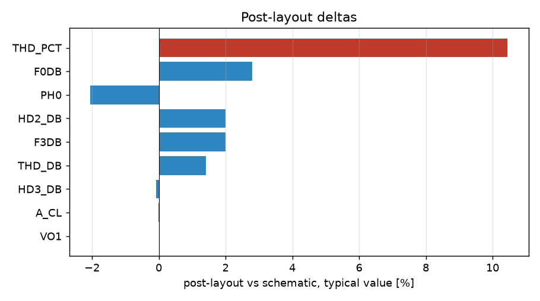

# Schematic vs post-layout

* schematic run: `/foss/designs/sg13cmos5l_spma_ip__instramp/runs/RUN_2026-10-13_19-20-22` (netlist source: schematic)
* post-layout run: `/foss/designs/sg13cmos5l_spma_ip__instramp/runs/pex_cace/instramp_cmos5l/RUN_2026-10-13_19-38-39` (netlist source: pex)
* flag threshold: 5 % on the typical value; units as in the CACE summary

| Parameter | Var | Unit | Schematic min / typ / max | Post-layout min / typ / max | Δ typ | Δ typ % | Status | Flag |
|---|---|---|---|---|---:|---:|---|---|
| Closed-loop gain at 1 Hz | A_CL | dB | 17.765 / 18.061 / 18.262 | 18.06 / 18.06 / 18.06 | -0.001 | -0.01 | Pass → Pass |  |
| Gain error vs 8 V/V | A_ERR | dB | -0.297 / -0 / 0.2 | -0.002 / -0.002 / -0.002 | -0.002 | n/a | Pass → Pass |  |
| -3 dB bandwidth | F3DB | Hz | 2.0889e+05 / 2.7925e+05 / 3.6165e+05 | 2.8482e+05 / 2.8482e+05 / 2.8482e+05 | +5569 | +1.99 | Pass → Pass |  |
| 0 dB frequency | F0DB | Hz | 1.5061e+06 / 1.9876e+06 / 2.539e+06 | 2.0432e+06 / 2.0432e+06 / 2.0432e+06 | +5.566e+04 | +2.80 | Pass → Pass |  |
| Closed-loop phase at 0 dB | PH0 | ° | -143.19 / -139.83 / -134.18 | -142.71 / -142.71 / -142.71 | -2.877 | -2.06 | Pass → Pass |  |
| THD | THD_DB | dB | -72.538 / -63.52 / -46.17 | -62.618 / -62.618 / -62.618 | +0.902 | +1.42 | Pass → Pass |  |
| THD | THD_PCT | % | 0.024 / 0.067 / 0.491 | 0.074 / 0.074 / 0.074 | +0.007 | +10.45 | Pass → Pass | Δ |
| 2nd harmonic | HD2_DB | dB | -80.791 / -64.979 / -48.314 | -63.677 / -63.677 / -63.677 | +1.302 | +2.00 | Pass → Pass |  |
| 3rd harmonic | HD3_DB | dB | -76.241 / -69.23 / -50.352 | -69.281 / -69.281 / -69.281 | -0.051 | -0.07 | Pass → Pass |  |
| Output fundamental amplitude | VO1 | V | 0.192 / 0.2 / 0.204 | 0.2 / 0.2 / 0.2 | +0 | +0.00 | Pass → Pass |  |

1 row(s) flagged.

