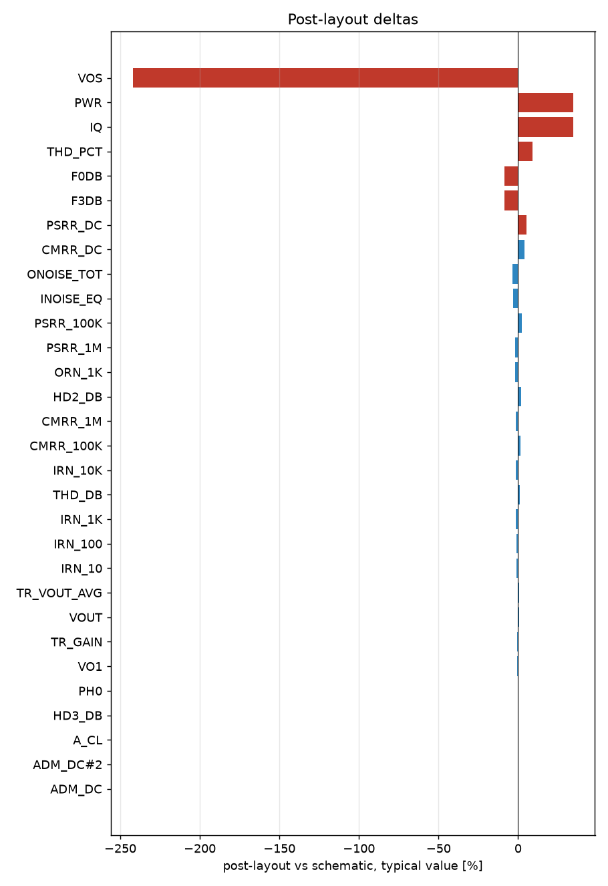

# Schematic vs post-layout

* schematic run: `/foss/designs/sg13cmos5l_spma_ip__instramp/runs/RUN_2026-10-21_10-03-50` (netlist source: schematic)
* post-layout run: `/foss/designs/sg13cmos5l_spma_ip__instramp/runs/pex_cace_rc/instramp_cmos5l/RUN_2026-10-21_10-06-04` (netlist source: pex)
* flag threshold: 5 % on the typical value; units as in the CACE summary

| Parameter | Var | Unit | Schematic min / typ / max | Post-layout min / typ / max | Δ typ | Δ typ % | Status | Flag |
|---|---|---|---|---|---:|---:|---|---|
| Closed-loop gain at 1 Hz | A_CL | dB | 17.765 / 18.061 / 18.262 | 18.008 / 18.008 / 18.008 | -0.053 | -0.29 | Pass → Pass |  |
| Gain error vs 8 V/V | A_ERR | dB | -0.297 / -0 / 0.2 | -0.054 / -0.054 / -0.054 | -0.054 | n/a | Pass → Pass |  |
| -3 dB bandwidth | F3DB | Hz | 2.0889e+05 / 2.7925e+05 / 3.6166e+05 | 2.558e+05 / 2.558e+05 / 2.558e+05 | -2.346e+04 | -8.40 | Pass → Pass | Δ |
| 0 dB frequency | F0DB | Hz | 1.5061e+06 / 1.9876e+06 / 2.539e+06 | 1.8139e+06 / 1.8139e+06 / 1.8139e+06 | -1.737e+05 | -8.74 | Pass → Pass | Δ |
| Closed-loop phase at 0 dB | PH0 | ° | -143.19 / -139.83 / -134.18 | -139.17 / -139.17 / -139.17 | +0.662 | +0.47 | Pass → Pass |  |
| THD | THD_DB | dB | -72.538 / -63.52 / -46.17 | -62.696 / -62.696 / -62.696 | +0.824 | +1.30 | Pass → Pass |  |
| THD | THD_PCT | % | 0.024 / 0.067 / 0.491 | 0.073 / 0.073 / 0.073 | +0.006 | +8.96 | Pass → Pass | Δ |
| 2nd harmonic | HD2_DB | dB | -80.791 / -64.979 / -48.314 | -63.725 / -63.725 / -63.725 | +1.254 | +1.93 | Pass → Pass |  |
| 3rd harmonic | HD3_DB | dB | -76.241 / -69.23 / -50.352 | -69.469 / -69.469 / -69.469 | -0.239 | -0.35 | Pass → Pass |  |
| Output fundamental amplitude | VO1 | V | 0.192 / 0.2 / 0.204 | 0.199 / 0.199 / 0.199 | -0.001 | -0.50 | Pass → Pass |  |
| Differential gain @10 Hz | ADM_DC | dB | 17.735 / 18.039 / 18.241 | 17.994 / 17.994 / 17.994 | -0.045 | -0.25 | Pass → Pass |  |
| CMRR @10 Hz | CMRR_DC | dB | 41.798 / 47.694 / 52.303 | 49.579 / 49.579 / 49.579 | +1.885 | +3.95 | Pass → Pass |  |
| CMRR @100 kHz | CMRR_100K | dB | 38.52 / 44.356 / 49.51 | 44.98 / 44.98 / 44.98 | +0.624 | +1.41 | Pass → Pass |  |
| CMRR @1 MHz | CMRR_1M | dB | 21.311 / 27.278 / 32.934 | 26.854 / 26.854 / 26.854 | -0.424 | -1.55 | Pass → Pass |  |
| Differential gain @10 Hz | ADM_DC#2 | dB | 17.735 / 18.039 / 18.241 | 17.994 / 17.994 / 17.994 | -0.045 | -0.25 | Pass → Pass |  |
| PSRR @10 Hz | PSRR_DC | dB | 50.403 / 72.884 / 102.12 | 76.736 / 76.736 / 76.736 | +3.852 | +5.29 | Pass → Pass | Δ |
| PSRR @100 kHz | PSRR_100K | dB | 50.344 / 62.056 / 66.067 | 63.606 / 63.606 / 63.606 | +1.55 | +2.50 | Pass → Pass |  |
| PSRR @1 MHz | PSRR_1M | dB | 41.461 / 44.243 / 50.529 | 43.381 / 43.381 / 43.381 | -0.862 | -1.95 | Pass → Pass |  |
| Input noise @10 Hz | IRN_10 | nV/rtHz | 2859.5 / 3453.6 / 4016.5 | 3414.4 / 3414.4 / 3414.4 | -39.17 | -1.13 | Pass → Pass |  |
| Input noise @100 Hz | IRN_100 | nV/rtHz | 906.4 / 1095 / 1272.9 | 1082.2 / 1082.2 / 1082.2 | -12.75 | -1.16 | Pass → Pass |  |
| Input noise @1 kHz | IRN_1K | nV/rtHz | 293.35 / 354.55 / 411.25 | 350.01 / 350.01 / 350.01 | -4.546 | -1.28 | Pass → Pass |  |
| Input noise @10 kHz | IRN_10K | nV/rtHz | 111.85 / 134.68 / 155.09 | 132.89 / 132.89 / 132.89 | -1.787 | -1.33 | Pass → Pass |  |
| Output noise @1 kHz | ORN_1K | nV/rtHz | 2392.1 / 2837.7 / 3213.4 | 2782.8 / 2782.8 / 2782.8 | -54.91 | -1.94 | Pass → Pass |  |
| Integrated output noise | ONOISE_TOT | uV-rms | 482.78 / 544.2 / 593.5 | 524.24 / 524.24 / 524.24 | -19.96 | -3.67 | Pass → Pass |  |
| In-band input-referred noise (Vn_out / gain) | INOISE_EQ | uV-rms | 59.204 / 67.899 / 75.955 | 65.936 / 65.936 / 65.936 | -1.963 | -2.89 | Pass → Pass |  |
| Output offset (Vcm - Vout) | VOS | mV | -4.87 / -1.933 / -0.436 | -6.613 / -6.613 / -6.613 | -4.68 | -242.11 | Pass → Pass | Δ |
| Output voltage | VOUT | V | 0.6 / 0.602 / 0.605 | 0.607 / 0.607 / 0.607 | +0.005 | +0.83 | Pass → Pass |  |
| Quiescent current | IQ | uA | 48.004 / 54.873 / 59.75 | 73.811 / 73.811 / 73.811 | +18.94 | +34.51 | Pass → Pass | Δ |
| Quiescent power | PWR | uW | 57.605 / 74.078 / 89.625 | 99.645 / 99.645 / 99.645 | +25.57 | +34.51 | Pass → Pass | Δ |
| Small-signal gain (transient) | TR_GAIN |  | 7.7318 / 7.9999 / 8.1872 | 7.9513 / 7.9513 / 7.9513 | -0.04857 | -0.61 | Pass → Pass |  |
| Mean output level | TR_VOUT_AVG | V | 0.6 / 0.602 / 0.605 | 0.607 / 0.607 / 0.607 | +0.005 | +0.83 | Pass → Pass |  |

7 row(s) flagged.

