# ota_cmos5l - CACE characterisation

- Generated: 2026-10-12 10:02 by `scripts/make_readme.py` from `runs/RUN_2026-10-12_09-59-32`
- Commit: `64fa8b3` (working tree dirty)
- Netlist source: schematic; datasheet: `cace/ota_cmos5l.yaml`; reproduce with `scripts/run_cace.sh ota_cmos5l`
- Sections marked *(CACE)* are written by CACE itself, the rest by this script (CACE has no per-corner MC statistics, worst-case conditions or unit-scaled spread plots).

## Design *(CACE)*

- Description: PMOS-input two-stage Miller OTA
- PDK: ihp-sg13cmos5l

### Authorship

- Designer: SPMA
- Created: October 9, 2026
- License: MIT
- Company: None
- Last modified: None

### Pins

- VDD
  + Description: Positive analog power supply
  + Type: power
  + Direction: inout
  + Vmin: 1.2
  + Vmax: 1.5
- VSS
  + Description: Analog ground
  + Type: ground
  + Direction: inout
- IBIAS
  + Description: Bias current input
  + Type: signal
  + Direction: input
- VINP
  + Description: Non-inverting input
  + Type: signal
  + Direction: input
- VINN
  + Description: Inverting input
  + Type: signal
  + Direction: input
- VOUT
  + Description: Output
  + Type: signal
  + Direction: output

### Default Conditions

- vdd
  + Description: Analog power supply voltage
  + Display: Vdd
  + Unit: V
  + Typical: 1.2
- vcm
  + Description: Input common mode voltage
  + Display: Vcm
  + Unit: V
  + Typical: 0.6
- ib
  + Description: Bias current
  + Display: Ib
  + Unit: uA
  + Typical: 1.4
- cl
  + Description: Output load capacitance
  + Display: CLoad
  + Unit: pF
  + Typical: 3
- corner
  + Description: Process corner
  + Display: Corner
  + Typical: tt
- rcorner
  + Description: Resistor corner (res_<rcorner> section of cornerRES.lib)
  + Display: Rcorner
  + Typical: typ
- temperature
  + Description: Ambient temperature
  + Display: Temp
  + Unit: °C
  + Typical: 27

### Symbol

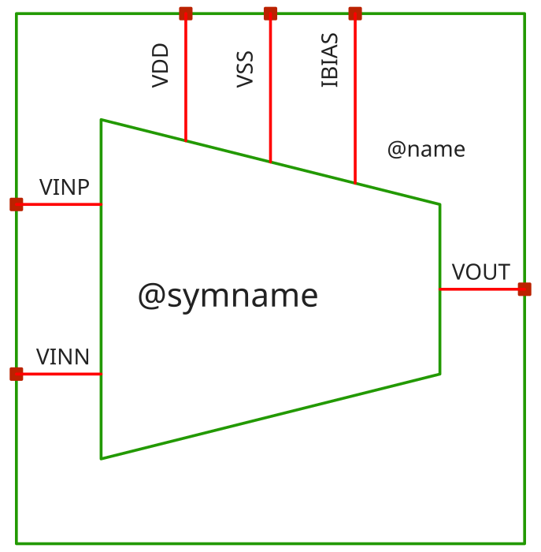

### Schematic

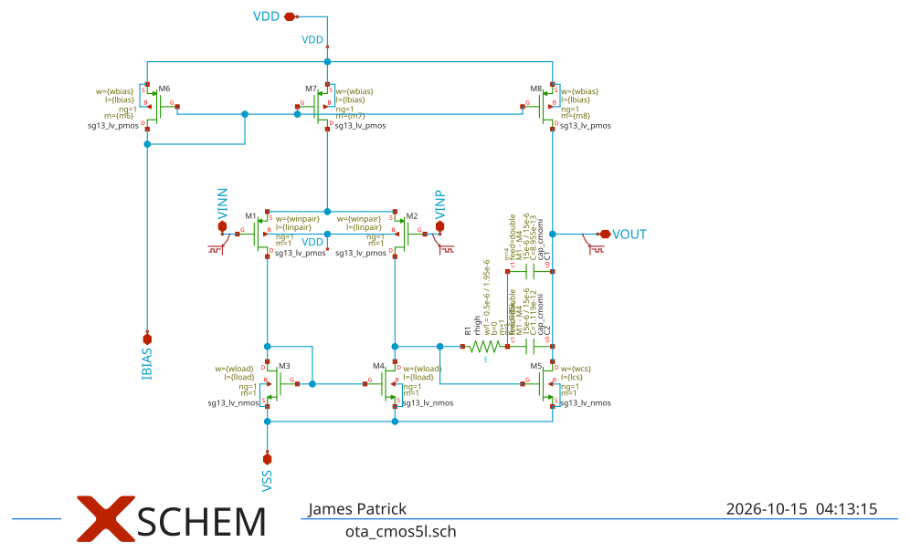

## Results summary *(CACE)*

min / typ / max over all conditions of a parameter; Monte Carlo parameters (`mc_*`) are min/max over all samples.

**netlist source**: schematic

|      Parameter       |         Tool         |     Result      | Min Limit  |  Min Value   | Typ Target |  Typ Value   | Max Limit  |  Max Value   |  Status  |
| :------------------- | :------------------- | :-------------- | ---------: | -----------: | ---------: | -----------: | ---------: | -----------: | :------: |
| DC gain              | ngspice              | A0                   |           50 dB |  55.594 dB |          any |  57.873 dB |          any |  59.484 dB |   Pass ✅    |
| -3 dB frequency      | ngspice              | F3DB                 |             any | 3075.780 Hz |          any | 3697.540 Hz |          any | 4351.160 Hz |   Pass ✅    |
| Unity-gain frequency | ngspice              | UGF                  |    1000000.0 Hz | 2109530.000 Hz |          any | 2699830.000 Hz |          any | 3445080.000 Hz |   Pass ✅    |
| Phase margin         | ngspice              | PM                   |            60 ° |   55.635 ° |          any |   60.647 ° |          any |   66.901 ° |   Fail ❌    |
| Gain margin          | ngspice              | GM                   |             any |  14.131 dB |          any |  17.161 dB |          any |  21.660 dB |   Pass ✅    |
| Gain-bandwidth product (A0 x f3dB) | ngspice              | GBW                  |             any | 2259320.000 Hz |          any | 2861650.000 Hz |          any | 3610750.000 Hz |   Pass ✅    |
| Input noise @100 Hz  | ngspice              | IRN_100              |             any | 505.113 nV/rtHz |          any | 610.251 nV/rtHz |          any | 708.507 nV/rtHz |   Pass ✅    |
| Input noise @1 kHz   | ngspice              | IRN_1K               |             any | 163.111 nV/rtHz |          any | 197.006 nV/rtHz |          any | 228.600 nV/rtHz |   Pass ✅    |
| Input noise @10 kHz  | ngspice              | IRN_10K              |             any | 61.334 nV/rtHz |          any | 74.134 nV/rtHz |          any | 86.597 nV/rtHz |   Pass ✅    |
| Input noise @1 MHz   | ngspice              | IRN_1M               |             any | 45.977 nV/rtHz |          any | 66.977 nV/rtHz |          any | 98.969 nV/rtHz |   Pass ✅    |
| Output noise @1 kHz  | ngspice              | ORN_1K               |             any | 163.121 nV/rtHz |          any | 197.268 nV/rtHz |          any | 228.444 nV/rtHz |   Pass ✅    |
| Integrated input noise | ngspice              | INOISE_TOT           |             any | 2675.580 uV-rms |          any | 2863.530 uV-rms |          any | 3030.460 uV-rms |   Pass ✅    |
| Integrated output noise | ngspice              | ONOISE_TOT           |             any | 224.287 uV-rms |          any | 290.224 uV-rms |          any | 357.332 uV-rms |   Pass ✅    |
| Input offset voltage | ngspice              | VOS                  |           -1 mV |  -0.553 mV |          any |  -0.213 mV |         1 mV |  -0.046 mV |   Pass ✅    |
| Quiescent current    | ngspice              | IQ                   |             any |  16.008 uA |          any |  18.293 uA |          any |  19.919 uA |   Pass ✅    |
| Quiescent power      | ngspice              | PWR                  |             any |  19.209 uW |          any |  24.696 uW |        50 uW |  29.878 uW |   Pass ✅    |
| Output voltage       | ngspice              | VOUT                 |             any |    0.600 V |          any |    0.600 V |          any |    0.601 V |   Pass ✅    |
| Gain error (1 - dVout/dVin) | ngspice              | GAIN_ERR             |             any |   -0.218 % |          any |    0.044 % |          any |    0.084 % |   Pass ✅    |
| Gain tempco (ppm per °C) | ngspice              | GAIN_TC              |             any |  0.249 ppm |          any |  1.301 ppm |          any |  2.043 ppm |   Pass ✅    |
| Mean follower gain   | ngspice              | G_MEAN               |             any |  0.999 V/V |          any |  1.000 V/V |          any |  1.002 V/V |   Pass ✅    |
| CMRR @10 Hz          | ngspice              | CMRR_DC              |             any |  53.977 dB |          any |  64.868 dB |          any |  84.357 dB |   Pass ✅    |
| CMRR @100 kHz        | ngspice              | CMRR_100K            |             any |  27.317 dB |          any |  29.294 dB |          any |  31.224 dB |   Pass ✅    |
| CMRR @1 MHz          | ngspice              | CMRR_1M              |             any |   6.976 dB |          any |   9.152 dB |          any |  11.236 dB |   Pass ✅    |
| PSRR @10 Hz          | ngspice              | PSRR_DC              |             any |  51.479 dB |          any |  73.886 dB |          any | 105.355 dB |   Pass ✅    |
| PSRR @100 kHz        | ngspice              | PSRR_100K            |             any |  51.349 dB |          any |  62.907 dB |          any |  66.926 dB |   Pass ✅    |
| PSRR @1 MHz          | ngspice              | PSRR_1M              |             any |  41.813 dB |          any |  44.032 dB |          any |  48.104 dB |   Pass ✅    |
| Lower ICMR bound     | ngspice              | ICMR_MIN             |             any |    0.060 V |          any |    0.078 V |          any |    0.096 V |   Pass ✅    |
| Upper ICMR bound     | ngspice              | ICMR_MAX             |             any |    0.991 V |          any |    1.180 V |          any |    1.369 V |   Pass ✅    |
| ICMR span            | ngspice              | ICMR_SPAN            |             any |    0.900 V |          any |    1.103 V |          any |    1.297 V |   Pass ✅    |
| Delay (50 %)         | ngspice              | T_DELAY              |             any |  50.698 ns |          any |  67.558 ns |          any |  86.179 ns |   Pass ✅    |
| Rise time (10-90 %)  | ngspice              | T_RISE               |             any |  65.799 ns |          any |  79.484 ns |          any |  94.454 ns |   Pass ✅    |
| Overshoot            | ngspice              | OVERSHOOT            |             any |    4.413 % |          any |    9.871 % |          any |   14.731 % |   Pass ✅    |
| Settling time 1 %    | ngspice              | TS_1PCT              |             any | 100.072 ns |          any | 123.057 ns |          any | 388.205 ns |   Pass ✅    |
| Settling time 0.1 %  | ngspice              | TS_01PCT             |             any | 102.145 ns |          any | 365.746 ns |          any | 455.678 ns |   Pass ✅    |
| Positive slew rate   | ngspice              | SR_POS               |             any | 314969.000 V/s |          any | 1945790.000 V/s |          any | 2239030.000 V/s |   Pass ✅    |
| Negative slew rate   | ngspice              | SR_NEG               |             any | 2151780.000 V/s |          any | 2430660.000 V/s |          any | 2678770.000 V/s |   Pass ✅    |
| Rise time (10-90 %)  | ngspice              | T_RISE               |             any | 214.378 ns |          any | 246.686 ns |          any | 1523.960 ns |   Pass ✅    |
| Fall time (90-10 %)  | ngspice              | T_FALL               |             any | 179.187 ns |          any | 197.477 ns |          any | 223.071 ns |   Pass ✅    |
| Propagation delay tpLH | ngspice              | T_PLH                |             any | 153.229 ns |          any | 182.424 ns |          any | 208.093 ns |   Pass ✅    |
| Propagation delay tpHL | ngspice              | T_PHL                |             any | 121.768 ns |          any | 141.929 ns |          any | 161.907 ns |   Pass ✅    |
| Input offset voltage | ngspice              | VOS                  |             any |  -1.867 mV |          any |  -0.066 mV |          any |   2.551 mV |   Pass ✅    |
| CMRR @10 Hz          | ngspice              | CMRR_DC              |             any |  48.051 dB |          any |  63.006 dB |          any | 108.395 dB |   Pass ✅    |
| PSRR @10 Hz          | ngspice              | PSRR_DC              |             any |  46.691 dB |          any |  57.302 dB |          any |  75.805 dB |   Pass ✅    |

### Plots *(CACE)*

#### ac_response_A0_vs_temperature

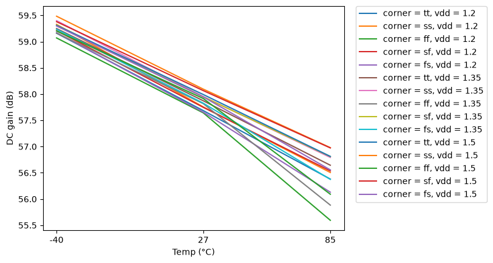

#### ac_response_UGF_vs_temperature

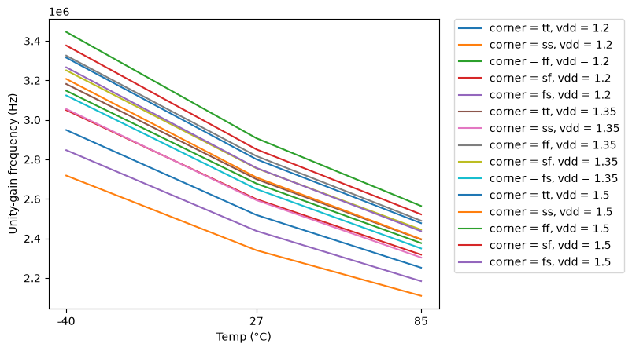

#### ac_response_PM_vs_temperature

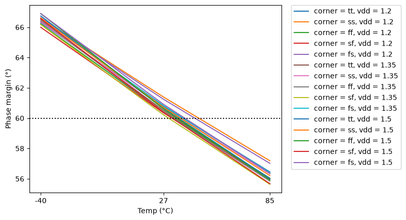

#### ac_response_PM_vs_vdd

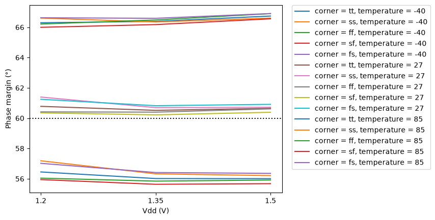

#### cmrr_CMRR_DC_vs_temperature

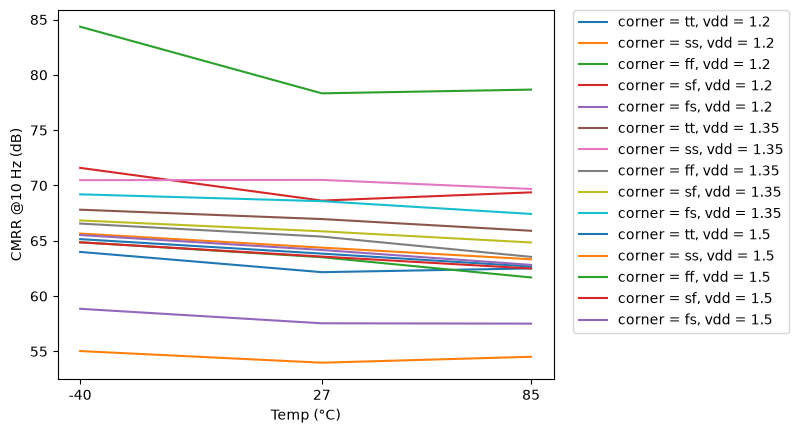

#### psrr_PSRR_DC_vs_temperature

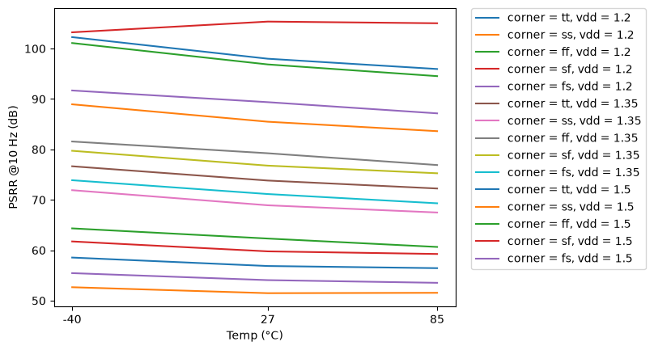

#### icmr_ICMR_SPAN_vs_vdd

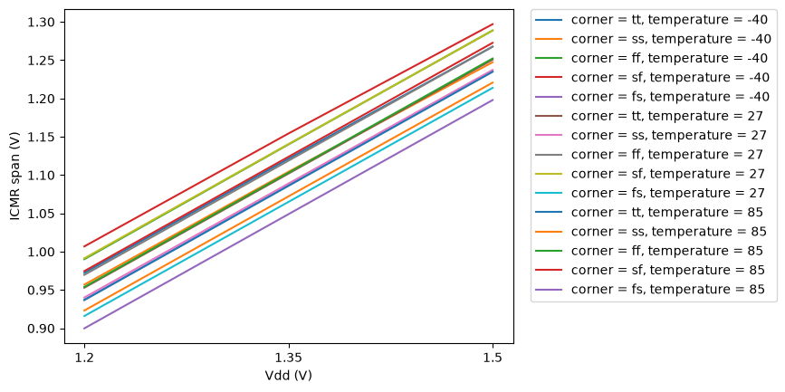

## PVT worst-case conditions

Corners tt/ss/ff/sf/fs, supply and temperature as in the yaml. Values in the display unit of the yaml.

### ac_response - AC response (Tian loop gain)

45 runs.

| metric | min | at (corner, vdd, T) | max | at (corner, vdd, T) | spec | fails |
|---|---|---|---|---|---|---|
| A0 [dB] | 55.59 | ff, 1.2 V, 85 C | 59.48 | ss, 1.5 V, -40 C | >= 50 | 0 |
| F3DB [Hz] | 3076 | ss, 1.2 V, -40 C | 4351 | ff, 1.5 V, 85 C | any | - |
| UGF [Hz] | 2.11e+06 | ss, 1.2 V, 85 C | 3.445e+06 | ff, 1.5 V, -40 C | >= 1e+06 | 0 |
| PM [°] | 55.64 | sf, 1.35 V, 85 C | 66.9 | fs, 1.5 V, -40 C | >= 60 | **15/45** |
| GM [dB] | 14.13 | sf, 1.2 V, 85 C | 21.66 | fs, 1.5 V, -40 C | any | - |
| GBW [Hz] | 2.259e+06 | ss, 1.2 V, 85 C | 3.611e+06 | ff, 1.5 V, -40 C | any | - |

### noise - Noise

45 runs.

| metric | min | at (corner, vdd, T) | max | at (corner, vdd, T) | spec | fails |
|---|---|---|---|---|---|---|
| IRN_100 [nV/rtHz] | 505.1 | ff, 1.2 V, -40 C | 708.5 | ss, 1.5 V, 85 C | any | - |
| IRN_1K [nV/rtHz] | 163.1 | ff, 1.2 V, -40 C | 228.6 | ss, 1.5 V, 85 C | any | - |
| IRN_10K [nV/rtHz] | 61.33 | ff, 1.2 V, -40 C | 86.6 | ss, 1.2 V, 85 C | any | - |
| IRN_1M [nV/rtHz] | 45.98 | ff, 1.5 V, -40 C | 98.97 | ss, 1.2 V, 85 C | any | - |
| ORN_1K [nV/rtHz] | 163.1 | ff, 1.2 V, -40 C | 228.4 | ss, 1.5 V, 85 C | any | - |
| INOISE_TOT [uV-rms] | 2676 | ff, 1.2 V, -40 C | 3030 | ss, 1.5 V, 27 C | any | - |
| ONOISE_TOT [uV-rms] | 224.3 | ff, 1.2 V, -40 C | 357.3 | ss, 1.2 V, 85 C | any | - |

### dc_op - DC operating point (follower)

45 runs.

| metric | min | at (corner, vdd, T) | max | at (corner, vdd, T) | spec | fails |
|---|---|---|---|---|---|---|
| VOS [mV] | -0.5531 | ss, 1.2 V, 85 C | -0.04621 | ff, 1.5 V, -40 C | >= -1 <= 1 | 0 |
| IQ [uA] | 16.01 | ss, 1.2 V, -40 C | 19.92 | ff, 1.5 V, 85 C | any | - |
| PWR [uW] | 19.21 | ss, 1.2 V, -40 C | 29.88 | ff, 1.5 V, 85 C | <= 50 | 0 |
| VOUT [V] | 0.6 | ff, 1.5 V, -40 C | 0.6006 | ss, 1.2 V, 85 C | any | - |
| GAIN_ERR [%] | -0.2182 | ss, 1.2 V, 27 C | 0.08398 | ff, 1.5 V, 85 C | any | - |

### gain_tc - Gain temperature coefficient

15 runs.

| metric | min | at (corner, vdd, T) | max | at (corner, vdd, T) | spec | fails |
|---|---|---|---|---|---|---|
| GAIN_TC [ppm] | 0.2493 | ss, 1.35 V, 27 C | 2.043 | ff, 1.5 V, 27 C | any | - |
| G_MEAN [V/V] | 0.9993 | ff, 1.5 V, 27 C | 1.002 | ss, 1.2 V, 27 C | any | - |

### cmrr - CMRR

45 runs.

| metric | min | at (corner, vdd, T) | max | at (corner, vdd, T) | spec | fails |
|---|---|---|---|---|---|---|
| CMRR_DC [dB] | 53.98 | ss, 1.2 V, 27 C | 84.36 | ff, 1.2 V, -40 C | any | - |
| CMRR_100K [dB] | 27.32 | ss, 1.2 V, 85 C | 31.22 | ff, 1.5 V, -40 C | any | - |
| CMRR_1M [dB] | 6.976 | ss, 1.2 V, 85 C | 11.24 | ff, 1.5 V, -40 C | any | - |

### psrr - PSRR

45 runs.

| metric | min | at (corner, vdd, T) | max | at (corner, vdd, T) | spec | fails |
|---|---|---|---|---|---|---|
| PSRR_DC [dB] | 51.48 | ss, 1.2 V, 27 C | 105.4 | sf, 1.5 V, 27 C | any | - |
| PSRR_100K [dB] | 51.35 | ss, 1.2 V, 27 C | 66.93 | ff, 1.5 V, -40 C | any | - |
| PSRR_1M [dB] | 41.81 | ss, 1.2 V, 85 C | 48.1 | tt, 1.2 V, -40 C | any | - |

### icmr - Input common-mode range

45 runs.

| metric | min | at (corner, vdd, T) | max | at (corner, vdd, T) | spec | fails |
|---|---|---|---|---|---|---|
| ICMR_MIN [V] | 0.06041 | fs, 1.2 V, -40 C | 0.09616 | sf, 1.5 V, 85 C | any | - |
| ICMR_MAX [V] | 0.9912 | fs, 1.2 V, 85 C | 1.369 | sf, 1.5 V, 27 C | any | - |
| ICMR_SPAN [V] | 0.8998 | fs, 1.2 V, 85 C | 1.297 | sf, 1.5 V, -40 C | any | - |

### tran_small - Small-signal step (100 mV)

45 runs.

| metric | min | at (corner, vdd, T) | max | at (corner, vdd, T) | spec | fails |
|---|---|---|---|---|---|---|
| T_DELAY [ns] | 50.7 | ff, 1.5 V, -40 C | 86.18 | ss, 1.2 V, 85 C | any | - |
| T_RISE [ns] | 65.8 | ff, 1.5 V, -40 C | 94.45 | ss, 1.2 V, 85 C | any | - |
| OVERSHOOT [%] | 4.413 | ss, 1.2 V, -40 C | 14.73 | sf, 1.35 V, 85 C | any | - |
| TS_1PCT [ns] | 100.1 | ff, 1.5 V, -40 C | 388.2 | ff, 1.2 V, 85 C | any | - |
| TS_01PCT [ns] | 102.1 | ff, 1.5 V, -40 C | 455.7 | fs, 1.2 V, 85 C | any | - |

### tran_large - Large-signal step (0.8 V)

45 runs.

| metric | min | at (corner, vdd, T) | max | at (corner, vdd, T) | spec | fails |
|---|---|---|---|---|---|---|
| SR_POS [V/s] | 3.15e+05 | ss, 1.2 V, -40 C | 2.239e+06 | ff, 1.5 V, -40 C | any | - |
| SR_NEG [V/s] | 2.152e+06 | ss, 1.2 V, -40 C | 2.679e+06 | ff, 1.5 V, -40 C | any | - |
| T_RISE [ns] | 214.4 | ff, 1.5 V, -40 C | 1524 | ss, 1.2 V, -40 C | any | - |
| T_FALL [ns] | 179.2 | ff, 1.5 V, -40 C | 223.1 | ss, 1.2 V, -40 C | any | - |
| T_PLH [ns] | 153.2 | ff, 1.5 V, -40 C | 208.1 | fs, 1.2 V, 85 C | any | - |
| T_PHL [ns] | 121.8 | ff, 1.5 V, -40 C | 161.9 | ss, 1.2 V, 85 C | any | - |

## Monte Carlo (local mismatch)

Mismatch models only (`mos_<corner>_mismatch`, `res_typ_mismatch`; `cap_cmomi` has no characterised spread), one seed per iteration (`seed = 12345 + iteration`, **the same 50 mismatch draws are reused at every corner and temperature**, so boxes are paired comparisons and the pooled counts overstate the number of independent samples: 50, not 50 x 15). Box = interquartile range, dots = individual samples, dotted lines = spec (if any).

### mc_vos - MC input offset

Monte Carlo (local mismatch, 50 seeds x 5 corners x 3 temperatures, vdd 1.2 V)

**VOS [mV]** - 750 samples

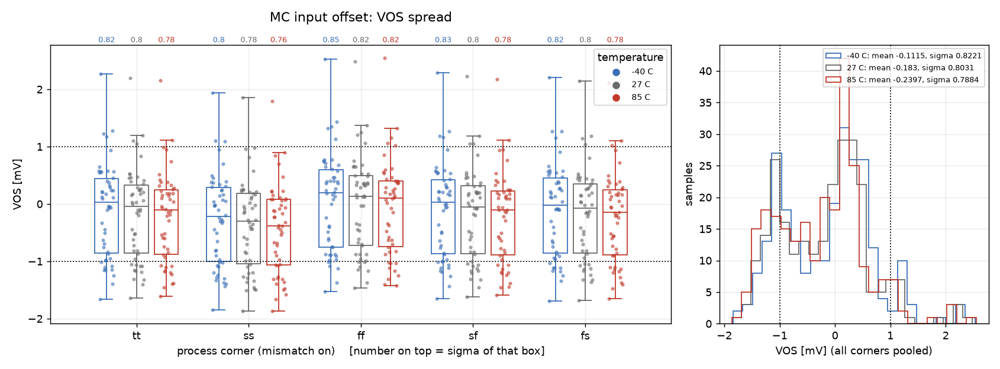

| corner | T [C] | N | mean | sigma | min | max | mean-3sigma | mean+3sigma |
|---|---|---|---|---|---|---|---|---|
| tt | -40 | 50 | -0.1026 | 0.8236 | -1.662 | 2.264 | -2.573 | 2.368 |
| tt | 27 | 50 | -0.1713 | 0.8004 | -1.641 | 2.195 | -2.573 | 2.23 |
| tt | 85 | 50 | -0.2255 | 0.7806 | -1.608 | 2.15 | -2.567 | 2.116 |
| ss | -40 | 50 | -0.2751 | 0.7989 | -1.842 | 1.935 | -2.672 | 2.122 |
| ss | 27 | 50 | -0.3731 | 0.7807 | -1.867 | 1.854 | -2.715 | 1.969 |
| ss | 85 | 50 | -0.4391 | 0.7617 | -1.862 | 1.795 | -2.724 | 1.846 |
| ff | -40 | 50 | 0.03537 | 0.8473 | -1.528 | 2.526 | -2.507 | 2.577 |
| ff | 27 | 50 | -0.01439 | 0.8245 | -1.47 | 2.481 | -2.488 | 2.459 |
| ff | 85 | 50 | -0.06178 | 0.8209 | -1.421 | 2.551 | -2.524 | 2.401 |
| sf | -40 | 50 | -0.11 | 0.8264 | -1.652 | 2.288 | -2.589 | 2.369 |
| sf | 27 | 50 | -0.1795 | 0.8045 | -1.623 | 2.225 | -2.593 | 2.234 |
| sf | 85 | 50 | -0.2332 | 0.7839 | -1.588 | 2.173 | -2.585 | 2.119 |
| fs | -40 | 50 | -0.1053 | 0.8172 | -1.689 | 2.208 | -2.557 | 2.346 |
| fs | 27 | 50 | -0.177 | 0.7965 | -1.677 | 2.143 | -2.566 | 2.212 |
| fs | 85 | 50 | -0.2391 | 0.7797 | -1.654 | 2.114 | -2.578 | 2.1 |
| **all** | | 750 | -0.1781 | 0.8053 | -1.867 | 2.551 | -2.594 | 2.238 |

_pooled sigma 0.8053 mV - 72 % of all samples inside [-1, 1] mV_

### mc_cmrr - MC CMRR

Monte Carlo (local mismatch, 50 seeds x 5 corners x 3 temperatures, vdd 1.2 V)

**CMRR_DC [dB]** - 750 samples

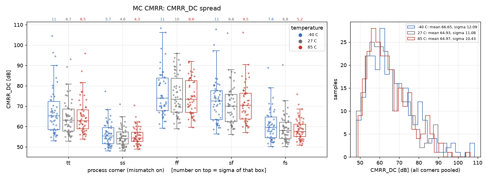

| corner | T [C] | N | mean | sigma | min | max | mean-3sigma | mean+3sigma |
|---|---|---|---|---|---|---|---|---|
| tt | -40 | 50 | 67.48 | 11.5 | 52.94 | 104.6 | 32.98 | 102 |
| tt | 27 | 50 | 64.62 | 8.713 | 52.88 | 93.15 | 38.49 | 90.76 |
| tt | 85 | 50 | 64.98 | 8.548 | 53.78 | 95.92 | 39.34 | 90.63 |
| ss | -40 | 50 | 56.21 | 5.678 | 48.11 | 77.37 | 39.17 | 73.24 |
| ss | 27 | 50 | 54.88 | 4.582 | 48.05 | 70.96 | 41.13 | 68.62 |
| ss | 85 | 50 | 55.37 | 4.318 | 48.9 | 70.41 | 42.42 | 68.33 |
| ff | -40 | 50 | 76.34 | 11.31 | 59.21 | 108.4 | 42.43 | 110.3 |
| ff | 27 | 50 | 75.26 | 10.09 | 58.88 | 95.96 | 45.01 | 105.5 |
| ff | 85 | 50 | 74.51 | 8.604 | 59.61 | 92.03 | 48.7 | 100.3 |
| sf | -40 | 50 | 72.54 | 10.61 | 56.38 | 107.8 | 40.7 | 104.4 |
| sf | 27 | 50 | 70.79 | 9.831 | 56.06 | 106 | 41.3 | 100.3 |
| sf | 85 | 50 | 71.34 | 9.546 | 57.09 | 106.3 | 42.7 | 99.98 |
| fs | -40 | 50 | 60.66 | 7.607 | 50.21 | 88.89 | 37.84 | 83.48 |
| fs | 27 | 50 | 59.07 | 6.826 | 50.17 | 90.36 | 38.59 | 79.55 |
| fs | 85 | 50 | 58.63 | 5.193 | 50.82 | 75.95 | 43.05 | 74.21 |
| **all** | | 750 | 65.51 | 11.24 | 48.05 | 108.4 | 31.81 | 99.22 |

_pooled sigma 11.24 dB_

### mc_psrr - MC PSRR

Monte Carlo (local mismatch, 50 seeds x 5 corners x 3 temperatures, vdd 1.2 V)

**PSRR_DC [dB]** - 750 samples

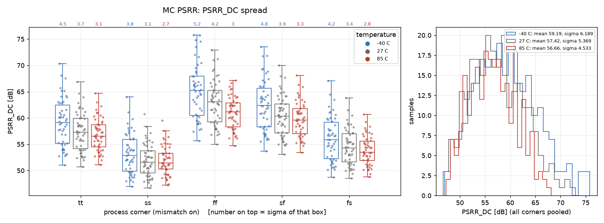

| corner | T [C] | N | mean | sigma | min | max | mean-3sigma | mean+3sigma |
|---|---|---|---|---|---|---|---|---|
| tt | -40 | 50 | 59.16 | 4.528 | 51.01 | 70.34 | 45.58 | 72.74 |
| tt | 27 | 50 | 57.37 | 3.663 | 50.68 | 66.87 | 46.38 | 68.36 |
| tt | 85 | 50 | 56.85 | 3.096 | 51.08 | 64.69 | 47.57 | 66.14 |
| ss | -40 | 50 | 53.24 | 3.828 | 46.93 | 64.03 | 41.75 | 64.72 |
| ss | 27 | 50 | 51.93 | 3.121 | 46.69 | 60.73 | 42.57 | 61.3 |
| ss | 85 | 50 | 51.94 | 2.747 | 47.24 | 59.52 | 43.69 | 60.18 |
| ff | -40 | 50 | 65.09 | 5.162 | 55.66 | 75.8 | 49.61 | 80.58 |
| ff | 27 | 50 | 62.93 | 4.211 | 54.99 | 72.94 | 50.29 | 75.56 |
| ff | 85 | 50 | 60.94 | 3.048 | 54.71 | 67.15 | 51.8 | 70.09 |
| sf | -40 | 50 | 62.41 | 4.768 | 53.67 | 73.52 | 48.11 | 76.72 |
| sf | 27 | 50 | 60.32 | 3.884 | 53.07 | 70.03 | 48.67 | 71.97 |
| sf | 85 | 50 | 59.73 | 3.336 | 53.43 | 68.13 | 49.72 | 69.74 |
| fs | -40 | 50 | 56.04 | 4.2 | 48.75 | 67.09 | 43.44 | 68.64 |
| fs | 27 | 50 | 54.54 | 3.436 | 48.49 | 63.84 | 44.23 | 64.85 |
| fs | 85 | 50 | 53.85 | 2.761 | 48.77 | 60.69 | 45.56 | 62.13 |
| **all** | | 750 | 57.76 | 5.501 | 46.69 | 75.8 | 41.25 | 74.26 |

_pooled sigma 5.501 dB_

