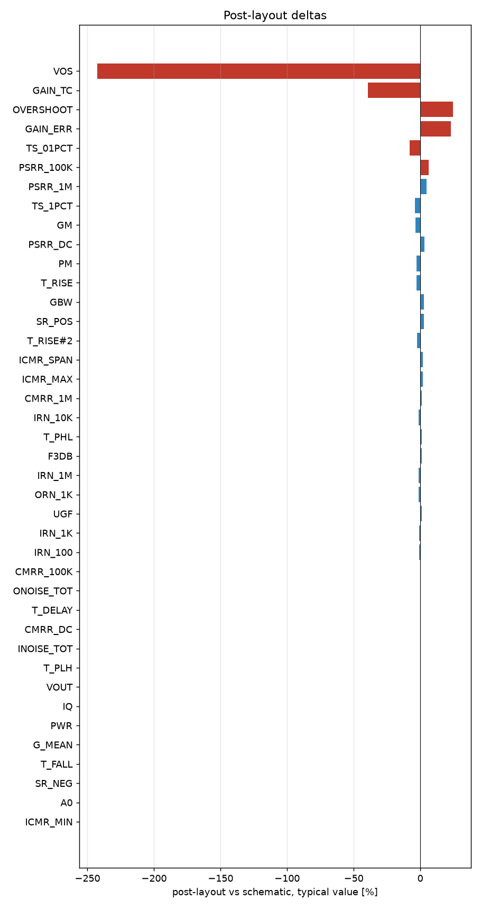

# Schematic vs post-layout

* schematic run: `/foss/designs/sg13cmos5l_spma_ip__instramp/runs/RUN_2026-10-15_18-48-38` (netlist source: schematic)
* post-layout run: `/foss/designs/sg13cmos5l_spma_ip__instramp/runs/pex_cace/ota_cmos5l/RUN_2026-10-15_18-51-45` (netlist source: pex)
* flag threshold: 5 % on the typical value; units as in the CACE summary

| Parameter | Var | Unit | Schematic min / typ / max | Post-layout min / typ / max | Δ typ | Δ typ % | Status | Flag |
|---|---|---|---|---|---:|---:|---|---|
| DC gain | A0 | dB | 55.594 / 57.873 / 59.484 | 57.904 / 57.904 / 57.904 | +0.031 | +0.05 | Pass → Pass |  |
| -3 dB frequency | F3DB | Hz | 3075.8 / 3697.5 / 4351.2 | 3742.9 / 3742.9 / 3742.9 | +45.32 | +1.23 | Pass → Pass |  |
| Unity-gain frequency | UGF | Hz | 2.1095e+06 / 2.6998e+06 / 3.4451e+06 | 2.7324e+06 / 2.7324e+06 / 2.7324e+06 | +3.255e+04 | +1.21 | Pass → Pass |  |
| Phase margin | PM | ° | 55.635 / 60.647 / 66.901 | 58.963 / 58.963 / 58.963 | -1.684 | -2.78 | Pass → Pass |  |
| Gain margin | GM | dB | 14.131 / 17.161 / 21.66 | 16.507 / 16.507 / 16.507 | -0.654 | -3.81 | Pass → Pass |  |
| Gain-bandwidth product (A0 x f3dB) | GBW | Hz | 2.2593e+06 / 2.8616e+06 / 3.6108e+06 | 2.9404e+06 / 2.9404e+06 / 2.9404e+06 | +7.873e+04 | +2.75 | Pass → Pass |  |
| Input noise @100 Hz | IRN_100 | nV/rtHz | 505.11 / 610.25 / 708.51 | 604.31 / 604.31 / 604.31 | -5.944 | -0.97 | Pass → Pass |  |
| Input noise @1 kHz | IRN_1K | nV/rtHz | 163.11 / 197.01 / 228.6 | 195.07 / 195.07 / 195.07 | -1.938 | -0.98 | Pass → Pass |  |
| Input noise @10 kHz | IRN_10K | nV/rtHz | 61.334 / 74.134 / 86.597 | 73.211 / 73.211 / 73.211 | -0.923 | -1.25 | Pass → Pass |  |
| Input noise @1 MHz | IRN_1M | nV/rtHz | 45.977 / 66.977 / 98.969 | 66.043 / 66.043 / 66.043 | -0.934 | -1.39 | Pass → Pass |  |
| Output noise @1 kHz | ORN_1K | nV/rtHz | 163.12 / 197.27 / 228.44 | 194.96 / 194.96 / 194.96 | -2.309 | -1.17 | Pass → Pass |  |
| Integrated input noise | INOISE_TOT | uV-rms | 2675.6 / 2863.5 / 3030.5 | 2853.9 / 2853.9 / 2853.9 | -9.63 | -0.34 | Pass → Pass |  |
| Integrated output noise | ONOISE_TOT | uV-rms | 224.29 / 290.22 / 357.33 | 291.58 / 291.58 / 291.58 | +1.352 | +0.47 | Pass → Pass |  |
| Input offset voltage | VOS | mV | -0.553 / -0.213 / -0.046 | -0.73 / -0.73 / -0.73 | -0.517 | -242.72 | Pass → Pass | Δ |
| Quiescent current | IQ | uA | 16.008 / 18.3 / 19.919 | 18.324 / 18.324 / 18.324 | +0.024 | +0.13 | Pass → Pass |  |
| Quiescent power | PWR | uW | 19.209 / 24.705 / 29.878 | 24.737 / 24.737 / 24.737 | +0.032 | +0.13 | Pass → Pass |  |
| Output voltage | VOUT | V | 0.6 / 0.6 / 0.601 | 0.601 / 0.601 / 0.601 | +0.001 | +0.17 | Pass → Pass |  |
| Gain error (1 - dVout/dVin) | GAIN_ERR | % | -0.218 / 0.048 / 0.084 | 0.059 / 0.059 / 0.059 | +0.011 | +22.92 | Pass → Pass | Δ |
| Gain tempco (ppm per °C) | GAIN_TC | ppm | 0.48 / 1.301 / 2.043 | 0.788 / 0.788 / 0.788 | -0.513 | -39.43 | Pass → Pass | Δ |
| Mean follower gain | G_MEAN | V/V | 0.999 / 1 / 1.002 | 0.999 / 0.999 / 0.999 | -0.001 | -0.10 | Pass → Pass |  |
| CMRR @10 Hz | CMRR_DC | dB | 53.977 / 64.868 / 84.357 | 65.094 / 65.094 / 65.094 | +0.226 | +0.35 | Pass → Pass |  |
| CMRR @100 kHz | CMRR_100K | dB | 27.317 / 29.294 / 31.224 | 29.461 / 29.461 / 29.461 | +0.167 | +0.57 | Pass → Pass |  |
| CMRR @1 MHz | CMRR_1M | dB | 6.976 / 9.152 / 11.236 | 9.28 / 9.28 / 9.28 | +0.128 | +1.40 | Pass → Pass |  |
| PSRR @10 Hz | PSRR_DC | dB | 51.479 / 73.886 / 105.36 | 76.33 / 76.33 / 76.33 | +2.444 | +3.31 | Pass → Pass |  |
| PSRR @100 kHz | PSRR_100K | dB | 51.349 / 62.907 / 66.926 | 65.52 / 65.52 / 65.52 | +2.613 | +4.15 | Pass → Pass |  |
| PSRR @1 MHz | PSRR_1M | dB | 41.813 / 44.032 / 48.104 | 44.966 / 44.966 / 44.966 | +0.934 | +2.12 | Pass → Pass |  |
| Lower ICMR bound | ICMR_MIN | V | 0.06 / 0.078 / 0.096 | 0.078 / 0.078 / 0.078 | +0 | +0.00 | Pass → Pass |  |
| Upper ICMR bound | ICMR_MAX | V | 0.991 / 1.18 / 1.369 | 1.202 / 1.202 / 1.202 | +0.022 | +1.86 | Pass → Pass |  |
| ICMR span | ICMR_SPAN | V | 0.9 / 1.103 / 1.297 | 1.124 / 1.124 / 1.124 | +0.021 | +1.90 | Pass → Pass |  |
| Delay (50 %) | T_DELAY | ns | 50.698 / 67.558 / 86.179 | 67.732 / 67.732 / 67.732 | +0.174 | +0.26 | Pass → Pass |  |
| Rise time (10-90 %) | T_RISE | ns | 65.799 / 79.484 / 94.454 | 77.17 / 77.17 / 77.17 | -2.314 | -2.91 | Pass → Pass |  |
| Overshoot | OVERSHOOT | % | 4.413 / 9.871 / 14.731 | 12.253 / 12.253 / 12.253 | +2.382 | +24.13 | Pass → Pass | Δ |
| Settling time 1 % | TS_1PCT | ns | 100.07 / 123.06 / 388.2 | 118.09 / 118.09 / 118.09 | -4.967 | -4.04 | Pass → Pass |  |
| Settling time 0.1 % | TS_01PCT | ns | 102.14 / 365.75 / 455.68 | 335.12 / 335.12 / 335.12 | -30.62 | -8.37 | Pass → Pass | Δ |
| Positive slew rate | SR_POS | V/s | 3.1497e+05 / 1.9458e+06 / 2.239e+06 | 1.9976e+06 / 1.9976e+06 / 1.9976e+06 | +5.181e+04 | +2.66 | Pass → Pass |  |
| Negative slew rate | SR_NEG | V/s | 2.1518e+06 / 2.4306e+06 / 2.6786e+06 | 2.4299e+06 / 2.4299e+06 / 2.4299e+06 | -610 | -0.03 | Pass → Pass |  |
| Rise time (10-90 %) | T_RISE#2 | ns | 214.38 / 246.69 / 1524 | 240.29 / 240.29 / 240.29 | -6.398 | -2.59 | Pass → Pass |  |
| Fall time (90-10 %) | T_FALL | ns | 179.2 / 197.49 / 223.07 | 197.54 / 197.54 / 197.54 | +0.05 | +0.03 | Pass → Pass |  |
| Propagation delay tpLH | T_PLH | ns | 153.22 / 182.43 / 208.09 | 182.57 / 182.57 / 182.57 | +0.15 | +0.08 | Pass → Pass |  |
| Propagation delay tpHL | T_PHL | ns | 121.78 / 141.94 / 161.9 | 143.71 / 143.71 / 143.71 | +1.765 | +1.24 | Pass → Pass |  |

5 row(s) flagged.

