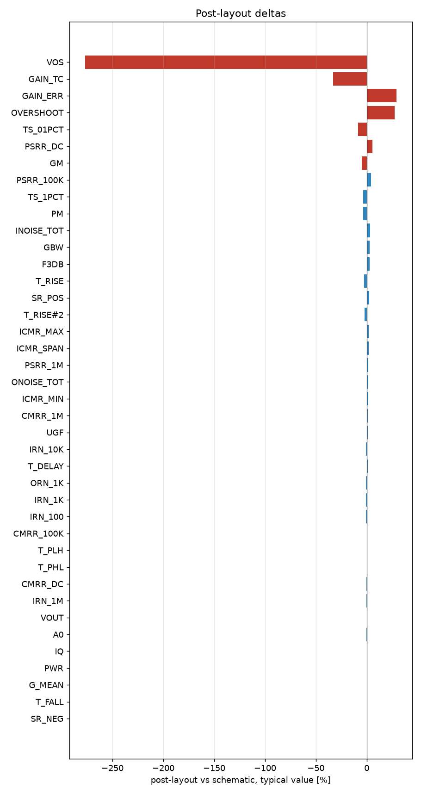

# Schematic vs post-layout

* schematic run: `/foss/designs/sg13cmos5l_spma_ip__instramp/runs/RUN_2026-10-13_19-33-20` (netlist source: schematic)
* post-layout run: `/foss/designs/sg13cmos5l_spma_ip__instramp/runs/pex_cace_rc/ota_cmos5l/RUN_2026-10-14_14-14-09` (netlist source: pex)
* flag threshold: 5 % on the typical value; units as in the CACE summary

| Parameter | Var | Unit | Schematic min / typ / max | Post-layout min / typ / max | Δ typ | Δ typ % | Status | Flag |
|---|---|---|---|---|---:|---:|---|---|
| DC gain | A0 | dB | 55.594 / 57.873 / 59.484 | 57.779 / 57.779 / 57.779 | -0.094 | -0.16 | Pass → Pass |  |
| -3 dB frequency | F3DB | Hz | 3075.8 / 3697.5 / 4351.2 | 3794.7 / 3794.7 / 3794.7 | +97.16 | +2.63 | Pass → Pass |  |
| Unity-gain frequency | UGF | Hz | 2.1095e+06 / 2.6998e+06 / 3.4451e+06 | 2.7266e+06 / 2.7266e+06 / 2.7266e+06 | +2.676e+04 | +0.99 | Pass → Pass |  |
| Phase margin | PM | ° | 55.635 / 60.647 / 66.901 | 58.592 / 58.592 / 58.592 | -2.055 | -3.39 | Pass → Pass |  |
| Gain margin | GM | dB | 14.131 / 17.161 / 21.66 | 16.288 / 16.288 / 16.288 | -0.873 | -5.09 | Pass → Pass | Δ |
| Gain-bandwidth product (A0 x f3dB) | GBW | Hz | 2.2593e+06 / 2.8616e+06 / 3.6108e+06 | 2.9384e+06 / 2.9384e+06 / 2.9384e+06 | +7.672e+04 | +2.68 | Pass → Pass |  |
| Input noise @100 Hz | IRN_100 | nV/rtHz | 505.11 / 610.25 / 708.51 | 606.73 / 606.73 / 606.73 | -3.52 | -0.58 | Pass → Pass |  |
| Input noise @1 kHz | IRN_1K | nV/rtHz | 163.11 / 197.01 / 228.6 | 195.82 / 195.82 / 195.82 | -1.186 | -0.60 | Pass → Pass |  |
| Input noise @10 kHz | IRN_10K | nV/rtHz | 61.334 / 74.134 / 86.597 | 73.422 / 73.422 / 73.422 | -0.712 | -0.96 | Pass → Pass |  |
| Input noise @1 MHz | IRN_1M | nV/rtHz | 45.977 / 66.977 / 98.969 | 66.864 / 66.864 / 66.864 | -0.113 | -0.17 | Pass → Pass |  |
| Output noise @1 kHz | ORN_1K | nV/rtHz | 163.12 / 197.27 / 228.44 | 195.71 / 195.71 / 195.71 | -1.562 | -0.79 | Pass → Pass |  |
| Integrated input noise | INOISE_TOT | uV-rms | 2675.6 / 2863.5 / 3030.5 | 2954.7 / 2954.7 / 2954.7 | +91.18 | +3.18 | Pass → Pass |  |
| Integrated output noise | ONOISE_TOT | uV-rms | 224.29 / 290.22 / 357.33 | 294.85 / 294.85 / 294.85 | +4.624 | +1.59 | Pass → Pass |  |
| Input offset voltage | VOS | mV | -0.553 / -0.213 / -0.046 | -0.803 / -0.803 / -0.803 | -0.59 | -277.00 | Pass → Pass | Δ |
| Quiescent current | IQ | uA | 16.008 / 18.3 / 19.919 | 18.323 / 18.323 / 18.323 | +0.023 | +0.13 | Pass → Pass |  |
| Quiescent power | PWR | uW | 19.209 / 24.705 / 29.878 | 24.736 / 24.736 / 24.736 | +0.031 | +0.13 | Pass → Pass |  |
| Output voltage | VOUT | V | 0.6 / 0.6 / 0.601 | 0.601 / 0.601 / 0.601 | +0.001 | +0.17 | Pass → Pass |  |
| Gain error (1 - dVout/dVin) | GAIN_ERR | % | -0.218 / 0.048 / 0.084 | 0.062 / 0.062 / 0.062 | +0.014 | +29.17 | Pass → Pass | Δ |
| Gain tempco (ppm per °C) | GAIN_TC | ppm | 0.48 / 1.301 / 2.043 | 0.873 / 0.873 / 0.873 | -0.428 | -32.90 | Pass → Pass | Δ |
| Mean follower gain | G_MEAN | V/V | 0.999 / 1 / 1.002 | 0.999 / 0.999 / 0.999 | -0.001 | -0.10 | Pass → Pass |  |
| CMRR @10 Hz | CMRR_DC | dB | 53.977 / 64.868 / 84.357 | 64.69 / 64.69 / 64.69 | -0.178 | -0.27 | Pass → Pass |  |
| CMRR @100 kHz | CMRR_100K | dB | 27.317 / 29.294 / 31.224 | 29.456 / 29.456 / 29.456 | +0.162 | +0.55 | Pass → Pass |  |
| CMRR @1 MHz | CMRR_1M | dB | 6.976 / 9.152 / 11.236 | 9.265 / 9.265 / 9.265 | +0.113 | +1.23 | Pass → Pass |  |
| PSRR @10 Hz | PSRR_DC | dB | 51.479 / 73.886 / 105.36 | 77.847 / 77.847 / 77.847 | +3.961 | +5.36 | Pass → Pass | Δ |
| PSRR @100 kHz | PSRR_100K | dB | 51.349 / 62.907 / 66.926 | 65.512 / 65.512 / 65.512 | +2.605 | +4.14 | Pass → Pass |  |
| PSRR @1 MHz | PSRR_1M | dB | 41.813 / 44.032 / 48.104 | 44.738 / 44.738 / 44.738 | +0.706 | +1.60 | Pass → Pass |  |
| Lower ICMR bound | ICMR_MIN | V | 0.06 / 0.078 / 0.096 | 0.079 / 0.079 / 0.079 | +0.001 | +1.28 | Pass → Pass |  |
| Upper ICMR bound | ICMR_MAX | V | 0.991 / 1.18 / 1.369 | 1.202 / 1.202 / 1.202 | +0.022 | +1.86 | Pass → Pass |  |
| ICMR span | ICMR_SPAN | V | 0.9 / 1.103 / 1.297 | 1.123 / 1.123 / 1.123 | +0.02 | +1.81 | Pass → Pass |  |
| Delay (50 %) | T_DELAY | ns | 50.698 / 67.558 / 86.179 | 68.126 / 68.126 / 68.126 | +0.568 | +0.84 | Pass → Pass |  |
| Rise time (10-90 %) | T_RISE | ns | 65.799 / 79.484 / 94.454 | 77.535 / 77.535 / 77.535 | -1.949 | -2.45 | Pass → Pass |  |
| Overshoot | OVERSHOOT | % | 4.413 / 9.871 / 14.731 | 12.584 / 12.584 / 12.584 | +2.713 | +27.48 | Pass → Pass | Δ |
| Settling time 1 % | TS_1PCT | ns | 100.07 / 123.06 / 388.2 | 118.49 / 118.49 / 118.49 | -4.566 | -3.71 | Pass → Pass |  |
| Settling time 0.1 % | TS_01PCT | ns | 102.14 / 365.75 / 455.68 | 334.57 / 334.57 / 334.57 | -31.17 | -8.52 | Pass → Pass | Δ |
| Positive slew rate | SR_POS | V/s | 3.1497e+05 / 1.9458e+06 / 2.239e+06 | 1.9888e+06 / 1.9888e+06 / 1.9888e+06 | +4.302e+04 | +2.21 | Pass → Pass |  |
| Negative slew rate | SR_NEG | V/s | 2.1518e+06 / 2.4306e+06 / 2.6786e+06 | 2.4286e+06 / 2.4286e+06 / 2.4286e+06 | -1950 | -0.08 | Pass → Pass |  |
| Rise time (10-90 %) | T_RISE#2 | ns | 214.38 / 246.69 / 1524 | 241.35 / 241.35 / 241.35 | -5.337 | -2.16 | Pass → Pass |  |
| Fall time (90-10 %) | T_FALL | ns | 179.2 / 197.49 / 223.07 | 197.65 / 197.65 / 197.65 | +0.159 | +0.08 | Pass → Pass |  |
| Propagation delay tpLH | T_PLH | ns | 153.22 / 182.43 / 208.09 | 183.41 / 183.41 / 183.41 | +0.988 | +0.54 | Pass → Pass |  |
| Propagation delay tpHL | T_PHL | ns | 121.78 / 141.94 / 161.9 | 142.57 / 142.57 / 142.57 | +0.631 | +0.44 | Pass → Pass |  |

7 row(s) flagged.

