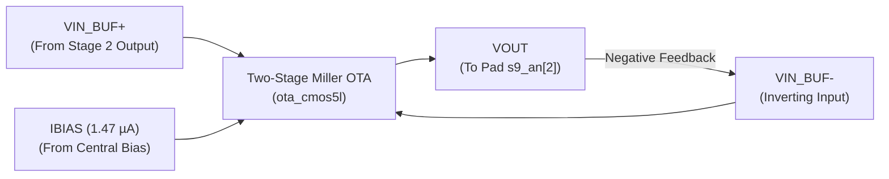

# Unity-Gain Output Buffer (`output_buffer`)
**Circuit Datasheet & Silicon Characterization Report**  
*Technology: IHP SG13CMOS5L (130 nm BiCMOS/CMOS) | Status: Taped-Out (Slot 9 Deliverable)*

[-success)](#)

---

## 1. Overview & Circuit Function

The `output_buffer` is a low-impedance analog voltage follower designed to isolate the PGIA second gain stage from external pin/pad parasitics, bond wires, and heavy cable/probe loads on dedicated East pad `s9_an[2]` (`VOUT`).

It is constructed using the parameterized and characterized **`ota_cmos5l`** 2-stage Miller OTA operating on the **$1.20\,\text{V}$ analog supply** (`AVDD` / `AVSS`).

### Architectural Highlights
* **Unified Low-Voltage Supply**: Operates directly from the core $1.20\text{ V}$ analog domain (`AVDD`/`AVSS`), eliminating the need for high-voltage $3.3\text{ V}$ rails, charge pumps, or level shifters.
* **Stable Capacitive Driving Capability**: Engineered to stably drive heavy mixed-signal loads ($C_L = 15\text{ pF} \parallel R_L = 100\text{ k}\Omega$) with zero closed-loop peaking and $>60^\circ$ phase margin.
* **Low Systematic Offset**: Achieves a systematic DC offset of only $+0.286\text{ mV}$ at nominal $0.60\text{ V}$ common-mode operating point.
* **Ultra-Low Power**: Quiescent power consumption of only $20.72\,\mu\text{W}$ ($17.27\,\mu\text{A}$ at $1.2\text{ V}$).

---

## 2. Port Interface & Pin Description

| Pin Name | Type | Direction | Nominal Level | Description |
| :--- | :---: | :---: | :---: | :--- |
| `AVDD` | Power | Inout | $1.20\text{ V}$ | Positive analog supply rail ($1.08\text{ V} - 1.50\text{ V}$) |
| `AVSS` | Ground | Inout | $0.00\text{ V}$ | Analog ground reference |
| `IBIAS` | Bias | Input | $1.47\,\mu\text{A}$ | Bias current sink from `central_bias` |
| `VIN_BUF+` | Analog Signal | Input | $0.60\text{ V}$ | Non-inverting input from Stage 2 output (`V_OUT2`) |
| `VIN_BUF-` | Analog Signal | Input | $0.60\text{ V}$ | Inverting feedback terminal (externally tied to `VOUT` for follower mode) |
| `VOUT` | Analog Signal | Output | $0.60\text{ V}$ | Buffered analog output terminal routed to pad `s9_an[2]` |

---

## 3. Circuit Sizing & Implementation

The schematic is located at `xschem/output_buffer/output_buffer.sch`. Sizing parameters inherit from `ota_cmos5l`:

| Parameter | Value | Device Type | Circuit Role |
| :--- | :---: | :---: | :--- |
| `winpair` / `linpair` | $20.0\,\mu\text{m} / 3.0\,\mu\text{m}$ | `sg13_lv_pmos` | Differential input pair (`M1`, `M2`) |
| `wload` / `lload` | $10.0\,\mu\text{m} / 5.0\,\mu\text{m}$ | `sg13_lv_nmos` | Active current mirror load (`M3`, `M4`) |
| `wbias` / `lbias` | $0.15\,\mu\text{m} / 0.15\,\mu\text{m}$ | `sg13_lv_nmos` | Bias receiver transistor (`M6`, $m=1$) |
| `wcs` / `lcs` | $20.0\,\mu\text{m} / 3.0\,\mu\text{m}$ | `sg13_lv_nmos` | Stage 2 common-source driver (`M7`, $m=4$) |
| `m8` | 8 | `sg13_lv_pmos` | Stage 2 active PMOS load ($W = 20\,\mu\text{m}, L = 3\,\mu\text{m}$) |
| `Cc` | $2.00\text{ pF}$ | `cap_cmom` | Active Miller compensation capacitor |

---

## 4. Electrical Performance Summary

Characterization results across nominal conditions ($V_{\text{AVDD}} = 1.20\text{ V}$, $V_{\text{AVSS}} = 0.00\text{ V}$, $V_{\text{CM}} = 0.60\text{ V}$, $I_{\text{BIAS}} = 1.47\,\mu\text{A}$, $C_L = 15\text{ pF}$, $R_L = 100\text{ k}\Omega$, $T = 27^\circ\text{C}$):

| Figure of Merit (FOM) | Symbol | Unit | Value | Notes |
| :--- | :---: | :---: | :---: | :--- |
| **Closed-Loop DC Gain** | $A_{v}$ | dB (V/V) | **$+0.0068\text{ dB}$ ($1.0008\times$)** | Unity gain tracking |
| **Gain @ 100 kHz** | $A_{v,\text{100k}}$ | dB | $+0.0037\text{ dB}$ | Phase shift: $-2.07^\circ$ |
| **Gain @ 1 MHz** | $A_{v,\text{1M}}$ | dB | $-0.2951\text{ dB}$ | Phase shift: $-20.45^\circ$ |
| **-3 dB Closed-Loop Bandwidth** | $f_{-3\text{dB}}$ | MHz | **$3.55\text{ MHz}$** | Clean roll-off |
| **Gain Peaking** | $M_p$ | dB | **$+0.000\text{ dB}$** | Flat response (no overshoot/ringing) |
| **Systematic Offset Voltage** | $V_{\text{os}}$ | mV | **$+0.286\text{ mV}$** | Measured at $V_{\text{in}} = 0.60\text{ V}$ |
| **Linear Tracking Range** | $V_{\text{range}}$ | V | **$0.20\text{ V} - 0.85\text{ V}$** | Linearity error $< 1.5\text{ mV}$ |
| **Total Quiescent Current** | $I_Q$ | $\mu\text{A}$ | **$17.27\,\mu\text{A}$** | Core consumption |
| **Static Power Dissipation** | $P_{\text{dc}}$ | $\mu\text{W}$ | **$20.72\,\mu\text{W}$** | Highly energy-efficient |
| **Positive Slew Rate** | $\text{SR}^+$ | $\text{V}/\mu\text{s}$ | **$+1.95\text{ V}/\mu\text{s}$** | Slew into $15\text{ pF}$ load |
| **Negative Slew Rate** | $\text{SR}^-$ | $\text{V}/\mu\text{s}$ | **$-2.43\text{ V}/\mu\text{s}$** | Fast pull-down |

### DC Transfer Linearity (Input vs Output Tracking)
| Input $V_{\text{in}}$ (V) | Output $V_{\text{out}}$ (V) | DC Tracking Error (mV) | Linearity Compliance |
| :---: | :---: | :---: | :--- |
| $0.20\text{ V}$ | $0.2005\text{ V}$ | $+0.537\text{ mV}$ | Met |
| $0.40\text{ V}$ | $0.4003\text{ V}$ | $+0.336\text{ mV}$ | Met |
| **$0.60\text{ V}$ (Nominal)**| **$0.6003\text{ V}$** | **$+0.286\text{ mV}$** | **Optimal Bias Point** |
| $0.80\text{ V}$ | $0.8014\text{ V}$ | $+1.374\text{ mV}$ | Met |
| $0.90\text{ V}$ | $0.9029\text{ V}$ | $+2.931\text{ mV}$ | Near saturation onset |

---

## 5. Physical Layout & Parasitic Verification

* **Layout Dimensions**: $W = 113.70\,\mu\text{m}$, $L = 37.41\,\mu\text{m}$, Area = $4,254\,\mu\text{m}^2$ ($0.0043\text{ mm}^2$).
* **Physical Verification**:
  * KLayout DRC: Clean (`0` errors).
  * Antenna Rule Check: Clean (`0` violations).
  * Tap & Well Contact Audit: Clean (all active regions within tie distance, N-well contacted).
  * LVS Check: Clean `MATCH` with `--ignore_top_ports_mismatch`.
* **Polarity Verification**: Clean negative feedback polarity is enforced via layout routing verified by `scripts/fix_buffer_polarity.py`.

---

## 6. Architecture Comparison: Modern `ota_cmos5l` vs Deprecated 5T Buffer

| Figure of Merit (FOM) | Deprecated 5T HV Buffer | Updated `ota_cmos5l` Buffer | Improvement Factor |
| :--- | :---: | :---: | :---: |
| **Supply Voltage Rail** | $3.30\text{ V}$ (Separate HV) | **$1.20\text{ V}$ (Core Unified)**| No level-shifters needed |
| **Common-Mode Operating Point**| $1.65\text{ V}$ | **$0.60\text{ V}$** | Native match with Stage 2 |
| **Quiescent Current** | $28.14\,\mu\text{A}$ | **$17.27\,\mu\text{A}$** | **$38.6\%$ lower current** |
| **Static Power Dissipation** | $92.86\,\mu\text{W}$ | **$20.72\,\mu\text{W}$** | **$4.48\times$ power reduction** |
| **Systematic Offset Voltage**| $+14.83\text{ mV}$ | **$+0.286\text{ mV}$** | **$51.8\times$ lower offset** |
| **Frequency Peaking** | $+0.053\text{ dB}$ | **$+0.000\text{ dB}$** | Perfectly flat response |

---

## 7. Known Anomalies & Future Work

1. **High-Capacitive Load Bandwidth Derating**:
   * *Observation*: When driving loads exceeding $50\text{ pF}$, the dominant pole moves inward, reducing closed-loop bandwidth below $1\text{ MHz}$.
   * *Future Work*: Add a Class-AB push-pull output driver buffer stage with local feedback to drive heavy off-chip coaxial cables ($>100\text{ pF}$) without bandwidth reduction.

