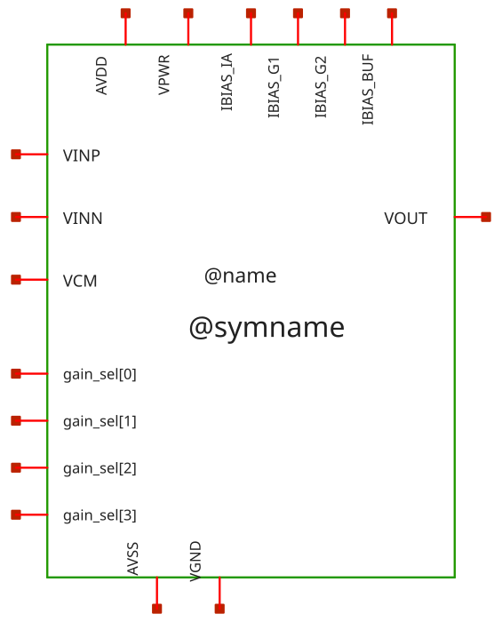
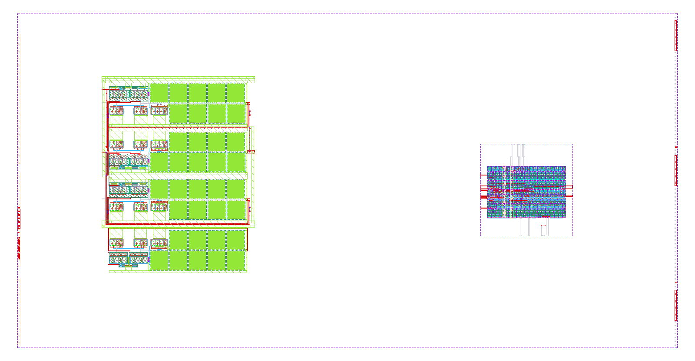
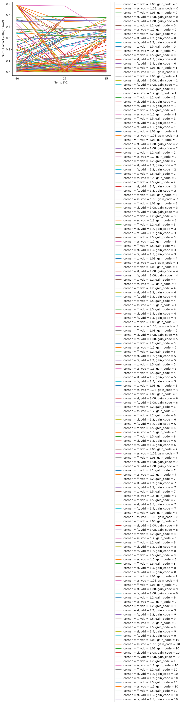
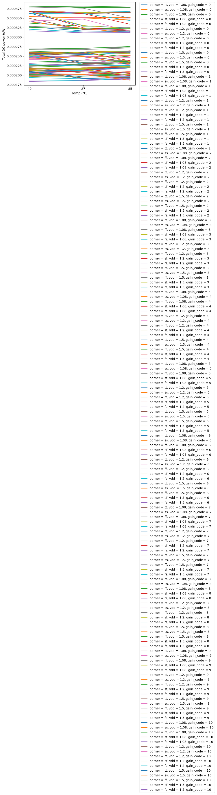
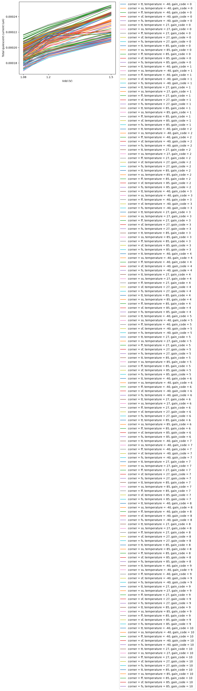
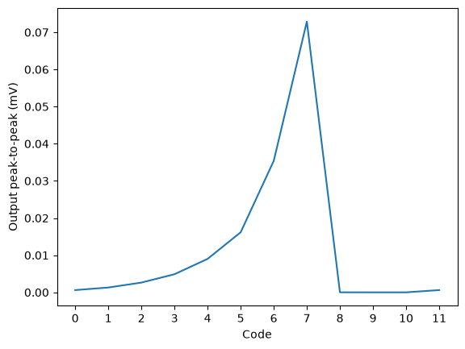
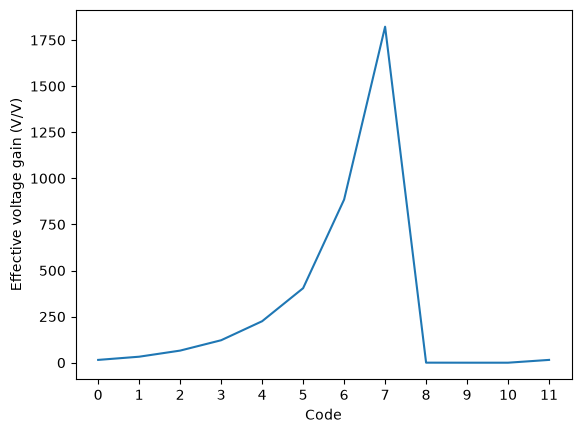

# pgia_top - CACE characterisation

- Generated: 2026-10-30 05:38 by `scripts/make_readme.py` from `runs/RUN_2026-10-30_05-27-03`
- Commit: `789d8d8` (working tree dirty)
- Netlist source: schematic; datasheet: `cace/pgia_top.yaml`; reproduce with `scripts/run_cace.sh pgia_top`
- Sections marked *(CACE)* are written by CACE itself, the rest by this script (CACE has no per-corner MC statistics, worst-case conditions or unit-scaled spread plots).

## Design *(CACE)*

- Description: Top-level Programmable Gain Instrumentation Amplifier IP with 11 gain steps (8x to 8192x)
- PDK: ihp-sg13cmos5l

### Authorship

- Designer: SPMA
- Created: October 23, 2026
- License: MIT
- Company: None
- Last modified: None

### Pins

- AVDD
  + Description: Positive analog power supply (1.2V typ)
  + Type: power
  + Direction: inout
  + Vmin: 1.08
  + Vmax: 1.5
- VPWR
  + Description: Positive digital power supply for decoder (1.2V typ)
  + Type: power
  + Direction: inout
  + Vmin: 1.08
  + Vmax: 1.5
- AVSS
  + Description: Analog ground (0V)
  + Type: ground
  + Direction: inout
- VGND
  + Description: Digital ground for decoder (0V)
  + Type: ground
  + Direction: inout
- IBIAS_IA
  + Description: Bias current sink for instrumentation amplifier (4.2 uA)
  + Type: signal
  + Direction: input
- IBIAS_G1
  + Description: Bias current source for stage 1 gain network (1.0 uA from AVDD)
  + Type: signal
  + Direction: input
- IBIAS_G2
  + Description: Bias current source for stage 2 gain network (1.0 uA from AVDD)
  + Type: signal
  + Direction: input
- IBIAS_BUF
  + Description: Bias current sink for output buffer (1.4 uA)
  + Type: signal
  + Direction: input
- VINP
  + Description: Non-inverting differential analog input
  + Type: signal
  + Direction: input
- VINN
  + Description: Inverting differential analog input
  + Type: signal
  + Direction: input
- VCM
  + Description: Common-mode reference voltage (0.6V typ)
  + Type: signal
  + Direction: input
- gain_sel[0]
  + Description: Digital gain select bit 0 (LSB)
  + Type: signal
  + Direction: input
- gain_sel[1]
  + Description: Digital gain select bit 1
  + Type: signal
  + Direction: input
- gain_sel[2]
  + Description: Digital gain select bit 2
  + Type: signal
  + Direction: input
- gain_sel[3]
  + Description: Digital gain select bit 3 (MSB)
  + Type: signal
  + Direction: input
- VOUT
  + Description: Single-ended analog output
  + Type: signal
  + Direction: output

### Default Conditions

- vdd
  + Description: Analog and digital power supply voltage
  + Display: Vdd
  + Unit: V
  + Typical: 1.2
- vcm
  + Description: Common-mode voltage
  + Display: Vcm
  + Unit: V
  + Typical: 0.6
- ib_ia
  + Description: Bias current for IA
  + Display: Ib_ia
  + Unit: uA
  + Typical: 4.2
- ib_g1
  + Description: Bias current for Gain Stage 1
  + Display: Ib_g1
  + Unit: uA
  + Typical: 1.0
- ib_g2
  + Description: Bias current for Gain Stage 2
  + Display: Ib_g2
  + Unit: uA
  + Typical: 1.0
- ib_buf
  + Description: Bias current for Output Buffer
  + Display: Ib_buf
  + Unit: uA
  + Typical: 1.4
- cl
  + Description: Output load capacitance
  + Display: CLoad
  + Unit: pF
  + Typical: 15
- rl
  + Description: Output load resistance
  + Display: RLoad
  + Unit: kOhm
  + Typical: 100
- cin
  + Description: Input AC coupling capacitance
  + Display: Cin
  + Unit: nF
  + Typical: 10
- gain_code
  + Description: Active 4-bit binary gain code (0 to 10 valid, 11 clamped)
  + Display: Code
  + Typical: 0
- corner
  + Description: Process corner
  + Display: Corner
  + Typical: tt
- rcorner
  + Description: Resistor corner (res_<rcorner> section of cornerRES.lib)
  + Display: Rcorner
  + Typical: typ
- temperature
  + Description: Ambient temperature
  + Display: Temp
  + Unit: °C
  + Typical: 27

### Symbol

### Schematic

**Parameters** (`.param` of the schematic and of the cells it instantiates; generated by `scripts/update_images.py`, do not edit)

| Source | Parameter | Value |
|---|---|---|
| ota_cmos5l (x1, x2, x3) | `temp` | `27` |
| ota_cmos5l (x1, x2, x3) | `lbias` | `0.15u` |
| ota_cmos5l (x1, x2, x3) | `wbias` | `0.15u` |
| ota_cmos5l (x1, x2, x3) | `m6` | `1` |
| ota_cmos5l (x1, x2, x3) | `m7` | `4` |
| ota_cmos5l (x1, x2, x3) | `m8` | `8` |
| ota_cmos5l (x1, x2, x3) | `linpair` | `3u` |
| ota_cmos5l (x1, x2, x3) | `winpair` | `20u` |
| ota_cmos5l (x1, x2, x3) | `lload` | `5u` |
| ota_cmos5l (x1, x2, x3) | `wload` | `10u` |
| ota_cmos5l (x1, x2, x3) | `lcs` | `3u` |
| ota_cmos5l (x1, x2, x3) | `wcs` | `20u` |
| ota_cmos5l (x1, x2, x3) | `Cc` | `2p` |

### Layout

**Physical size** (bounding box of `slot9_wrapper`; generated by `scripts/update_images.py`)

| Width W | Length L | Area |
|---|---|---|
| 537.15 µm | 273.00 µm | 146642 µm² |

## Results summary *(CACE)*

min / typ / max over all conditions of a parameter; Monte Carlo parameters (`mc_*`) are min/max over all samples.

**netlist source**: schematic

|      Parameter       |         Tool         |     Result      | Min Limit  |  Min Value   | Typ Target |  Typ Value   | Max Limit  |  Max Value   |  Status  |
| :------------------- | :------------------- | :-------------- | ---------: | -----------: | ---------: | -----------: | ---------: | -----------: | :------: |
| Closed-loop gain @1 kHz | ngspice              | A_CL                 |             any | -180.218 dB |     18.06 dB |  26.226 dB |          any |  77.481 dB |   Pass ✅    |
| Gain step error vs target | ngspice              | A_ERR                |             any | -258.486 dB |          any |  -3.804 dB |          any |  20.668 dB |   Pass ✅    |
| -3 dB bandwidth      | ngspice              | F3DB                 |         1000 Hz | 1422.560 Hz |          any | 207272.000 Hz |          any | 93620400.000 Hz |   Pass ✅    |
| 0 dB frequency       | ngspice              | F0DB                 |             any | 2368.360 Hz |          any | 2605740.000 Hz |          any | 10000000.000 Hz |   Pass ✅    |
| Phase @1 kHz         | ngspice              | PH_1K                |             any | -179.899 ° |          any |   -0.398 ° |          any |  179.815 ° |   Pass ✅    |
| Input pseudo-resistor | ngspice              | R_PSEUDO             |          1 GOhm | 3.803 GOhm |      15 GOhm | 13.656 GOhm |          any | 46.053 GOhm |   Pass ✅    |
| Output offset voltage | ngspice              | VOS                  |             any |   0.011 mV |      1.08 mV |  78.923 mV |          any | 587.698 mV |   Pass ✅    |
| IA output DC voltage | ngspice              | V_IA                 |             any |    0.600 V |        0.6 V |    0.602 V |          any |    0.611 V |   Pass ✅    |
| Stage 1 output DC voltage | ngspice              | V_ST1                |             any |    0.270 V |        0.6 V |    0.562 V |          any |    0.915 V |   Pass ✅    |
| Stage 2 output DC voltage | ngspice              | V_ST2                |             any |    0.000 V |        0.6 V |    0.637 V |          any |    1.500 V |   Pass ✅    |
| DC output voltage    | ngspice              | VOUT                 |             any |    0.012 V |        0.6 V |    0.636 V |          any |    1.090 V |   Pass ✅    |
| Analog supply current | ngspice              | I_AVDD               |             any | 169.901 uA |       216 uA | 213.755 uA |       400 uA | 254.745 uA |   Pass ✅    |
| Digital supply current | ngspice              | I_VPWR               |             any |   0.001 uA |     0.014 uA |   0.020 uA |       1.0 uA |   0.478 uA |   Pass ✅    |
| Total quiescent current | ngspice              | IQ_TOT               |             any | 169.907 uA |       216 uA | 213.774 uA |       400 uA | 254.896 uA |   Pass ✅    |
| Total DC power       | ngspice              | PWR                  |             any | 183.500 uW |       260 uW | 257.108 uW |       500 uW | 382.344 uW |   Pass ✅    |
| Output peak-to-peak  | ngspice              | VPP_OUT              |             any |   0.000 mV |          any |   1.962 mV |          any |  72.896 mV |   Pass ✅    |
| Effective voltage gain | ngspice              | EFF_GAIN             |             any |  0.000 V/V |          any | 49.052 V/V |          any | 1822.400 V/V |   Pass ✅    |

### Plots *(CACE)*

#### ac_gain_A_CL_vs_temperature

#### ac_gain_F3DB_vs_temperature

#### ac_gain_A_CL_vs_gain_code

#### ac_gain_R_PSEUDO_vs_temperature

#### dc_op_VOS_vs_temperature

#### dc_op_PWR_vs_temperature

#### dc_op_IQ_TOT_vs_vdd

#### tran_VPP_OUT_vs_gain_code

#### tran_EFF_GAIN_vs_gain_code

## PVT worst-case conditions

Corners tt/ss/ff/sf/fs, supply and temperature as in the yaml. Values in the display unit of the yaml.

### ac_gain - Closed-loop AC gain & bandwidth

540 runs.

| metric | min | at (corner, vdd, T) | max | at (corner, vdd, T) | spec | fails |
|---|---|---|---|---|---|---|
| A_CL [dB] | -180.2 | tt, 1.5 V, -40 C | 77.48 | tt, 1.2 V, -40 C | any | - |
| A_ERR [dB] | -258.5 | tt, 1.5 V, -40 C | 20.67 | ss, 1.08 V, -40 C | any | - |
| F3DB [Hz] | 1423 | fs, 1.08 V, -40 C | 9.362e+07 | sf, 1.5 V, 85 C | >= 1000 | 0 |
| F0DB [Hz] | 2368 | fs, 1.08 V, -40 C | 1e+07 | ss, 1.08 V, -40 C | any | - |
| PH_1K [°] | -179.9 | ss, 1.5 V, 27 C | 179.8 | sf, 1.2 V, -40 C | any | - |
| R_PSEUDO [GOhm] | 3.803 | ff, 1.08 V, 85 C | 46.05 | ss, 1.5 V, -40 C | >= 1 | 0 |

### dc_op - DC operating point

495 runs.

| metric | min | at (corner, vdd, T) | max | at (corner, vdd, T) | spec | fails |
|---|---|---|---|---|---|---|
| VOS [mV] | 0.01119 | ff, 1.08 V, 27 C | 587.7 | ss, 1.5 V, -40 C | any | - |
| V_IA [V] | 0.5997 | ff, 1.5 V, 85 C | 0.611 | ss, 1.08 V, 27 C | any | - |
| V_ST1 [V] | 0.2705 | fs, 1.08 V, 85 C | 0.9153 | ss, 1.08 V, -40 C | any | - |
| V_ST2 [V] | 0.0001101 | ss, 1.5 V, -40 C | 1.5 | tt, 1.5 V, -40 C | any | - |
| VOUT [V] | 0.0123 | ss, 1.5 V, -40 C | 1.09 | ff, 1.5 V, 27 C | any | - |
| I_AVDD [uA] | 169.9 | fs, 1.08 V, -40 C | 254.7 | ff, 1.5 V, -40 C | <= 400 | 0 |
| I_VPWR [uA] | 0.001239 | ss, 1.08 V, -40 C | 0.4779 | ff, 1.5 V, 85 C | <= 1 | 0 |
| IQ_TOT [uA] | 169.9 | fs, 1.08 V, -40 C | 254.9 | ff, 1.5 V, 85 C | <= 400 | 0 |
| PWR [uW] | 183.5 | fs, 1.08 V, -40 C | 382.3 | ff, 1.5 V, 85 C | <= 500 | 0 |

### tran - Dynamic transient response

12 runs.

| metric | min | at (corner, vdd, T) | max | at (corner, vdd, T) | spec | fails |
|---|---|---|---|---|---|---|
| VPP_OUT [mV] | 1.689e-07 | tt, 1.2 V, 27 C | 72.9 | tt, 1.2 V, 27 C | any | - |
| EFF_GAIN [V/V] | 4.224e-06 | tt, 1.2 V, 27 C | 1822 | tt, 1.2 V, 27 C | any | - |

## Monte Carlo (local mismatch)

Mismatch models only (`mos_<corner>_mismatch`, `res_typ_mismatch`; `cap_cmomi` has no characterised spread), one seed per iteration (`seed = 12345 + iteration`, **the same 50 mismatch draws are reused at every corner and temperature**, so boxes are paired comparisons and the pooled counts overstate the number of independent samples: 50, not 50 x 15). Box = interquartile range, dots = individual samples, dotted lines = spec (if any).

