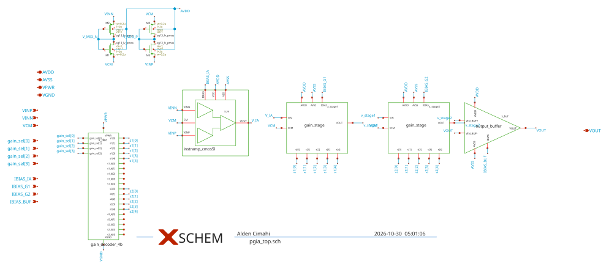

# pgia_top

- Description: Top-level Programmable Gain Instrumentation Amplifier IP with 11 gain steps (8x to 8192x)
- PDK: ihp-sg13cmos5l

## Authorship

- Designer: SPMA
- Created: October 23, 2026
- License: MIT
- Company: None
- Last modified: None

## Pins

- AVDD
  + Description: Positive analog power supply (1.2V typ)
  + Type: power
  + Direction: inout
  + Vmin: 1.08
  + Vmax: 1.5
- VPWR
  + Description: Positive digital power supply for decoder (1.2V typ)
  + Type: power
  + Direction: inout
  + Vmin: 1.08
  + Vmax: 1.5
- AVSS
  + Description: Analog ground (0V)
  + Type: ground
  + Direction: inout
- VGND
  + Description: Digital ground for decoder (0V)
  + Type: ground
  + Direction: inout
- IBIAS_IA
  + Description: Bias current sink for instrumentation amplifier (4.2 uA)
  + Type: signal
  + Direction: input
- IBIAS_G1
  + Description: Bias current source for stage 1 gain network (1.0 uA from AVDD)
  + Type: signal
  + Direction: input
- IBIAS_G2
  + Description: Bias current source for stage 2 gain network (1.0 uA from AVDD)
  + Type: signal
  + Direction: input
- IBIAS_BUF
  + Description: Bias current sink for output buffer (1.4 uA)
  + Type: signal
  + Direction: input
- VINP
  + Description: Non-inverting differential analog input
  + Type: signal
  + Direction: input
- VINN
  + Description: Inverting differential analog input
  + Type: signal
  + Direction: input
- VCM
  + Description: Common-mode reference voltage (0.6V typ)
  + Type: signal
  + Direction: input
- gain_sel[0]
  + Description: Digital gain select bit 0 (LSB)
  + Type: signal
  + Direction: input
- gain_sel[1]
  + Description: Digital gain select bit 1
  + Type: signal
  + Direction: input
- gain_sel[2]
  + Description: Digital gain select bit 2
  + Type: signal
  + Direction: input
- gain_sel[3]
  + Description: Digital gain select bit 3 (MSB)
  + Type: signal
  + Direction: input
- VOUT
  + Description: Single-ended analog output
  + Type: signal
  + Direction: output

## Default Conditions

- vdd
  + Description: Analog and digital power supply voltage
  + Display: Vdd
  + Unit: V
  + Typical: 1.2
- vcm
  + Description: Common-mode voltage
  + Display: Vcm
  + Unit: V
  + Typical: 0.6
- ib_ia
  + Description: Bias current for IA
  + Display: Ib_ia
  + Unit: uA
  + Typical: 4.2
- ib_g1
  + Description: Bias current for Gain Stage 1
  + Display: Ib_g1
  + Unit: uA
  + Typical: 1.0
- ib_g2
  + Description: Bias current for Gain Stage 2
  + Display: Ib_g2
  + Unit: uA
  + Typical: 1.0
- ib_buf
  + Description: Bias current for Output Buffer
  + Display: Ib_buf
  + Unit: uA
  + Typical: 1.4
- cl
  + Description: Output load capacitance
  + Display: CLoad
  + Unit: pF
  + Typical: 15
- rl
  + Description: Output load resistance
  + Display: RLoad
  + Unit: kOhm
  + Typical: 100
- cin
  + Description: Input AC coupling capacitance
  + Display: Cin
  + Unit: nF
  + Typical: 10
- gain_code
  + Description: Active 4-bit binary gain code (0 to 10 valid, 11 clamped)
  + Display: Code
  + Typical: 0
- corner
  + Description: Process corner
  + Display: Corner
  + Typical: tt
- rcorner
  + Description: Resistor corner (res_<rcorner> section of cornerRES.lib)
  + Display: Rcorner
  + Typical: typ
- temperature
  + Description: Ambient temperature
  + Display: Temp
  + Unit: °C
  + Typical: 27

## Symbol

## Schematic

