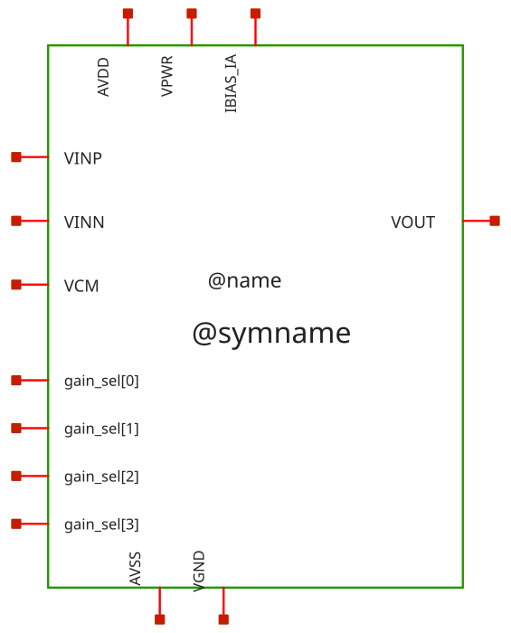
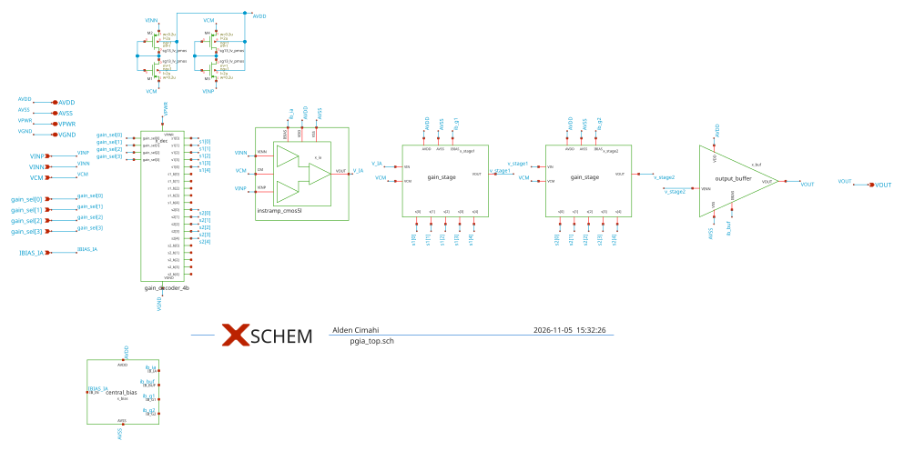

# pgia_top

- Description: Top-level Programmable Gain Instrumentation Amplifier IP with 11 gain steps (8x to 8192x)
- PDK: ihp-sg13cmos5l

## Authorship

- Designer: SPMA
- Created: October 23, 2026
- License: MIT
- Company: None
- Last modified: None

## Pins

- AVDD
  + Description: Positive analog power supply (1.2V typ)
  + Type: power
  + Direction: inout
  + Vmin: 1.08
  + Vmax: 1.5
- VPWR
  + Description: Positive digital power supply for decoder (1.2V typ)
  + Type: power
  + Direction: inout
  + Vmin: 1.08
  + Vmax: 1.5
- AVSS
  + Description: Analog ground (0V)
  + Type: ground
  + Direction: inout
- VGND
  + Description: Digital ground for decoder (0V)
  + Type: ground
  + Direction: inout
- IBIAS_IA
  + Description: Bias current input = ibias0 of the harness (1.0 uA sourced into the pin; central_bias makes the IA 4.4 / buffer 1.5 / stage 1.1 uA currents)
  + Type: signal
  + Direction: input
- VINP
  + Description: Non-inverting differential analog input
  + Type: signal
  + Direction: input
- VINN
  + Description: Inverting differential analog input
  + Type: signal
  + Direction: input
- VCM
  + Description: Common-mode reference voltage (0.6V typ)
  + Type: signal
  + Direction: input
- gain_sel[0]
  + Description: Digital gain select bit 0 (LSB)
  + Type: signal
  + Direction: input
- gain_sel[1]
  + Description: Digital gain select bit 1
  + Type: signal
  + Direction: input
- gain_sel[2]
  + Description: Digital gain select bit 2
  + Type: signal
  + Direction: input
- gain_sel[3]
  + Description: Digital gain select bit 3 (MSB)
  + Type: signal
  + Direction: input
- VOUT
  + Description: Single-ended analog output
  + Type: signal
  + Direction: output

## Default Conditions

- vdd
  + Description: Analog and digital power supply voltage
  + Display: Vdd
  + Unit: V
  + Typical: 1.2
- vcm
  + Description: Common-mode voltage
  + Display: Vcm
  + Unit: V
  + Typical: 0.6
- ib_ia
  + Description: Current sourced into the single bias pin IBIAS_IA (ibias0); 0.7 .. 1.3 uA is the working window (xschem/central_bias/README.md)
  + Display: Ib_ia
  + Unit: uA
  + Typical: 1.0
- cl
  + Description: Output load capacitance
  + Display: CLoad
  + Unit: pF
  + Typical: 15
- rl
  + Description: Output load resistance
  + Display: RLoad
  + Unit: kOhm
  + Typical: 100
- cin
  + Description: Input AC coupling capacitance
  + Display: Cin
  + Unit: nF
  + Typical: 10
- vin_off
  + Description: Intentional DC offset on VINP (relative to VCM) that cancels the systematic input-referred offset of the chip. 0 = chip as built; -334.7 uV = the value of tb_pgia_top, the null of the SCHEMATIC; -903.7 uV = the null of the EXTRACTED LAYOUT (C and RC netlists). With the right null gain codes 8 to 10 (x2000 .. x8192) stay in range, without it they rail
  + Display: Vin_off
  + Unit: uV
  + Typical: 0
- gain_code
  + Description: Active 4-bit binary gain code (0 to 10 valid, 11 clamped)
  + Display: Code
  + Typical: 0
- corner
  + Description: Process corner
  + Display: Corner
  + Typical: tt
- rcorner
  + Description: Resistor corner (res_<rcorner> section of cornerRES.lib)
  + Display: Rcorner
  + Typical: typ
- temperature
  + Description: Ambient temperature
  + Display: Temp
  + Unit: °C
  + Typical: 27

## Symbol

## Schematic

