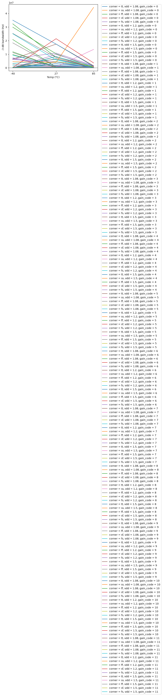
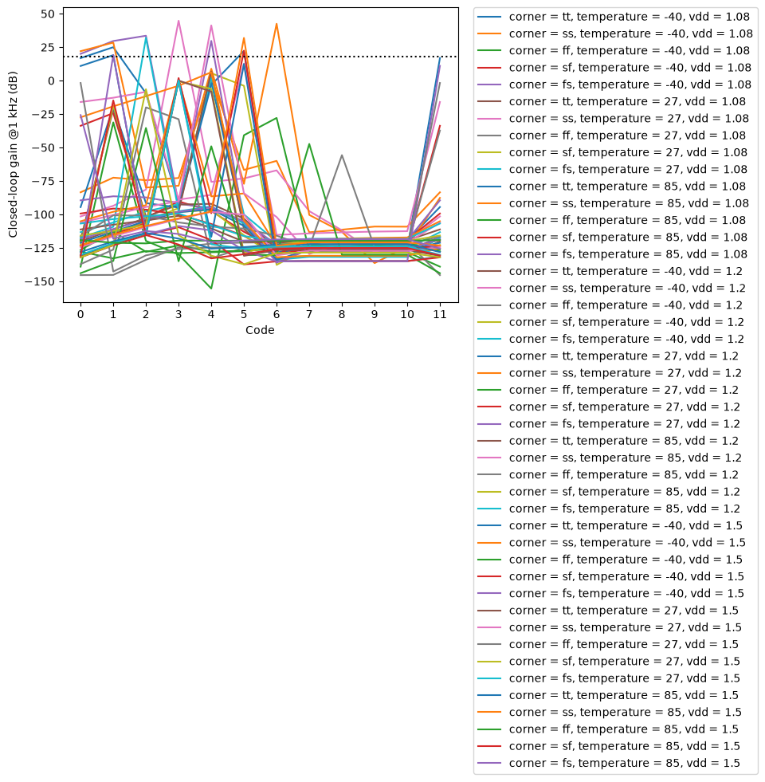
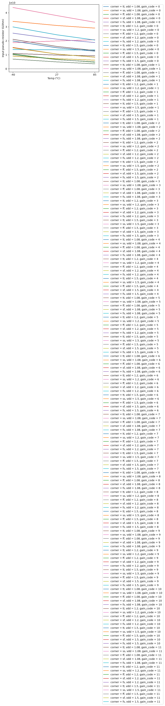
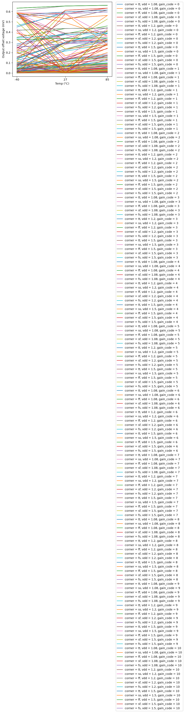
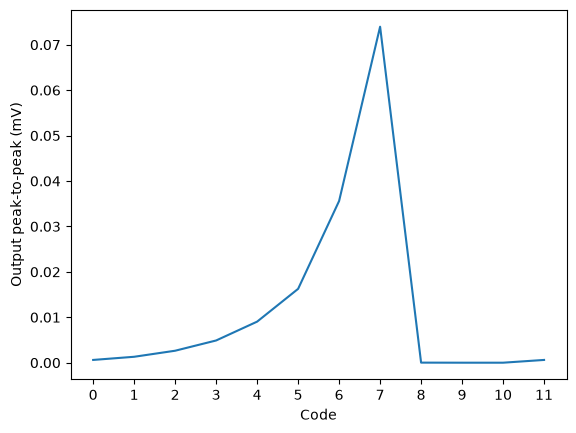
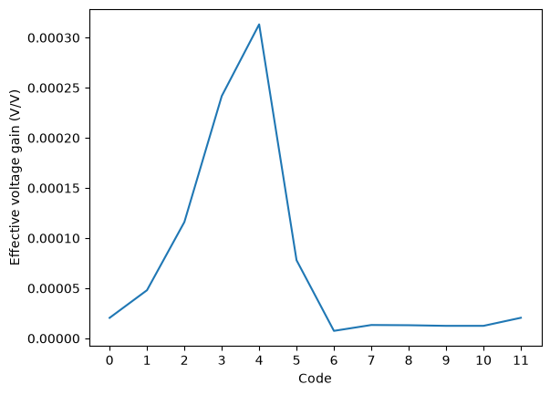

# CACE Summary for pgia_top

**netlist source**: schematic

|      Parameter       |         Tool         |     Result      | Min Limit  |  Min Value   | Typ Target |  Typ Value   | Max Limit  |  Max Value   |  Status  |
| :------------------- | :------------------- | :-------------- | ---------: | -----------: | ---------: | -----------: | ---------: | -----------: | :------: |
| Closed-loop gain @1 kHz | ngspice              | A_CL                 |             any | -155.451 dB |     18.06 dB | -119.585 dB |          any |  44.760 dB |   Pass ✅    |
| Gain step error vs target | ngspice              | A_ERR                |             any | -213.257 dB |          any | -158.404 dB |          any |   8.637 dB |   Pass ✅    |
| -3 dB bandwidth      | ngspice              | F3DB                 |         1000 Hz | 9957.440 Hz |          any | 20418850.000 Hz |          any | 91606000.000 Hz |   Pass ✅    |
| 0 dB frequency       | ngspice              | F0DB                 |             any | 65321.000 Hz |          any | 10000000.000 Hz |          any | 10000000.000 Hz |   Pass ✅    |
| Phase @1 kHz         | ngspice              | PH_1K                |             any | -179.916 ° |          any |   -0.063 ° |          any |  179.913 ° |   Pass ✅    |
| Input pseudo-resistor | ngspice              | R_PSEUDO             |          1 GOhm | 1.175 GOhm |      15 GOhm | 5.357 GOhm |          any | 17.061 GOhm |   Pass ✅    |
| Output offset voltage | ngspice              | VOS                  |             any |   2.867 mV |      1.08 mV | 554.438 mV |          any | 876.478 mV |   Pass ✅    |
| IA output DC voltage | ngspice              | V_IA                 |             any |    0.608 V |        0.6 V |    0.613 V |          any |    0.632 V |   Pass ✅    |
| Stage 1 output DC voltage | ngspice              | V_ST1                |             any |    0.633 V |        0.6 V |    1.071 V |          any |    1.497 V |   Pass ✅    |
| Stage 2 output DC voltage | ngspice              | V_ST2                |             any |    0.000 V |        0.6 V |    0.296 V |          any |    1.135 V |   Pass ✅    |
| DC output voltage    | ngspice              | VOUT                 |             any |    0.006 V |        0.6 V |    1.148 V |          any |    1.476 V |   Pass ✅    |
| Analog supply current | ngspice              | I_AVDD               |             any | 177.637 uA |       216 uA | 806.335 uA |       400 uA | 2955.040 uA |   Fail ❌    |
| Digital supply current | ngspice              | I_VPWR               |             any |   0.001 uA |     0.014 uA |   0.021 uA |       1.0 uA |   0.478 uA |   Pass ✅    |
| Total quiescent current | ngspice              | IQ_TOT               |             any | 177.638 uA |       216 uA | 806.349 uA |       400 uA | 2955.120 uA |   Fail ❌    |
| Total DC power       | ngspice              | PWR                  |             any | 191.849 uW |       260 uW | 959.205 uW |       500 uW | 4432.680 uW |   Fail ❌    |
| Output peak-to-peak  | ngspice              | VPP_OUT              |             any |   0.000 mV |          any |   0.000 mV |          any |   0.000 mV |   Pass ✅    |
| Effective voltage gain | ngspice              | EFF_GAIN             |             any |  0.000 V/V |          any |  0.000 V/V |          any |  0.000 V/V |   Pass ✅    |

## Plots

## ac_gain_A_CL_vs_temperature

## ac_gain_F3DB_vs_temperature

## ac_gain_A_CL_vs_gain_code

## ac_gain_R_PSEUDO_vs_temperature

## dc_op_VOS_vs_temperature

## dc_op_PWR_vs_temperature

## dc_op_IQ_TOT_vs_vdd

## tran_VPP_OUT_vs_gain_code

## tran_EFF_GAIN_vs_gain_code

