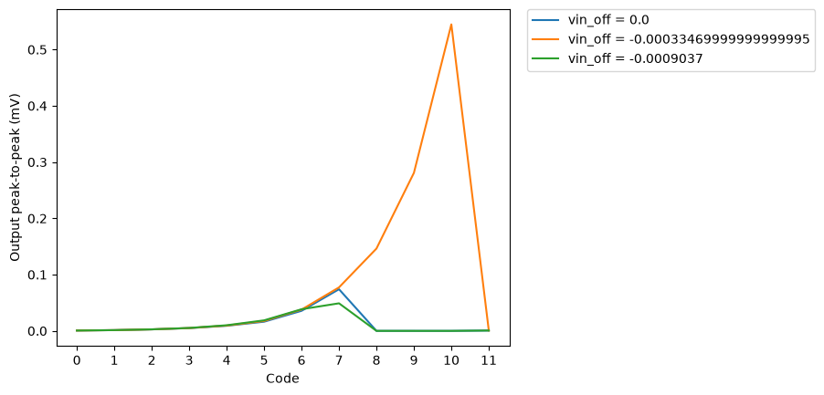
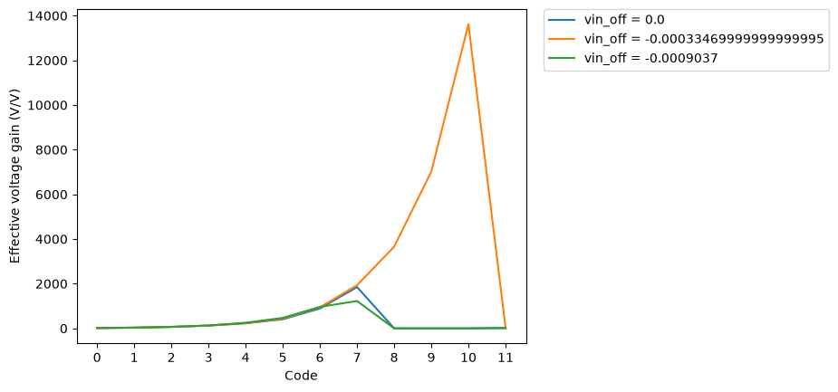

# CACE Summary for pgia_top

**netlist source**: schematic

|      Parameter       |         Tool         |     Result      | Min Limit  |  Min Value   | Typ Target |  Typ Value   | Max Limit  |  Max Value   |  Status  |
| :------------------- | :------------------- | :-------------- | ---------: | -----------: | ---------: | -----------: | ---------: | -----------: | :------: |
| Closed-loop gain @1 kHz | ngspice              | A_CL                 |             any |          ​ |     18.06 dB |          ​ |          any |          ​ |  Cancel 🟧   |
| Gain step error vs target | ngspice              | A_ERR                |             any |          ​ |          any |          ​ |          any |          ​ |  Cancel 🟧   |
| -3 dB bandwidth      | ngspice              | F3DB                 |         1000 Hz |          ​ |          any |          ​ |          any |          ​ |  Cancel 🟧   |
| 0 dB frequency       | ngspice              | F0DB                 |             any |          ​ |          any |          ​ |          any |          ​ |  Cancel 🟧   |
| Phase @1 kHz         | ngspice              | PH_1K                |             any |          ​ |          any |          ​ |          any |          ​ |  Cancel 🟧   |
| Input pseudo-resistor | ngspice              | R_PSEUDO             |          1 GOhm |          ​ |      15 GOhm |          ​ |          any |          ​ |  Cancel 🟧   |
| Output offset voltage | ngspice              | VOS                  |             any |   0.026 mV |      1.08 mV |  80.184 mV |          any | 661.207 mV |   Pass ✅    |
| IA output DC voltage | ngspice              | V_IA                 |             any |    0.593 V |        0.6 V |    0.601 V |          any |    0.610 V |   Pass ✅    |
| Stage 1 output DC voltage | ngspice              | V_ST1                |             any |    0.273 V |        0.6 V |    0.597 V |          any |    1.070 V |   Pass ✅    |
| Stage 2 output DC voltage | ngspice              | V_ST2                |             any |    0.000 V |        0.6 V |    0.601 V |          any |    1.500 V |   Pass ✅    |
| DC output voltage    | ngspice              | VOUT                 |             any |    0.011 V |        0.6 V |    0.600 V |          any |    1.261 V |   Pass ✅    |
| Analog supply current | ngspice              | I_AVDD               |             any | 166.433 uA |       216 uA | 229.546 uA |       400 uA | 315.963 uA |   Pass ✅    |
| Digital supply current | ngspice              | I_VPWR               |             any |   0.001 uA |     0.014 uA |   0.021 uA |       1.0 uA |   0.478 uA |   Pass ✅    |
| Total quiescent current | ngspice              | IQ_TOT               |             any | 166.434 uA |       216 uA | 229.565 uA |       400 uA | 316.416 uA |   Pass ✅    |
| Total DC power       | ngspice              | PWR                  |             any | 179.749 uW |       260 uW | 272.885 uW |       500 uW | 474.624 uW |   Pass ✅    |
| Output peak-to-peak  | ngspice              | VPP_OUT              |             any |   0.000 mV |          any |   3.800 mV |          any | 544.773 mV |   Pass ✅    |
| Effective voltage gain | ngspice              | EFF_GAIN             |             any |  0.000 V/V |          any | 94.990 V/V |          any | 13619.300 V/V |   Pass ✅    |

## Plots

## dc_op_VOS_vs_temperature

## dc_op_PWR_vs_temperature

## dc_op_IQ_TOT_vs_vdd

## tran_VPP_OUT_vs_gain_code

## tran_EFF_GAIN_vs_gain_code

