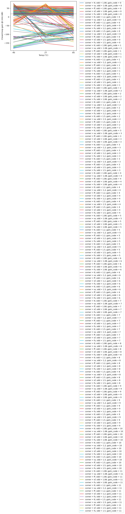
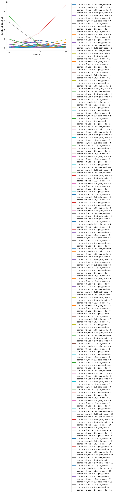
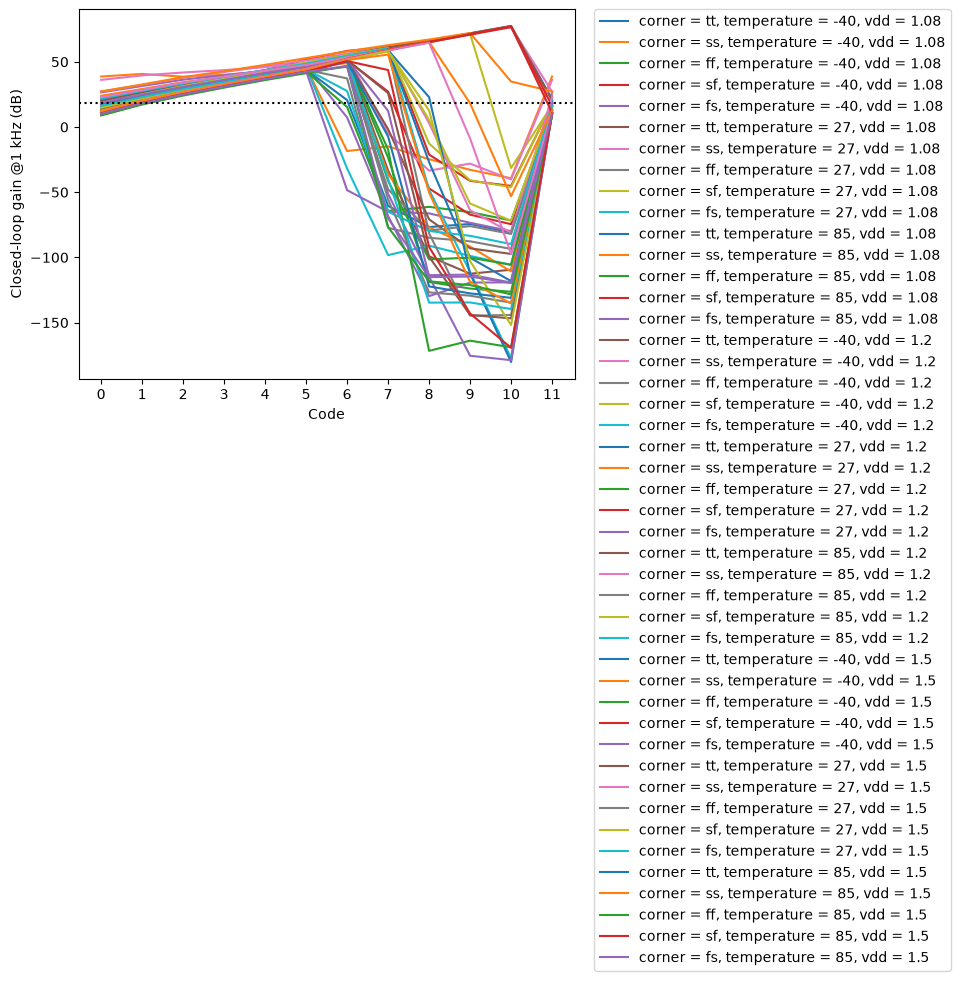
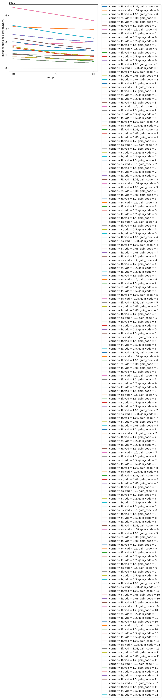

# CACE Summary for pgia_top

**netlist source**: schematic

|      Parameter       |         Tool         |     Result      | Min Limit  |  Min Value   | Typ Target |  Typ Value   | Max Limit  |  Max Value   |  Status  |
| :------------------- | :------------------- | :-------------- | ---------: | -----------: | ---------: | -----------: | ---------: | -----------: | :------: |
| Closed-loop gain @1 kHz | ngspice              | A_CL                 |             any | -180.218 dB |     18.06 dB |  26.226 dB |          any |  77.481 dB |   Pass ✅    |
| Gain step error vs target | ngspice              | A_ERR                |             any | -258.486 dB |          any |  -3.804 dB |          any |  20.668 dB |   Pass ✅    |
| -3 dB bandwidth      | ngspice              | F3DB                 |         1000 Hz | 1422.560 Hz |          any | 207272.000 Hz |          any | 93620400.000 Hz |   Pass ✅    |
| 0 dB frequency       | ngspice              | F0DB                 |             any | 2368.360 Hz |          any | 2605740.000 Hz |          any | 10000000.000 Hz |   Pass ✅    |
| Phase @1 kHz         | ngspice              | PH_1K                |             any | -179.899 ° |          any |   -0.398 ° |          any |  179.815 ° |   Pass ✅    |
| Input pseudo-resistor | ngspice              | R_PSEUDO             |          1 GOhm | 3.803 GOhm |      15 GOhm | 13.656 GOhm |          any | 46.053 GOhm |   Pass ✅    |
| Output offset voltage | ngspice              | VOS                  |             any |          ​ |      1.08 mV |          ​ |          any |          ​ |   Skip 🟧    |
| IA output DC voltage | ngspice              | V_IA                 |             any |          ​ |        0.6 V |          ​ |          any |          ​ |   Skip 🟧    |
| Stage 1 output DC voltage | ngspice              | V_ST1                |             any |          ​ |        0.6 V |          ​ |          any |          ​ |   Skip 🟧    |
| Stage 2 output DC voltage | ngspice              | V_ST2                |             any |          ​ |        0.6 V |          ​ |          any |          ​ |   Skip 🟧    |
| DC output voltage    | ngspice              | VOUT                 |             any |          ​ |        0.6 V |          ​ |          any |          ​ |   Skip 🟧    |
| Analog supply current | ngspice              | I_AVDD               |             any |          ​ |       216 uA |          ​ |       400 uA |          ​ |   Skip 🟧    |
| Digital supply current | ngspice              | I_VPWR               |             any |          ​ |     0.014 uA |          ​ |       1.0 uA |          ​ |   Skip 🟧    |
| Total quiescent current | ngspice              | IQ_TOT               |             any |          ​ |       216 uA |          ​ |       400 uA |          ​ |   Skip 🟧    |
| Total DC power       | ngspice              | PWR                  |             any |          ​ |       260 uW |          ​ |       500 uW |          ​ |   Skip 🟧    |
| Output peak-to-peak  | ngspice              | VPP_OUT              |             any |          ​ |          any |          ​ |          any |          ​ |   Skip 🟧    |
| Effective voltage gain | ngspice              | EFF_GAIN             |             any |          ​ |          any |          ​ |          any |          ​ |   Skip 🟧    |

## Plots

## ac_gain_A_CL_vs_temperature

## ac_gain_F3DB_vs_temperature

## ac_gain_A_CL_vs_gain_code

## ac_gain_R_PSEUDO_vs_temperature

