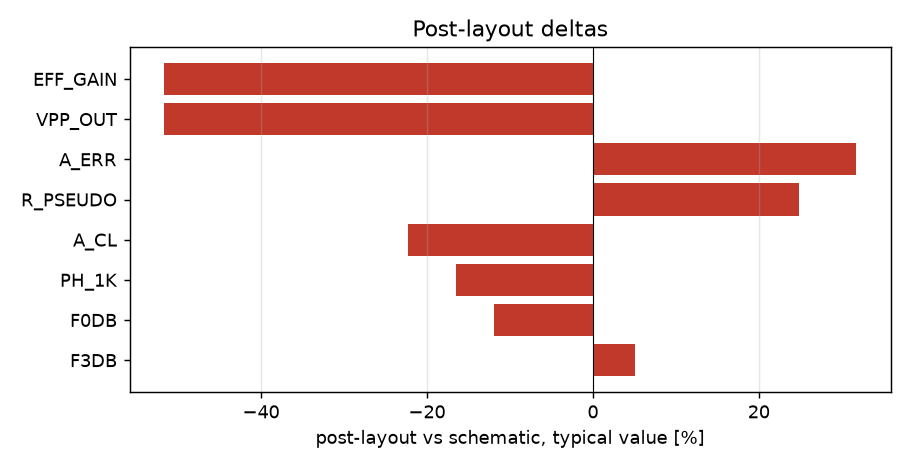

# Schematic vs post-layout

* schematic run: `/foss/designs/sg13cmos5l_spma_ip__instramp/runs/RUN_2026-11-05_17-41-44` (netlist source: schematic)
* post-layout run: `/foss/designs/sg13cmos5l_spma_ip__instramp/runs/pex_cace/pgia_top/RUN_2026-11-05_18-39-19` (netlist source: pex)
* flag threshold: 5 % on the typical value; units as in the CACE summary

| Parameter | Var | Unit | Schematic min / typ / max | Post-layout min / typ / max | Δ typ | Δ typ % | Status | Flag |
|---|---|---|---|---|---:|---:|---|---|
| Closed-loop gain @1 kHz | A_CL | dB | -157.27 / 26.91 / 77.375 | -81.275 / 20.909 / 45.018 | -6.001 | -22.30 | Pass → Pass | Δ |
| Gain step error vs target | A_ERR | dB | -235.54 / -3.527 / 21.937 | -159.35 / -2.409 / 0.129 | +1.118 | +31.70 | Pass → Pass | Δ |
| -3 dB bandwidth | F3DB | Hz | 1421.3 / 2.2013e+05 / 4.448e+07 | 7657.3 / 2.3135e+05 / 4.1579e+06 | +1.122e+04 | +5.10 | Pass → Pass | Δ |
| 0 dB frequency | F0DB | Hz | 27614 / 2.8383e+06 / 1e+07 | 3.9307e+05 / 2.501e+06 / 1e+07 | -3.373e+05 | -11.88 | Pass → Pass | Δ |
| Phase @1 kHz | PH_1K | ° | -179.24 / -0.377 / 179.81 | -93.593 / -0.439 / -0.326 | -0.062 | -16.45 | Pass → Pass | Δ |
| Input pseudo-resistor | R_PSEUDO | GOhm | 3.563 / 13.559 / 43.789 | 16.935 / 16.935 / 16.935 | +3.376 | +24.90 | Pass → Pass | Δ |
| Output peak-to-peak | VPP_OUT | mV | 0 / 1.969 / 73.973 | 0 / 0.952 / 14.237 | -1.017 | -51.65 | Pass → Pass | Δ |
| Effective voltage gain | EFF_GAIN | V/V | 0 / 49.237 / 1849.3 | 0.002 / 23.799 / 355.92 | -25.44 | -51.66 | Pass → Pass | Δ |

8 row(s) flagged.

