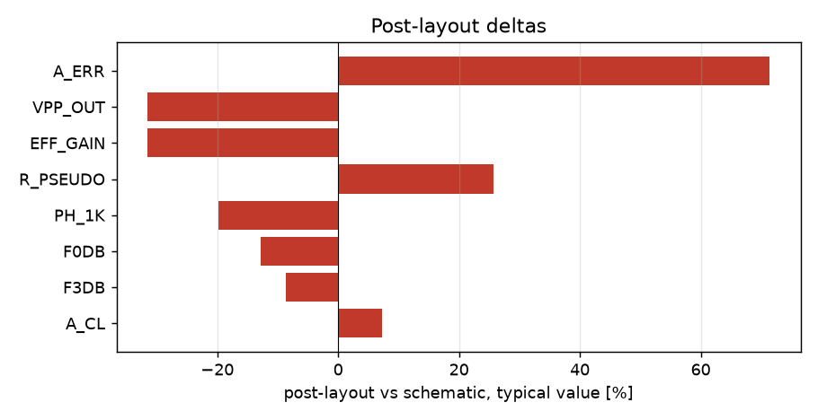

# Schematic vs post-layout

* schematic run: `/foss/designs/sg13cmos5l_spma_ip__instramp/runs/RUN_2026-11-05_20-16-47` (netlist source: schematic)
* post-layout run: `/foss/designs/sg13cmos5l_spma_ip__instramp/runs/pex_cace_rc/pgia_top/RUN_2026-11-05_20-43-08` (netlist source: pex)
* flag threshold: 5 % on the typical value; units as in the CACE summary

| Parameter | Var | Unit | Schematic min / typ / max | Post-layout min / typ / max | Δ typ | Δ typ % | Status | Flag |
|---|---|---|---|---|---:|---:|---|---|
| Closed-loop gain @1 kHz | A_CL | dB | -157.27 / 28.225 / 77.375 | -40.065 / 30.255 / 76.618 | +2.03 | +7.19 | Pass → Pass | Δ |
| Gain step error vs target | A_ERR | dB | -235.54 / -3.185 / 23.554 | -118.33 / -0.912 / 0.344 | +2.273 | +71.37 | Pass → Pass | Δ |
| -3 dB bandwidth | F3DB | Hz | 1421.3 / 2.128e+05 / 4.448e+07 | 6409.4 / 1.9441e+05 / 4.8474e+05 | -1.839e+04 | -8.64 | Pass → Pass | Δ |
| 0 dB frequency | F0DB | Hz | 4883.8 / 2.895e+06 / 1e+07 | 3.9484e+05 / 2.5231e+06 / 1e+07 | -3.719e+05 | -12.85 | Pass → Pass | Δ |
| Phase @1 kHz | PH_1K | ° | -179.92 / -0.378 / 179.97 | -10.734 / -0.453 / -0.354 | -0.075 | -19.84 | Pass → Pass | Δ |
| Input pseudo-resistor | R_PSEUDO | GOhm | 3.563 / 13.573 / 43.802 | 16.63 / 17.058 / 20.156 | +3.485 | +25.68 | Pass → Pass | Δ |
| Output peak-to-peak | VPP_OUT | mV | 0 / 3.8 / 544.77 | 0.001 / 2.602 / 542.13 | -1.198 | -31.53 | Pass → Pass | Δ |
| Effective voltage gain | EFF_GAIN | V/V | 0 / 94.99 / 13619 | 0.02 / 65.055 / 13553 | -29.93 | -31.51 | Pass → Pass | Δ |

8 row(s) flagged.

