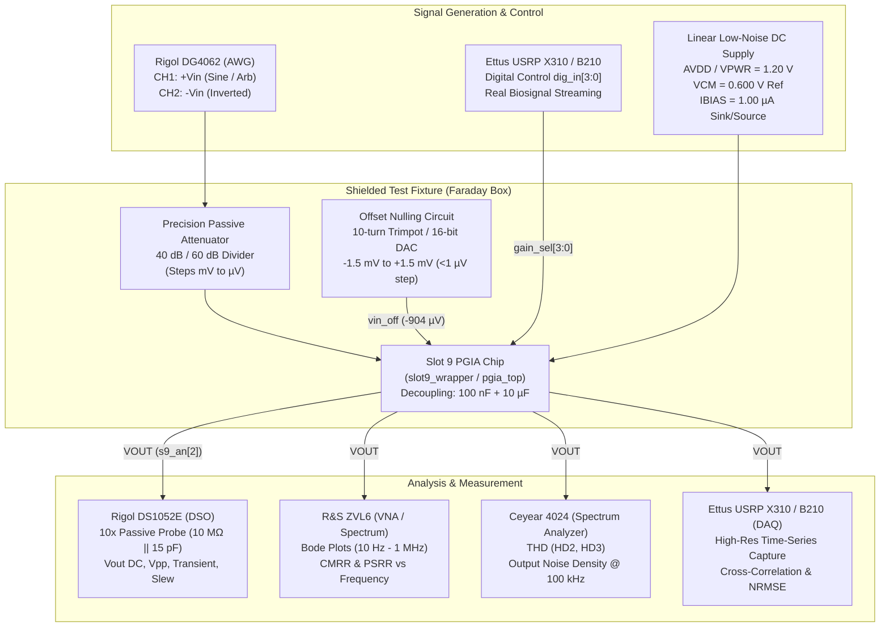
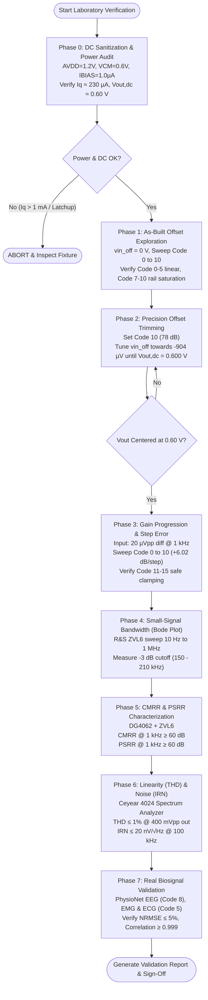
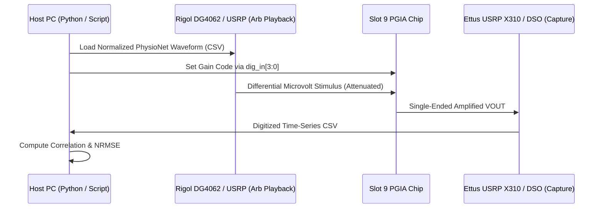

# Post-Silicon Laboratory Testing & Characterization Procedure
**Programmable Gain Instrumentation Amplifier (PGIA) IP on IHP SG13CMOS5L**  
*Chipalooza 2026 Challenge #2 — Slot 9 Deliverable (`slot9_wrapper` / `slot_9.gds`)*

**Design & Test Team:**
* **Kean Malik Aji Santoso** — Principal Designer
* **Rafi Ananta Alden** — Designer/Engineer #1
* **James Patrick** — Designer/Engineer #2
* **Ibrahim Hanif Mulyana** — Designer/Engineer #3
*Institution: Institut Teknologi Bandung (ITB)*


## 1. Scope & Objective

This document defines the comprehensive post-silicon physical testing, laboratory setup, calibration procedures, and acceptance criteria for the **Programmable Gain Instrumentation Amplifier (PGIA)** IP. Fabricated on the open-source **IHP SG13CMOS5L 130 nm BiCMOS/CMOS** process and integrated into **Slot 9** of the Chipalooza 2026 Challenge #2 MPW frame, the chip is designed for ultra-high-impedance, low-noise biomedical recording (EEG, EMG, and ECG).

### Testing Objectives
1. **Quiescent DC Bias & Power Audit**: Verify power rails ($1.20\text{ V}$), master bias current ($1.00\text{ }\mu\text{A}$), common-mode reference ($0.60\text{ V}$), and quiescent power consumption ($< 400\text{ }\mu\text{W}$).
2. **Systematic Offset Characterization & Calibration**: Characterize the intrinsic systematic input offset ($V_{\text{OS,in}} \approx -904\text{ }\mu\text{V}$) across the 11 gain steps in **As-Built (Uncompensated)** mode and execute the **Precision Offset Nulling** procedure to unlock full linear operation up to $78.27\text{ dB}$ ($8192\times$).
3. **Linear-in-dB Monotonic Gain Progression**: Validate all 11 binary gain codes (`0000` to `1010`) spanning $18.06\text{ dB}$ to $78.27\text{ dB}$ in uniform $+6.02\text{ dB}$ ($2\times$) increments, and verify safe-clamping for out-of-range codes (`1011` to `1111`).
4. **AC Small-Signal Bandwidth & Frequency Response**: Confirm -3 dB bandwidth ($150\text{ kHz} - 210\text{ kHz}$) and flat passband response across the biomedical band ($0.05\text{ Hz} - 20\text{ kHz}$).
5. **Common-Mode & Power-Supply Rejection (CMRR & PSRR)**: Measure CMRR and PSRR vs. frequency (target $\ge 60\text{ dB}$ at $1\text{ kHz}$).
6. **Dynamic Linearity & Noise Performance**: Measure Total Harmonic Distortion ($\text{THD} \le 1\%$) and Input-Referred Noise density ($\text{IRN} \le 20\text{ nV}/\sqrt{\text{Hz}}$ at $100\text{ kHz}$).
7. **Real Biosignal Provenance**: Play back PhysioNet human EEG, EMG, and ECG records and verify output waveform reproduction with Normalized Root Mean Square Error $\text{NRMSE} \le 5.0\%$ and waveform cross-correlation $\ge 0.999$.


## 2. Chip Interface & Key Architectural Constraints

### 2.1 Slot 9 Pin Mapping (`slot9_wrapper`)

The device under test (DUT) is packaged within the standardized Chipalooza Slot 9 frame ([slot9_wrapper.md](file:///home/osotnas/eda/designs/sg13cmos5l_spma_ip__instramp/docs/slot9_wrapper.md)):

| Harness Pad | Internal Net | Type | Nominal Level | Description / Test Connection |
| :--- | :--- | :---: | :---: | :--- |
| `s9_an_0_esd` | `VINP` | Analog In | $0.60\text{ V} \pm 20\text{ mV}$ | Non-inverting differential input (ESD protected) |
| `s9_an_1_esd` | `VINN` | Analog In | $0.60\text{ V} \pm 20\text{ mV}$ | Inverting differential input (ESD protected) |
| `vbias` | `VCM` | Analog Ref | $0.600\text{ V}$ | Common-mode analog reference voltage ($V_{\text{DD}}/2$) |
| `ibias0` | `IBIAS_IA`| Analog Bias| $1.00\text{ }\mu\text{A}$ (in) | Master reference bias current sourced into chip |
| `dig_in[0]` | `gain_sel[0]`| Digital In| $0\text{ V} / 1.2\text{ V}$ | Gain control bit 0 (LSB) |
| `dig_in[1]` | `gain_sel[1]`| Digital In| $0\text{ V} / 1.2\text{ V}$ | Gain control bit 1 |
| `dig_in[2]` | `gain_sel[2]`| Digital In| $0\text{ V} / 1.2\text{ V}$ | Gain control bit 2 |
| `dig_in[3]` | `gain_sel[3]`| Digital In| $0\text{ V} / 1.2\text{ V}$ | Gain control bit 3 (MSB) |
| `s9_an[2]` | `VOUT` | Analog Out| $0.60\text{ V} \pm 400\text{ mV}$ | Single-ended buffered analog output ($C_L \le 15\text{ pF}, R_L \ge 100\text{ k}\Omega$) |
| `vdd_1v2` | `AVDD`, `VPWR`| Power | $1.20\text{ V}$ | Positive analog & digital supply rail |
| `vss_1v2` | `AVSS`, `VGND`| Ground | $0.00\text{ V}$ | Analog ground & digital ground return |

### 2.2 Key Silicon Anomalies & Constraints

1. **Systematic Input Offset ($V_{\text{OS,in}} \approx -903.7\text{ }\mu\text{V}$)**:
   * **Mechanism**: Extracted layout parasitics (RC-PEX) introduce an intrinsic input-referred DC offset of $\approx -0.904\text{ mV}$. Because the core is DC-coupled across `instramp_cmos5l`, `Stage 1`, and `Stage 2`, this offset is multiplied by the cascaded gain.
   * **Uncompensated Standalone (As-Built)**:
     - Codes 0 to 5 ($18\text{ dB} - 48\text{ dB}$): Linear operation ($V_{\text{OUT,dc}}$ shifts from $0.602\text{ V}$ to $0.666\text{ V}$).
     - Code 6 ($54\text{ dB}$, $512\times$): Offset amplification ($\approx 463\text{ mV}$) drives Stage 2 into partial triode compression ($V_{\text{OUT,dc}} \approx 0.745\text{ V}$, gain drops by $-16\text{ dB}$, bandwidth shrinks to $6\text{ kHz}$).
     - Codes 7 to 10 ($60\text{ dB} - 78\text{ dB}$, $1024\times - 8192\times$): Internal nodes saturate hard against the positive rail ($V_{\text{OUT}} \approx 0.989\text{ V}$); AC signals are completely suppressed.
   * **Compensated Mode**: Nulling the offset with $v_{\text{in,off}} = -903.7\text{ }\mu\text{V}$ (adjusted for random die mismatch) restores full linear dynamic range across all 11 codes.
2. **Microvolt Differential Dynamic Range**:
   * Peak linear output swing is $\approx 400\text{ mV}_{\text{pp}}$ centered around $0.60\text{ V}$ ($0.40\text{ V} - 0.80\text{ V}$).
   * At Code 10 ($8192\times$), the maximum allowed differential input is:
     $$V_{\text{in,diff,max}} = \frac{400\text{ mV}_{\text{pp}}}{8192} \approx 48.8\text{ }\mu\text{V}_{\text{pp}}$$
   * Any input stimulus $> 50\text{ }\mu\text{V}_{\text{pp}}$ at Code 10 will drive the amplifier into clipping.
3. **Inter-Stage Resistive Loading**:
   * Gain Stage 1 input resistance ($R_{\text{in}} \approx 1.97\text{ k}\Omega$) loads the output resistance of the front-end subtractor OTA ($R_{\text{out}} \approx 850\text{ }\Omega$), introducing a deterministic $\approx 5.1\text{ dB}$ uniform attenuation. The actual realized gain range is $17.68\text{ dB}$ to $76.62\text{ dB}$ (step size remains exact at $+6.02\text{ dB}$).
4. **RF vs. Baseband Pre-Amplifier Compatibility**:
   * The benchtop inventory includes Mini-Circuits RF amplifiers (**ZX60-33LN-S+**, **ZRL-2300**, and **TB-363+**). Because their lower frequency cutoff is $\ge 50\text{ MHz}$, they **cannot** be used for PGIA baseband signals ($0.05\text{ Hz} - 250\text{ kHz}$). Output noise and weak signals must be measured directly using baseband instruments (Ceyear 4024, R&S ZVL6, or Ettus USRP baseband DAQ).

## 3. Laboratory Equipment & Test Fixture Setup

### 3.1 Inventory Role Allocation



### 3.2 Required Auxiliary Hardware to Prepare

1. **Precision Offset Nulling Module**:
   * High-stability voltage divider with a 10-turn cermet potentiometer ($10\text{ k}\Omega$) or a 16-bit DAC (e.g. TI DAC8562) powered from an ultra-low-noise reference (e.g. ADR4525).
   * Provides an adjustable DC offset from $-1.50\text{ mV}$ to $+1.50\text{ mV}$ relative to $V_{\text{CM}}$ with $< 1\text{ }\mu\text{V}$ resolution.
2. **Shielded Low-Noise Passive Attenuator (40 dB / 60 dB)**:
   * Symmetrical Pi-network or T-network using 0.1% metal-film resistors.
   * Converts Rigol DG4062 outputs ($20 - 40\text{ mV}_{\text{pp}}$) down to $20 - 40\text{ }\mu\text{V}_{\text{pp}}$ with $> 80\text{ dB}$ dynamic shielding.
3. **Linear DC Power Supply & Bias Source**:
   * $1.20\text{ V}$ rail for `vdd_1v2` (ripple $< 1\text{ mV}_{\text{rms}}$).
   * Stable $0.600\text{ V} \pm 1\text{ mV}$ reference for `vbias` ($V_{\text{CM}}$).
   * Stable $1.00\text{ }\mu\text{A} \pm 10\text{ nA}$ current source for `ibias0` (via precision SMU or high-value precision resistor from $1.20\text{ V}$).
4. **4-Bit Digital Logic Selector**:
   * DIP switch with pull-ups to $1.20\text{ V}$ and pull-downs to $0\text{ V}$, or digital GPIOs from USRP / Arduino.
5. **Faraday Enclosure & Ground Plane**:
   * Die-cast aluminum chassis. At $78\text{ dB}$ gain, $50\text{ Hz}$ mains electromagnetic interference will saturate the core unless fully enclosed.
6. **Oscilloscope Probe**:
   * **Mandatory**: Use a $10\times$ passive probe ($10\text{ M}\Omega \parallel 10 - 15\text{ pF}$). Never use a $1\times$ probe ($1\text{ M}\Omega \parallel 100\text{ pF}$), which exceeds the $C_L = 15\text{ pF}$ load limit and causes loop instability.

## 4. End-to-End Test Procedure Flowchart



## 5. Detailed Step-by-Step Test Execution

### Phase 0: DC Sanitization & Pre-Power Audit

1. **Passive Connectivity Check**:
   * With power off, verify with a DMM that resistance between `vdd_1v2` and `vss_1v2` is $> 100\text{ k}\Omega$ (no board shorts).
   * Confirm decoupling capacitors ($100\text{ nF}$ NP0 $+ 10\text{ }\mu\text{F}$ tantalum) are mounted directly adjacent to DUT pins.
2. **Power-Up Sequence**:
   * Set linear supply current limit to $5.0\text{ mA}$ (overcurrent safeguard).
   * Apply $1.20\text{ V}$ to `vdd_1v2`.
   * Apply $0.600\text{ V}$ reference to `vbias` ($V_{\text{CM}}$).
   * Source $1.00\text{ }\mu\text{A}$ into `ibias0`.
   * Set digital inputs `dig_in[3:0]` to `0000` (Code 0).
3. **Quiescent Power Verification**:
   * Measure total supply current:
     $$164\text{ }\mu\text{A} \le I_{\text{Q,TOT}} \le 320\text{ }\mu\text{A} \quad (\text{Nominal: } 230.5\text{ }\mu\text{A}, P_{\text{dc}} \approx 277\text{ }\mu\text{W})$$
   * Measure DC voltage at `s9_an[2]` (`VOUT`) using Rigol DS1052E ($10\times$ probe):
     $$V_{\text{OUT,dc}} = 0.600\text{ V} \pm 20\text{ mV}$$

### Phase 1: As-Built Standalone Offset Exploration ($v_{\text{in,off}} = 0\text{ V}$)
*Goal: Empirically document the uncompensated silicon behavior and confirm the saturation boundary predicted by extracted simulations.*

1. Tie `s9_an_0_esd` (`VINP`) and `s9_an_1_esd` (`VINN`) together directly to $V_{\text{CM}} = 0.600\text{ V}$ ($v_{\text{in,diff}} = 0\text{ V}$).
2. Connect `VOUT` to Rigol DS1052E (DC coupling, $100\text{ mV/div}$).
3. Step `dig_in[3:0]` sequentially from Code 0 to Code 10 and log $V_{\text{OUT,dc}}$:
   * **Codes 0 to 5** ($18.06\text{ dB} - 48.16\text{ dB}$): $V_{\text{OUT,dc}}$ moves moderately ($0.602\text{ V} \rightarrow 0.666\text{ V}$).
   * **Code 6** ($54.19\text{ dB}$): $V_{\text{OUT,dc}}$ jumps to $\approx 0.745\text{ V}$.
   * **Codes 7 to 10** ($60.21\text{ dB} - 78.27\text{ dB}$): $V_{\text{OUT,dc}}$ locks firmly at the positive rail clamp:
     $$V_{\text{OUT,dc}} \approx 0.989\text{ V}$$
4. Inject a $40\text{ }\mu\text{V}_{\text{pp}}$ differential sine wave at $1\text{ kHz}$. Observe on the oscilloscope that AC transmission collapses for Codes 7–10, confirming offset-induced output transconductance crushing.

### Phase 2: Precision Offset Trimming Procedure ($V_{\text{OS,in}} \approx -904\text{ }\mu\text{V}$)
*Goal: Cancel the net input offset (systematic layout offset + random mismatch) to center the operating point at $0.600\text{ V}$ under maximum gain.*

```
      +1.2 V Ref
          |
     [ 10-turn ]
     [ Trimpot ] ---> R_div_top (99.9 kΩ) ---> VINP Node (s9_an_0_esd)
          |                                            |
         GND                                   R_div_bot (100 Ω)
                                                       |
                                               VCM Reference (0.600 V)
```

1. Set the gain control to **Code 10 (`1010`)** (nominal gain $8192\times$ / $78.27\text{ dB}$).
2. Connect the *Precision Offset Nulling Module* to `VINP` (`s9_an_0_esd`), while keeping `VINN` (`s9_an_1_esd`) referenced to $V_{\text{CM}} = 0.600\text{ V}$.
3. Monitor `VOUT` on Rigol DS1052E / 6.5-digit DMM.
4. Slowly tune the trimpot / 16-bit trim DAC to apply a negative differential offset ($V_{\text{INP}} - V_{\text{INN}} < 0$).
   * Start search around $-900\text{ }\mu\text{V}$ and sweep across $-500\text{ }\mu\text{V}$ to $-1200\text{ }\mu\text{V}$.
5. Observe `VOUT` as it drops out of the $0.989\text{ V}$ rail clamp. Fine-tune until:
   $$V_{\text{OUT,dc}} = 0.600\text{ V} \pm 10\text{ mV}$$
6. Lock the trimpot position or record the trim DAC code. This establishes the calibrated baseline for all subsequent wide-range tests.

### Phase 3: Monotonic Linear-in-dB Gain Verification (Codes 0 to 10)

1. Configure Rigol DG4062 to output a differential $1\text{ kHz}$ sine wave via the $60\text{ dB}$ attenuator:
   * CH1 (`VINP`): Symmetrical AC coupled on top of $V_{\text{CM}} + v_{\text{in,off}}$.
   * CH2 (`VINN`): Inverted AC coupled on top of $V_{\text{CM}}$.
   * Differential input amplitude:
     $$V_{\text{in,diff}} = 20.0\text{ }\mu\text{V}_{\text{pp}} \quad (7.07\text{ }\mu\text{V}_{\text{rms}})$$
2. Step through each gain code from `0000` to `1010` and measure $V_{\text{OUT,pp}}$ with Rigol DS1052E:

| Code | `gain_sel[3:0]` | Target Gain (dB) | Nominal Voltage Gain | Expected $V_{\text{OUT,pp}}$ ($20\text{ }\mu\text{V}_{\text{pp}}$ In) | Extracted RC $A_{\text{CL}}$ | Measured $V_{\text{OUT,pp}}$ | Measured Gain (dB) |
| :---: | :---: | :---: | :---: | :---: | :---: | :---: | :---: |
| **0** | `0000` | $18.06\text{ dB}$ | $8\times$ | $0.153\text{ mV}_{\text{pp}}$ | $17.68\text{ dB}$ | — | — |
| **1** | `0001` | $24.08\text{ dB}$ | $16\times$ | $0.328\text{ mV}_{\text{pp}}$ | $24.30\text{ dB}$ | — | — |
| **2** | `0010` | $30.10\text{ dB}$ | $32\times$ | $0.666\text{ mV}_{\text{pp}}$ | $30.45\text{ dB}$ | — | — |
| **3** | `0011` | $36.12\text{ dB}$ | $64\times$ | $1.246\text{ mV}_{\text{pp}}$ | $35.89\text{ dB}$ | — | — |
| **4** | `0100` | $42.14\text{ dB}$ | $128\times$ | $2.342\text{ mV}_{\text{pp}}$ | $41.37\text{ dB}$ | — | — |
| **5** | `0101` | $48.16\text{ dB}$ | $256\times$ | $4.364\text{ mV}_{\text{pp}}$ | $46.78\text{ dB}$ | — | — |
| **6** | `0110` | $54.19\text{ dB}$ | $512\times$ | $9.385\text{ mV}_{\text{pp}}$ | $53.43\text{ dB}$ | — | — |
| **7** | `0111` | $60.21\text{ dB}$ | $1024\times$ | $19.16\text{ mV}_{\text{pp}}$ | $59.63\text{ dB}$ | — | — |
| **8** | `1000` | $66.23\text{ dB}$ | $2048\times$ | $36.29\text{ mV}_{\text{pp}}$ | $65.18\text{ dB}$ | — | — |
| **9** | `1001` | $72.25\text{ dB}$ | $4096\times$ | $69.73\text{ mV}_{\text{pp}}$ | $70.85\text{ dB}$ | — | — |
| **10**| `1010` | $78.27\text{ dB}$ | $8192\times$ | $135.5\text{ mV}_{\text{pp}}$ | $76.62\text{ dB}$ | — | — |

3. Calculate Gain Step Increment:
   $$\Delta A = A_{\text{CL}}(k) - A_{\text{CL}}(k-1) \approx 6.02\text{ dB} \pm 0.20\text{ dB}$$
4. **Out-of-Range Safe-Clamping Verification**:
   * Apply binary words `1011`, `1100`, `1101`, `1110`, and `1111` (Codes 11 to 15).
   * Confirm output immediately clamps to Code 0 amplitude ($0.153\text{ mV}_{\text{pp}}$, $17.68\text{ dB}$).

### Phase 4: AC Frequency Response & Bandwidth (Bode Plot)

1. Connect the Tracking Generator output of the **Rohde & Schwarz ZVL6** (or Rigol DG4062 in frequency sweep mode) through the passive attenuator to DUT inputs.
2. Connect `VOUT` to the RF/Baseband input of the R&S ZVL6.
3. Configure sweep parameters:
   * Frequency Range: **$10\text{ Hz}$ to $1.0\text{ MHz}$** (logarithmic sweep).
   * Resolution Bandwidth (RBW): $100\text{ Hz}$.
4. Record Bode magnitude curves for Code 0, Code 5, and Code 10:
   * Verify mid-band gain flatness ($10\text{ Hz} - 20\text{ kHz}$) within $\pm 0.1\text{ dB}$.
   * Identify -3 dB cutoff frequency ($f_{-3\text{dB}}$):
     - Code 0 ($18\text{ dB}$): $f_{-3\text{dB}} \approx 210\text{ kHz}$
     - Code 5 ($48\text{ dB}$): $f_{-3\text{dB}} \approx 172\text{ kHz}$
     - Code 10 ($78\text{ dB}$): $f_{-3\text{dB}} \approx 152\text{ kHz}$
   * Confirm $f_{-3\text{dB}} \ge 20\text{ kHz}$ across all settings ($>7.5\times$ proposal requirement).

### Phase 5: Common-Mode & Power-Supply Rejection (CMRR & PSRR)

#### 5.1 Common-Mode Rejection Ratio (CMRR)
1. Tie Rigol DG4062 CH1 and CH2 in-phase: apply $v_{\text{cm}} = 100\text{ mV}_{\text{pp}}$ common-mode signal simultaneously to `VINP` and `VINN` at $10\text{ Hz}$, $100\text{ Hz}$, $1\text{ kHz}$, and $10\text{ kHz}$.
2. Measure common-mode feedthrough at `VOUT` ($V_{\text{out,cm}}$) using R&S ZVL6 / Rigol DS1052E.
3. Compute CMRR:
   $$\text{CMRR (dB)} = 20 \log_{10}\left( \frac{A_{\text{DM}}}{A_{\text{CM}}} \right) = 20 \log_{10}\left( \frac{V_{\text{out,diff}} / V_{\text{in,diff}}}{V_{\text{out,cm}} / v_{\text{cm}}} \right)$$
4. Verify $\text{CMRR} \ge 60\text{ dB}$ at $1\text{ kHz}$ (PEX simulation: $64.69\text{ dB}$).
5. Inspect low-frequency ($10\text{ Hz}$) CMRR to observe whether the schematic corner anomaly ($34\text{ dB}$) or layout-stabilized performance ($> 64\text{ dB}$) is manifested on physical silicon.

#### 5.2 Power Supply Rejection Ratio (PSRR)
1. Modulate the $1.20\text{ V}$ positive supply rail (`vdd_1v2`) with a $50\text{ mV}_{\text{pp}}$ AC ripple ($v_{\text{ripple}}$) at $100\text{ Hz}$, $1\text{ kHz}$, and $10\text{ kHz}$ using an AC summing network / bias-tee.
2. Measure the residual ripple voltage appearing at `VOUT` ($V_{\text{out,ripple}}$) with Ceyear 4024 / R&S ZVL6.
3. Compute PSRR:
   $$\text{PSRR (dB)} = 20 \log_{10}\left( \frac{v_{\text{ripple}}}{V_{\text{out,ripple}}} \right) + A_{\text{CL}}$$
4. Verify $\text{PSRR} \ge 60\text{ dB}$ at $1\text{ kHz}$ (PEX simulation: $77.85\text{ dB}$).

### Phase 6: Linearity (THD) & Noise Density (IRN)

#### 6.1 Total Harmonic Distortion (THD)
1. Set DUT to Code 0 ($17.68\text{ dB}$). Inject a pure $1\text{ kHz}$ sine wave adjusted to drive the output to $400\text{ mV}_{\text{pp}}$ ($141.4\text{ mV}_{\text{rms}}$).
2. Connect `VOUT` to the **Ceyear 4024 Spectrum Analyzer** (center frequency $2\text{ kHz}$, span $10\text{ kHz}$).
3. Measure power in fundamental ($V_1$), second harmonic at $2\text{ kHz}$ ($V_2$), and third harmonic at $3\text{ kHz}$ ($V_3$).
4. Compute THD:
   $$\text{THD (\%)} = \frac{\sqrt{V_2^2 + V_3^2 + \dots}}{V_1} \times 100\% \quad (\text{Target: } \le 1.0\%)$$
   * Post-layout PEX RC simulation predicts $\text{THD} \approx 0.073\%$ ($-62.7\text{ dB}$).

#### 6.2 Input-Referred Noise Spectral Density (IRN)
1. Terminate DUT inputs differentially into AC ground (`VINP` and `VINN` shorted together and decoupled to $V_{\text{CM}}$ through $10\text{ nF}$ capacitors).
2. Set gain to Code 10 ($76.62\text{ dB} \approx 6776\text{ V/V}$) to elevate output noise floor well above spectrum analyzer instrument noise.
3. Measure output noise voltage spectral density $S_{\text{v,out}}(f)$ (in $\text{nV}/\sqrt{\text{Hz}}$) on Ceyear 4024 at $100\text{ kHz}$.
4. Calculate input-referred noise:
   $$e_{n,\text{in}} = \frac{S_{\text{v,out}}(100\text{ kHz})}{A_{\text{v,Code10}}} \quad (\text{Target: } \le 20\text{ nV}/\sqrt{\text{Hz}})$$
   * Post-layout PEX RC simulation predicts $19.5\text{ nV}/\sqrt{\text{Hz}}$.

### Phase 7: Real Biosignal Playback & Verification

Using digitized human biosignal records from the [PhysioNet Database](file:///home/osotnas/eda/designs/sg13cmos5l_spma_ip__instramp/docs/biosignal/README.md) loaded onto Rigol DG4062 Arb mode or streamed via Ettus USRP X310/B210:



1. **Electroencephalogram (EEG)**:
   * Source: PhysioNet Motor Imagery (Oz alpha rhythm, $377\text{ }\mu\text{V}_{\text{pp}}$).
   * Gain Setting: **Code 8 ($2048\times$)**.
   * Output Range: Verify unclipped swing between $0.24\text{ V}$ and $0.93\text{ V}$.
2. **Electromyogram (EMG)**:
   * Source: Tibialis anterior needle record ($1.6\text{ mV}_{\text{pp}}$, $4\text{ kHz}$ burst activity).
   * Gain Setting: **Code 5 ($256\times$)**.
   * Output Range: Verify clean reproduction within $0.48\text{ V} - 0.81\text{ V}$.
3. **Electrocardiogram (ECG)**:
   * Source: MIT-BIH Record 100 ($1.5\text{ mV}_{\text{pp}}$ QRS complex).
   * Gain Setting: **Code 5 ($256\times$)**.
   * Output Range: Verify peak-to-peak tracking within $0.54\text{ V} - 0.84\text{ V}$.
4. **Statistical Waveform Correlation**:
   * Export captured waveform array $y_{\text{meas}}[n]$ and reference simulated array $y_{\text{ref}}[n]$.
   * Compute Normalized Root Mean Square Error (NRMSE):
     $$\text{NRMSE} = \frac{\sqrt{\sum (y_{\text{meas}}[n] - y_{\text{ref}}[n])^2}}{\max(y_{\text{ref}}) - \min(y_{\text{ref}})} \times 100\% \quad (\text{Target: } \le 5.0\%)$$
   * Compute Pearson cross-correlation coefficient:
     $$\rho = \frac{\sum (y_{\text{meas}} - \bar{y}_{\text{meas}})(y_{\text{ref}} - \bar{y}_{\text{ref}})}{\sqrt{\sum (y_{\text{meas}} - \bar{y}_{\text{meas}})^2 \sum (y_{\text{ref}} - \bar{y}_{\text{ref}})^2}} \quad (\text{Target: } \ge 0.999)$$


## 6. Summary Characterization Matrix & Acceptance Limits

| Test Item | Parameter | Symbol | Stimulus / Test Condition | Expected Typ. | Acceptance Limit | Instrument Used |
| :--- | :--- | :---: | :--- | :---: | :---: | :--- |
| **Supply Voltage** | Rail Voltage | $V_{\text{DD}}$ | Normal operation | $1.20\text{ V}$ | $1.08\text{ V} - 1.50\text{ V}$ | Linear DC Supply |
| **Quiescent Current** | Total DC Current | $I_{\text{Q,TOT}}$ | Code 0, no signal | $230.5\text{ }\mu\text{A}$ | $\le 400.0\text{ }\mu\text{A}$ | DMM / DC Supply |
| **Static Power** | Total DC Power | $P_{\text{dc}}$ | $V_{\text{DD}} = 1.20\text{ V}$ | $276.6\text{ }\mu\text{W}$ | $\le 500.0\text{ }\mu\text{W}$ | DMM / DC Supply |
| **Uncompensated Offset** | Rail Saturation | $V_{\text{OUT,dc}}$ | $v_{\text{in,off}} = 0\text{ V}$, Code 10 | $0.989\text{ V}$ | Rail clamped | Rigol DS1052E |
| **Calibrated Offset** | Input Offset Null | $v_{\text{in,off}}$ | Null to $V_{\text{OUT}} = 0.60\text{ V}$ @ Code 10 | $-903.7\text{ }\mu\text{V}$ | $-1.5\text{ to }+1.5\text{ mV}$ | Trimpot Nulling + DMM |
| **Base Gain (Code 0)** | Closed-Loop Gain | $A_{\text{CL,0}}$ | $1\text{ kHz}$ sine, $20\text{ }\mu\text{V}_{\text{pp}}$ diff | $17.68\text{ dB}$ | $17.5\text{ to }18.5\text{ dB}$ | DG4062 + Atten + DS1052E |
| **Max Gain (Code 10)**| Closed-Loop Gain | $A_{\text{CL,10}}$ | $1\text{ kHz}$ sine, $20\text{ }\mu\text{V}_{\text{pp}}$ diff | $76.62\text{ dB}$ | $75.5\text{ to }77.5\text{ dB}$ | DG4062 + Atten + DS1052E |
| **Gain Step Increment**| Step Size | $\Delta A$ | Code $k$ to $k+1$ | $+6.02\text{ dB}$ | $5.82\text{ to }6.22\text{ dB}$ | DG4062 + DS1052E |
| **Cutoff Bandwidth** | -3 dB Bandwidth | $f_{-3\text{dB}}$ | Swept $10\text{ Hz} - 1\text{ MHz}$ | $152 - 210\text{ kHz}$ | $\ge 20.0\text{ kHz}$ | R&S ZVL6 |
| **CMRR @ 1 kHz** | Common-Mode Rej. | CMRR | $v_{\text{cm}} = 100\text{ mV}_{\text{pp}}$ | $64.69\text{ dB}$ | $\ge 60.0\text{ dB}$ | DG4062 + ZVL6 |
| **PSRR @ 1 kHz** | Power-Supply Rej. | PSRR | $v_{\text{ripple}} = 50\text{ mV}_{\text{pp}}$ on $V_{\text{DD}}$ | $77.85\text{ dB}$ | $\ge 60.0\text{ dB}$ | DG4062 + ZVL6 / 4024 |
| **Linear Distortion** | Total Harmonic Dist. | THD | $V_{\text{OUT}} = 400\text{ mV}_{\text{pp}}$ @ $1\text{ kHz}$ | $0.073\%$ | $\le 1.0\%$ | Ceyear 4024 |
| **Noise Density** | Input-Referred Noise | IRN | AC ground inputs, Code 10 | $19.5\text{ nV}/\sqrt{\text{Hz}}$ | $\le 20.0\text{ nV}/\sqrt{\text{Hz}}$ | Ceyear 4024 |
| **Biosignal Accuracy** | Waveform Tracking | NRMSE | PhysioNet EEG/EMG/ECG | $< 5.0\%$ | $\le 5.0\%$ | Ettus USRP / DS1052E |
| **Biosignal Fidelity** | Cross-Correlation | $\rho$ | PhysioNet EEG/EMG/ECG | $> 0.999$ | $\ge 0.999$ | Ettus USRP / DS1052E |


## 7. Practical Laboratory Hazards, Pitfalls & Troubleshooting

### 7.1 Power Sequencing & ESD Latch-Up Prevention
* **Risk**: Applying an active input signal to `s9_an_0_esd` / `s9_an_1_esd` before powering up `vdd_1v2` will forward-bias internal ESD clamp diodes into the unpowered supply rail, potentially triggering destructive CMOS latch-up or gate oxide degradation on input pseudo-resistors.
* **Mitigation**: Always power up `vdd_1v2` and `vbias` **before** enabling signal generators. Always turn off signal generators **before** powering down the chip.

### 7.2 Oscilloscope Probe Capacitive Overloading
* **Risk**: Using a standard $1\times$ oscilloscope probe adds $\approx 100\text{ pF}$ of parasitic capacitance directly to `VOUT`. This degrades the output buffer phase margin from $60^\circ$ down to $< 20^\circ$, causing output ringing, spontaneous multi-megahertz oscillation, or severe bandwidth truncation.
* **Mitigation**: Strictly use high-impedance **$10\times$ probes** ($10\text{ M}\Omega \parallel 10 - 15\text{ pF}$) calibrated for flat square-wave response.

### 7.3 Power-Line Hum (50 Hz) Contamination
* **Risk**: At Code 10 ($8192\times$), an ambient $50\text{ Hz}$ noise pickup of only $50\text{ }\mu\text{V}$ on the input cables will produce $400\text{ mV}$ of hum at the output, entirely obliterating the desired signal.
* **Mitigation**:
  1. Enclose the DUT and attenuator fixture inside a solid aluminum Faraday box.
  2. Earth-ground the chassis to the benchtop single-point ground.
  3. Keep differential input wires twisted and as short as possible ($< 5\text{ cm}$), or use matched length coaxial lines with grounded shields.

### 7.4 Gain Switching Charge Injection Glitches
* **Risk**: Stepping the gain code causes brief charge-injection current spikes through switched transmission gates in `gain_network`.
* **Mitigation**: When evaluating transient settling, allow at least $5\text{ }\mu\text{s}$ settling window after each code transition before logging ADC/DSO measurements.