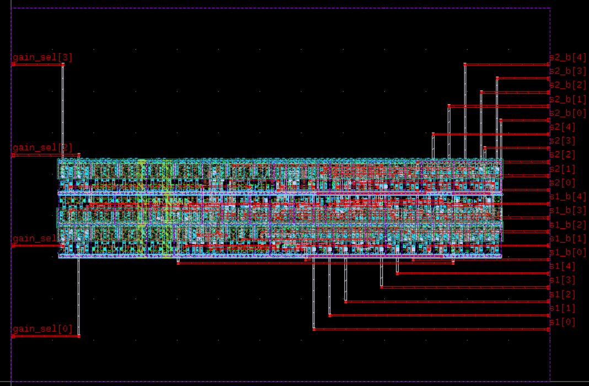

# 4-Bit Two-Stage Gain Decoder (`gain_decoder_4b`) ASIC Implementation Note

**Project:** Programmable Gain Instrumentation Amplifier IP (Chipalooza)
**Process Technology:** IHP SG13CMOS5L
**Standard Cell Library:** `sg13cmos5l_stdcell`
**Target Toolchain:** LibreLane v3.1.0 (`OpenROAD` / `Yosys` / `Magic` / `Netgen` / `KLayout`)
**Working Directory:** [`gds/gain_decoder_4b/`](file:///home/ranantalden/Projects/Designs/Chipalooza/Programmable-Instrumentation-Amplifier-IP/gds/gain_decoder_4b/)
**Physical Dimensions:** $65.0\,\mu\text{m} \times 45.0\,\mu\text{m}$ ($2925\,\mu\text{m}^2$)
**Physical Signoff Status:** **100% SIGN-OFF CLEAN** (0 DRC, 0 LVS, 0 Antenna, 0 Timing Violations)

---

## 1. Executive Summary & Architecture

The **`gain_decoder_4b`** macro is the dedicated digital gain-selection engine for the two-stage Programmable Gain Instrumentation Amplifier (PGIA). It receives a 4-bit binary gain programming word (`gain_sel[3:0]`, routed from `dig_in[3:0]` of the Chipalooza Slot 9 wrapper) and translates it into 20 steering signals:

- **Gain Stage 1 Select Lines:** 5 active-high lines (`s1[4:0]`) and 5 complementary active-low lines (`s1_b[4:0] = ~s1[4:0]`).
- **Gain Stage 2 Select Lines:** 5 active-high lines (`s2[4:0]`) and 5 complementary active-low lines (`s2_b[4:0] = ~s2[4:0]`).

These complementary lines directly control CMOS Transmission Gates ($N$-channel and $P$-channel FET pairs) inside the analog gain blocks, providing dynamic gain selection from $1\times$ ($0\,\text{dB}$) up to $1024\times$ ($60\,\text{dB}$) in $6\,\text{dB}$ binary steps ($1\times, 2\times, 4\times, 8\times, 16\times, 32\times$).

```
                               ┌──────────────────────────────────────────────┐
                               │               gain_decoder_4b                │
                               │              (65 um x 45 um)                 │
                               │                                              │
    gain_sel[3] (IN) ─────────►│ [W]                                      [E] ├──► s1[0], s1_b[0]   (Stage 1: 2x)
    gain_sel[2] (IN) ─────────►│                                              ├──► s1[1], s1_b[1]   (Stage 1: 4x)
    gain_sel[1] (IN) ─────────►│       ││ (Metal4 VPWR)                       ├──► s1[2], s1_b[2]   (Stage 1: 8x)
    gain_sel[0] (IN) ─────────►│       ││ (Metal4 VGND)                       ├──► s1[3], s1_b[3]   (Stage 1: 16x)
                               │                                              ├──► s1[4], s1_b[4]   (Stage 1: 32x)
    TopMetal1 Rails (Top-Lvl)  │                                              ├──► s2[0], s2_b[0]   (Stage 2: 2x)
            │ (TopVia1)        │                                              ├──► s2[1], s2_b[1]   (Stage 2: 4x)
            ▼                  │                                              ├──► s2[2], s2_b[2]   (Stage 2: 8x)
    Vertical Metal4 Straps ───►│                                              ├──► s2[3], s2_b[3]   (Stage 2: 16x)
                               │                                              ├──► s2[4], s2_b[4]   (Stage 2: 32x)
                               └──────────────────────────────────────────────┘
```

---

## 2. Truth Table & Gain Decoding Strategy

The two amplifier stages are configured so that **Stage 1** steps up first ($1\times \dots 32\times$) to optimize the overall noise figure before **Stage 2** engages ($1\times \dots 32\times$). Undefined states (`4'd11` through `4'd15`) are safely clamped to the minimum gain setting ($1\times, 1\times \rightarrow 0\,\text{dB}$) to avoid floating analog switches.

| `gain_sel[3:0]` | Binary Code |           Stage 1 Gain           |           Stage 2 Gain           |                  Total Gain                  | Stage 1 Active Bus (`s1[4:0]`) | Stage 2 Active Bus (`s2[4:0]`) |        Complementary Outputs        |
| :---------------: | :---------: | :------------------------------: | :------------------------------: | :------------------------------------------: | :------------------------------: | :------------------------------: | :----------------------------------: |
|     `4'd0`     | `4'b0000` |  $1\times$ ($0\,\text{dB}$)  |  $1\times$ ($0\,\text{dB}$)  |   **$1\times$ ($0\,\text{dB}$)**   |     `5'b00000` (Base Tap)     |     `5'b00000` (Base Tap)     | `s1_b=5'b11111`, `s2_b=5'b11111` |
|     `4'd1`     | `4'b0001` |  $2\times$ ($6\,\text{dB}$)  |  $1\times$ ($0\,\text{dB}$)  |   **$2\times$ ($6\,\text{dB}$)**   |    `5'b00001` ($S_{1,0}$)    |     `5'b00000` (Base Tap)     | `s1_b=5'b11110`, `s2_b=5'b11111` |
|     `4'd2`     | `4'b0010` | $4\times$ ($12\,\text{dB}$) |  $1\times$ ($0\,\text{dB}$)  |  **$4\times$ ($12\,\text{dB}$)**  |    `5'b00010` ($S_{1,1}$)    |     `5'b00000` (Base Tap)     | `s1_b=5'b11101`, `s2_b=5'b11111` |
|     `4'd3`     | `4'b0011` | $8\times$ ($18\,\text{dB}$) |  $1\times$ ($0\,\text{dB}$)  |  **$8\times$ ($18\,\text{dB}$)**  |    `5'b00100` ($S_{1,2}$)    |     `5'b00000` (Base Tap)     | `s1_b=5'b11011`, `s2_b=5'b11111` |
|     `4'd4`     | `4'b0100` | $16\times$ ($24\,\text{dB}$) |  $1\times$ ($0\,\text{dB}$)  |  **$16\times$ ($24\,\text{dB}$)**  |    `5'b01000` ($S_{1,3}$)    |     `5'b00000` (Base Tap)     | `s1_b=5'b10111`, `s2_b=5'b11111` |
|     `4'd5`     | `4'b0101` | $32\times$ ($30\,\text{dB}$) |  $1\times$ ($0\,\text{dB}$)  |  **$32\times$ ($30\,\text{dB}$)**  |    `5'b10000` ($S_{1,4}$)    |     `5'b00000` (Base Tap)     | `s1_b=5'b01111`, `s2_b=5'b11111` |
|     `4'd6`     | `4'b0110` | $32\times$ ($30\,\text{dB}$) |  $2\times$ ($6\,\text{dB}$)  |  **$64\times$ ($36\,\text{dB}$)**  |    `5'b10000` ($S_{1,4}$)    |    `5'b00001` ($S_{2,0}$)    | `s1_b=5'b01111`, `s2_b=5'b11110` |
|     `4'd7`     | `4'b0111` | $32\times$ ($30\,\text{dB}$) | $4\times$ ($12\,\text{dB}$) | **$128\times$ ($42\,\text{dB}$)** |    `5'b10000` ($S_{1,4}$)    |    `5'b00010` ($S_{2,1}$)    | `s1_b=5'b01111`, `s2_b=5'b11101` |
|     `4'd8`     | `4'b1000` | $32\times$ ($30\,\text{dB}$) | $8\times$ ($18\,\text{dB}$) | **$256\times$ ($48\,\text{dB}$)** |    `5'b10000` ($S_{1,4}$)    |    `5'b00100` ($S_{2,2}$)    | `s1_b=5'b01111`, `s2_b=5'b11011` |
|     `4'd9`     | `4'b1001` | $32\times$ ($30\,\text{dB}$) | $16\times$ ($24\,\text{dB}$) | **$512\times$ ($54\,\text{dB}$)** |    `5'b10000` ($S_{1,4}$)    |    `5'b01000` ($S_{2,3}$)    | `s1_b=5'b01111`, `s2_b=5'b10111` |
|     `4'd10`     | `4'b1010` | $32\times$ ($30\,\text{dB}$) | $32\times$ ($30\,\text{dB}$) | **$1024\times$ ($60\,\text{dB}$)** |    `5'b10000` ($S_{1,4}$)    |    `5'b10000` ($S_{2,4}$)    | `s1_b=5'b01111`, `s2_b=5'b01111` |
|   `4'd11..15`   |   Default   |  $1\times$ ($0\,\text{dB}$)  |  $1\times$ ($0\,\text{dB}$)  |   **$1\times$ ($0\,\text{dB}$)**   |      `5'b00000` (Clamped)      |      `5'b00000` (Clamped)      | `s1_b=5'b11111`, `s2_b=5'b11111` |

---

## 3. Physical Layout & Geometric Breakdown

The physical macro layout in GDSII after the tuning iteration is shown below:



### Layout Refinements Implemented:

1. **Aspect Ratio Optimization ($65\,\mu\text{m} \times 45\,\mu\text{m}$):**
   - The active standard cell core occupies 9 horizontal cell rows ($9 \times 3.84\,\mu\text{m} \approx 34.6\,\mu\text{m}$ active core height).
   - In the initial run, setting a square $65\times 65\,\mu\text{m}$ die left large empty silicon areas along the north and south margins.
   - Reducing the die boundary to $65.0\,\mu\text{m} \times 45.0\,\mu\text{m}$ trimmed the footprint from $4225\,\mu\text{m}^2$ down to **$2925\,\mu\text{m}^2$** ($\mathbf{30.8\%}$ area reduction) while preserving the full $65\,\mu\text{m}$ width needed for horizontal routing and buffer placement without congestion.
2. **Deterministic Left-to-Right Pin Separation:**
   - Instead of default unconstrained Hungarian placement which scattered pins across all four edges, a strict constraint file ([`pin_order.cfg`](file:///home/ranantalden/Projects/Designs/Chipalooza/Programmable-Instrumentation-Amplifier-IP/gds/gain_decoder_4b/pin_order.cfg)) was enforced:
     - **West Edge ($x = 0.20\,\mu\text{m}$):** Exclusively houses `gain_sel[3:0]`.
     - **East Edge ($x = 64.80\,\mu\text{m}$):** Exclusively houses all 20 output select lines (`s1[4:0]`, `s1_b[4:0]`, `s2[4:0]`, `s2_b[4:0]`), uniformly pitched at $1.68\,\mu\text{m}$.
     - **North & South Edges:** **Zero signal pins**, keeping horizontal inter-block routing corridors completely unobstructed.
3. **Power Distribution Network (PDN):**
   - Internally, two vertical **`Metal4`** stripes (one for `VPWR` and one for `VGND`) drop vias down to horizontal `Metal1` follower rails on each standard cell row.
   - At the chip top-level, horizontal `TopMetal1` power/ground rails drop **`TopVia1`** contacts directly onto these vertical `Metal4` stripes, satisfying the requirement that `TopMetal1` is used exclusively for the global power grid.

---

## 4. Port Interface & Physical Pin Mapping

| Pin Name        | Width | Direction |        Edge        |         Layer         | Placement Coordinates $(X, Y)\,[\mu\text{m}]$ | Functional Role                                          |
| :-------------- | :---: | :-------: | :-----------------: | :-------------------: | :---------------------------------------------: | :------------------------------------------------------- |
| `gain_sel[0]` |   1   |   Input   |   **West**   | `Metal2`/`Metal4` |                $(0.20, 5.46)$                | 4-bit gain selection LSB (from `dig_in[0]`)            |
| `gain_sel[1]` |   1   |   Input   |   **West**   | `Metal2`/`Metal4` |                $(0.20, 16.38)$                | 4-bit gain selection bit 1 (from `dig_in[1]`)          |
| `gain_sel[2]` |   1   |   Input   |   **West**   | `Metal2`/`Metal4` |                $(0.20, 27.30)$                | 4-bit gain selection bit 2 (from `dig_in[2]`)          |
| `gain_sel[3]` |   1   |   Input   |   **West**   | `Metal2`/`Metal4` |                $(0.20, 38.22)$                | 4-bit gain selection MSB (from `dig_in[3]`)            |
| `s1[0]`       |   1   |  Output  |   **East**   | `Metal2`/`Metal4` |                $(64.80, 6.30)$                | Stage 1 $2\times$ tap active-high select               |
| `s1[1]`       |   1   |  Output  |   **East**   | `Metal2`/`Metal4` |                $(64.80, 7.98)$                | Stage 1 $4\times$ tap active-high select               |
| `s1[2]`       |   1   |  Output  |   **East**   | `Metal2`/`Metal4` |                $(64.80, 9.66)$                | Stage 1 $8\times$ tap active-high select               |
| `s1[3]`       |   1   |  Output  |   **East**   | `Metal2`/`Metal4` |               $(64.80, 11.34)$               | Stage 1 $16\times$ tap active-high select              |
| `s1[4]`       |   1   |  Output  |   **East**   | `Metal2`/`Metal4` |               $(64.80, 13.02)$               | Stage 1 $32\times$ tap active-high select              |
| `s1_b[0]`     |   1   |  Output  |   **East**   | `Metal2`/`Metal4` |               $(64.80, 14.70)$               | Stage 1 $2\times$ tap complementary active-low select  |
| `s1_b[1]`     |   1   |  Output  |   **East**   | `Metal2`/`Metal4` |               $(64.80, 16.38)$               | Stage 1 $4\times$ tap complementary active-low select  |
| `s1_b[2]`     |   1   |  Output  |   **East**   | `Metal2`/`Metal4` |               $(64.80, 18.06)$               | Stage 1 $8\times$ tap complementary active-low select  |
| `s1_b[3]`     |   1   |  Output  |   **East**   | `Metal2`/`Metal4` |               $(64.80, 19.74)$               | Stage 1 $16\times$ tap complementary active-low select |
| `s1_b[4]`     |   1   |  Output  |   **East**   | `Metal2`/`Metal4` |               $(64.80, 21.42)$               | Stage 1 $32\times$ tap complementary active-low select |
| `s2[0]`       |   1   |  Output  |   **East**   | `Metal2`/`Metal4` |               $(64.80, 23.10)$               | Stage 2 $2\times$ tap active-high select               |
| `s2[1]`       |   1   |  Output  |   **East**   | `Metal2`/`Metal4` |               $(64.80, 24.78)$               | Stage 2 $4\times$ tap active-high select               |
| `s2[2]`       |   1   |  Output  |   **East**   | `Metal2`/`Metal4` |               $(64.80, 26.46)$               | Stage 2 $8\times$ tap active-high select               |
| `s2[3]`       |   1   |  Output  |   **East**   | `Metal2`/`Metal4` |               $(64.80, 28.14)$               | Stage 2 $16\times$ tap active-high select              |
| `s2[4]`       |   1   |  Output  |   **East**   | `Metal2`/`Metal4` |               $(64.80, 29.82)$               | Stage 2 $32\times$ tap active-high select              |
| `s2_b[0]`     |   1   |  Output  |   **East**   | `Metal2`/`Metal4` |               $(64.80, 31.50)$               | Stage 2 $2\times$ tap complementary active-low select  |
| `s2_b[1]`     |   1   |  Output  |   **East**   | `Metal2`/`Metal4` |               $(64.80, 33.18)$               | Stage 2 $4\times$ tap complementary active-low select  |
| `s2_b[2]`     |   1   |  Output  |   **East**   | `Metal2`/`Metal4` |               $(64.80, 34.86)$               | Stage 2 $8\times$ tap complementary active-low select  |
| `s2_b[3]`     |   1   |  Output  |   **East**   | `Metal2`/`Metal4` |               $(64.80, 36.54)$               | Stage 2 $16\times$ tap complementary active-low select |
| `s2_b[4]`     |   1   |  Output  |   **East**   | `Metal2`/`Metal4` |               $(64.80, 38.22)$               | Stage 2 $32\times$ tap complementary active-low select |
| `VPWR`        |   1   |   Inout   | **Core Mesh** | `Metal4`/`Metal1` |           Distributed Vertical Stripe           | $1.2\,\text{V}$ core digital power                     |
| `VGND`        |   1   |   Inout   | **Core Mesh** | `Metal4`/`Metal1` |           Distributed Vertical Stripe           | $0.0\,\text{V}$ core digital ground                    |

---

## 5. Flow Configuration Files

### 5.1 LibreLane Configuration: `config.json`

```json
{
  "PDK": "ihp-sg13cmos5l",
  "STD_CELL_LIBRARY": "sg13cmos5l_stdcell",
  "DESIGN_NAME": "gain_decoder_4b",
  "VERILOG_FILES": [
    "dir::gain_decoder_4b.v"
  ],
  "CLOCK_PORT": null,
  "PDN_MULTILAYER": false,
  "FP_SIZING": "absolute",
  "DIE_AREA": [
    0,
    0,
    65,
    45
  ],
  "PL_TARGET_DENSITY_PCT": 50,
  "SYNTH_ARITH_TREE": false,
  "RT_MIN_LAYER": "Metal2",
  "RT_MAX_LAYER": "Metal4",
  "IO_PIN_ORDER_CFG": "dir::pin_order.cfg"
}
```

### 5.2 Custom Pin Constraint: `pin_order.cfg`

```ini
@bus_major

#W
gain_sel.*

#E
s1\[.*
s1_b.*
s2\[.*
s2_b.*

#N

#S
```

### 5.3 Flow Execution Command:

```bash
docker exec -i iic-osic-tools_x11 bash -lc \
  "export PDK=ihp-sg13cmos5l && \
   cd /foss/designs/Chipalooza/Programmable-Instrumentation-Amplifier-IP/gds/gain_decoder_4b && \
   librelane config.json < /dev/null"
```

---

## 6. Physical Signoff Verification Audit

The flow executed cleanly across all 80 stages with zero physical or timing defects:

| Verification Checkpoint                                |               Result Metric               |            Target Spec            |                      Signoff Status                      |
| :----------------------------------------------------- | :----------------------------------------: | :-------------------------------: | :------------------------------------------------------: |
| **Die Bounding Box**                             | `[0.0, 0.0, 65.0, 45.0]` $\mu\text{m}$ | $65.0 \times 45.0\,\mu\text{m}$ |       **PASS ✅** ($2925\,\mu\text{m}^2$)       |
| **Pin Separation**                               |       4 West, 20 East, 0 North/South       |       Natural Left-to-Right       |                    **PASS ✅**                    |
| **Magic DRC Violations**                         |                `0` errors                |               `0`               |                    **PASS ✅**                    |
| **KLayout Signoff DRC (`ihp-sg13cmos5l.drc`)** |                `0` errors                |               `0`               |                    **PASS ✅**                    |
| **Netgen LVS (Device & Net Matching)**           |        `0` unmatched / `0` diff        |               `0`               | **PASS ✅** (59 devices, 61 nets uniquely matched) |
| **Antenna Ratio Violations**                     |                   `0`                   |               `0`               |                    **PASS ✅**                    |
| **Worst Setup Slack (WNS / TNS)**                |     $+4.63\,\text{ns}$ / `0.0 ns`     |      $\ge 0.0\,\text{ns}$      |                    **PASS ✅**                    |
| **Worst Hold Slack (WNS / TNS)**                 |     $+3.91\,\text{ns}$ / `0.0 ns`     |      $\ge 0.0\,\text{ns}$      |                    **PASS ✅**                    |
| **Max Slew & Cap Violations**                    |               `0` / `0`               |               `0`               |                    **PASS ✅**                    |
| **PDK Purity**                                   |           `sg13cmos5l_stdcell`           |      `sg13cmos5l_stdcell`      |        **PASS ✅** (100% CMOS5L, 0 BiCMOS)        |
| **Signal Routing Layer Ceiling**                 |            $\le\text{Metal4}$            |       $\le\text{Metal4}$       |    **PASS ✅** (TopMetal1 signal shapes: `0`)    |
| **Total Standard Cells**                         |              `55` instances              |                —                |  31 logic/inv/buf + 24 timing buffers + 134 fill/decap  |

---

## 7. Production Signoff Deliverables Inventory

All signoff files are exported and maintained directly in [`final/`](file:///home/ranantalden/Projects/Designs/Chipalooza/Programmable-Instrumentation-Amplifier-IP/gds/gain_decoder_4b/final/):

| File Path                                                                                                                                                                                                                |   Format   |        Size        | Description                                                              |
| :----------------------------------------------------------------------------------------------------------------------------------------------------------------------------------------------------------------------- | :---------: | :-----------------: | :----------------------------------------------------------------------- |
| [`final/gds/gain_decoder_4b.gds`](file:///home/ranantalden/Projects/Designs/Chipalooza/Programmable-Instrumentation-Amplifier-IP/gds/gain_decoder_4b/final/gds/gain_decoder_4b.gds)                                     |    GDSII    |  $89\,\text{kB}$  | Final standard-cell layout macro ready for top-level placement           |
| [`final/lef/gain_decoder_4b.lef`](file:///home/ranantalden/Projects/Designs/Chipalooza/Programmable-Instrumentation-Amplifier-IP/gds/gain_decoder_4b/final/lef/gain_decoder_4b.lef)                                     |     LEF     | $6.6\,\text{kB}$ | Abstract macro view defining pin geometries on West/East and power pins  |
| [`final/def/gain_decoder_4b.def`](file:///home/ranantalden/Projects/Designs/Chipalooza/Programmable-Instrumentation-Amplifier-IP/gds/gain_decoder_4b/final/def/gain_decoder_4b.def)                                     |     DEF     | $52.6\,\text{kB}$ | Detailed placement and routing database                                  |
| [`final/spice/gain_decoder_4b.spice`](file:///home/ranantalden/Projects/Designs/Chipalooza/Programmable-Instrumentation-Amplifier-IP/gds/gain_decoder_4b/final/spice/gain_decoder_4b.spice)                             | CDL / SPICE | $10.5\,\text{kB}$ | Transistor-level extracted netlist for Xschem mixed-signal co-simulation |
| [`final/render/gain_decoder_4b.png`](file:///home/ranantalden/Projects/Designs/Chipalooza/Programmable-Instrumentation-Amplifier-IP/gds/gain_decoder_4b/final/render/gain_decoder_4b.png)                               |     PNG     | $165\,\text{kB}$ | High-resolution layout render                                            |
| [`final/sdc/gain_decoder_4b.sdc`](file:///home/ranantalden/Projects/Designs/Chipalooza/Programmable-Instrumentation-Amplifier-IP/gds/gain_decoder_4b/final/sdc/gain_decoder_4b.sdc)                                     |     SDC     | $4.7\,\text{kB}$ | Timing constraints file                                                  |
| [`final/sdf/nom_typ_1p20V_25C/gain_decoder_4b.sdf`](file:///home/ranantalden/Projects/Designs/Chipalooza/Programmable-Instrumentation-Amplifier-IP/gds/gain_decoder_4b/final/sdf/nom_typ_1p20V_25C/gain_decoder_4b.sdf) |     SDF     | $16.5\,\text{kB}$ | Standard Delay Format back-annotation file for post-layout timing        |
| [`final/pnl/gain_decoder_4b.pnl.v`](file:///home/ranantalden/Projects/Designs/Chipalooza/Programmable-Instrumentation-Amplifier-IP/gds/gain_decoder_4b/final/pnl/gain_decoder_4b.pnl.v)                                 |   Verilog   | $14.0\,\text{kB}$ | Post-layout physical gate-level netlist with power pins                  |

The subcircuit interface in the extracted SPICE netlist:

```spice
.subckt gain_decoder_4b VGND VPWR gain_sel[0] gain_sel[1] gain_sel[2] gain_sel[3]
+ s1[0] s1[1] s1[2] s1[3] s1[4] s1_b[0] s1_b[1] s1_b[2] s1_b[3] s1_b[4]
+ s2[0] s2[1] s2[2] s2[3] s2[4] s2_b[0] s2_b[1] s2_b[2] s2_b[3] s2_b[4]
```
