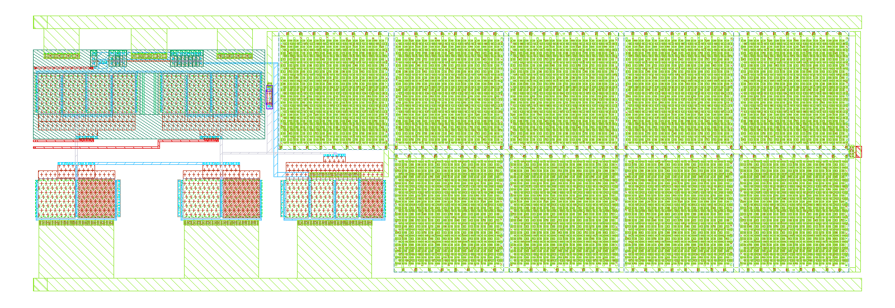
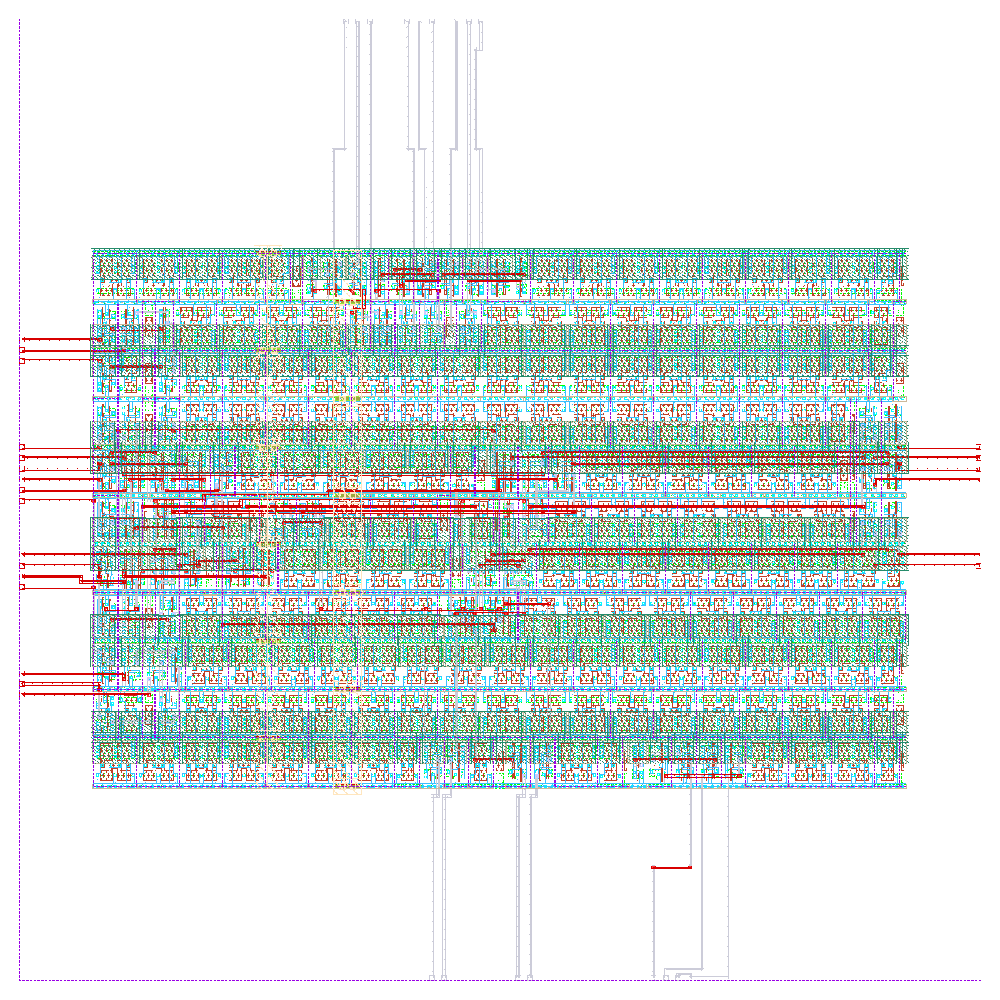
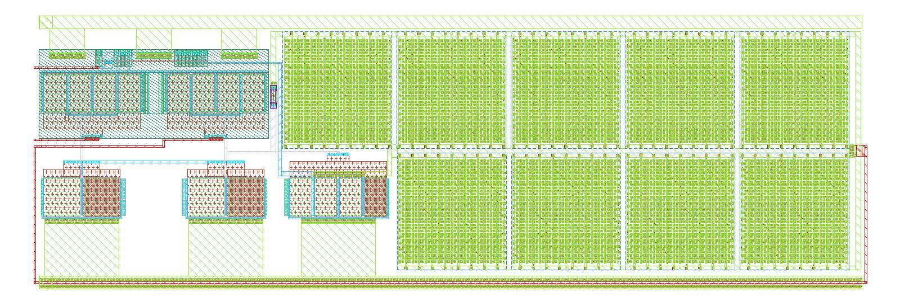

# Layout

## Top-Level
<!-- AUTO:layout:pgia_top -->

<!-- /AUTO -->

### Physical Spec
<!-- AUTO:dims:pgia_top -->
```bash
W = 500.00um
L = 250.00um
```
<!-- /AUTO -->

### Post-Layout Metrics
- Insert metrics
  
## Cells

### Static Instrumentation Amplifier
<!-- AUTO:layout:instramp_cmos5l -->

<!-- /AUTO -->

Dimension:
<!-- AUTO:dims:instramp_cmos5l -->
```bash
W = 124.25um
L = 122.79um
```
<!-- /AUTO -->

### OTA_CMOS5L
<!-- AUTO:layout:ota_cmos5l -->

<!-- /AUTO -->

Dimension:
<!-- AUTO:dims:ota_cmos5l -->
```bash
W = 112.21um
L = 37.41um
```
<!-- /AUTO -->

### Decoder
<!-- AUTO:layout:decoder_top_10b -->

<!-- /AUTO -->

Dimension:
<!-- AUTO:dims:decoder_top_10b -->
```bash
W = 75.00um
L = 75.00um
```
<!-- /AUTO -->

### Buffer
<!-- AUTO:layout:output_buffer -->

<!-- /AUTO -->

Dimension:
<!-- AUTO:dims:output_buffer -->
```bash
W = 113.55um
L = 37.41um
```
<!-- /AUTO -->
