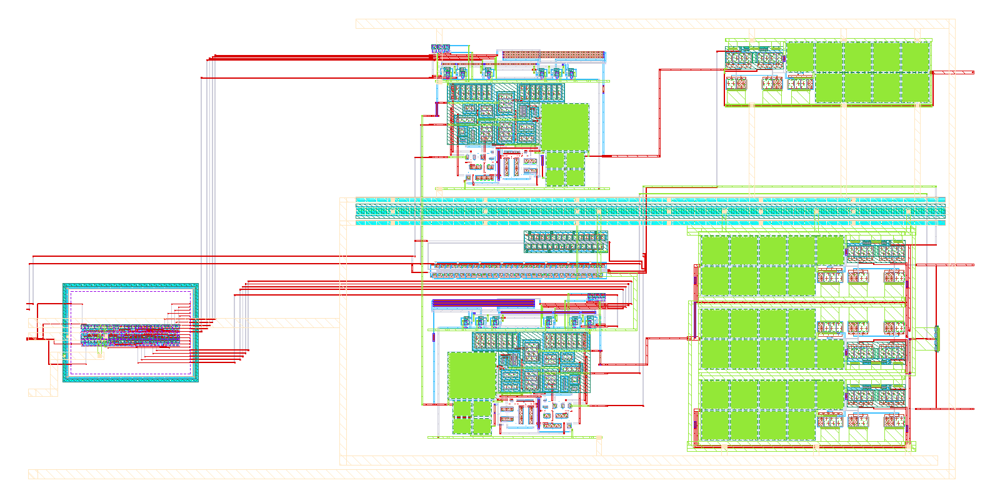
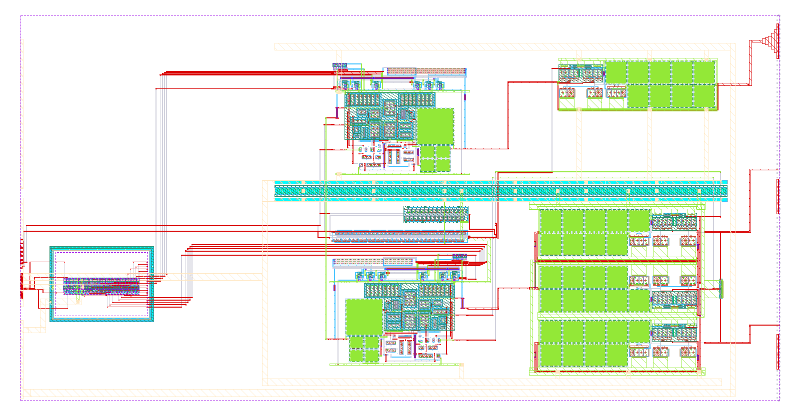
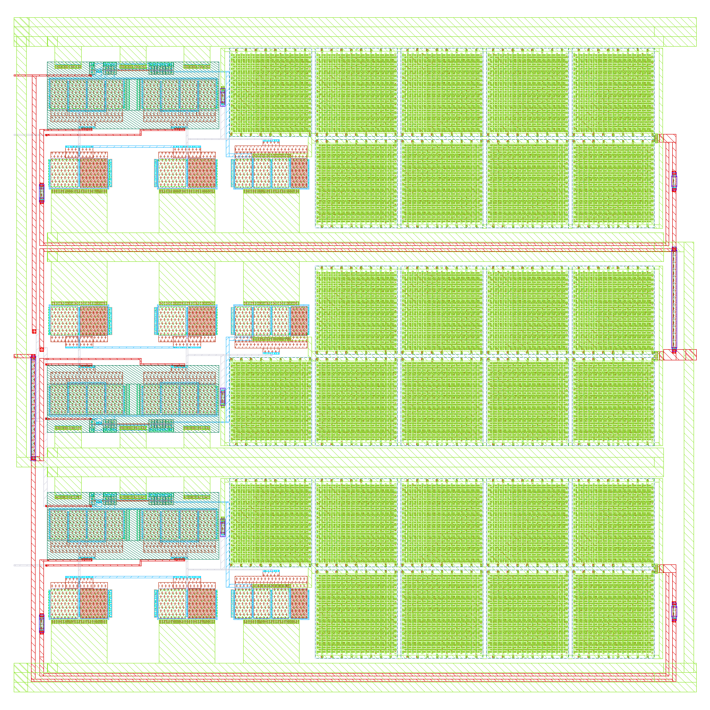
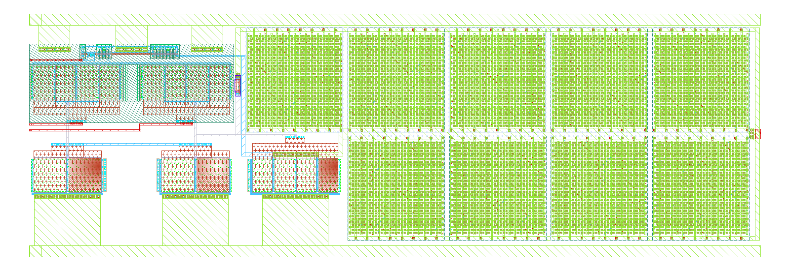
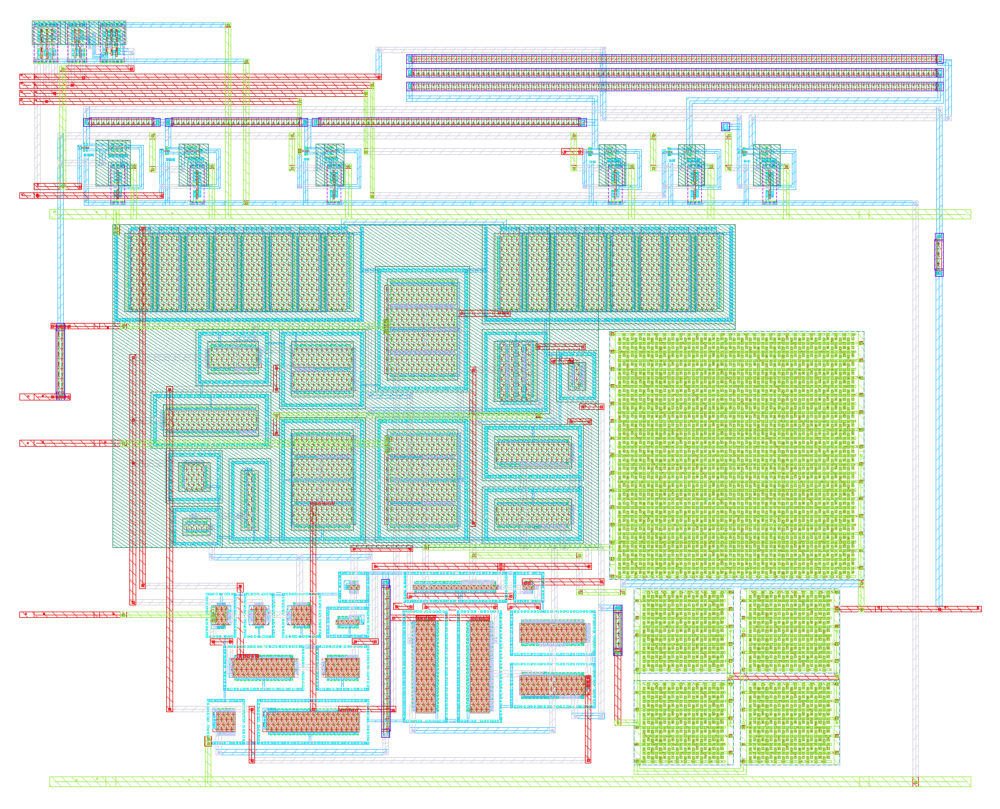
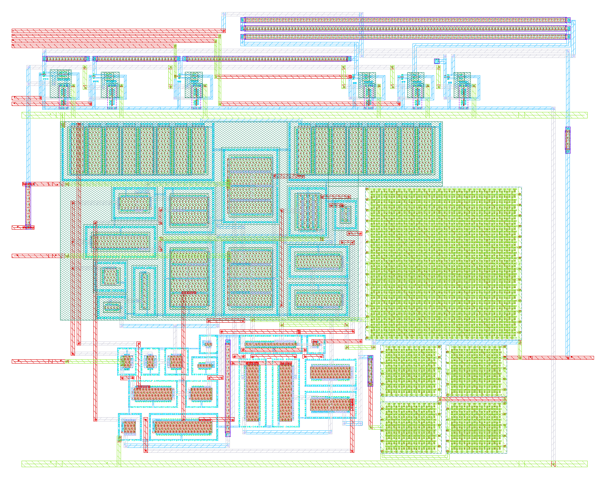
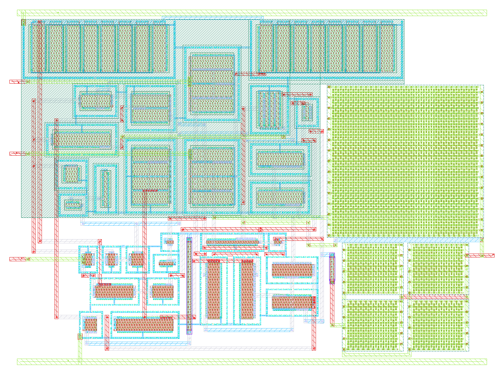
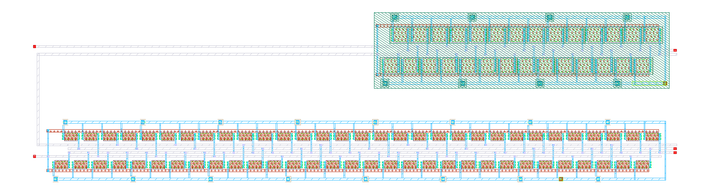
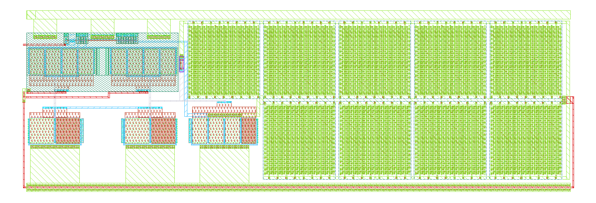
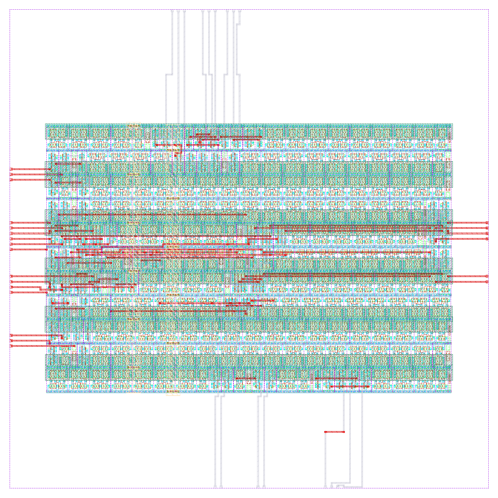

# Layout & Physical Verification

This document catalogs the physical layout, floorplan dimensions, and layout renderings of the **PGIA IP (`pgia_top`)** and its constituent building blocks in **IHP SG13CMOS5L**.

---

## 1. Top-Level Core Macro (`pgia_top`)

<!-- AUTO:layout:pgia_top -->

<!-- /AUTO -->

### Physical Specifications
<!-- AUTO:dims:pgia_top -->
```bash
W = 514.60um
L = 250.00um
Area = 128,650 um² (0.129 mm²)
```
<!-- /AUTO -->

### Integration & Verification
* **DRC**: 0 errors (Main DRC clean, antenna clean, density filled).
* **LVS**: Clean `MATCH` with `--disable_tap_extraction --ignore_top_ports_mismatch`.
* **Floorplan**: Arranged with `instramp_cmos5l` on the input side, followed by `central_bias` above `gain_stage` 1, cascading into `gain_stage` 2, and concluding with `output_buffer` adjacent to pad routing.

---

## 2. Chip-Level Deliverable Frame (`slot9_wrapper`)

<!-- AUTO:layout:slot9_wrapper -->

<!-- /AUTO -->

### Physical Specifications
<!-- AUTO:dims:slot9_wrapper -->
```bash
W = 537.15um
L = 273.00um
Area = 146,642 um² (0.147 mm²)
```
<!-- /AUTO -->

* **Role**: Slot 9 harness macro (`gds/slot_9.gds`) for Chipalooza 2026 Challenge #2. Verified clean via `scripts/harness_trial.sh`.

---

## 3. Sub-Block Layouts

### Static Instrumentation Amplifier (`instramp_cmos5l`)
<!-- AUTO:layout:instramp_cmos5l -->

<!-- /AUTO -->

```bash
W = 124.25um
L = 122.79um
Area = 15,257 um²
```

### Two-Stage Miller OTA (`ota_cmos5l`)
<!-- AUTO:layout:ota_cmos5l -->

<!-- /AUTO -->

```bash
W = 112.21um
L = 37.41um
Area = 4,198 um²
```

### Programmable Gain Stage Top (`gain_stage`)
<!-- AUTO:layout:gain_stage -->

<!-- /AUTO -->

```bash
W = 98.90um
L = 78.81um
Area = 7,794 um²
```

### Switched Resistor Feedback Network (`gain_network`)
<!-- AUTO:layout:gain_network -->

<!-- /AUTO -->

```bash
W = 97.45um
L = 76.13um
Area = 7,419 um²
```

### Folded-Cascode Class-AB Gain OTA (`gain_ota`)
<!-- AUTO:layout:gain_ota -->

<!-- /AUTO -->

```bash
W = 81.00um
L = 59.41um
Area = 4,812 um²
```

### Central Bias Current Generator (`central_bias`)
<!-- AUTO:layout:central_bias -->

<!-- /AUTO -->

```bash
W = 99.68um
L = 26.34um
Area = 2,626 um²
```

### Output Buffer (`output_buffer`)
<!-- AUTO:layout:output_buffer -->

<!-- /AUTO -->

```bash
W = 113.70um
L = 37.41um
Area = 4,254 um²
```

---

## 4. Legacy Blocks (Deprecated)

### 10-Bit Standard Cell Decoder (`decoder_top_10b`)
<!-- AUTO:layout:decoder_top_10b -->

<!-- /AUTO -->

```bash
W = 75.00um
L = 75.00um
Status: DEPRECATED (Replaced by static combinational decoder gain_decoder_4b)
```
