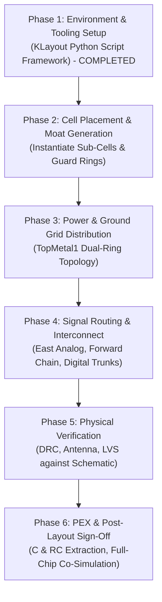

# PGIA Top-Level Layout Assembly Implementation Plan

**Project:** Programmable Gain Instrumentation Amplifier (PGIA) IP  
**Challenge:** Chipalooza Challenge #2 (IHP SG13CMOS5L, $0.13\,\mu\text{m}$ CMOS-only)  
**Target Cell:** `pgia_top` instantiated inside `slot9_wrapper`  
**Slot Footprint:** $537.15\,\mu\text{m} \times 273.00\,\mu\text{m}$ ($0.1466\,\text{mm}^2$)  
**Floorplan Architecture:** **Option B — Folded Horseshoe Flow (All Dedicated Analog Pads on East Edge)**  
**Artifact Path:** [`pgia_top_layout_implementation_plan.md`](file:///C:/Users/Rafi%20Ananta%20Alden/.gemini/antigravity-ide/brain/9b509c80-ad1d-4a5b-a482-cbfa8079847a/pgia_top_layout_implementation_plan.md)  

---

## 1. Executive Summary & Design Scope

This document specifies the end-to-end implementation plan for the **top-level physical layout assembly** of the Programmable Gain Instrumentation Amplifier IP (`pgia_top`). The design integrates an instrumentation amplifier front-end, two cascaded 5-tap binary programmable gain stages, an output buffer, and a 4-bit synthesized digital decoder into the **`slot9_wrapper`** harness frame.

Following the architectural sign-off of **Option B**, all three primary analog I/Os (`VINP`, `VINN`, `VOUT`) are assigned exclusively to the **dedicated analog bond pads on the East boundary** (`s9_an[0..2]`). This bypasses the shared chip-level analog bus, eliminating non-linear transmission-gate on-resistance and slot-to-slot contention.

### Core Physical Design Constraints:
1. **Shuttle Metal Stack Rule:** SG13CMOS5L is an M1-M4-TM1 process (**NO Metal5, NO Via4, NO TopVia2, NO TopMetal2**). Signal routing is strictly constrained to **$\le \text{Metal4}$** (Layer `50/0`). The **`TopMetal1`** layer (Layer `126/0`, $2.0\,\mu\text{m}$ thick) is reserved exclusively for global power/ground rings. Vertical connections from `TopMetal1` down to `Metal4` use `TopVia1` (Layer `125/0`).
2. **Substrate & Feedback Isolation:** High-gain cascading ($A_v \le 8192\,\text{V/V}$ / $+78\,\text{dB}$) requires a minimum $>60\,\mu\text{m}$ physical separation between input and output, plus a continuous grounded substrate moat (`AVSS` / `AVDD` N-well) to suppress substrate-mediated parasitic oscillation.
3. **Domain Partitioning:** Digital logic (`gain_decoder_4b`) is placed on the **far West edge** adjacent to `dig_in[3:0]`, maintaining $>260\,\mu\text{m}$ physical distance from the microvolt-level analog bond pads on the East.

---

## 2. Sub-Block GDS Inventory & Interface Contracts

All constituent sub-blocks have completed individual physical design, DRC, and LVS verification:

| Sub-Block | GDS Source File | Dimensions ($W \times H$) | Key Interface Ports & Metal Layers | Physical Sign-Off Status |
|---|---|:---:|---|:---:|
| **`slot9_wrapper`** | [`sg13cmos5l_ocd_chipalooza/gds/slot9_wrapper.gds`](file:///home/ranantalden/Projects/Designs/Chipalooza/sg13cmos5l_ocd_chipalooza/gds/slot9_wrapper.gds) | $537.15 \times 273.00\,\mu\text{m}$ | **East:** `s9_an[0..2]` (M3 @ $X=535.45$)<br/>**West:** `dig_in[0..3]`, `vdd_1v2`, `vss_1v2`, biases | Golden Harness Frame |
| **`instramp_cmos5l`** | [`gds/pgia_top/instramp_cmos5l.gds`](file:///home/ranantalden/Projects/Designs/Chipalooza/Programmable-Instrumentation-Amplifier-IP/gds/pgia_top/instramp_cmos5l.gds) | $124.25 \times 122.79\,\mu\text{m}$ | **In:** `VINP` (M2), `VINN` (M2), `CM` (M3)<br/>**Out:** `VOUT` (M3 @ $X=124.15$)<br/>**Power:** `VDD`, `VSS` (M4) | DRC Clean / LVS Clean |
| **`gain_network`** (Stage 1 & 2) | [`gds/gain_network/gain_network.klay.gds`](file:///home/ranantalden/Projects/Designs/Chipalooza/Programmable-Instrumentation-Amplifier-IP/gds/gain_network/gain_network.klay.gds) | $97.45 \times 74.61\,\mu\text{m}$ | **In:** `V_IN2`, `V_CM` (M3)<br/>**Control:** `S0..S5` (M3)<br/>**Out:** `V_OUT2` (M3 @ $X=39.57$)<br/>**Power:** `AVDD`, `AVSS` (M4) | DRC Clean / LVS Clean / PEX RC Signed |
| **`output_buffer`** | [`gds/pgia_top/output_buffer.gds`](file:///home/ranantalden/Projects/Designs/Chipalooza/Programmable-Instrumentation-Amplifier-IP/gds/pgia_top/output_buffer.gds) | $113.55 \times 37.41\,\mu\text{m}$ | **In:** `VINN` (M3 @ $X=0.12$)<br/>**Out:** `VOUT` (M3 @ $X=113.44$)<br/>**Power:** `VDD`, `VSS` (M4) | DRC Clean / LVS Clean |
| **`gain_decoder_4b`** | [`gds/gain_decoder_4b/final/gds/gain_decoder_4b.gds`](file:///home/ranantalden/Projects/Designs/Chipalooza/Programmable-Instrumentation-Amplifier-IP/gds/gain_decoder_4b/final/gds/gain_decoder_4b.gds) | $65.00 \times 45.00\,\mu\text{m}$ | **In:** `gain_sel[0..3]` (M3 @ $X=0.2$)<br/>**Out:** `s1[0..4]`, `s2[0..4]` (M3 @ $X=64.8$)<br/>**Power:** `VPWR`, `VGND` (M4) | DRC Clean / LVS Clean / LibreLane Signed |

> [!NOTE]
> `gain_network.klay.gds` contains the complete Gain Stage core, integrating the `gain_ota` differential amplifier, the $R_1\dots R_7$ resistor ladder, and the 6 CMOS transmission-gate switches. Two instances are placed: **`gain_stage_1`** in the Lower Lane and **`gain_stage_2`** in the Upper Lane. All sub-block power pins are on **Metal4** (`50/25`), ready for vertical drop connections from `TopMetal1`.

---

## 3. Floorplan Architecture & Placed Coordinate Budget

```
(0, 273) ┌────────────────────────────────────────────────────────────────────────┐ (537.15, 273)
         │                                       [UPPER ANALOG LANE]              │
         │                               ┌─────────────┐       ┌────────────┐     │
         │                               │gain_stage_2 │──────►│output_buf  ├─────┼─► s9_an[2]
         │                               │(gain_network│       │(Unity-Gain)│     │   (VOUT @ Y=254.55)
         │                               └──────▲──────┘       └────────────┘     │
         │                                      │                                 │
         │ ┌────────────────────────────────────┴───────────────────────────────┐ │
         │ │ === CONTINUOUS GROUNDED ISOLATION MOAT (AVSS / AVDD N-WELL) ====== │ │   (Y ≈ 141..160)
         │ └──────────────────┬─────────────────────────────────────────────────┘ │
         │                    │ (s2 bus)                                          │
         │ ┌────────────────┐ │                  [LOWER ANALOG LANE]              │
dig_in──►├─┤gain_decoder_4b ├─┴──────┐   ┌─────────────┐       ┌────────────┐     │
[3:0]    │ │(65 um x 45 um) │ (s1 bus)──►│gain_stage_1 │◄──────┤instramp    │◄────┼── s9_an[1] (VINN @ 144.55)
         │ └────────────────┘            │(gain_network│       │(Front-End) │◄────┼── s9_an[0] (VINP @ 34.55)
vdd_1v2  │      [WEST]                   └─────────────┘       └────────────┘     │
vss_1v2  │                                    [CENTER]             [EAST]         │
  (0, 0) └────────────────────────────────────────────────────────────────────────┘
```

### Placed Instance Coordinate Schedule:

| Instance Name | Sub-Cell Reference | Placed Bounding Box $[X_1, Y_1] \rightarrow [X_2, Y_2]$ ($\mu\text{m}$) | Center $(X_c, Y_c)$ | Orientation | Function / Corridor |
|---|---|:---:|:---:|:---:|---|
| **`x_dec`** | `gain_decoder_4b` | $[25.00, 60.00] \rightarrow [90.00, 105.00]$ | $(57.5, 82.5)$ | `R0` | Digital decoder receiving `dig_in[0..3]` from West edge |
| **`x_ia`** | `instramp_cmos5l` | $[360.00, 18.00] \rightarrow [484.25, 140.79]$ | $(422.1, 79.4)$ | `M90` | Low-noise front-end directly facing `s9_an[0..1]` on East |
| **`x_stage1`** | `gain_network` | $[220.00, 25.00] \rightarrow [317.45, 99.61]$ | $(268.7, 62.3)$ | `M90` | Lower Lane: Receives IA output from East, `V_OUT2` on West |
| **`x_stage2`** | `gain_network` | $[220.00, 160.00] \rightarrow [317.45, 234.61]$ | $(268.7, 197.3)$ | `R0` | Upper Lane: Turnaround input on West, drives buffer on East |
| **`x_buf`** | `output_buffer` | $[380.00, 205.00] \rightarrow [493.55, 242.41]$ | $(436.8, 223.7)$ | `R0` | Upper Lane: Drives pad `s9_an[2]` (`VOUT`) on East |
| **`guard_moat`** | Custom Geometry | $[180.00, 141.00] \rightarrow [500.00, 156.00]$ | $(340.0, 148.5)$ | — | Inter-lane $P^+/\text{N-well}$ isolation trench ($15\,\mu\text{m}$ width) |
| **`guard_dec`** | Custom Geometry | $[20.00, 55.00] \rightarrow [95.00, 110.00]$ | $(57.5, 82.5)$ | — | Double guard ring enclosing digital decoder |

---

## 4. Phased Implementation Roadmap



---

### Phase 1: Environment & Automated Assembly Tooling Setup [COMPLETED]
- **Status:** **100% COMPLETE & VERIFIED**
- **Objectives Achieved:**
  - Built standalone, repeatable Python assembly script [`scripts/assemble_pgia_top.py`](file:///home/ranantalden/Projects/Designs/Chipalooza/Programmable-Instrumentation-Amplifier-IP/scripts/assemble_pgia_top.py) utilizing the `klayout.db` API.
  - Implemented exact verified technology layer mappings for IHP SG13CMOS5L:
    - Base: `Activ (1/0, 1/2)`, `Cont (6/0)`, `nSD (7/0)`, `pSD (14/0)`, `NWell (31/0)`, `PWell (46/0)`
    - BEOL Routing: `Metal1 (8/0, 8/25)`, `Via1 (19/0)`, `Metal2 (10/0, 10/25)`, `Via2 (29/0)`, `Metal3 (30/0, 30/25)`, `Via3 (49/0)`, `Metal4 (50/0, 50/25)`
    - Power Stack: `TopVia1 (125/0)`, `TopMetal1 (126/0, 126/25)`
    - Boundary: `prBoundary (189/4)`
    - **No Metal5 / Via4 rule enforced.**
  - Implemented automatic cell conflict resolution (`RenameCell`) to safely ingest standard cells and device PCells across all 5 sub-blocks.
  - Ingested and placed all 5 constituent sub-blocks into `pgia_top` within `slot9_wrapper`.
  - Executed spatial collision and clearance audit:
    - **Spatial Overlaps:** 0 errors (all 5 blocks have clean, non-intersecting bounding boxes).
    - **Central Moat Corridor:** $Y \in [140.79, 160.00]\,\mu\text{m}$ ($19.21\,\mu\text{m}$ clearance available for $15\,\mu\text{m}$ trench).
    - **Digital-to-Analog Separation:** $130.00\,\mu\text{m}$ physical isolation.
    - **Turnaround Spine Alignment:** Stage 1 `V_OUT2` ($X = 223.735$) aligns with Stage 2 `V_IN2` ($X = 220.945$) with $\Delta X < 2.8\,\mu\text{m}$.
    - **East Analog Pad Runs:** IA inputs $<52\,\mu\text{m}$ from `s9_an[0..1]`; buffer output $<42\,\mu\text{m}$ from `s9_an[2]`.
- **Artifacts:**
  - Assembly Script: [`scripts/assemble_pgia_top.py`](file:///home/ranantalden/Projects/Designs/Chipalooza/Programmable-Instrumentation-Amplifier-IP/scripts/assemble_pgia_top.py)
  - Layout Output: [`gds/pgia_top/pgia_top.gds`](file:///home/ranantalden/Projects/Designs/Chipalooza/Programmable-Instrumentation-Amplifier-IP/gds/pgia_top/pgia_top.gds)
  - Visual Preview: 

---

### Phase 2: Sub-Cell Placement & Isolation Moat Generation
- **Objectives:**
  - Formalize geometry generators for the physical isolation structures in `assemble_pgia_top.py`:
  - **Central Isolation Moat ($Y \in [141, 156]\,\mu\text{m}$, $X \in [180, 500]\,\mu\text{m}$, Width $= 15\,\mu\text{m}$):**
    - Inner $P^+$ tap ring tied to `AVSS` (`pSD (14/0)` + `Activ (1/0)` + `Cont (6/0)` + `Metal1 (8/0)`).
    - Outer N-well guard strip tied to `AVDD` (`NWell (31/0)` + `nSD (7/0)` + `Activ (1/0)` + `Cont (6/0)` + `Metal1 (8/0)`).
  - **Digital Guard Ring:**
    - Dual guard ring around `gain_decoder_4b` ($X \in [20, 95]\,\mu\text{m}, Y \in [55, 110]\,\mu\text{m}$) tied to `vss_1v2` / `vdd_1v2`.
- **Deliverables:** Placed layout with synthesized guard moats passing DRC base rules.

---

### Phase 3: Power & Ground Grid Distribution (`TopMetal1`)
- **Objectives:**
  - Implement the shuttle-mandated global power grid strictly on **`TopMetal1`** ($126/0$, $2.0\,\mu\text{m}$ thick):
    - **Analog Power Ring:** $12\,\mu\text{m}$ wide `AVDD` and `AVSS` rings encircling the analog blocks ($X \ge 160\,\mu\text{m}$).
    - **Digital Power Ring:** $6\,\mu\text{m}$ wide `vdd_1v2` and `vss_1v2` rings encircling the West decoder.
  - **Via Stacks:** Drop vertical via stacks (`TopVia1 (125/0)` $\rightarrow$ `Metal4 (50/0)`) connecting `TopMetal1` power trunks directly to the `Metal4` power rings/pins of each sub-cell.
  - Verify zero short circuits between quiet analog ground (`AVSS`) and digital ground (`vss_1v2`).
- **Deliverables:** Completed P/G distribution network with verified IR-drop capability.

---

### Phase 4: Signal Routing & Interconnect ($\le \text{Metal4}$)
- **Objectives:**
  - Route all inter-block connections observing the strict $\le \text{Metal4}$ shuttle rule:
    1. **Analog Inputs (East):**
       - `s9_an[0]` $(535.45, 34.55) \rightarrow$ `VINP` on `instramp_cmos5l` (`Metal3`, shielded with `AVSS` ground tracks).
       - `s9_an[1]` $(535.45, 144.55) \rightarrow$ `VINN` on `instramp_cmos5l` (`Metal3`, shielded with `AVSS` ground tracks).
    2. **Lower Lane Forward Interconnect:**
       - IA output `VOUT` $(X = 360.10) \rightarrow$ `gain_stage_1` `V_IN2` $(X = 316.51)$ via horizontal `Metal3` trace ($L = 43.6\,\mu\text{m}$).
    3. **Inter-Stage Turnaround Spine ($X \approx 221\dots 224\,\mu\text{m}$):**
       - Route Stage 1 output `V_OUT2` $(X = 223.74, Y = 43.45)$ northward across the isolation moat to Stage 2 input `V_IN2` $(X = 220.95, Y = 191.76)$ on `Metal3`.
    4. **Upper Lane Forward Interconnect & Output Feed:**
       - Stage 2 output `V_OUT2` $(X = 313.72, Y = 178.45) \rightarrow$ `output_buffer` input `VINN` $(X = 380.12, Y = 225.44)$ on `Metal3`.
       - Buffer output `VOUT` $(X = 493.44, Y = 223.95) \rightarrow$ `s9_an[2]` $(535.45, 254.55)$ on `Metal4` ($L = 42.0\,\mu\text{m}$).
    5. **Digital Control Buses (West to East):**
       - `dig_in[0..3]` from slot wrapper $(X = 1.0, Y \approx 78\text{--}80) \rightarrow$ `gain_decoder_4b` inputs at $X = 25.20\,\mu\text{m}$.
       - Route `s1[0..4]` bus from decoder East edge $(X = 89.80\,\mu\text{m}) \rightarrow$ `gain_stage_1` `S1..S5`.
       - Route `s2[0..4]` bus from decoder East edge $(X = 89.80\,\mu\text{m}) \rightarrow$ `gain_stage_2` `S1..S5`.
    6. **Bias Current Tracing:**
       - Route bias current sinks/sources (`IBIAS_IA`, `IBIAS_G1`, `IBIAS_G2`, `IBIAS_BUF`) from wrapper pads/test points to sub-block current mirrors.
- **Deliverables:** 100% routed top-level layout in `gds/pgia_top/pgia_top.gds`.

---

### Phase 5: Physical Verification (DRC, LVS, Antenna)
- **Objectives:**
  - Execute automated batch verification scripts:
    ```bash
    # 1. DRC Verification
    ./scripts/run_drc.sh gds/pgia_top/pgia_top.gds
    
    # 2. LVS Verification against schematic
    ./scripts/run_lvs.sh gds/pgia_top/pgia_top.gds xschem/pgia_top/simulations/pgia_top.spice
    ```
  - Audit and fix all design rule violations:
    - Minimum metal spacing, widths, and enclosures.
    - Antenna ratios on long digital control lines (`s1`, `s2`) by adding reverse-biased diode tie-downs if necessary.
    - Exact port pin matching between layout text labels (layers `30/25`, `50/25`, `126/25`) and the 16 pins of `pgia_top.sym`.
- **Pass Criteria:**
  - DRC: `0 errors` (density rules flagged as info only).
  - LVS: `RESULT: MATCH`.

---

### Phase 6: Parasitic Extraction (PEX) & Co-Simulation Sign-Off
- **Objectives:**
  - Run parasitic extraction on the finalized top-level layout:
    ```bash
    ./scripts/run_pex.sh pgia_top
    ```
  - Generate extracted netlists:
    - `netlist/pgia_top/pex/pgia_top.c.spice` (Capacitance only)
    - `netlist/pgia_top/pex/pgia_top.rc.spice` (Full distributed RC)
  - Execute automated post-layout co-simulation battery:
    ```bash
    python3 xschem/pgia_top/verify_pgia_top.py --run --update-readme
    ```
  - Verify that top-level interconnect parasitics:
    1. Do not introduce parasitic oscillation or phase margin degradation at maximum gain ($69.5\,\text{dB}$).
    2. Maintain strictly monotonic $6\,\text{dB}$ gain steps across all 11 settings.
    3. Preserve safe clamping back to Step 0 for states $11\dots 15$.
- **Pass Criteria:**
  - All 3 phases (DC, AC, Transient) report `[PASS]` in `verify_pgia_top.py`.
  - Sign-off report and layout screenshots committed to [`xschem/pgia_top/README.md`](file:///Ubuntu-24.04/home/ranantalden/Projects/Designs/Chipalooza/Programmable-Instrumentation-Amplifier-IP/xschem/pgia_top/README.md).

---

## 5. Milestone Checklist & Sign-Off Tracking

- [x] **Milestone 1: Scripted Assembly Framework Setup & Sub-Block Placement (Phase 1)**
  - Implement `scripts/assemble_pgia_top.py` using `klayout.db`.
  - Verify SG13CMOS5L layer definitions (M1-M4-TM1, no Metal5).
  - Ingest all 5 sub-blocks (`slot9_wrapper`, `instramp_cmos5l`, `gain_network`, `output_buffer`, `gain_decoder_4b`).
  - Verify 0 collisions, 0 spatial overlaps, and Option B folded horseshoe alignment.
  - Generate `gds/pgia_top/pgia_top.gds` and visual preview.
- [ ] **Milestone 2: Placement & Guard Ring Moat Generation (Phase 2)**
  - Synthesize $15\,\mu\text{m}$ horizontal isolation trench ($Y \in [141, 156]\,\mu\text{m}$) and digital double guard ring.
- [ ] **Milestone 3: Power Grid Synthesis (`TopMetal1`) (Phase 3)**
  - Route analog (`AVDD`/`AVSS`) and digital (`vdd_1v2`/`vss_1v2`) power rings on `TopMetal1`.
  - Connect all sub-block `Metal4` power rails through `TopVia1` vertical stacks.
- [ ] **Milestone 4: Full Signal Interconnect Routing ($\le \text{Metal4}$) (Phase 4)**
  - Route East analog inputs (`VINP`, `VINN`), forward chain, turnaround spine, and output (`VOUT`).
  - Route 4-bit digital input trunk and 10-bit decoder output buses (`s1`, `s2`).
- [ ] **Milestone 5: DRC & LVS Clean Sign-Off (Phase 5)**
  - Achieve clean DRC (`0 items`).
  - Achieve clean LVS match against `xschem/pgia_top/simulations/pgia_top.spice`.
- [ ] **Milestone 6: Post-Layout PEX & Co-Simulation Verification (Phase 6)**
  - Extract distributed RC netlist (`pgia_top.rc.spice`).
  - Run `verify_pgia_top.py` and document post-layout performance in `README.md`.
