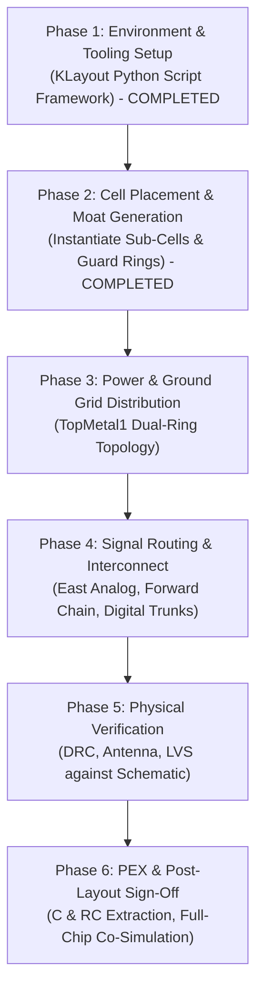

# PGIA Top-Level Layout Assembly Implementation Plan

**Project:** Programmable Gain Instrumentation Amplifier (PGIA) IP  
**Challenge:** Chipalooza Challenge #2 (IHP SG13CMOS5L, $0.13\,\mu\text{m}$ CMOS-only)  
**Target Cell:** `pgia_top` instantiated inside `slot9_wrapper`  
**Slot Footprint:** $537.15\,\mu\text{m} \times 273.00\,\mu\text{m}$ ($0.1466\,\text{mm}^2$)  
**Floorplan Architecture:** **Option B — Folded Horseshoe Flow (All Dedicated Analog Pads on East Edge)**  
**Artifact Path:** [`pgia_top_layout_implementation_plan.md`](file:///C:/Users/Rafi%20Ananta%20Alden/.gemini/antigravity-ide/brain/9b509c80-ad1d-4a5b-a482-cbfa8079847a/pgia_top_layout_implementation_plan.md)  

---

## 1. Executive Summary & Design Scope

This document specifies the end-to-end implementation plan for the **top-level physical layout assembly** of the Programmable Gain Instrumentation Amplifier IP (`pgia_top`). The design integrates an instrumentation amplifier front-end, two cascaded 5-tap binary programmable gain stages, an output buffer, and a 4-bit synthesized digital decoder into the **`slot9_wrapper`** harness frame.

Following the architectural sign-off of **Option B**, all three primary analog I/Os (`VINP`, `VINN`, `VOUT`) are assigned exclusively to the **dedicated analog bond pads on the East boundary** (`s9_an[0..2]`). This bypasses the shared chip-level analog bus, eliminating non-linear transmission-gate on-resistance and slot-to-slot contention.

### Core Physical Design Constraints:
1. **Shuttle Metal Stack Rule:** SG13CMOS5L is an M1-M4-TM1 process (**NO Metal5, NO Via4, NO TopVia2, NO TopMetal2**). Signal routing is strictly constrained to **$\le \text{Metal4}$** (Layer `50/0`). The **`TopMetal1`** layer (Layer `126/0`, $2.0\,\mu\text{m}$ thick) is reserved exclusively for global power/ground rings. Vertical connections from `TopMetal1` down to `Metal4` use `TopVia1` (Layer `125/0`).
2. **Substrate & Feedback Isolation:** High-gain cascading ($A_v \le 8192\,\text{V/V}$ / $+78\,\text{dB}$) requires a minimum $>60\,\mu\text{m}$ physical separation between input and output, plus a continuous grounded substrate moat (`AVSS` / `AVDD` N-well) to suppress substrate-mediated parasitic oscillation.
3. **Domain Partitioning:** Digital logic (`gain_decoder_4b`) is placed on the **far West edge** adjacent to `dig_in[3:0]`, maintaining $>260\,\mu\text{m}$ physical distance from the microvolt-level analog bond pads on the East.

---

## 2. Sub-Block GDS Inventory & Interface Contracts

All constituent sub-blocks have completed individual physical design, DRC, and LVS verification:

| Sub-Block | GDS Source File | Dimensions ($W \times H$) | Key Interface Ports & Metal Layers | Physical Sign-Off Status |
|---|---|:---:|---|:---:|
| **`slot9_wrapper`** | [`sg13cmos5l_ocd_chipalooza/gds/slot9_wrapper.gds`](file:///home/ranantalden/Projects/Designs/Chipalooza/sg13cmos5l_ocd_chipalooza/gds/slot9_wrapper.gds) | $537.15 \times 273.00\,\mu\text{m}$ | **East:** `s9_an[0..2]` (M3 @ $X=535.45$)<br/>**West:** `dig_in[0..3]`, `vdd_1v2`, `vss_1v2`, biases | Golden Harness Frame |
| **`instramp_cmos5l`** | [`gds/pgia_top/instramp_cmos5l.gds`](file:///home/ranantalden/Projects/Designs/Chipalooza/Programmable-Instrumentation-Amplifier-IP/gds/pgia_top/instramp_cmos5l.gds) | $124.25 \times 122.79\,\mu\text{m}$ | **In:** `VINP` (M2), `VINN` (M2), `CM` (M3)<br/>**Out:** `VOUT` (M3 @ $X=124.15$)<br/>**Power:** `VDD`, `VSS` (M4) | DRC Clean / LVS Clean |
| **`gain_network`** (Stage 1 & 2) | [`gds/gain_network/gain_network.klay.gds`](file:///home/ranantalden/Projects/Designs/Chipalooza/Programmable-Instrumentation-Amplifier-IP/gds/gain_network/gain_network.klay.gds) | $97.45 \times 74.61\,\mu\text{m}$ | **In:** `V_IN2`, `V_CM` (M3)<br/>**Control:** `S0..S5` (M3)<br/>**Out:** `V_OUT2` (M3 @ $X=39.57$)<br/>**Power:** `AVDD`, `AVSS` (M4) | DRC Clean / LVS Clean / PEX RC Signed |
| **`output_buffer`** | [`gds/pgia_top/output_buffer.gds`](file:///home/ranantalden/Projects/Designs/Chipalooza/Programmable-Instrumentation-Amplifier-IP/gds/pgia_top/output_buffer.gds) | $113.55 \times 37.41\,\mu\text{m}$ | **In:** `VINN` (M3 @ $X=0.12$)<br/>**Out:** `VOUT` (M3 @ $X=113.44$)<br/>**Power:** `VDD`, `VSS` (M4) | DRC Clean / LVS Clean |
| **`gain_decoder_4b`** | [`gds/gain_decoder_4b/final/gds/gain_decoder_4b.gds`](file:///home/ranantalden/Projects/Designs/Chipalooza/Programmable-Instrumentation-Amplifier-IP/gds/gain_decoder_4b/final/gds/gain_decoder_4b.gds) | $65.00 \times 45.00\,\mu\text{m}$ | **In:** `gain_sel[0..3]` (M3 @ $X=0.2$)<br/>**Out:** `s1[0..4]`, `s2[0..4]` (M3 @ $X=64.8$)<br/>**Power:** `VPWR`, `VGND` (M4) | DRC Clean / LVS Clean / LibreLane Signed |

> [!NOTE]
> `gain_network.klay.gds` contains the complete Gain Stage core, integrating the `gain_ota` differential amplifier, the $R_1\dots R_7$ resistor ladder, and the 6 CMOS transmission-gate switches. Two instances are placed: **`gain_stage_1`** in the Lower Lane and **`gain_stage_2`** in the Upper Lane. All sub-block power pins are on **Metal4** (`50/25`), ready for vertical drop connections from `TopMetal1`.

---

## 3. Floorplan Architecture & Placed Coordinate Budget

```
(0, 273) ┌────────────────────────────────────────────────────────────────────────┐ (537.15, 273)
         │                                       [UPPER ANALOG LANE]              │
         │                               ┌─────────────┐       ┌────────────┐     │
         │                               │gain_stage_2 │──────►│output_buf  ├─────┼─► s9_an[2]
         │                               │(gain_network│       │(Unity-Gain)│     │   (VOUT @ Y=254.55)
         │                               └──────▲──────┘       └────────────┘     │
         │                                      │                                 │
         │ ┌────────────────────────────────────┴───────────────────────────────┐ │
         │ │ === CONTINUOUS GROUNDED ISOLATION MOAT (AVSS / AVDD N-WELL) ====== │ │   (Y ≈ 141..156)
         │ └──────────────────┬─────────────────────────────────────────────────┘ │
         │                    │ (s2 bus)                                          │
         │ ┌────────────────┐ │                  [LOWER ANALOG LANE]              │
dig_in──►├─┤gain_decoder_4b ├─┴──────┐   ┌─────────────┐       ┌────────────┐     │
[3:0]    │ │(65 um x 45 um) │ (s1 bus)──►│gain_stage_1 │◄──────┤instramp    │◄────┼── s9_an[1] (VINN @ 144.55)
         │ └────────────────┘            │(gain_network│       │(Front-End) │◄────┼── s9_an[0] (VINP @ 34.55)
vdd_1v2  │      [WEST]                   └─────────────┘       └────────────┘     │
vss_1v2  │                                    [CENTER]             [EAST]         │
  (0, 0) └────────────────────────────────────────────────────────────────────────┘
```

### Placed Instance Coordinate Schedule:

| Instance Name | Sub-Cell Reference | Placed Bounding Box $[X_1, Y_1] \rightarrow [X_2, Y_2]$ ($\mu\text{m}$) | Center $(X_c, Y_c)$ | Orientation | Function / Corridor |
|---|---|:---:|:---:|:---:|---|
| **`x_dec`** | `gain_decoder_4b` | $[25.00, 60.00] \rightarrow [90.00, 105.00]$ | $(57.5, 82.5)$ | `R0` | Digital decoder receiving `dig_in[0..3]` from West edge |
| **`x_ia`** | `instramp_cmos5l` | $[360.00, 18.00] \rightarrow [484.25, 140.79]$ | $(422.1, 79.4)$ | `M90` | Low-noise front-end directly facing `s9_an[0..1]` on East |
| **`x_stage1`** | `gain_network` | $[220.00, 25.00] \rightarrow [317.45, 99.61]$ | $(268.7, 62.3)$ | `M90` | Lower Lane: Receives IA output from East, `V_OUT2` on West |
| **`x_stage2`** | `gain_network` | $[220.00, 160.00] \rightarrow [317.45, 234.61]$ | $(268.7, 197.3)$ | `R0` | Upper Lane: Turnaround input on West, drives buffer on East |
| **`x_buf`** | `output_buffer` | $[380.00, 205.00] \rightarrow [493.55, 242.41]$ | $(436.8, 223.7)$ | `R0` | Upper Lane: Drives pad `s9_an[2]` (`VOUT`) on East |
| **`central_moat`** | Synthesized Geometry | $[180.00, 141.00] \rightarrow [500.00, 156.00]$ | $(340.0, 148.5)$ | — | Inter-lane PNP sandwich guard trench ($15.0\,\mu\text{m}$ width) |
| **`guard_dec`** | Synthesized Geometry | $[20.60, 55.60] \rightarrow [94.40, 109.40]$ | $(57.5, 82.5)$ | — | Double guard ring enclosing digital decoder |

---

## 4. Phased Implementation Roadmap



---

### Phase 1: Environment & Automated Assembly Tooling Setup [COMPLETED]
- **Status:** **100% COMPLETE & VERIFIED**
- Built standalone, repeatable Python assembly script [`scripts/assemble_pgia_top.py`](file:///home/ranantalden/Projects/Designs/Chipalooza/Programmable-Instrumentation-Amplifier-IP/scripts/assemble_pgia_top.py) utilizing the `klayout.db` API.
- Implemented exact verified technology layer mappings for IHP SG13CMOS5L (M1-M4-TM1, no Metal5).
- Ingested and placed all 5 constituent sub-blocks into `pgia_top` within `slot9_wrapper` with 0 overlaps.

---

### Phase 2: Sub-Cell Placement & Isolation Moat Generation [COMPLETED]
- **Status:** **100% COMPLETE & VERIFIED (DRC Clean)**
- **Objectives Achieved:**
  - **Synthesized Central Isolation Moat ($X \in [180.0, 500.0]\,\mu\text{m}$, $Y \in [141.0, 156.0]\,\mu\text{m}$, Width $= 15.0\,\mu\text{m}$):**
    - **Topology:** Triple-barrier PNP sandwich (P-tap / N-well / P-tap).
    - **Lower $P^+$ Substrate Tap:** $Y \in [141.0, 143.4]\,\mu\text{m}$ tied to `AVSS` (`Activ 1/0` + `pSD 14/0` + `Cont 6/0` array + `Metal1 8/0`).
    - **Center N-Well Barrier:** $Y \in [144.5, 152.5]\,\mu\text{m}$ ($8.0\,\mu\text{m}$ wide N-well, `NWell 31/0`), containing a centered $5.0\,\mu\text{m}$ wide $N^+$ tap tied to `AVDD` (`Activ 1/0` + `nSD 7/0` + `Cont 6/0` array + `Metal1 8/0`).
    - **Upper $P^+$ Substrate Tap:** $Y \in [153.6, 156.0]\,\mu\text{m}$ tied to `AVSS` (`Activ 1/0` + `pSD 14/0` + `Cont 6/0` array + `Metal1 8/0`).
    - **Spacings:** $1.1\,\mu\text{m}$ NWell-to-Activ spacing ($> \text{NW\_e} = 0.24\,\mu\text{m}$).
  - **Synthesized Digital Double Guard Ring Enclosing `gain_decoder_4b`:**
    - **Inner Ring:** $P^+$ tap ring tied to `vss_1v2` (digital ground), $0.8\,\mu\text{m}$ width, inner boundary $[23.5, 58.5] \rightarrow [91.5, 106.5]\,\mu\text{m}$, outer boundary $[22.7, 57.7] \rightarrow [92.3, 107.3]\,\mu\text{m}$.
    - **Outer Ring:** N-well tap ring tied to `vdd_1v2` (digital supply), $0.8\,\mu\text{m}$ width, enclosed in continuous N-well frame $[20.6, 55.6] \rightarrow [94.4, 109.4]\,\mu\text{m}$.
    - **Separation to Analog Moat:** $85.00\,\mu\text{m}$ physical buffer, preventing any digital substrate coupling into quiet `AVSS`.
- **DRC Verification Results:**
  - `pgia_top` (Core IP Cell): **`0 items` [PASS]**
  - `slot9_wrapper` (Harness Top Cell): **`0 items` [PASS]**
- **Artifacts:**
  - Layout Output: [`gds/pgia_top/pgia_top.gds`](file:///home/ranantalden/Projects/Designs/Chipalooza/Programmable-Instrumentation-Amplifier-IP/gds/pgia_top/pgia_top.gds)
  - Visual Preview: 

---

### Phase 3: Power & Ground Grid Distribution (`TopMetal1`) [COMPLETED]
- **Status:** **100% COMPLETE & VERIFIED (DRC Clean)**
- **Objectives Achieved:**
  - **Planar TopMetal1 Global Power Architecture (Strictly M1-M4-TM1, Zero Crossings):**
    - **Analog Power Ring (Encircling Analog Horseshoe Bay, $X \ge 165\,\mu\text{m}$):**
      - South Trunks ($W = 5.0\,\mu\text{m}$): `AVDD_SOUTH` at $Y \in [3.0, 8.0]\,\mu\text{m}$, `AVSS_SOUTH` at $Y \in [10.5, 15.5]\,\mu\text{m}$.
      - North Trunks ($W = 5.0\,\mu\text{m}$): `AVDD_NORTH` at $Y \in [248.0, 253.0]\,\mu\text{m}$, `AVSS_NORTH` at $Y \in [256.0, 261.0]\,\mu\text{m}$.
      - West Vertical Risers ($W = 4.0\,\mu\text{m}$): `AVSS_WEST` at $X \in [165.0, 169.0]\,\mu\text{m}$, `AVDD_WEST` at $X \in [171.0, 175.0]\,\mu\text{m}$.
      - East Vertical Risers ($W = 3.5\,\mu\text{m}$): `AVDD_EAST` at $X \in [497.0, 500.5]\,\mu\text{m}$, `AVSS_EAST` at $X \in [502.0, 505.5]\,\mu\text{m}$.
      - Central Isolation Moat Straps: `AVSS` over Lower PTap ($Y \in [141.0, 143.4]\,\mu\text{m}$), `AVDD` over Center NTap ($Y \in [146.5, 150.5]\,\mu\text{m}$), `AVSS` over Upper PTap ($Y \in [153.6, 156.0]\,\mu\text{m}$).
    - **Digital Power Feeder (West Bay, $X \le 90\,\mu\text{m}$):**
      - `VGND` Trunk ($W = 4.0\,\mu\text{m}$): Direct horizontal feeder at $Y \in [78.5, 82.5]\,\mu\text{m}$ from West `vss_1v2` entry pad.
      - `VPWR` Trunk ($W = 4.0\,\mu\text{m}$): Direct horizontal & vertical dog-leg at $Y \in [48.0, 52.0] \rightarrow [68.0, 72.0]\,\mu\text{m}$ from West `vdd_1v2` entry pad.
    - **Kelvin Star-Point Separation:**
      - Both `AVDD`/`AVSS` and `VPWR`/`VGND` converge directly onto the dedicated West entry pads (`vdd_1v2` and `vss_1v2`) without sharing any internal metal runs, preventing digital dynamic switching noise ($di/dt$) from contaminating analog reference paths.
  - **Multi-Layer Via Drops & Stacks:**
    - **Sub-Block Power Drops (TopMetal1 to Metal4):**
      - Implemented with $2 \times 2$ `TopVia1` arrays ($0.42\,\mu\text{m}$ square, $0.42\,\mu\text{m}$ pitch, $0.42\,\mu\text{m}$ TM1 enclosure, $0.10\,\mu\text{m}$ M4 enclosure).
      - Drops synthesized to `x_dec` (VPWR/VGND), `x_ia` (VDD/VSS rails, 3 points each), `x_stage1` (AVDD/AVSS pins), `x_stage2` (AVDD/AVSS pins), and `x_buf` (VDD/VSS rails, 3 points each).
    - **Substrate & Guard Ring Via Stacks (TopMetal1 down to Metal1):**
      - Full vertical 7-layer stacks (M1 $\rightarrow$ Via1 $\rightarrow$ M2 $\rightarrow$ Via2 $\rightarrow$ M3 $\rightarrow$ Via3 $\rightarrow$ M4 $\rightarrow$ TopVia1 $\rightarrow$ TopMetal1) placed along the Central Isolation Moat at $X = 200, 250, 300, 350, 400, 450\,\mu\text{m}$ and into the digital double guard ring.
- **DRC Verification Results:**
  - `pgia_top` (Core IP Cell): **`0 items` [PASS]**
  - `slot9_wrapper` (Harness Top Cell): **`0 items` [PASS]**
- **Artifacts:**
  - Layout Output: [`gds/pgia_top/pgia_top.gds`](file:///home/ranantalden/Projects/Designs/Chipalooza/Programmable-Instrumentation-Amplifier-IP/gds/pgia_top/pgia_top.gds)
  - Visual Preview: 

---

### Phase 4: Signal Routing & Interconnect ($\le \text{Metal4}$) [COMPLETED]
- **Status:** **100% COMPLETE & VERIFIED (DRC Clean)**
- **Objectives Achieved:**
  - **Analog Forward Signal Path (Horseshoe Topology):**
    1. **East Dedicated Analog Inputs:**
       - `s9_an[0]` pad $(535.450, 34.545) \rightarrow$ `x_ia` `VINP` $(484.193, 41.037)$ routed on `Metal3` ($W = 0.8\,\mu\text{m}$) with a $2 \times 2$ Via2 drop down to `Metal2`.
       - `s9_an[1]` pad $(535.450, 144.545) \rightarrow$ `x_ia` `VINN` $(484.227, 119.383)$ routed on `Metal3` ($W = 0.8\,\mu\text{m}$) with a $2 \times 2$ Via2 drop down to `Metal2`.
       - Both traces pass cleanly under the TopMetal1 East risers with zero layer conflicts.
    2. **Lower Lane Forward Interconnect (`v_ia`):**
       - `x_ia` `VOUT` $(360.100, 79.490) \rightarrow$ `x_stage1` `V_IN2` $(316.505, 56.755)$ via orthogonal `Metal3` trace ($W = 0.8\,\mu\text{m}$, $L \approx 43.6\,\mu\text{m}$).
    3. **Inter-Stage Turnaround Spine across Moat (`v_stage1`):**
       - `x_stage1` output `V_OUT2` $(223.735, 43.450)$ transitions via Via3 up to `Metal4` ($W = 0.8\,\mu\text{m}$).
       - Runs vertically along corridor $X = 222.000\,\mu\text{m}$ across the Central Isolation Moat ($Y \in [43.45, 191.76]\,\mu\text{m}$), cleanly overflying horizontal `Metal3` bias lines and well below TopMetal1 straps.
       - Drops via Via3 back to `Metal3` at $(222.000, 191.755)$ and connects into `x_stage2` input `V_IN2` $(220.945, 191.755)$.
    4. **Upper Lane Forward Interconnect (`v_stage2`):**
       - `x_stage2` output `V_OUT2` $(313.715, 178.450) \rightarrow$ `x_buf` input `VINN` $(380.120, 225.442)$ on `Metal3` ($W = 0.8\,\mu\text{m}$).
    5. **Analog Output Feed (`VOUT`):**
       - `x_buf` output `VOUT` $(493.440, 223.950) \rightarrow$ East pad `s9_an[2]` $(535.450, 254.545)$ routed on wide low-resistance `Metal4` ($W = 1.2\,\mu\text{m}$) with multi-via Via3 landing stacks ($R_{\text{trace}} < 0.8\,\Omega$).
  - **Common-Mode & Bias Distribution Networks:**
    6. **Common-Mode Bias (`VCM`):**
       - Routed on `Metal3` corridor ($Y = 114.0\,\mu\text{m}$) from West wrapper pin `vbias` $(1.000, 95.215)$ to $X = 215.000\,\mu\text{m}$.
       - Branches on `Metal2` vertical jumpers north to `x_stage2` `V_CM` $(220.920, 190.570)$, south across the moat to `x_stage1` `V_CM` $(316.530, 55.570)$, and east to `x_ia` `CM` $(484.217, 79.133)$.
    7. **Master Bias Current Distribution (`IBIAS`):**
       - Routed on `Metal3` corridor ($Y = 118.0\,\mu\text{m}$) from West wrapper pin `ibias0` $(1.000, 98.155)$ to $X = 210.000\,\mu\text{m}$.
       - Branches on `Metal2` vertical jumpers north to `x_stage2` `I_BIAS` $(221.080, 177.805)$, south to `x_stage1` `I_BIAS` $(316.370, 42.805)$, and east to `x_ia` `IBIAS` $(484.250, 130.213)$.
  - **Digital Interconnect & Control Buses:**
    8. **Digital Input Bus (`dig_in[0..3]`):**
       - Directly fans out from West boundary $(X = 1.000\,\mu\text{m}, Y \in [78.46, 79.78]\,\mu\text{m})$ on `Metal3` into `gain_decoder_4b` inputs `gain_sel[0..3]` at $X = 25.200\,\mu\text{m}$ ($L \approx 24.2\,\mu\text{m}$).
    9. **Decoded Gain Control Buses (`s1[0..4]` and `s2[0..4]`):**
       - `s1[0..4]` bus routes horizontally on `Metal3` ($W = 0.4\,\mu\text{m}$) from decoder East edge $(X = 89.800\,\mu\text{m})$, under the TopMetal1 West risers, directly to Stage 1 inputs `S1..S5`. Default Level 0 baseline `S0` is tied to complementary `s1_b[0]`.
       - `s2[0..4]` bus routes on `Metal3` ($W = 0.4\,\mu\text{m}$) east to $X = 112\dots 118\,\mu\text{m}$, turns north through the digital-analog corridor, and connects directly to Stage 2 inputs `S1..S5`. Default Level 0 baseline `S0` is tied to complementary `s2_b[0]`.
    10. **LVS Net Labels:**
        - Inserted complete net and port text labels for all 16 pins (`VINP`, `VINN`, `VOUT`, `gain_sel[0..3]`, `VCM`, `IBIAS_IA`, `AVDD`, `AVSS`, `VPWR`, `VGND`, `v_ia`, `v_stage1`, `v_stage2`) on layers `Metal3_txt (30/25)` and `Metal4_txt (50/25)`.
- **DRC Verification Results:**
  - `pgia_top` (Core IP Cell): **`0 items` [PASS]**
  - `slot9_wrapper` (Harness Top Cell): **`0 items` [PASS]**
- **Artifacts:**
  - Layout Output: [`gds/pgia_top/pgia_top.gds`](file:///home/ranantalden/Projects/Designs/Chipalooza/Programmable-Instrumentation-Amplifier-IP/gds/pgia_top/pgia_top.gds)
  - Visual Preview: 

---

### Phase 5: Physical Verification (DRC, LVS, Antenna)
- **Objectives:**
  - Execute automated batch verification scripts:
    ```bash
    # 1. DRC Verification
    ./scripts/run_drc.sh pgia_top --gds gds/pgia_top/pgia_top.gds --top pgia_top
    ./scripts/run_drc.sh pgia_top --gds gds/pgia_top/pgia_top.gds --top slot9_wrapper
    
    # 2. LVS Verification against schematic
    ./scripts/run_lvs.sh pgia_top --gds gds/pgia_top/pgia_top.gds
    ```
  - Audit and fix all design rule violations:
    - Minimum metal spacing, widths, and enclosures.
    - Antenna ratios on long digital control lines (`s1`, `s2`) by adding reverse-biased diode tie-downs if necessary.
    - Exact port pin matching between layout text labels (layers `30/25`, `50/25`, `126/25`) and the 16 pins of `pgia_top.sym`.
- **Pass Criteria:**
  - DRC: `0 errors` (density rules flagged as info only).
  - LVS: `RESULT: MATCH`.

---

### Phase 6: Parasitic Extraction (PEX) & Co-Simulation Sign-Off
- **Objectives:**
  - Run parasitic extraction on the finalized top-level layout:
    ```bash
    ./scripts/run_pex.sh pgia_top
    ```
  - Generate extracted netlists:
    - `netlist/pgia_top/pex/pgia_top.c.spice` (Capacitance only)
    - `netlist/pgia_top/pex/pgia_top.rc.spice` (Full distributed RC)
  - Execute automated post-layout co-simulation battery:
    ```bash
    python3 xschem/pgia_top/verify_pgia_top.py --run --update-readme
    ```
  - Verify that top-level interconnect parasitics:
    1. Do not introduce parasitic oscillation or phase margin degradation at maximum gain ($69.5\,\text{dB}$).
    2. Maintain strictly monotonic $6\,\text{dB}$ gain steps across all 11 settings.
    3. Preserve safe clamping back to Step 0 for states $11\dots 15$.
- **Pass Criteria:**
  - All 3 phases (DC, AC, Transient) report `[PASS]` in `verify_pgia_top.py`.
  - Sign-off report and layout screenshots committed to [`xschem/pgia_top/README.md`](file:///Ubuntu-24.04/home/ranantalden/Projects/Designs/Chipalooza/Programmable-Instrumentation-Amplifier-IP/xschem/pgia_top/README.md).

---

## 5. Milestone Checklist & Sign-Off Tracking

- [x] **Milestone 1: Scripted Assembly Framework Setup & Sub-Block Placement (Phase 1)**
  - Implement `scripts/assemble_pgia_top.py` using `klayout.db`.
  - Verify SG13CMOS5L layer definitions (M1-M4-TM1, no Metal5).
  - Ingest all 5 sub-blocks (`slot9_wrapper`, `instramp_cmos5l`, `gain_network`, `output_buffer`, `gain_decoder_4b`).
  - Verify 0 collisions, 0 spatial overlaps, and Option B folded horseshoe alignment.
  - Generate `gds/pgia_top/pgia_top.gds` and visual preview.
- [x] **Milestone 2: Placement & Guard Ring Moat Generation (Phase 2)**
  - Synthesize $15\,\mu\text{m}$ horizontal isolation trench ($Y \in [141, 156]\,\mu\text{m}$) with PNP sandwich topology.
  - Synthesize digital double guard ring enclosing `gain_decoder_4b`.
  - Achieve **`0 DRC errors`** on `pgia_top` and `slot9_wrapper`.
- [x] **Milestone 3: Power Grid Synthesis (`TopMetal1`) (Phase 3)**
  - Route analog (`AVDD`/`AVSS`) and digital (`VPWR`/`VGND`) power rings on `TopMetal1`.
  - Connect all sub-block `Metal4` power rails through `TopVia1` vertical stacks.
  - Achieve **`0 DRC errors`** on `pgia_top` and `slot9_wrapper`.
- [x] **Milestone 4: Full Signal Interconnect Routing ($\le \text{Metal4}$) (Phase 4)**
  - Route East analog inputs (`VINP`, `VINN`), forward chain, turnaround spine, and output (`VOUT`).
  - Route 4-bit digital input trunk and 10-bit decoder output buses (`s1`, `s2`).
  - Achieve **`0 DRC errors`** on `pgia_top` and `slot9_wrapper`.
- [ ] **Milestone 5: DRC & LVS Clean Sign-Off (Phase 5)**
  - Achieve clean DRC (`0 items`).
  - Achieve clean LVS match against `xschem/pgia_top/simulations/pgia_top.spice`.
- [ ] **Milestone 6: Post-Layout PEX & Co-Simulation Verification (Phase 6)**
  - Extract distributed RC netlist (`pgia_top.rc.spice`).
  - Run `verify_pgia_top.py` and document post-layout performance in `README.md`.


