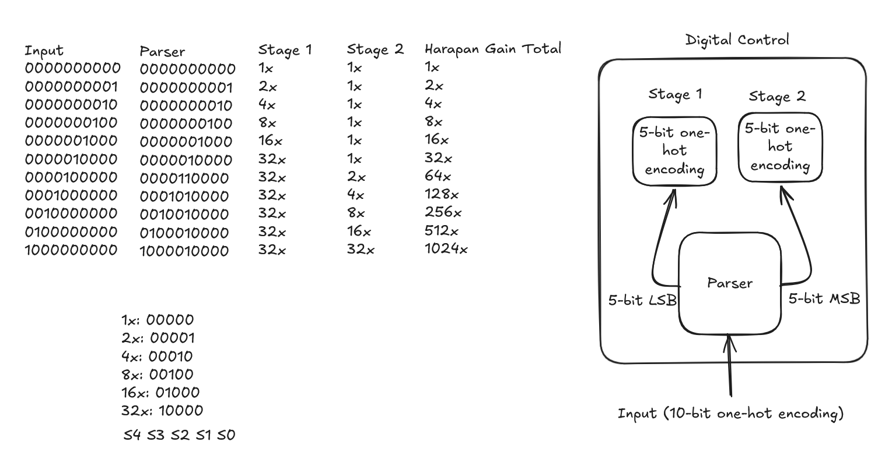
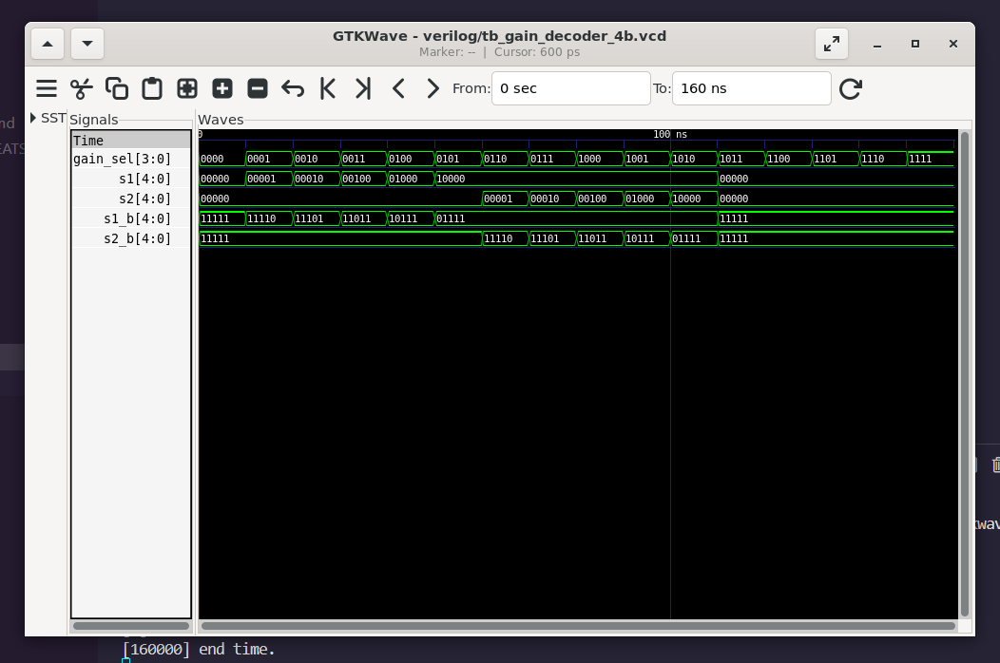

# 4-Bit Binary to Two-Stage Complementary Gain Decoder (`gain_decoder_4b`)

## 1. Overview & Architectural Role

The **`gain_decoder_4b`** is the central digital control module for the redesigned 10-gain-setting Programmable Gain Instrumentation Amplifier (PGIA) on the **IHP SG13CMOS5L (130nm BiCMOS)** platform for **Chipalooza #2**.

### Key Architectural Updates:
* **Pin Efficiency:** Replaces the legacy 10-bit coarse/fine split bus with a compact **4-bit binary gain selection code** (`gain_sel[3:0]`). Under the Chipalooza chip harness constraints, where only 12 shared digital pads (`io_in[11:0]`) exist on the entire chip frame, this saves **6 chip pads**, consuming only 4 pads instead of 10.
* **Cascaded Gain Architecture:** Controls two cascaded analog amplifier stages (Stage 1 and Stage 2) to deliver 10 uniform $+6.02\text{ dB}$ gain steps from **$+18.06\text{ dB}$ (Level 0) to $+78.27\text{ dB}$ (Level 10)**.
* **Transmission Gate Complementary Drivers:** Directly generates both true active-high (`s1`, `s2`) and complementary active-low (`s1_b`, `s2_b`) steering lines to switch CMOS Transmission Gates (TGates) with zero skew.
* **Robust Clamping:** Automatically clamps any illegal binary input codes (`4'd11` to `4'd15`) to the safe baseline Level 0 ($1\times, 1\times$), preventing open-loop or short-circuit conditions in the analog feedback ladders.

---

## 2. Block Diagram & Port Definitions

```
                     ┌──────────────────────────────────────────────┐
                     │               gain_decoder_4b                │
                     │                                              │
                     │                 ┌──────────┐                 │
                     │                 │  Binary  │──► s1[4:0]      │ (5b Active-High Stage 1 Select)
  gain_sel[3:0] ─────┼────────────────►│    to    │──► s1_b[4:0]    │ (5b Active-Low Stage 1 Select)
  (4-bit Binary)     │                 │ 2-Stage  │                 │
                     │                 │  Parser  │──► s2[4:0]      │ (5b Active-High Stage 2 Select)
                     │                 │          │──► s2_b[4:0]    │ (5b Active-Low Stage 2 Select)
                     │                 └──────────┘                 │
                     └──────────────────────────────────────────────┘
```

### Port List

| Port Name | Direction | Width | Polarity | Description |
| :--- | :---: | :---: | :---: | :--- |
| `gain_sel` | Input | 4 | Active-High | 4-bit binary gain programming code ($0$ to $10$ valid, $11$ to $15$ clamped). |
| `s1` | Output | 5 | Active-High | Stage 1 NMOS transmission gate control ($S_0=2\times \dots S_4=32\times$, `00000` = $1\times$). |
| `s1_b` | Output | 5 | Active-Low | Stage 1 PMOS transmission gate control ($\sim s_1$). |
| `s2` | Output | 5 | Active-High | Stage 2 NMOS transmission gate control ($S_0=2\times \dots S_4=32\times$, `00000` = $1\times$). |
| `s2_b` | Output | 5 | Active-Low | Stage 2 PMOS transmission gate control ($\sim s_2$). |

---

## 3. Truth Table & Gain Schedule

The fixed front-end Instrumentation Amplifier provides a baseline gain of $8\,\text{V/V} = 18.06\text{ dB}$. The two programmable stages configure as follows:

| Code (`gain_sel`) | Level | Stage 1 `s1[4:0]` | Stage 2 `s2[4:0]` | Stage 1 Gain | Stage 2 Gain | Total PGA Gain | Total System Gain ($A_v$) | Total Gain (dB) |
| :---: | :---: | :---: | :---: | :---: | :---: | :---: | :---: | :---: |
| `4'd0` (`0000`) | **0** | `00000` | `00000` | $1\times$ | $1\times$ | $1\times$ ($0\text{ dB}$) | $8\text{ V/V}$ | **$18.06\text{ dB}$** |
| `4'd1` (`0001`) | **1** | `00001` | `00000` | $2\times$ | $1\times$ | $2\times$ ($6\text{ dB}$) | $16\text{ V/V}$ | **$24.08\text{ dB}$** |
| `4'd2` (`0010`) | **2** | `00010` | `00000` | $4\times$ | $1\times$ | $4\times$ ($12\text{ dB}$) | $32\text{ V/V}$ | **$30.10\text{ dB}$** |
| `4'd3` (`0011`) | **3** | `00100` | `00000` | $8\times$ | $1\times$ | $8\times$ ($18\text{ dB}$) | $64\text{ V/V}$ | **$36.12\text{ dB}$** |
| `4'd4` (`0100`) | **4** | `01000` | `00000` | $16\times$ | $1\times$ | $16\times$ ($24\text{ dB}$) | $128\text{ V/V}$ | **$42.14\text{ dB}$** |
| `4'd5` (`0101`) | **5** | `10000` | `00000` | $32\times$ | $1\times$ | $32\times$ ($30\text{ dB}$) | $256\text{ V/V}$ | **$48.16\text{ dB}$** |
| `4'd6` (`0110`) | **6** | `10000` | `00001` | $32\times$ | $2\times$ | $64\times$ ($36\text{ dB}$) | $512\text{ V/V}$ | **$54.19\text{ dB}$** |
| `4'd7` (`0111`) | **7** | `10000` | `00010` | $32\times$ | $4\times$ | $128\times$ ($42\text{ dB}$) | $1024\text{ V/V}$ | **$60.21\text{ dB}$** |
| `4'd8` (`1000`) | **8** | `10000` | `00100` | $32\times$ | $8\times$ | $256\times$ ($48\text{ dB}$) | $2048\text{ V/V}$ | **$66.23\text{ dB}$** |
| `4'd9` (`1001`) | **9** | `10000` | `01000` | $32\times$ | $16\times$ | $512\times$ ($48\text{ dB}$) | $4096\text{ V/V}$ | **$72.25\text{ dB}$** |
| `4'd10` (`1010`) | **10** | `10000` | `10000` | $32\times$ | $32\times$ | $1024\times$ ($60\text{ dB}$) | $8192\text{ V/V}$ | **$78.27\text{ dB}$** |
| `4'd11`..`4'd15` | **Clamp** | `00000` | `00000` | $1\times$ | $1\times$ | $1\times$ ($0\text{ dB}$) | $8\text{ V/V}$ | **$18.06\text{ dB}$** |



> [!NOTE]
> **Noise Optimization Rationale (Friis' Formula):**
> By ramping Stage 1 to its maximum gain ($32\times$) first before increasing Stage 2, the input-referred noise contribution of Stage 2 is divided by $32$ ($\approx 30\text{ dB}$ suppression):
> $$F_{\text{total}} = F_1 + \frac{F_2 - 1}{G_1}$$
> This guarantees optimal noise performance across all active gain levels.

---

## 4. Functional Simulation & Verification

The testbench **`tb_gain_decoder_4b.v`** performs an exhaustive verification sweep across all 16 input combinations ($0$ to $15$), checking:
1. Exact one-hot steering match for Stage 1 (`s1`) and Stage 2 (`s2`).
2. Strict inversion integrity on complementary outputs (`s1_b == ~s1` and `s2_b == ~s2`).
3. Out-of-range clamping behavior for codes `4'd11` through `4'd15`.



### How to Run Simulation

From this directory:

```bash
# 1. Compile design and testbench with Icarus Verilog
iverilog -o sim_gain_decoder_4b gain_decoder_4b.v tb_gain_decoder_4b.v

# 2. Run simulation
vvp sim_gain_decoder_4b

# 3. (Optional) View waveform in GTKWave
gtkwave tb_gain_decoder_4b.vcd &
```

---

## 5. Next Steps for ASIC Synthesis (Phase 3)

With RTL and functional verification complete, the design is ready for physical synthesis via **LibreLane** using the IHP SG13CMOS5L standard cell library (`sg13cmos5l_stdcell`):
* Small cell footprint: Estimated $\sim 15\text{--}20$ standard cells ($\approx 25\,\mu\text{m} \times 25\,\mu\text{m}$).
* Reserved floorplan area: $[400.0, 150.0]\,\mu\text{m}$ in `gds/pgia_top/pgia_top.gds`.
