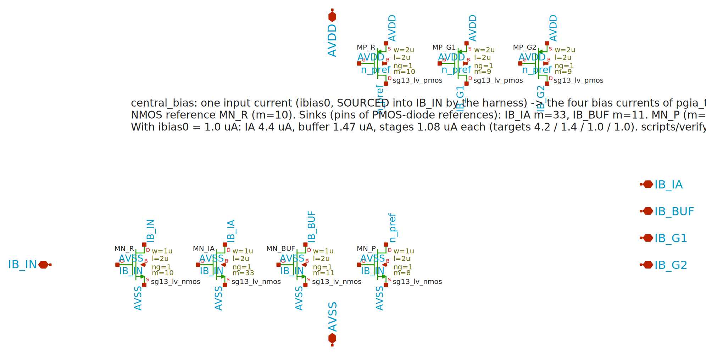

# central_bias

One bias current in (`ibias0` of the Chipalooza harness) -> the four bias currents `pgia_top` needs. **Instantiated in `pgia_top` (schematic and layout).** Layout: `gds/central_bias/central_bias.gds`, generated by `scripts/make_central_bias_layout.py`; placed and wired into the chip by `scripts/integrate_central_bias.py`.

## Why it exists

`pgia_top.sch` ties `IBIAS_IA` to the bias pin of the instrumentation amplifier, both gain stages and the buffer. That cannot work:

| block | bias pin must | reference | needed (commit 0777ca0, where the chip worked) |
|---|---|---|---|
| `instramp_cmos5l` (3 OTAs) | be **sunk** | PMOS diode to VDD (`MM6 IBIAS IBIAS VDD VDD`) | 4.2 uA |
| `output_buffer` (1 OTA) | be **sunk** | same | 1.4 uA |
| `gain_stage` x2 (`gain_ota`) | be **sourced** | NMOS diode to VSS (`MM_refn I_bias I_bias VSS`) | 1.0 uA each |

The harness gives the slot `ibias0` / `ibias1`, driven by iDACs through `idac1_source` / `idac2_source` in the harness netlist: a **sourced** current of programmable value (5 bit; the range is defined by the harness biasgen, not in this checkout).

## Circuit (7 transistors)

<!-- AUTO:schematic:central_bias -->

<!-- /AUTO -->

```
ibias0 (sourced) -> IB_IN = NMOS diode MN_R (m=10, W=1u L=2u)           reference
                    MN_IA  m=33  drain IB_IA   (sinks into the IA bias pin)
                    MN_BUF m=11  drain IB_BUF  (sinks into the buffer bias pin)
                    MN_P   m=8   drain n_pref  (pulls the PMOS reference)
n_pref = PMOS diode MP_R (m=10, W=2u L=2u) from AVDD
                    MP_G1 m=9 -> IB_G1  (sources into stage 1)      MP_G2 m=9 -> IB_G2 (stage 2)
```
Pins: `IB_IN` (in), `IB_IA` `IB_BUF` (out, sink), `IB_G1` `IB_G2` (out, source), `AVDD`, `AVSS`. The mirrors deliver about 1.26x their drawn ratio (measured; longer devices barely change it), so the multipliers are calibrated: **1.0 uA in -> IA 4.40, buffer 1.47, stages 1.08 / 1.08 uA** (targets 4.2 / 1.4 / 1.0 / 1.0).

## Proof

`python3 scripts/verify_central_bias.py` (23 s, nothing in the repo is modified; also step `bias` of `scripts/build_all.sh`): takes the current schematics, puts `central_bias` between `ibias0` and the four blocks in the chip testbench and checks the four currents (+-15 %), `VOUT` at code 0, power < 500 uW and the 11 gain codes against the verified result of commit 0777ca0. Result: VOUT 0.5991 V, 277 uW, **all codes within 0.04 dB** (17.64 ... 76.67 dB).

**Input offset (important):** `tb_pgia_top` applies a DC offset of **-334.7 uV on VINP**. The chip has a systematic input-referred offset of about 0.33 mV that, without it, is amplified to the rail at gain codes 8 to 10 (x2000 .. x8192). The values above are therefore *with the intentional offset*; this is a property of the chip, not of `central_bias` (ideal bias sources behave the same). The extracted layout needs **-903.7 uV** (schematic: -334.7 uV). `cace/pgia_top.yaml` runs all three cases (condition `vin_off` = 0 / -334.7 / -903.7 uV) and `docs/pgia_top/cace/gain_codes.md` lists the gain per code for each. With its own null the schematic reaches 17.64 ... 76.67 dB and the extracted layout 17.65 ... 76.70 dB (codes 0 to 10).
Operating window (same script, `--ibias0`): 0.7 uA -> 208 uW, all codes within 0.25 dB; 1.3 uA -> 342 uW, within 0.35 dB; 1.5 uA -> 384 uW, code 10 +0.98 dB (outside the 0.6 dB check); 2.0 uA -> 481 uW and codes 9-10 collapse (the gain-stage OTAs run out of headroom). So the harness iDAC should be set to **0.7 .. 1.3 uA** (nominal 1.0 uA); the absolute scale is the knob for power vs accuracy. The iDAC range itself is defined by the harness and is not in this checkout: confirm it reaches this window.

## Integration (done, commit S2c)

`scripts/integrate_central_bias.py` (backup + exact-shape guard, idempotent, `--check`): the cell is placed at (215.3, 110.5) um in `pgia_top` (free band above stage 1, x 218-318, y 111-138), the old shared tree (M3 trunk y=124, branches at x=212 / 336 / 376, M4 line y=162) is cut into five pieces and a maze router (Metal2-4, grid 0.8 um) joins them to the pins of the cell:

| net | joined to | pin side |
|---|---|---|
| `IB_IN` | trunk from the harness pin (`IBIAS`, x < 211.3) | left |
| `IB_G2` | column x=212 to stage 2 | left |
| `IB_G1` | column x=336, y < 117.5, to stage 1 | right |
| `IB_IA` | column x=336 (y 124-162) + the M4 line y=162 to the instrumentation amplifier | right |
| `IB_BUF` | buffer branch column x=376 (cut off the M4 line at its Via3) | right |

`AVSS` of the cell: M4 line at x=300 up to the M4 landing of the TopMetal1 AVSS rail (y 141); `AVDD`: M4 tab to the AVDD M4 line (x 311-313). `pgia_top.sch`: the four block pins are the nets `ib_ia ib_g1 ib_g2 ib_buf`, `x_bias` joins `IBIAS_IA` -> `IB_IN`. The pgia_top pin list is unchanged.
Checked: LVS MATCH `pgia_top` / `slot9_wrapper` (453 devices), DRC main 0 / antenna 0, tap audit, harness DRC, `harness_trial.sh`, LVS canary 4/4, `verify_central_bias.py`.

## Layout requirements

- Matching sets the ratios. Done: unit devices only (1u x 2u NMOS, 2u x 2u PMOS, every transistor of the schematic is a number of identical units), the units of each mirror group spread evenly over two staggered rows (error-diffusion order), one shared gate bus and source bus per block. **Not done**: dummy devices at the ends of the rows and an exactly common-centroid order; the ratios were calibrated on the schematic (x1.26 of the drawn ratio), so a post-layout/Monte-Carlo check of the four currents is still worth doing (`scripts/run_pex.sh central_bias` + the verify script on the extracted netlist).
- NMOS in the substrate with a p-tie ring, PMOS in its own NWell with an n-tie ring (`scripts/tap_audit.py` must stay clean; the 20 um latch-up distance is easily met).
- Only the four outputs and the input leave the cell (Metal3 pins named `IB_IN`, `IB_IA`, `IB_BUF`, `IB_G1`, `IB_G2`, `/25` text labels as in the other cells); supply from the existing AVDD/AVSS grid.
- Keep it away from the digital decoder (x 25-90, y 60-105): these are nA..uA nodes.
- PDK PCells (`SG13_dev`) are usable from a script: `import sg13cmos5l_pycell_lib` with `libs.tech/klayout/python` and `pycell4klayout-api/source/python` on `sys.path` (see `docs/README.md`).
