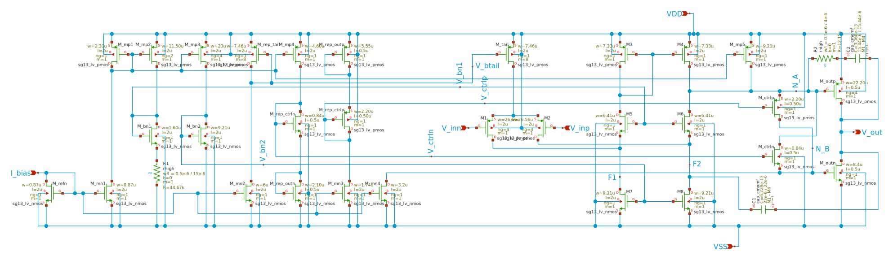
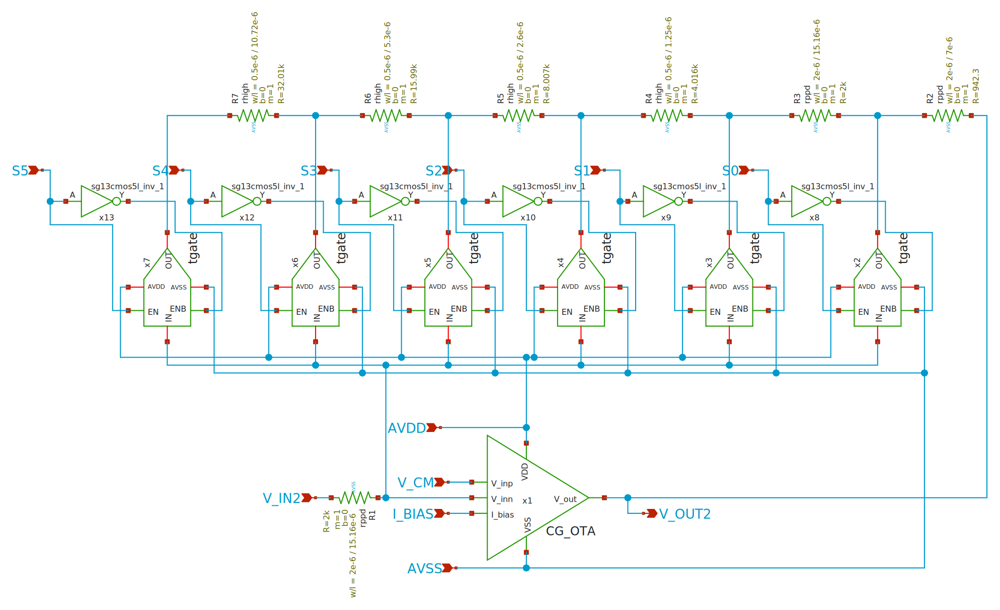
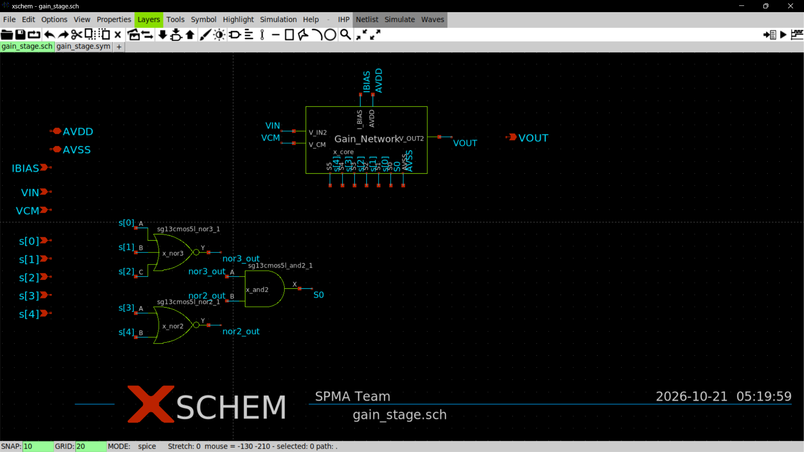
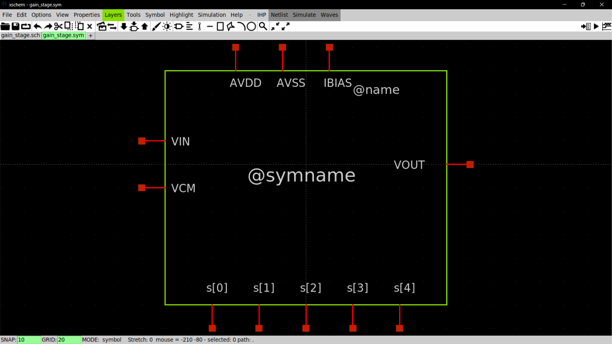

# Binary Programmable Gain Stage (`gain_stage`)

The `gain_stage` is a self-contained, drop-in hierarchical analog-digital cell in **IHP SG13CMOS5L** implementing a 6-tap binary switched-resistor feedback amplifier ($1\times \dots 32\times$, $0\,\text{dB} \dots +30.10\,\text{dB}$).

It incorporates the analog core ([`gain_network`](gain_network.sch)) and an **on-chip standard cell interface adaptor** that directly accepts the digital decoder's 5-bit one-hot bus `s[4:0]` and automatically synthesizes the active-high default feedback tap $S_0$ ($0\,\text{dB}$ / unity feedback).

Two identical instances (`x_stage1` and `x_stage2`) are cascaded in [`pgia_top.sch`](../pgia_top/pgia_top.sch).

---

## 1. Circuit Architecture & Tap Adaptor

```
                                  gain_stage
      ┌─────────────────────────────────────────────────────────────────┐
      │                                                                 │
      │   Standard Cell S0 Synthesis Logic                              │
      │  ┌─────────────────┐                                            │
s[0] ─┼─►│A                │                                            │
s[1] ─┼─►│B sg13cmos5l_    ├──nor3_out──┐                               │
s[2] ─┼─►│C   nor3_1       │            │                               │
      │  └─────────────────┘      ┌─────▼──────────┐                    │
      │  ┌─────────────────┐      │A sg13cmos5l_   ├──────► S0          │
s[3] ─┼─►│A sg13cmos5l_    ├──nor2_out►B  and2_1   │         │          │
s[4] ─┼─►│B   nor2_1       │      └────────────────┘         │          │
      │  └─────────────────┘                                 │          │
      │                                                      │          │
      │   Analog Core (gain_network)                         │          │
      │  ┌───────────────────────────────────────────────────▼───────┐  │
VIN  ─┼─►│ V_IN2                                          S0 (1x)    ├──┼─► VOUT
VCM  ─┼─►│ V_CM                                           S1 (2x) ◄──┼─ s[0]
IBIAS─┼─►│ I_BIAS                                         S2 (4x) ◄──┼─ s[1]
AVDD ─┼─►│ AVDD                                           S3 (8x) ◄──┼─ s[2]
AVSS ─┼─►│ AVSS                                           S4 (16x)◄──┼─ s[3]
      │  │                                                S5 (32x)◄──┼─ s[4]
      │  └───────────────────────────────────────────────────────────┘  │
      └─────────────────────────────────────────────────────────────────┘
```


*Coarse Gain Schematic*


*Coarse Gain CG Network Schematic*


*Gain Stage Schematic*

### Boolean Synthesis Logic:
$$S_0 = \overline{s[0] \lor s[1] \lor s[2] \lor s[3] \lor s[4]} = \text{AND}\big(\text{NOR3}(s[0], s[1], s[2]),\ \text{NOR2}(s[3], s[4])\big)$$

- When $s[4:0] = 00000$: `nor3_out` = 1, `nor2_out` = 1 $\implies S_0 = 1$ ($1\times$ feedback active, $0\,\text{dB}$).
- When any bit $s[k] = 1$: either `nor3_out` = 0 or `nor2_out` = 0 $\implies S_0 = 0$. Tap $S_{k+1}$ is activated.

---

## 2. Symbol Pin Interface (`gain_stage.sym`)

| Pin | Direction | Description |
|:---|:---:|:---|
| **`AVDD`** | inout | $1.2\,\text{V}$ Core Analog/Digital Supply |
| **`AVSS`** | inout | $0\,\text{V}$ Ground |
| **`IBIAS`** | in | $1.0\,\mu\text{A}$ Master Bias Current |
| **`VIN`** | in | Analog Signal Input |
| **`VCM`** | in | Common-Mode Bias ($0.60\,\text{V}$) |
| **`VOUT`** | out | Analog Signal Output |
| **`s[0]`** | in | Tap 1 Control ($2\times$ / $+6.02\,\text{dB}$) |
| **`s[1]`** | in | Tap 2 Control ($4\times$ / $+12.04\,\text{dB}$) |
| **`s[2]`** | in | Tap 3 Control ($8\times$ / $+18.06\,\text{dB}$) |
| **`s[3]`** | in | Tap 4 Control ($16\times$ / $+24.08\,\text{dB}$) |
| **`s[4]`** | in | Tap 5 Control ($32\times$ / $+30.10\,\text{dB}$) |


*Gain Stage Symbol*

---

## 3. Standalone Verification Results (`tb_gain_stage.sch`)

Simulated in NGSPICE across all 6 tap states at $V_{DD} = 1.2\,\text{V}$, $V_{CM} = 0.60\,\text{V}$, $I_{BIAS} = 1.0\,\mu\text{A}$, $C_L = 2\,\text{pF}$:

| Tap | Input `s[4:0]` | Active Tap | Target Gain (dB) | Target Gain (V/V) | Measured Gain (dB) | Gain Error (dB) | Accuracy (%) | Status |
|:---:|:---:|:---:|:---:|:---:|:---:|:---:|:---:|:---:|
| **0** | `00000` | $S_0$ (Auto) | $0.00\,\text{dB}$ | $1.00\times$ | **$+0.0736\,\text{dB}$** | $+0.0736\,\text{dB}$ | $99.2\%$ | **PASS** |
| **1** | `00001` | $S_1$ | $+6.02\,\text{dB}$ | $2.00\times$ | **$+6.0089\,\text{dB}$** | $-0.0111\,\text{dB}$ | $99.8\%$ | **PASS** |
| **2** | `00010` | $S_2$ | $+12.04\,\text{dB}$ | $4.00\times$ | **$+12.0658\,\text{dB}$** | $+0.0258\,\text{dB}$ | $99.7\%$ | **PASS** |
| **3** | `00100` | $S_3$ | $+18.06\,\text{dB}$ | $8.00\times$ | **$+18.0543\,\text{dB}$** | $-0.0057\,\text{dB}$ | $99.9\%$ | **PASS** |
| **4** | `01000` | $S_4$ | $+24.08\,\text{dB}$ | $16.00\times$ | **$+24.0960\,\text{dB}$** | $+0.0160\,\text{dB}$ | $99.8\%$ | **PASS** |
| **5** | `10000` | $S_5$ | $+30.10\,\text{dB}$ | $32.00\times$ | **$+30.0738\,\text{dB}$** | $-0.0262\,\text{dB}$ | $99.7\%$ | **PASS** |

### Key Takeaways:
- Standard cell logic seamlessly switches $S_0$ without glitching or floating feedback.
- Gain accuracy across all binary steps is within **$<0.08\,\text{dB}$** ($<0.9\%$ worst-case error).
- Subcircuit is ready for dual instantiation in `pgia_top.sch` (Milestone 2).
