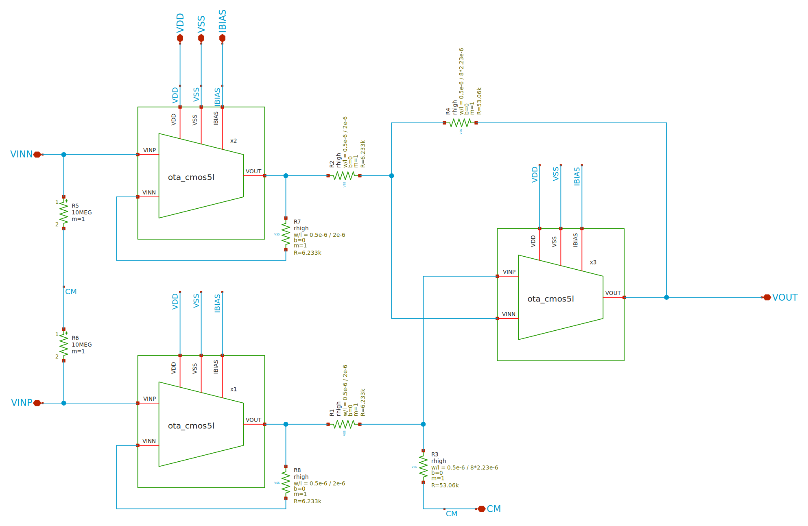

# OTA Specs and Performance

## Topology
<!-- AUTO:schematic:instramp_cmos5l -->


**Parameters** (`.param` of the schematic and of the cells it instantiates; generated by `scripts/update_images.py`, do not edit)

| Source | Parameter | Value |
|---|---|---|
| ota_cmos5l (x1, x2, x3) | `temp` | `27` |
| ota_cmos5l (x1, x2, x3) | `lbias` | `0.15u` |
| ota_cmos5l (x1, x2, x3) | `wbias` | `0.15u` |
| ota_cmos5l (x1, x2, x3) | `m6` | `1` |
| ota_cmos5l (x1, x2, x3) | `m7` | `4` |
| ota_cmos5l (x1, x2, x3) | `m8` | `8` |
| ota_cmos5l (x1, x2, x3) | `linpair` | `3u` |
| ota_cmos5l (x1, x2, x3) | `winpair` | `20u` |
| ota_cmos5l (x1, x2, x3) | `lload` | `5u` |
| ota_cmos5l (x1, x2, x3) | `wload` | `10u` |
| ota_cmos5l (x1, x2, x3) | `lcs` | `3u` |
| ota_cmos5l (x1, x2, x3) | `wcs` | `20u` |
| ota_cmos5l (x1, x2, x3) | `Cc` | `2p` |
<!-- /AUTO -->

## Physical Spec
```ngspice
.param lbias=0.15u wbias=0.15u
.param m6=1 m7=4 m8=8
.param linpair=3u winpair=20u
.param lload=5u wload=10u
.param lcs=3u wcs=20u
.param Cc=2p
```

## Metrics
- Offset: 118.4uV
- Closed Loop Gain: 18.0613dB
- Gain Offset (dB): 0,0004997 dB
- Gain Offset (%): 0.005753%

## Plots

TBA

## Future Plan

TBA
